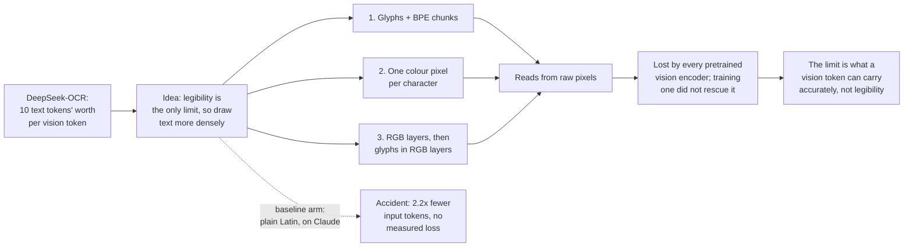
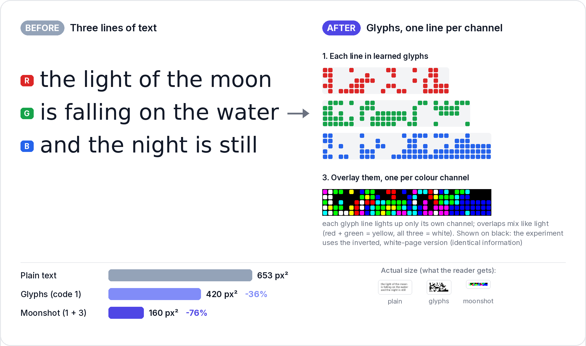
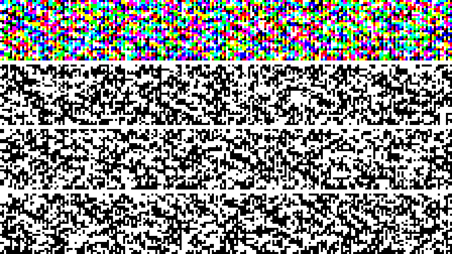
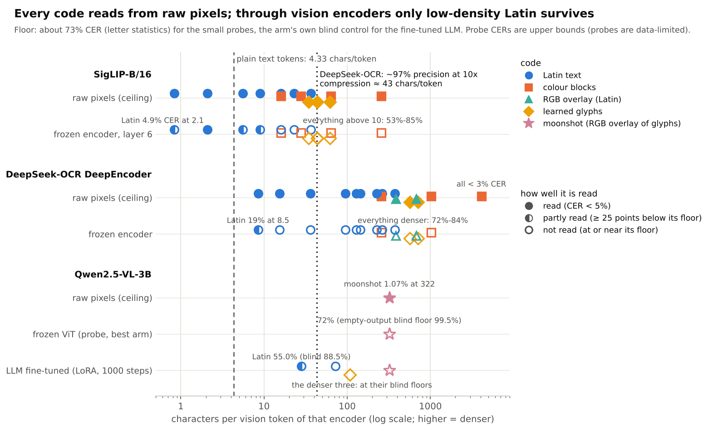
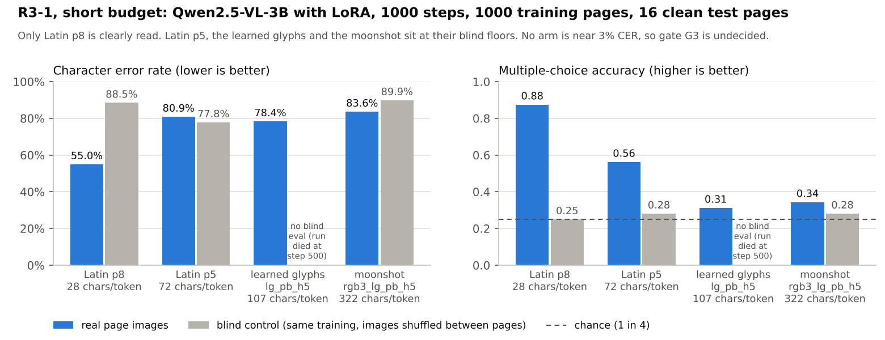
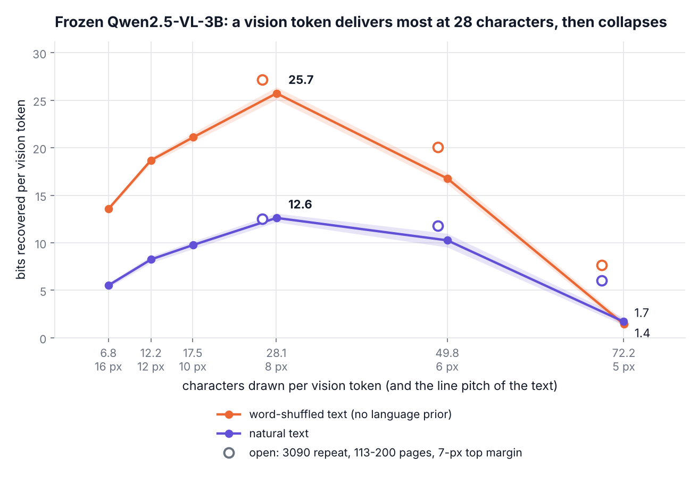
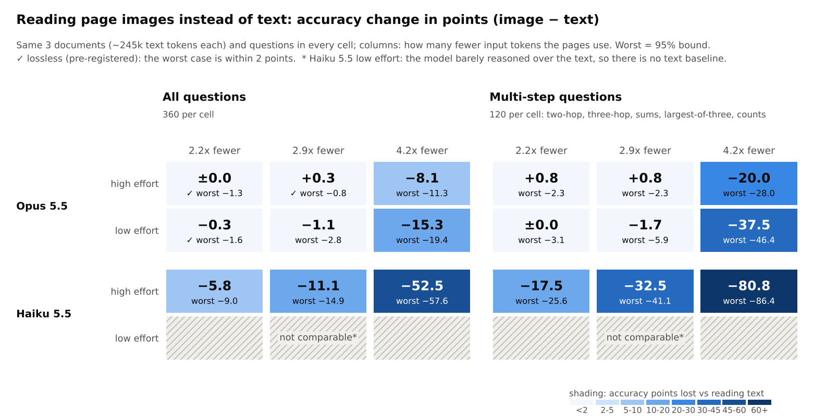
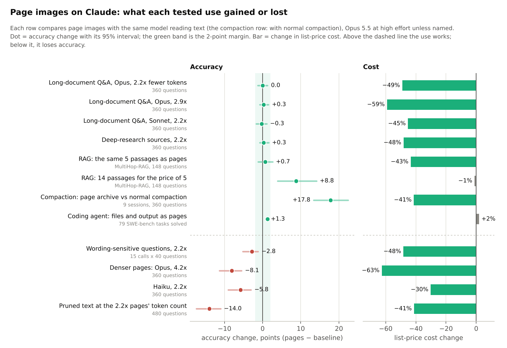

# Visual BPE

**Claude Opus reading a long document for about a third of the input tokens was not the goal. It is where this
ended up.** Render the document as page images of ordinary small text and Opus answers lookups, chains and counts
as well as it does from the text, at 2.2x fewer input tokens (2.9x at high effort). Everything this repo set out to
build (dense glyph alphabets, colour codes, layered pages) reads from raw pixels and is lost by every pretrained
model that was asked to read it.

This README tells that in the order it happened. The finished study is in [docs/](docs/README.md); the one run that
is left is a prompt for a local GPU in [docs/HANDOFF.md](docs/HANDOFF.md).

## 1. Where it started: DeepSeek-OCR, and a misunderstanding

DeepSeek-OCR reported about 97% OCR precision while spending one vision token for every ten text tokens of the
page. A vision token takes one position in a model's context, exactly like a text token, so a page read through
vision holds ten times the text.

I took that to mean **legibility was the only limit**: if a page stays readable, the model gets its text. Under that
belief the way to more compression is obvious: make text legible at fewer pixels. Latin letters were designed for
paper and human eyes, not for a 14-pixel patch. So design something better.

That belief was wrong, and most of this repo is the work of finding out why (section 4).

## 2. Three ideas for drawing text more densely

### Idea 1: why Latin letters at all? Braille, then byte-pair encoding

Braille is built to be read at very low resolution: six dots a cell. A model's reader could be given an alphabet
made for small bitmaps instead of one made for pens. And once the alphabet is ours to design, there is no reason to
stop at letters: byte-pair encoding merges frequent letter runs (`the`, `ing`, ` of the `) into single tokens, so
each of those can have its own glyph. That is the name of the repo.

*The haiku goes from 66 characters to 32 symbols and its lines get 36% shorter.*

**The first tests said this works, in pixels.** A glyph alphabet of 395 symbols (95 characters plus 300 chunks),
learned together with a small reader, needs **0.57x the pixels of plain Latin** for the same 3% character error
(3.75 against 6.54 px² per character, scored in the unchanged pipeline that had been built for Latin). On a grid
that matches a vision model's patches, the chunk alphabet carries 76 characters per vision token at 0.11% error,
where plain Latin drawn into the same area gets 0.58%. Hand-picked glyphs (Chinese characters standing in for
chunks) did not work: a complex glyph needs a larger font to stay legible, which cancels what it saves.
→ [learned_glyphs/RESULTS.md](learned_glyphs/RESULTS.md), [docs/glyphs/RESULTS.md](docs/glyphs/RESULTS.md)

### Idea 2: why shapes at all? One colour, one pixel, one character

If the reader is a network, a character does not need a shape. Give each of the 95 printable characters its own
colour and draw every character as one block.

From raw pixels a trained reader gets this almost perfectly, down to one pixel per character: 256 characters per
vision token at 0.06% error. → [encoder_probe/RESULTS.md](encoder_probe/RESULTS.md)

### Idea 3: layers. RGB text, then glyphs in RGB

An image has three colour channels and black-on-white text uses them as one. Put a different line of text in each
channel and the same pixels hold three lines. The idea came from fibre-optic multiplexing, where several signals
share one fibre on different wavelengths.

Then the obvious combination: the learned glyph alphabet of idea 1, three streams of it, one per channel. This
"moonshot" page carries **322 characters per vision token**, about 75 times plain text's 4.3, and a reader trained
on its raw pixels reads it at 1.07% error.

At which point it became clear what this is: a small bitmap alphabet, packed on a grid, in three colour layers. I
had re-invented the colour barcode, which already has a standard: [JAB Code](https://en.wikipedia.org/wiki/JAB_Code)
(ISO/IEC 23634:2022, "JAB Code polychrome bar code symbology specification"), a QR-like grid of coloured
modules in 4 or 8 colours. Three on-off colour channels are exactly 8 colours. 🙄

## 3. What happened when a real model had to read them

Every code above is readable **from raw pixels by a reader trained for it**. None is readable by a model that
already exists.

*Each strip is one encoder and stage; x is characters per vision token for that encoder. The dotted line is
DeepSeek-OCR's published operating point (approximate: converted at 4.33 characters per text token).*

| Step | What was tried | What happened |
|---|---|---|
| Frozen encoders | SigLIP and DeepSeek-OCR's own DeepEncoder, a probe reading text back from their tokens | Colour codes never get below 62% error through SigLIP; through DeepEncoder colour blocks, the RGB overlay and learned glyphs sit at the floor (71-84%). Only low-density Latin (8.5 chars per token) is read. [encoder_probe/RESULTS.md](encoder_probe/RESULTS.md) |
| A full vision-language model, frozen | Qwen2.5-VL-3B | Glyph pages fade through its vision transformer and are gone after it merges 2x2 patches into one token. [encoder_probe/ROUND3.md](encoder_probe/ROUND3.md) |
| Fine-tuning that model | LoRA on the language model plus the last vision blocks, 1000 steps, every arm with a blind control | Only plain Latin at 28 chars per token is read at all (55% error against 88.5% blind). Latin at 72 gets the gist. Learned glyphs (107) and the moonshot (322) end exactly at their blind controls: not read. [docs/background/ANALYSIS.md](docs/background/ANALYSIS.md) |
| The overlay on its own | Latin in 2 colour channels, fine-tuned | The model reads the two layers as one blended text; two layers deliver less per token than one. [docs/gpu/COLOUR_GIST.md](docs/gpu/COLOUR_GIST.md) |
| Building the encoder ourselves | a vision encoder from scratch; a text-side compressor into a frozen model | Neither became readable at the budget available: the from-scratch encoder showed no gap to its control, and the text compressor's easiest setting kept the gist but not the words (64% error against 78% blind). [docs/gpu/OWN_ENCODER.md](docs/gpu/OWN_ENCODER.md) |
| Claude | coded and scrambled pages | Refused or cut off by safety classifiers. Claude can only be measured on natural text. [docs/glyphs/RESULTS.md](docs/glyphs/RESULTS.md) |

## 4. What I finally understood

**The limit is not how many characters fit in a vision token. It is how much a vision token can carry accurately.**

A vision token is one vector, and the encoder that makes it was trained to describe pictures and ordinary text. The
measurement that settled it: frozen Qwen2.5-VL recovers **at most 12.6 bits per vision token** on natural text, at
28 characters per token, and falls apart beyond that (1.7 to 6 bits at about 70 characters per token, depending on
where the text sits on the page). The moonshot page asks
for about 270 bits per token. Legibility in pixels was never the constraint; the page can be perfectly crisp and
the token still cannot hold it. → Run 0 in [docs/gpu/PLAN_3090.md](docs/gpu/PLAN_3090.md)

*Draw more characters into a vision token and it delivers more, up to 28 characters; past that it delivers less.
Natural text sits below shuffled text because the model can guess part of it without looking.*

It also explains why denser *plain text* fails the same way on Claude: at 4.2x fewer tokens it still finds single
facts but loses chains and counts, and at 7.8x it can transcribe a page at 3% error and yet cannot answer questions
over a document.

And for a model you can train, pixels are a detour: a compressor built on the text side reaches the same slots
without a rendering step. Two papers say this directly:

* **[Context Cascade Compression: Exploring the Upper Limits of Text Compression](https://arxiv.org/abs/2511.15244)**
  (Liu and Qiu, 2025) compresses text with a small language model instead of a vision encoder. Its abstract: "at a
  20x compression ratio (where the number of text tokens is 20 times the number of latent tokens), our model
  achieves 98% decoding accuracy, compared to approximately 60% for DeepSeek-OCR."
* **[Optical Context Compression Is Just (Bad) Autoencoding](https://arxiv.org/abs/2512.03643)** (Lee, Yang and
  Berg-Kirkpatrick, 2025) compares DeepSeek-OCR's vision encoder with mean pooling and a learned text encoder and
  finds that "these simple approaches match or surpass vision for reconstruction at matched compression ratios";
  for language modelling the first version says vision "fails to beat truncation", softened in the second to
  performing comparably to it. Its conclusion is that the excitement around optical compression outpaces the
  evidence.

So the vision route is a text compressor with a lossy rendering step in front, and not a good one. Current local
models also get much of the payoff from their architecture. A text-side compressor was therefore built here but not
run ([docs/gpu/TEXT_SLOTS.md](docs/gpu/TEXT_SLOTS.md); more prior work in
[docs/background/prior-art.md](docs/background/prior-art.md)).

## 5. The accident: plain Latin pages on a closed model

Every experiment had a baseline arm: plain Latin text, rendered small. On Claude that arm turned out to be the
result. A closed model takes text tokens and images and nothing else, so its vision encoder is the only compressor
a user can reach, and at ordinary text sizes it is a good one: a 28-pixel patch holds 7 to 9 legible characters
where a text token holds about 2.9.

*Accuracy change in points from reading pages instead of text (negative = worse); ✓ marks the pre-registered
"no loss larger than 2 points" verdict.*

| Use, tested with a pre-registration | What was measured | Result | Reference |
|---|---|---|---|
| Long-document Q&A | 3 documents of ~240k tokens, 360 questions per setting | **2.2x fewer tokens, no measured loss** on Opus and on Sonnet at high effort; Opus also at 2.9x at high effort; about half the list price per call | [CLAUDE_QA.md](docs/claude/CLAUDE_QA.md) |
| Deep-research sources | 3 corpora of 34-50 articles, 360 questions | 99.7% from pages against 99.4% from text; keeping only notes loses 29 points | [CLAUDE_QA.md](docs/claude/CLAUDE_QA.md#tested-deep-research-sources) |
| Retrieval (RAG) | 308 questions, 3 datasets | the same passages as pages: same accuracy, 27-43% cheaper; or +8.8 points on multi-hop questions for the same budget | [results/rag](results/rag/README.md) |
| Context compaction | the session transcript kept as pages and opened on demand, real Claude Code hooks, 9 sessions | **96-99% of questions answered against 78% after normal compaction**, 2.1x cheaper per correct answer | [results/compaction_scale](results/compaction_scale/README.md) |
| Coding agents | file contents and command output as pages, 79 SWE-bench tasks | no task lost, but no saving: reading is ~17% of an agent's cost | [SWE_IMAGES.md](docs/claude/SWE_IMAGES.md) |

**Where it does not hold** (all measured, all in [CLAUDE_QA.md](docs/claude/CLAUDE_QA.md)):

* **Wording that turns on one small word** (negation, passive voice, "all but"): pages lose about 3 points at 2.2x
  and 2.9x alike. In about 1 page call in 6, every "A was paid n by B" sentence is read backwards.
* **Denser pages:** at 4.2x Opus loses 8-15 points (Sonnet and Haiku more); chains and counts go first.
* **Haiku:** loses 5.8 points already at 2.2x. Use text.
* **Pruning the text instead** (deleting words a model can restore): 86.0% against 97.7% for pages at the same
  tokens, and it does not stack with pages.
* **A whole repository as pages (the "repo atlas")** for an agent or an orchestrator: seven tests and one repeat
  found no arm where it beats a cheaper option. [REPO_ATLAS_PLAN.md](docs/claude/REPO_ATLAS_PLAN.md)

**Using it in a harness.** The compaction result needs no change to the model: Claude Code hooks render the
transcript to pages when the session compacts and let the agent open them when a question needs the detail
([experiments/compaction/hooks](experiments/compaction/hooks)). The same renderer and a set of code minifiers are
packaged as read and bash-output hooks in [experiments/readhook/vbhook](experiments/readhook/vbhook) (they work;
for coding they do not pay). A harness that adopts this should re-run a page of planted facts whenever the model
changes: "lossless" is per model and per release.

## Read next, and what is left

**Finished: the Claude write-up.** Every use case tried, with what worked and what failed, is in
[docs/claude/CLAUDE_QA.md](docs/claude/CLAUDE_QA.md). Nothing in it is waiting on a run.

**Left to do: one GPU run.** Does the page-image trick carry over to a local model with no training? Qwen3.8-27B
on an RTX 3090, the Claude QA test in small, one evening. Plan in
[docs/gpu/LOCAL_QWEN.md](docs/gpu/LOCAL_QWEN.md); **the prompt to run is at the top of
[docs/HANDOFF.md](docs/HANDOFF.md)**.

**Parked:** the trained-encoder runs on Latin, the fair last test of the original idea
([docs/gpu/PLAN_3090.md](docs/gpu/PLAN_3090.md)). **Closed:** the dense-glyph and colour stages after them.

## Terms

* **Vision token:** one context position produced from an image patch (28x28 px for Claude and Qwen2.5-VL).
* **Nx fewer tokens:** input tokens of the text call divided by input tokens of the page call.
* **px² per character:** page area per character; lower is denser. Claude's safe setting is 117.6 (2.2x).
* **CER:** character error rate, edit distance over reference length.
* **Blind control:** the same training run with images shuffled between pages, so the image says nothing. Its
  score is what the model's language prior reaches alone.

## Repo map

| Path | What |
|---|---|
| [docs/](docs/README.md) | every write-up: `claude/` (page images on Claude), `glyphs/` (phases 1-2), `gpu/` (local-model runs and runbooks), `background/` (prior art, ideas, analysis, review), plus [HANDOFF](docs/HANDOFF.md), [FINDINGS](docs/FINDINGS.md), [RUNNING](docs/RUNNING.md), [GOTCHAS](docs/GOTCHAS.md) |
| `vbpe/` | layout engine, rendering schemes, CRNN reader, Claude and OCR readers, analysis |
| `learned_glyphs/` | the learned glyph alphabet: plan, code, results, saved glyph banks |
| `encoder_probe/` | frozen-encoder probes and the Qwen2.5-VL rounds |
| `experiments/` | drivers: `phases/` (1-2), `claude_qa/`, `rag/`, `erb/`, `compaction/`, `readhook/`, `atlas/` |
| `results/` | rows and per-test READMEs; [results/README.md](results/README.md) says where each stage's rows live |
| `scripts/`, `tests/` | data and figure scripts; CPU tests |

Setup and how to work here: [AGENTS.md](AGENTS.md).
