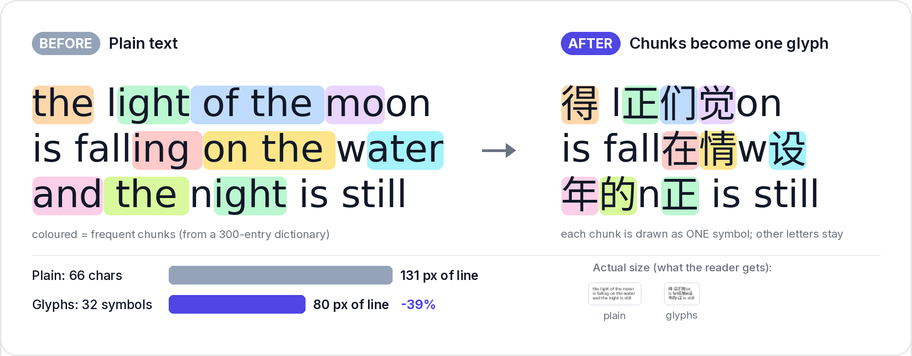
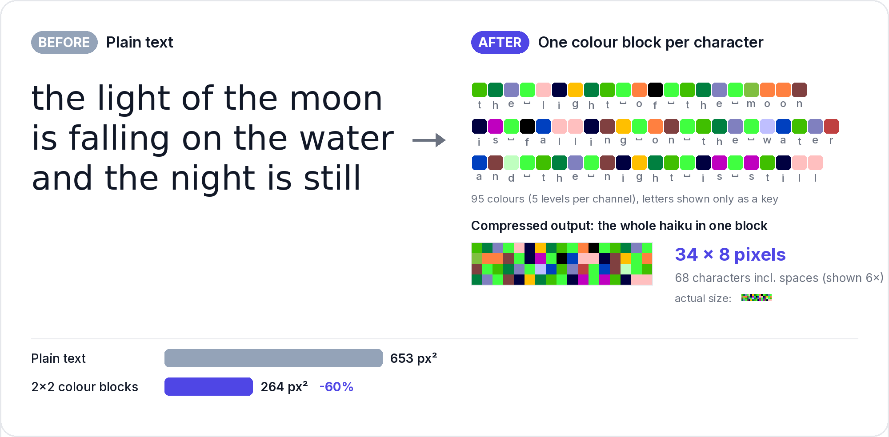
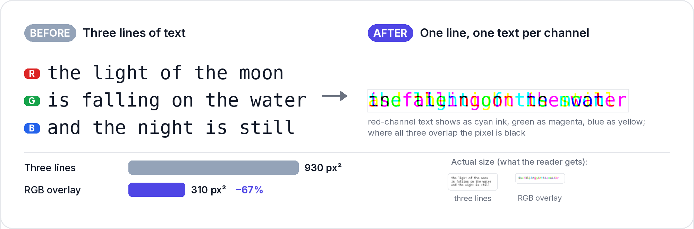

# Visual BPE

**Can we fit more text into fewer image pixels?**

Vision-language models can read text from images, and an image costs a fixed number of vision tokens per pixel
area (for Claude, about one token per 28×28 px). If text could be drawn more densely and still read back
correctly, a long document would cost fewer tokens as an image than as plain text.

This repo tests three ways of packing text more densely. Each was tried against plain text with readers that
were *trained* on the rendering, so neither side gets an unfair advantage.

> **How to read the numbers.** **px²/char** is image area per source character (lower is better). **Chars per
> vision token** is how many characters one image token carries (higher is better; a normal text token holds
> about 4). We compare renderings at the **same error rate**, usually 3% character error rate (CER).

---

## 1. Glyphs: one symbol for a frequent chunk of letters

Byte-pair encoding (BPE) merges frequent letter sequences such as `the`, `ing` and ` of the ` into single
tokens. *Visual* BPE does the same on the page: each of the 300 most useful chunks gets its own glyph, and
every other letter stays as it is. So `something` becomes `s` + glyph(`ome`) + `th` + glyph(`ing`).



The haiku goes from **66 characters to 32 symbols**, and its lines get **39% shorter** at the same font size.

There are two versions of the glyphs:
* **Hand-picked (pictured): common Chinese characters as the chunk glyphs.** This **failed**. A Chinese
  character has much more detail than a letter, so it needs a larger font to stay legible, which cancels the
  width saved (≥1.18× the pixels of plain text at equal accuracy).
* **Learned: the glyph shapes are optimised together with a reader.** Every symbol, single letters included,
  becomes a small bitmap that is easy to tell apart at tiny sizes ([glyph atlas](learned_glyphs/results/e1long/atlas/lg_learned_n300_pb_h5.png)).

**Result:** learned glyphs need **0.57×** the pixels of plain text for the same accuracy, so about 1.75× more
text fits per image (whole-pixel version: 0.77–0.88×). → [learned_glyphs/RESULTS.md](learned_glyphs/RESULTS.md)

## 2. Colour pixels: one coloured block per character

Skip letter shapes altogether: give each of the 95 printable characters its own colour and draw one small
solid block per character.



A 2×2-pixel block per character uses **60% less area** than the haiku in a 5-px font: the whole haiku fits in
a 34×8-pixel block. A 1×1 block (a single
pixel per character) would use 90% less.

**Result:** a reader that sees the raw pixels decodes this almost perfectly (1×1 blocks: 0.06% CER, 256 chars per
token, 7.5× plain text), and 2×2 blocks still survive JPEG compression (3× plain text). But once the image passes
through a pretrained vision encoder (SigLIP, as used in VLMs), the colour code is gone: the error rate never drops
below 62%. → [encoder_probe/RESULTS.md](encoder_probe/RESULTS.md)

## 3. RGB overlay: three lines in one, one per colour channel

An image has three colour channels. Write a different line of text into each one (red, green, blue) at the same
position, and one line of pixels carries three lines of text.



Each line only darkens its own channel, so nothing is painted over: each colour channel on its own still holds
one clean line. The overlay holds **exactly 3× the text** of a single monospace line (about 2.6× ordinary text).

**Result:** built and smoke-tested only (a 300-step test run already decodes recognisable text). The real test,
through an OCR-grade VLM encoder, is queued. → [encoder_probe/RGB_OVERLAY.md](encoder_probe/RGB_OVERLAY.md)

---

## Headline results so far (best case per approach)

| Approach | Best case measured | vs plain text | Verdict |
|---|---|---|---|
| **Learned glyphs** (300 chunks, trained reader) | 3% CER at 3.75 px²/char (plain: 6.54) | **0.57× the pixels** (1.75× text per pixel) | ✅ **qualified go** |
| ↳ whole-pixel glyphs (survive encoders better) | 3% CER at 5.73 px²/char | 0.88× (0.77× at 1% CER) | ✅ use these |
| ↳ under heavy blur, noise and JPEG | 3.5% CER vs plain text 43% at the same size | lead grows | ✅ |
| **Colour blocks**, raw pixels | 1×1 blocks: 0.06% CER at 256 chars/token | **7.5×** chars per token | ✅ ceiling only |
| ↳ through JPEG (q75) | 2×2 blocks: 3% CER at 71 chars/token | 3× | ✅ ceiling only |
| ↳ through a frozen VLM encoder (SigLIP) | never below 62% CER | – | ❌ dead for frozen encoders |
| **RGB overlay** | not yet measured (geometry: 3× mono, 2.6× plain) | – | ⏳ queued |
| Hand-picked Chinese glyphs (trained reader) | best: 2.26% CER at 8.9 px²/char | **≥1.18× the pixels (worse)** | ❌ killed |
| Hangul-style 2×2 letter packing | ~2% CER at 26 px²/char | ≥3× worse | ❌ killed |
| *Reference:* Claude reading plain English | 3% CER at 29.4 px²/char | ≈37 vision tokens per 1k chars (6.7× text tokens) | baseline |

Notes:
* "Trained reader" means a small CRNN trained from scratch on each rendering until it converged (10.5k steps),
  so every scheme is read equally well.
* Claude can only score natural text. Its safety classifiers refuse glyph-substituted or scrambled pages, so the
  dense schemes are scored with trained readers or the probe, never with Claude.
* SigLIP numbers come from a small probe trained on frozen encoder outputs. They are upper bounds on what the
  encoder destroys, not what an LLM would read. Plain text through the same probe reaches only 4.9% CER, and only
  at 2 chars per token.
* Full write-ups: [docs/RESULTS.md](docs/RESULTS.md) (all phases), [PLAN.md](PLAN.md) (pre-registered predictions
  and kill criteria).

## Still to test

1. **DeepSeek-OCR's encoder (round 2, queued, not started).** SigLIP is a caption encoder with no OCR training.
   The real question is whether an encoder built for reading text keeps dense codes. 49 queued jobs (~12-14 h on 4
   CPUs) push plain text, learned glyphs (grey-level and whole-pixel), colour blocks and the RGB overlay through
   DeepSeek-OCR's DeepEncoder, clean and with JPEG. → [encoder_probe/ROUND2.md](encoder_probe/ROUND2.md)
2. **RGB overlay, first real numbers.** These come from round 2 (its decision rule: worth pursuing only if it
   beats plain text by ≥2× through a real encoder with JPEG). The standalone 48-run SigLIP grid is written but not queued.
3. **Hardening the learned glyphs.** The densest alphabets break on degradations they never saw in training
   (55–68% CER on real JPEG and an unseen resize filter). Next: train with real JPEG and resampling, and try 1000
   chunks instead of 300 (GPU).
4. **End to end with a real VLM (GPU).** Fine-tune a small VLM on pages of learned glyphs vs plain text at equal
   vision-token budgets. This is the only test that answers "does the LLM actually read it?"
5. **More layers per pixel** (`rgb6`: two intensity levels per channel, six texts per line). Only worth trying
   if the RGB overlay keeps most of its 3× through a real encoder. → [docs/IDEAS.md](docs/IDEAS.md)

---

## Repo map

| Path | What |
|---|---|
| `vbpe/` | layout engine, rendering schemes (Latin, Chinese substitution, quadrant), CRNN reader, Claude eval, analysis |
| `experiments/` | Phase 1 (Claude), 1b (PP-OCR zero-shot) and 2 (trained CRNN) drivers |
| `learned_glyphs/` | learned glyph alphabet sub-project (plan, code, results, saved glyph banks) |
| `encoder_probe/` | frozen-encoder probe: colour blocks, RGB overlay, glyphs through SigLIP and DeepEncoder |
| `docs/` | results, prior art, idea backlog, README figures |
| `scripts/` | data building, fonts, job queue, `make_readme_figures.py` |

**Setup and how to run everything:** [AGENTS.md](AGENTS.md). Quick start:

```bash
pip install -r requirements.txt
pip install --index-url https://download.pytorch.org/whl/cpu torch
scripts/fetch_fonts.sh
python3 scripts/build_data.py            # WikiText-103 passages and chunk dictionaries (~5 min)
python3 -m pytest -q tests                # ~100 tests, <15 s
python3 scripts/make_readme_figures.py    # regenerate the three figures above
```
