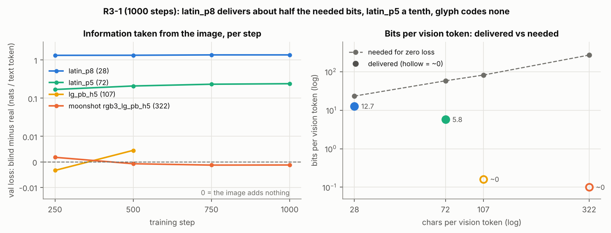

# Analysis of the results so far (2026-11-05)

What the rows say once each arm is measured against its own blind control, where the glyph codes lose their
information, how far each code is from what has been shown to work, and what to run next. Numbers come from the
committed rows. The R3-1 tables are generated by `python3 encoder_probe/experiments/analyse_r3.py` and written to
[encoder_probe/results/analysis_r3/summary.md](../encoder_probe/results/analysis_r3/summary.md).

## Bottom line
* **latin_p8 (28 chars/token) is read**, but only about half of the way. The image supplies ~55% of the information
  needed for a perfect transcription. The model reads the first line of a window, then drifts into invented text.
* **latin_p5 (72 chars/token) is partly read, which the docs had been calling "at its blind floor".** Its
  validation loss is 10% below its blind control's, and the gap grew at every checkpoint. Its multiple-choice score
  beats its blind control's (18/32 vs 9/32, p = 0.02). It picks up each page's gist but not the words, so its CER is
  at the floor.
* **Neither glyph code is read at all.** The moonshot's validation loss is within 0.002 nats of its blind run's at
  every checkpoint, and its generations are the same text whatever page it is shown. lg_pb_h5 behaves the same way.
* **Q1, G2-lite and R3-1 all place the loss inside the frozen ViT,** upstream of the four blocks R3-1 trained. The
  null result is therefore strong evidence that this recipe (1000 steps, last 4 blocks at LR 2e-5) can't teach Qwen
  the glyph codes. It is weak evidence against the codes themselves.
* **The moonshot needs ~270 bits per vision token beyond the language prior.** That is ~20x what latin_p8
  delivers here and roughly 8x the best published optical compression (DeepSeek-OCR at ~97%: about 30-35 bits per
  token, inferred). A credible attempt means retraining most of the ViT, not a LoRA.

*Left: validation loss of the blind run minus that of the real run, on the same 16 fixed targets (0 = the image adds
nothing). lg_pb_h5's blind run died at step 500. Right: bits per vision token. "Needed" is what the image must add
beyond the model's prior for a zero loss; "delivered" is the measured loss gap, converted to bits.*

## 1. R3-1 against its blind controls

The test uses 16 pages. MC has 4 options, so chance is 0.25. p-values are exact and one-sided (real better than
blind). The clean and jpeg75 rows share questions, so they are not independent replicates.

| Code (chars/token) | CER (blind) | MC real / blind (p) | Cloze real / blind (p) | Val-loss gain vs blind | Verdict |
|---|---|---|---|---|---|
| latin_p8 (28) | 55.0% (88.5%) | 28/32 / 8/32 (< 0.0001) | 33/64 / 14/64 (0.0004) | **54.6%** | read, drifts |
| latin_p5 (72) | 80.9% (77.8%) | 18/32 / 9/32 (**0.02**; jpeg75 0.04) | 20/64 / 19/64 (0.50) | **9.9%**, rising | gist only |
| lg_pb_h5 (107) | 78.4% (n/a) | 10/32 (vs chance: 0.26) | 11/64 | 0.2% (step 500) | not read |
| rgb3_lg_pb_h5 (322) | 83.6% (89.9%) | 11/32 / 9/32 (0.39) | 14/64 / 14/64 (0.58) | **0.0%** | not read |

* **Validation-loss gain** is 1 - L_real / L_blind, on the same targets with the images swapped between pages. It
  is the most sensitive measure in these rows. Across checkpoints the glyph arms vary by only ±0.005 nats per token.
  That resolves latin_p5's 0.24-nat gap easily, while CER does not register it at all.
* **The latin_p5 MC result** has p = 0.02 before any correction for multiple comparisons (eight clean tests). The
  loss gap, which grew from 0.17 to 0.24 nats over four checkpoints, is the stronger evidence of all three.

## 2. Why CER hid the partial reading
* **Fluent text that has nothing to do with the page scores ~0.80 normalised edit distance** on the stored 300-char
  samples (0.79-0.81 for every blind and glyph row). Every blind floor sits between 78% and 90% CER, and where in
  that range depends on output length. A CER above ~75% therefore can't tell partial reading from none.
* **Only latin_p8's generations depend on the page:** their distance to their own page's reference is 0.60,
  against 0.79 to the other pages'. Every other row is equidistant (0.79-0.80 both ways). latin_p5's outputs are on
  the right topic but not the right words: a page about a film actor came out as a generic film review.
* **latin_p8's 55% mixes two failures:** recognising characters (the first line is near-exact, up to 79 matching
  characters) and keeping track of position (it loses the line and continues from the language prior). One fix
  doesn't help the other, and separating them needs a per-line eval (see Next).

## 3. Where the glyph codes lose their information
Three independent measurements give the same answer.

| Stage | What was measured | Moonshot | Latin (for contrast) |
|---|---|---|---|
| Raw pixels (G0) | trained reader on the page itself | **1.07% CER** | < 0.3% |
| Q1: linear ink readout by ViT block | ink MCC at blocks 8 / 16 / 24 / 28 / final / after merger | 0.86 / 0.79 / 0.64 / 0.56 / 0.47 / 0.29 | latin_p8 0.89 / 0.67 / 0.18 / 0.02 / 0.02 / 0.03 |
| G2-lite: nonlinear probe on frozen states (500 pages) | share of reference chars matched | final block, no merger: **29%**; through the merger: 15% | latin_p16: 75.5% CER vs blind 87.3% (100 pages; the probe under-reads Latin) |
| R3-1: LLM reader, last 4 blocks + merger trained at LR 2e-5 | val-loss gain vs blind | **0.0%** | latin_p8 54.6% |

* **Latin loses its pixel readout by block 24 and is still read,** because Qwen's pretraining built character
  features that keep its content in non-pixel form. The glyphs have no such features, so their content survives
  only as pixel-like residue, which fades steadily with depth. By block 28, where R3-1's trainable blocks begin, the
  moonshot's readout is already down to 0.56.
* **R3-1 trained blocks 28-31 and the merger at LR 2e-5 under a cosine schedule to 0 over 1000 steps,** so the
  vision weights barely moved. The null result says the recipe is too weak. It doesn't measure the code's ceiling.
* **The probes are pessimistic about Latin.** DeepEncoder's probe reads Latin only up to 8.5 chars/token, while
  DeepSeek-OCR's own decoder reads ~35-45. Through Qwen, G2-lite reads latin_p16 (6.8) only at 75.5% CER (blind
  87.3%), yet the LLM reads latin_p8 (28). A probe negative is therefore weak evidence on its own. For the glyph codes, R3-1 is the
  direct test, and it agrees with the probes.

## 4. How far each code is from what has been shown to work
Bits per vision token, from the validation losses. "Needed" is L_blind x (text tokens per vision token) / ln 2, at
4.33 chars per text token.

| Code | chars/token | needed | delivered (R3-1) | Context in Qwen's 32k window if read perfectly |
|---|---|---|---|---|
| plain text | 4.33 | - | - | 0.14M chars |
| Glyph-style Latin (prior art) | ~15 | ~12 | - | 0.49M |
| latin_p8 | 28 | 23 | 12.7 | 0.92M |
| latin_p5 | 72 | 58 | 5.8 | 2.4M |
| lg_pb_h5 | 107 | 82 | ~0 | 3.5M |
| moonshot | 322 | 270 | ~0 | 10.5M |

* **Denser Latin delivers fewer bits, not the same bits spread thinner** (12.7 vs 5.8 per token). So recognising
  small text is the binding limit, not token capacity. A 2048-dim token is nowhere near full at these rates.
* **Prior art:** DeepSeek-OCR, at ~10x compression (~35-45 chars/token), delivers on the order of 30-35 bits per
  token with an encoder trained on very large OCR corpora. The moonshot needs ~8x that, and latin_p5 ~2x. The
  research report's go region (30-90 chars/token) corresponds to ~25-75 bits per token.

## 5. What more training is likely to buy
* **latin_p8's loss gap grew only +0.02 nats per doubling of steps,** with train loss (1.02) close to val loss
  (1.12): it is underfitting, not overfitting. A log fit puts a 5000-step run at ~57% of the needed bits.
  * The fit understates longer runs, because the cosine schedule spends the last quarter near LR 0.
  * Even so, 5x the steps alone is unlikely to take latin_p8 from 55% to near-3% CER.
  * The recipe is the likely limit: the vision side gets 2e-5 on 4 of 32 blocks, and the model sees ~2,400
    transcription windows in total.
* **latin_p5's gap is growing faster** (+0.036 nats per doubling), but the same fit only reaches ~14% at 5000 steps.
* **Round-2 probe scaling (DeepEncoder, latin_p32):** pages help less than steps.
  * At 10k steps: 18.9% / 17.2% / 14.9% CER at 1000 / 3000 / 5000 pages, ~6 points per tenfold increase in pages.
  * At 1000 pages, 3k to 10k steps took it from 25.9% to 18.9%.
  * Probe CERs are limited by training and rank codes; they are not absolute numbers.

## 6. Assessment by code
| Code | Where it stands | Outlook on Qwen2.5-VL-3B on one 24 GB GPU |
|---|---|---|
| latin_p8 (28) | read; recognises characters but loses its place | **Likely** to become usable with a stronger vision-side recipe; this is the realistic demo (~6.5x the default context) |
| latin_p6 / p5 (51 / 72) | p5: gist only | **Possible** stretch: needs about twice the published rate per token |
| lg_pb_h5 (107) | not read | **Unlikely** with partial-ViT tuning. Has no pretrained character features to build on |
| moonshot (322) | not read; readable from raw pixels | **Very unlikely** at this scale. Needs a ViT retrained to read glyphs, i.e. a new encoder, plus data far beyond 1000 pages |

The research is not stuck. The glyph result is a clean, well-controlled negative for this recipe. The positive
path is Latin, where the question is how dense it can go while still transcribing reliably.

## 7. What to run next (by information per GPU-hour)
1. **Vision-side diagnostic, 1000 steps, every arm with its own blind:** `--vision-blocks 24 --lr-vision 1e-4`,
   which trains from block 8, where Q1's readout is still 0.86. Arms: latin_p8 as the positive control, lg_pb_h5
   and the moonshot. Estimate: ~+8 GB of fp32 weights, gradients and Adam state, so ~18-19 GB peak.
   * **Decision rule for the glyph codes:** a val-loss gain vs blind above 0.02 nats per token by step 1000 (≥ 4x
     the noise seen so far). Without it, stop the glyph line on Qwen-3B.
   * **For latin_p8:** if the new recipe beats R3-1 on val loss (< 1.0 vs 1.125; never chosen on test CER), it becomes
     the shared recipe for every later arm. Pre-registered as stage A' in ROUND3.md (R3-1b).
2. **Latin density sweep with the LLM reader, 1000 steps plus blinds:** latin_p12 (~12.5 chars/token) and
   latin_p10 (~18). Together with p8 and p5, this maps how readability falls with density, which sets the demo's
   operating point. ~30 min per job on a 4090.
3. **A per-line eval** (one line per prompt, or windows of ≤ 300 chars) on latin_p8, to separate character
   recognition from position tracking. Eval only, no training; it needs a flag in `finetune_qwen.py`.
4. **Then the 5000-step Latin runs** (p8 / p6 / p5 with blinds) on the winning recipe. That sets the G3 baseline.
5. CPU option meanwhile: the G2-lite direct probe on block-8 and block-16 states of the moonshot. It needs a
   block-selection option in `run_g2lite.py`. It tests whether a nonlinear reader decodes the glyphs where Q1 says
   the pixels are still there, i.e. whether unfreezing from there can work at all.

## Caveats
* 16 test pages, 32 MC and 64 cloze questions per arm, one seed. Only large effects can be detected.
* Only four 300-char samples are stored per row, so the input-dependence numbers are indicative only. Rows written
  from now on also store `ops` and `prefix_frac`.
* lg_pb_h5's blind control stops at step 500 (the disk filled), and its gain is from that step.
* Bits per token come from a token-weighted loss over a mix of transcription and question targets. Treat them as
  orders of magnitude.
* The figures for DeepSeek-OCR's rate are inferred from its published compression and precision, not measured here.
