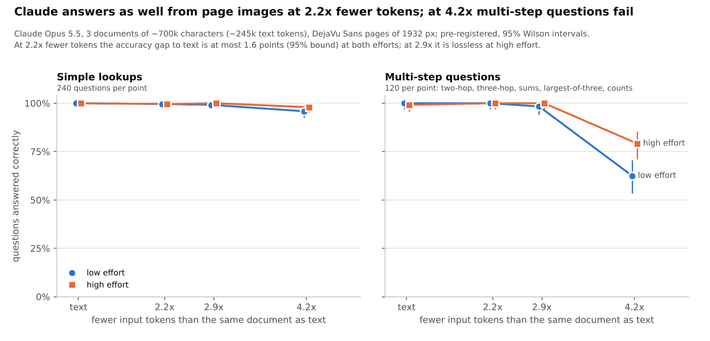
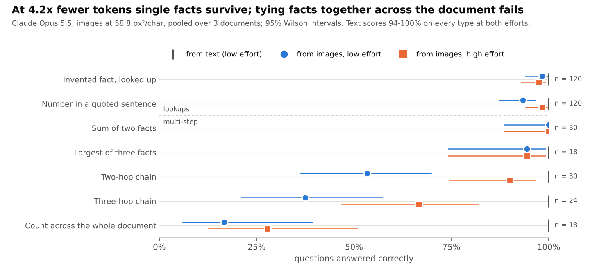

# Claude QA: can Claude answer questions from page images as well as from text?

*2026-11-10. Script `experiments/claude_qa_render.py`, analysis `experiments/analyse_claude_qa.py`, rows and per-run
notes in `results/claude_qa/` (`summary.md` there has every run in order, including the failed and discarded ones).*

**Answer, for Claude Opus 5.5 on documents of ~245k text tokens:** giving it the document as page images instead of
text uses **2.2x fewer input tokens with no measurable loss** (accuracy gap at most 1.6 points, 95% bound, at both
low and high effort). At **2.9x** it is lossless at high effort and within 2.8 points at low effort. At **4.2x**
single facts survive but questions that tie facts together across the document fail: 15 points lost overall at low
effort, 8 at high, and up to 83 points on counting.

## Why this test

Phase 1 found that Claude *transcribes* natural Latin at 29.4 px²/char with 3% character error, about 7.8x fewer
tokens than text. Transcribing a page is not the same as using a long document. This test asks questions over a
whole document given three ways: as text, as rendered pages, and not at all (the prior).

## Method (pre-registered for v2)

* **Model and call:** headless Claude Code (`claude -p`, no tools, isolated environment, `vbpe/claude_eval.py`),
  Opus 5.5, effort low and high. The image arm cannot see the source text. Input tokens come from the CLI's usage
  report.
* **Documents:** 3 non-overlapping ~700k-character documents (held-out WikiText-103 test and validation text; seeds
  0-2), each with invented facts inserted between paragraphs.
* **Pages:** the same document string rendered as DejaVu Sans Latin (Phase 1's renderer) on 1932 x 1932 px pages,
  which Opus 5.5 reads without downscaling (4,764 tokens each). Densities 117.6, 88.2 and 58.8 px²/char.
* **Questions (120 per document, exact numeric answers, scored automatically):**
  * 40 invented facts ("How many tonnes of granite did Pavo Dekbry use to rebuild the bridge at Rimosk?"): only the
    document can answer;
  * 40 numbers in real sentences ("Find the sentence that begins '...'. What number does it contain?");
  * 40 multi-step questions over invented facts: 10 two-hop (person -> chairs a rowing club -> how many boats),
    8 three-hop (person -> club -> the town where its boathouse stands -> lamp posts), 10 sums, 6 largest-of-three,
    6 counts across the whole document (of fact types no other question mentions). The facts in a chain are at
    least 1/8 of the document apart.
* **Analysis:** each image answer is paired with the same document's text answer; pooled over the 3 documents (360
  pairs per point). Paired difference with Newcombe's score interval, exact McNemar, Wilson intervals per kind.
  **Lossless = upper 95% bound of (text - image) below 2 points**, written down and committed before any v2 call.

## Results

| effort | fewer tokens than text | text | image | text - image (95% CI) | multi-step: text / image | verdict |
|---|---|---|---|---|---|---|
| low | 2.2x | 100.0% | 99.7% | +0.3 (-0.8 to +1.6) | 100% / 100% | **lossless** |
| high | 2.2x | 99.7% | 99.7% | 0.0 (-1.3 to +1.3) | 99% / 100% | **lossless** |
| low | 2.9x | 100.0% | 98.9% | +1.1 (-0.1 to +2.8) | 100% / 98% | not shown below 2 points |
| high | 2.9x | 99.7% | 100.0% | -0.3 (-1.6 to +0.8) | 99% / 100% | **lossless** |
| low | 4.2x | 100.0% | 84.7% | +15.3 (+11.8 to +19.4) | 100% / 62.5% | loss |
| high | 4.2x | 99.7% | 91.7% | +8.1 (+5.5 to +11.3) | 99% / 79% | loss |

No document: 5.0% (low) and 6.9% (high) of 360, from years and other guessable numbers.

**Pre-registered verdicts:** (1) lossless at 2.2x: PASS at both efforts; (2) a loss on multi-step questions at ~4x,
low effort: PASS (+37.5 points, CI +28.8 to +46.4); (3) effort: high effort halves the gap at 4.2x (15.3 -> 8.1
points) and makes 2.9x lossless.

At 4.2x the dense pages keep single facts (lookups 93-98%, sums 100%) but lose the ability to connect facts spread
over the document: two-hop 53% / 90% (low / high effort), three-hop 38% / 67%, counting 17% / 28%. Wrong two-hop
answers are usually another club's boat count: the facts are found, the link between them is not.

## Earlier, exploratory runs (same harness, before v2)

| document | questions | result |
|---|---|---|
| 500k chars (175k tokens), small pages | 80 simple | 7.8x fewer tokens (Phase 1's 3% CER density): 33-42% vs 100%; 4.3x: 85-95%; 2.2x and 1.5x: 100% |
| 2.3M chars (781k tokens), small pages | 80 simple | 4.5x: 97% / 93% (4 misses); 8.7x: 20% / 57%; the 4x arm lost pages (below) |
| 2.3M chars (783k tokens), 1932-px pages | 100 incl. 20 multi-step | 4.4x: lookups 90-95%, multi-step 60% vs 80% from text; 8.6x fails; 4x lost pages |
| 700k chars (245k tokens), 1932-px pages | 100 incl. 20 multi-step | 2.2x and 1.5x: 100% on all; 4.2x: lookups 97%, multi-step 70% |

These used one document and one call per arm, so they show no-loss-detected rather than lossless (with 100
questions and no disagreement, a gap up to 3.7 points cannot be excluded).

## Cost

Costs are the CLI's `total_cost_usd`: **list price, not what was billed** (these calls draw on the subscription
quota). Some high-effort calls ran within 5 minutes of the identical low-effort call and read the document from the
prompt cache at a tenth of the price, so high-effort costs below are not comparable with low-effort ones.

| experiment | calls (cached repeats excluded) | list-price cost |
|---|---|---|
| 500k chars, 80 questions, 4 densities | 5 | $2.27 |
| 781k tokens, 80 questions, small pages | 5 (one arm lost pages) | $6.14 |
| 783k tokens, 100 questions, first attempt (count questions leaked; discarded) | 3 | $4.49 |
| 783k tokens, 100 questions, 1932-px pages | 5 (one arm lost pages) | $6.17 |
| 700k chars, 100 questions | 5 | $3.15 |
| **v2, pre-registered: 3 documents x 2 efforts** | 30 | **$11.47** (low $8.52, high $2.95) |
| **Total** | 53 | **$33.70** |

Not counted: four small probes (one large page, three noise-page payload tests), under ~$0.25 together.

Typical single calls at low effort (v2 documents):

| call | input tokens | output tokens | cost |
|---|---|---|---|
| text, 245k-token document | ~247k | ~3k | ~$1.29 |
| image at 2.2x fewer tokens | ~112k | ~3k | ~$0.62 |
| image at 2.9x | ~86k | ~4k | ~$0.51 |
| image at 4.2x | ~59k | ~3.5k | ~$0.36 |
| text, 781k-token document | 781k | ~0.5k | $3.91 |

At 2.2x the image call costs about half the text call for the same answers. High effort adds thinking: an uncached
4.2x image call cost $0.48-0.53 at high effort (9-12k output tokens) against $0.36 at low.

## Limits

* **Ceiling:** text scores 99.7-100%, so these questions cannot show losses below ~1 point.
* **Length:** ~245k text tokens per document. Through the CLI, a request with more than ~175k image tokens silently
  loses its earliest pages (seen at ~345k: delivered ~145-157k; not bytes or image count; not documented). The script
  compares input tokens with the image-token formula and drops such arms; longer documents need a direct API test.
* **Scope:** one model, one font and layout, English Wikipedia text.
* **Question type:** planted facts and numbers with exact answers, not open-ended understanding or summarisation of
  the real text.

## Problems found on the way

* The first count questions leaked: they counted fact types that the needle questions enumerate, and the no-document
  arm got 3 of 3 by counting questions. Replaced with fact types no other question mentions (rows kept as
  `qa800kc_v1_countleak`).
* A sentence opening with a double quote broke the anchor lookup (fixed; earlier question sets unchanged).
* The first analysis used a bootstrap interval, which collapses to zero width when text and image never disagree;
  replaced with Newcombe's score interval before the v2 runs.
