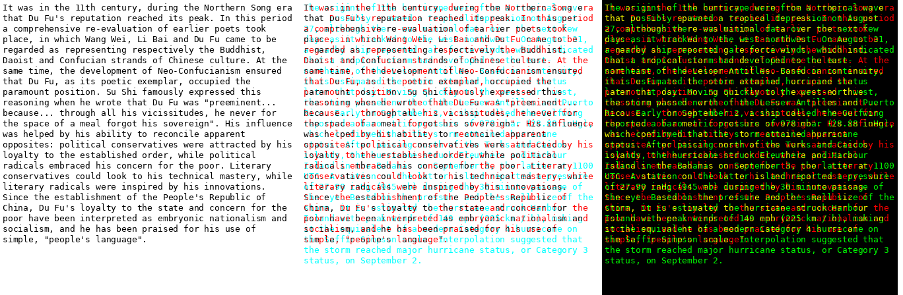

# Gist through colour channels: plan and first result (2026-11-06)

**User's direction (2026-11-06):**
* Target **gist**, not exact reconstruction.
* **"System 1" context:** bulk-load the subject matter as dense, low-resolution pages, and keep the user's own
  context as ordinary full-resolution text.
* **One variable at a time:**
  1. Latin text in 2 colour channels, then 3. No BPE chunks, no learned glyphs, large font first.
  2. A separate test of learned glyphs without BPE, to decide whether glyphs are worth pursuing.
  3. Only then merge the two.

Every phase compares against plain single-stream Latin under the same recipe. That comparison is a **control**,
not a goal (see [ANALYSIS.md](ANALYSIS.md)).

## At a glance: targets and status
**Measure.** Information per vision token = the val-loss gap vs the arm's own blind control (same targets,
images swapped between pages) × text tokens per vision token. R(k) = that of the k-stream page ÷ that of the
1-stream page at the same font size.

| Step | Question | Target (pre-registered) | Where | Status |
|---|---|---|---|---|
| A0 | Can untrained Qwen read colour-overlaid Latin? | (look only) | CPU | **done**: it reads one stream through the other, but can't pick a stream by colour |
| A0b | How much information does untrained Qwen take per stream? | (look only: zero-shot R(2), R(3)) | CPU | **done**: R(2) = 0.51 at 16 px, below 1 at every size |
| A1-cpu | 2 streams, LoRA-only fine-tune on CPU (amendment 2) | interim: R(2) > 1, CI above 1 | CPU (~4 h) | pre-registered, running |
| **A1** | 2 streams, fine-tuned (1000 steps, R3-1 recipe, 16 px) | **Headline: R(2) > 1, 95% CI above 1.** Strong: R(2) ≥ 1.5, each stream's MC ≥ 0.8x 1-stream MC, other-stream lure ≤ 15% | GPU (~2 h on a 4090) | built, CPU-tested, waiting for a GPU |
| A2 | 3 streams | R(3) ≥ 1.3 R(2), same per-stream rules | GPU (~1 h) | after A1 |
| A3 | Smaller font (16 → 12 → 8 px) on the best stream count | R(k) holds at each step, vs 1 stream at the same size | GPU | after A2 |
| B | Learned glyphs without BPE, read by a "pure" VLM | Glyph pages give at least Latin's gist at equal chars/token | GPU | not started |
| C | Merge: glyph streams in colour channels, then BPE | Each step pays for itself | GPU | not started |
| Use | "System 1": bulk background context as colour pages | Beats a text summary at equal KV bytes on gist QA | GPU | not started |

**The bar that makes it useful (equal density).** Beating one stream at the same font size (R(k) > 1) shows the
overlay works. To be worth using, an overlay must also carry at least as much information per vision token as a
single stream **shrunk to the same characters per token**. For example, rgb2s_p16 (13.7 chars/token) against
rgb1s_p12 (12.2). Zero-shot reference, single stream: 5.5 / 7.8 / 11.6 bits per vision token at 16 / 12 / 8 px
(A0b).

## Why gist, and what it has to beat
* **Every result so far points the same way:** meaning compresses much more easily than exact wording.
  * R3-1: latin_p5 got the gist only.
  * Stage 0: the 4x and 16x arms rebuilt the topic, not the text.
* **Gist is also what a "background knowledge" context needs.** Exact recall (names, numbers) can come from
  fetching the source passage on demand.
* **Prior art:** the DeepSeek-OCR paper proposes, without testing it, a similar memory: older context re-rendered
  at ever lower resolution, like forgetting. Nobody has tested colour-multiplexed pages for this.
* **Competitors at equal KV-cache bytes:**
  * no context (the model's own prior);
  * plain text cut to the same budget;
  * **a text summary of the same material**, the strongest baseline for gist.

  The system-1 test (after phase A) must beat all three.

## Phase A: Latin in colour channels (no BPE, no glyphs)
Each stream is ordinary text that owns its own colour channel(s), so every stream is fully recoverable from the
pixels. Two streams per page double the characters per vision token; three triple them.

| Pitch (DejaVu Sans, Qwen's 28-px tokens) | 1 stream | 2 streams | 3 streams |
|---|---|---|---|
| 16 px (large: phase A starts here) | 6.8 chars/vision token (plain text: 4.3 per token) | ~14 | ~20 |
| 8 px (later, if A passes) | 28 | ~56 | ~84 |

(1 stream = latin_p16 / latin_p8 as measured in rounds 2-3; multi-stream values are those x the stream count.)

At 16 px the test is a mechanism test (can streams be separated and understood?), not yet a context saving.
Density comes after.

### A0: zero-shot, no training. Done on CPU, 2026-11-06
Qwen2.5-VL-3B-Instruct, bf16 on CPU. Pages are 448 px with DejaVu Sans Mono at a 16-px pitch: 23 lines of ~56
characters, two different Wikipedia passages per page. For each stream the model was asked:
* "Transcribe only the red text": 3 pages;
* "Which of these phrases appears in the red text?": 12 pages. The 4 options include one phrase from the **other**
  stream on the same page.

Code: `encoder_probe/experiments/zeroshot_colour.py`. Rows: `encoder_probe/results/z0_colour/` and
`z0_colour_mc/` (the rerun that records whether a wrong answer picked the other stream).



| Condition | Stream | MC correct | MC answered with the other stream's phrase | Transcription CER |
|---|---|---|---|---|
| mono (black on white) | — | 12/12 | — | **0.0%** |
| red text alone, on white / on black | — | 12/12 / 12/12 | — | 0.1% / 20.9% |
| 2 streams, red + cyan inks on white | red | **12/12** | 0 | **14.3%** |
| | cyan | 1/12 | **10** | 76% (it transcribes the red text) |
| 2 streams, red + green light on black | red | 2/12 | 6 | 95% |
| | green | 6/12 | 4 | 82% |

**Reading:**
* **Overlap does not stop reading.** Untrained, Qwen reads the red stream at 14% CER straight through the
  overlapping cyan text, and answers every question about it.
* **It cannot select a stream by colour.** Asked for the cyan text, it reads the red text instead (10 of 12 MC
  answers come from the red stream). On black it mixes the two. It reads whichever stream is more salient.
* **So separating the streams has to be trained.** That is A1. The information is there: each stream owns its
  channels, and Q1 found all three colour channels survive about equally through Qwen's ViT.

### A0b: zero-shot information per stream. Done on CPU, 2026-11-06
Untrained Qwen2.5-VL-3B (bf16, CPU), the A1 encodings, 12 test pages. Prompt: "Transcribe all the <colour> text
on this page." Teacher-forced loss of the true text with the page's own image, against another page's image
(blind). Code `encoder_probe/experiments/zeroshot_info.py`; rows `encoder_probe/results/z0_info/`.

| Pitch | Streams | Chars per vision token | Loss (blind) | Info gap per text token, per stream | R(k) vs 1 stream (95% CI) |
|---|---|---|---|---|---|
| 16 px | 1 | 6.9 | 0.04 (2.42) | 2.38 | 1 |
| | 2 | 13.6 | 1.68 (2.29) | cyan 0.05, magenta 1.17 | **0.51** (0.31-0.72) |
| | 3 | 20.5 | 2.14 (2.30) | 0.01 / 0.46 / 0.02 | 0.21 (0.12-0.30) |
| 12 px | 1 | 12.2 | 0.42 (2.33) | 1.91 | 1 |
| | 2 | 24.4 | 2.00 (2.30) | 0.01 / 0.59 | 0.31 (0.18-0.45) |
| | 3 | 36.6 | 2.36 (2.40) | ~0 / 0.10 / ~0 | 0.06 (0.03-0.10) |
| 8 px | 1 | 28.2 | 1.10 (2.34) | 1.24 | 1 |
| | 2 | 56.3 | 2.41 (2.45) | ~0 / 0.08 | 0.06 (0.03-0.10) |
| | 3 | 84.4 | 2.43 (2.44) | ~0 | 0.01 (0.01-0.02) |

**Reading:**
* **Untrained, an overlay loses.** Qwen reads the magenta stream partly and the cyan and yellow streams hardly at
  all, as A0 found. This is the baseline training has to lift: A1 asks whether fine-tuning teaches the model to
  pick the stream it is asked about.
* **At 16 px a single stream is already read almost perfectly** (loss 0.04 against 2.42 blind: 98% of the
  information). Fine-tuning a 1-stream arm can add at most ~2% there.
* **Side finding:** untrained Qwen reads single-stream 8 px Latin about as well as R3-1's 1000-step fine-tune
  did (loss 1.10 here vs R3-1's val loss 1.12; different target mix, so indicative only). R3-1's Latin gain was
  mostly task format, not new reading ability.

**Amendment 2 (2026-11-06, before any A1-cpu row): a CPU interim check (A1-cpu), no GPU available.**
* **Measured CPU cost:**
  * the full A1 recipe: 85 s/step, so ~24 h per arm, not viable;
  * LoRA only (ViT and merger frozen), batch 2, ≤ 400-char targets: 24 s/step.
* **Run:** rgb2s_p16 only, LoRA r = 16 only, 500 steps, batch 2, 1000 train pages, `--max-target-chars 400`,
  run name `colour_a1cpu`.
  * **No trained 1-stream arm:** the reference is the zero-shot 1-stream arm, which is already at 98% of its
    blind loss, so training it could add ≤ 2%.
  * **No trained blind run:** per sample, the blind loss is the lower of (a) the trained model's loss with another
    page's image and (b) the untrained model's no-information loss on the same target. This can only shrink the
    gap, never inflate it.
* **Measure:** `zeroshot_info.py` on 24 test pages, first ≤ 400-char window of each stream (the training target
  length), zero-shot reference run first (`z0_info_w400`). Also `finetune_qwen.py`'s per-stream MC, lure rate and
  cloze.
* **Interim target:** R(2) > 1 with the CI above 1. Each stream's MC and lure rate are reported against the
  zero-shot A0 numbers (cyan MC 1/12, lure 10/12).
* **Reading:** a pass is early evidence that training teaches stream selection. A fail at this budget (a quarter
  of A1's samples, vision frozen) is not a verdict; the GPU A1 is.

### A1: two streams, fine-tuned (GPU, next)
* **Recipe:** R3-1's (LoRA r = 16 + merger + last 4 ViT blocks, 1000 steps, 1000 train pages). One `fair_hash`;
  every arm with its own blind control.
* **Arms:**
  * 1 stream (black ink);
  * 2 streams with **symmetric channels**: stream 1 darkens R (cyan ink), stream 2 darkens G (magenta ink), B is
    left free for A2's third stream (yellow ink).
* **Layout:** each channel is an ordinary Latin page (DejaVu Sans, 16 px) of one contiguous span, so stream 1
  reads top to bottom, then stream 2.
* **Tasks, all per stream:**
  * transcription windows ("Transcribe lines a-b of the magenta text");
  * MC with the other stream's phrase as a distractor;
  * cloze.
* **Metrics:**
  * per-stream MC, cloze and CER;
  * other-stream confusion rate;
  * val-loss gain vs blind, turned into bits per vision token (`analyse_r3.py`).
* **Gate (pre-registered here, before any A1 row):** two streams pass if all of these hold:
  * each stream's MC ≥ 0.8x the 1-stream arm's MC;
  * other-stream confusion ≤ 15% of MC answers;
  * the 2-stream arm delivers ≥ 1.5x the 1-stream arm's bits per vision token.
* **Cost:** 4 jobs (2 arms + 2 blinds), ~2 h on an RTX 4090.
* **To build first** (CPU-tested, as for R3-1):
  * the stream-contiguous colour encodings (`rgb2s_p<p>`, `rgb3s_p<p>`);
  * per-stream prompts in `r3_tasks.py`;
  * per-stream scoring in `finetune_qwen.py`.

**Amendment 1 (2026-11-06, user, before any A1 row): headline bar.** The headline claim is that the overlay
carries **more information per vision token than one stream**: R(2) > 1, with the lower bound of a 95% bootstrap
CI above 1.
* R(k) = information per vision token of the k-stream arm ÷ that of the 1-stream arm.
* Information per vision token = the val-loss gap vs the arm's own blind, on the same 64 fixed val targets
  (`val_per_sample`), × text tokens per vision token.

The gate above stays as the "strong" level (R(2) ≥ 1.5 plus the per-stream rules). `analyse_colour.py` reports both.

**Built (2026-11-06, CPU-tested in `encoder_probe/tests/test_colour.py`):**
* **Encodings** `rgb1s_p<p>`, `rgb2s_p<p>`, `rgb3s_p<p>` (`ep/geom.py`):
  * each channel holds an ordinary latin_p<p> page of its own contiguous span of text;
  * `rgb1s` is pixel-identical to latin_p<p>;
  * at p16: 6.9 / 13.7 / 20.5 chars per vision token.
* **Per-stream tasks** (`ep/r3_tasks.py`): every prompt names the stream by its ink colour. The MC lure is a phrase
  from another stream on the same page; for 1 stream, a phrase from the text that follows the page.
* **Per-stream eval** in `finetune_qwen.py`: CER, MC, lure rate and cloze per stream (`per_stream` in the row),
  plus `val_per_sample`.
* **Gate analysis:** `analyse_colour.py`.

**A1 runbook (RTX 4090, ~2 h; ~3 h with A2's arm).** Every arm uses the same command and flags (one
`fair_hash`), each with its blind:
```bash
F="--steps 1000 --train-pages 1000 --eval-mc 4 --eval-cloze 4 --val-samples 64 --eval-conds clean --run-name colour_a1"
for e in rgb1s_p16 rgb2s_p16 rgb3s_p16; do
  python3 encoder_probe/experiments/finetune_qwen.py --encoding $e $F || break
  python3 encoder_probe/experiments/finetune_qwen.py --encoding $e $F --blind-images || break
  git add encoder_probe/results/colour_a1* && git commit -qm "colour A1: $e" && git push -q
done
python3 encoder_probe/experiments/analyse_colour.py --real colour_a1 --pitch 16
```
rgb3s runs last and is analysed under the A2 gate only if A1's headline passes.

**Prompt for the GPU session:**
```text
Pull branch claude/validation-harness. Read AGENTS.md (gotchas) and docs/COLOUR_GIST.md (plan, A1 gate,
amendment 1 and the A1 runbook); runbook mechanics in docs/GPU_RUNNER.md sections 0-2.

1. Setup (GPU_RUNNER.md section 1; no page pre-rendering needed beyond what finetune_qwen.py does), then the CPU
   tests encoder_probe/tests/test_colour.py and test_round3.py.
2. Smoke: python3 encoder_probe/experiments/finetune_qwen.py --encoding rgb2s_p16 --smoke. Record s/step and peak
   GPU memory; check the row has per_stream (cyan, magenta) and val_per_sample.
3. Run the A1 runbook loop exactly (rgb1s_p16, rgb2s_p16, then rgb3s_p16; each with its --blind-images run;
   identical flags, one fair_hash). nohup, push after each arm, keep >= 5 GB disk free.
4. Then python3 encoder_probe/experiments/analyse_colour.py --real colour_a1 --pitch 16 and add its table plus
   the gate verdicts as a dated "A1 results" section in docs/COLOUR_GIST.md, with a line in docs/HANDOFF.md.
   Headline = R(2) with its CI (amendment 1). Apply the A2 gate to rgb3s only if the headline passed.

Stop and ask me if the smoke fails or a result would change the plan; record changes as dated amendments
before running them. Never choose on test-page CER. No PRs, no Claude API calls, no model IDs in commits.
Stop the pod when finished.
```

### A2: three streams (only if A1 passes)
* **Arm:** the same recipe with a third stream darkening B (yellow ink).
* **Gate:** each stream's MC ≥ 0.8x the 1-stream arm's, and bits per vision token ≥ 1.3x the 2-stream arm's.
* **Then density:** shrink the pitch (16 → 12 → 8) on the best channel count, each step against a 1-stream arm at
  the same pitch.

## Phase B: learned glyphs without BPE ("pure VLM" for glyphs)
* **Code:** the learned **characters-only** alphabet (`lg_learned_n0_pb_h5`: 95 whole-pixel glyphs, 5 px tall),
  no chunk glyphs. In raw pixels it already needs ~0.82x Latin's area for the same accuracy (8.0 vs ~9.8
  px²/char at ~0.6% CER, [learned_glyphs/RESULTS.md](../learned_glyphs/RESULTS.md)): a modest prior.
* **Scale:** glyphs upscaled (nearest neighbour, e.g. 3x) so tiny pixels are not the question. Latin at the same
  characters per vision token is the comparison.
* **Model, as I read "pure VLM":** a vision encoder with no pretrained bias towards Latin. A small ViT/CNN trained
  from scratch feeds a small LLM (Qwen2.5-0.5B), with Latin trained identically as the control. The cheaper
  alternative is Qwen with its ViT trained from block 8 (stage A' in [HANDOFF.md](HANDOFF.md)).
* **Gate:** glyph pages give at least Latin's gist (MC, bits per vision token) at equal chars/token. If not, glyphs
  are dropped and the merged phase uses Latin in colour channels.

## Phase C: merge
1. Glyph streams in colour channels: the moonshot without BPE.
2. Then BPE chunk glyphs on top, only if each earlier step paid for itself.

## System-1 use test (after phase A passes)
* **Setup:** long documents in the passing colour format as background context, then gist questions (topic,
  claims, relations; not needles).
* **Baselines:** no context, plain text cut to equal KV bytes, a text summary at equal KV bytes.
* **Bar:** beat the summary baseline, or match it at lower prefill compute.
