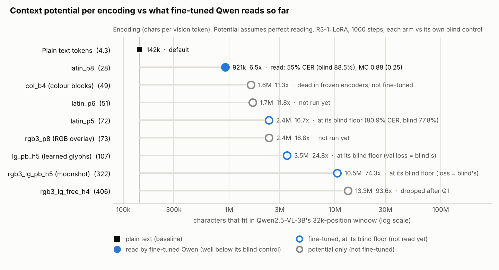

# Context budget: what each encoding could buy (living table, 2026-11-05)

Goal (user, 2026-11-04): show a local model on the RTX 3090 holding much more context than it can by default, without
shortcutting the research. This page turns each encoding's chars per context position (cpt) into context, KV and
compute, and says how much of it is measured. **Update the Evidence table after every round-3 step.**

*Generated by `python3 scripts/make_docs_figures.py`. Filled = read by the fine-tuned model (R3-1, 1000 steps), hollow =
potential only. So far only latin_p8 is read, at 55% CER: the 6.5x is a ceiling, not a working context gain.*

## Baselines

| | Qwen2.5-VL-3B (round-3 test model) | DeepSeek-V4.1-Flash (user's reference) |
|---|---|---|
| Size | 3.75B params (3.09B LLM + ~0.67B ViT), bf16 ~7.5 GB, fits the 3090 | 552B MoE, 8B active (prefill) / 16B (decode) [paper] |
| KV per position | 36,864 B (36 layers x 2 KV heads x 128 x 2 x bf16; verified from config) | 890 B global KV [paper]; ~5.4 KB measured in the community 3090 offload config |
| Native window | 32,768 positions (KV at 32k: 1.2 GB) | 1,048,576 tokens [NVIDIA card]; 262k in the 3090 offload config |
| Chars in window as text | ~142k (4.33 chars/token, measured on held-out WikiText) | ~4.5M (assumes ~4.3 chars/token: not measured) |
| On the 3090 PC | runs; the window, not KV, caps context | does not run as configured (offload pins 190 GiB of experts in host RAM; the PC has 32 GB) |

Sources: DeepSeek-V4.1-Flash paper (arXiv 2609.19969), NVIDIA model card, community offload wiki
(github.com/0xSero/dsv41-flash-offload). How V4.1-Flash tokenises images is not public in the abstract.

## Potential (upper bounds IF the model reads the encoding perfectly)

Compute/char = prefill FLOPs per document char vs plain text on Qwen-3B: 2 x params per position, plus ~5.4 GFLOP of
ViT per vision position (4 patches x 0.67B x 2); attention ignored.

| Input | cpt | KV cut vs text | Qwen-3B: KV per 1M chars | Qwen-3B: chars in 32k | V4.1-Flash: chars in 1M | Compute/char |
|---|---|---|---|---|---|---|
| Plain text (default) | 4.33 | 0% | 8.5 GB | 0.14M | ~4.5M | 1.00x |
| Latin images, Glyph-level (prior art) | ~15 | 71% | 2.5 GB | 0.49M | ~16M | 0.54x |
| latin_p8 | 28 | 85% | 1.3 GB | 0.92M | ~29M | 0.29x |
| col_b4 (colour blocks) | 49 | 91% | 0.75 GB | 1.6M | ~51M | 0.17x |
| latin_p5 / rgb3_p8 | ~72-73 | 94% | 0.50 GB | 2.4M | ~76M | 0.11x |
| lg_pb_h5 (learned glyphs) | ~107 | 96% | 0.34 GB | 3.5M | ~112M | 0.08x |
| Moonshot rgb3_lg_pb_h5 | 322 | 98.7% | 0.11 GB | 10.5M | ~338M | 0.03x |
| Moonshot rgb3_lg_free_h4 (dropped) | 405 | 98.9% | 0.09 GB | 13.3M | ~425M | 0.02x |

* Images cost ~1.9x text per position on Qwen-3B (the ViT), so they break even on compute at ~8 cpt.
* Fewer positions also speed long-context decoding on Qwen-3B. On V4.1-Flash decode is PCIe/expert-bound: no gain.
* Dense codes have no language prior: one misread glyph can corrupt a name or number, so exact recall (needle) is the
  hard test, not the gist.
* Bar (user, 2026-11-04): compare codes against Latin pushed equally far (p8 ~28, p6 ~51, p5 ~72), not Glyph's ~15.
  Literature calibration ([research report](research/2026-11-04_rgb3_lg_go_no_go_report.md)): plausible go ~30-60
  cpt, stretch 60-120, 322-405 implausible at LoRA-3B scale.

## Evidence (what is measured so far)

Identity32 ceilings are at DeepEncoder's 512-px geometry (200 pages); the cpt column is at Qwen's 448-px geometry.

| Input (cpt) | Raw pixels (identity probe) | Frozen encoder (probe) | Fine-tuned Qwen, R3-1 (1000 steps; blind in brackets) | Long-context QA (R3-2) |
|---|---|---|---|---|
| latin_p8 (28) | 0.04% (identity32) | DeepEncoder: only 8.5 cpt reads (15-19%). Qwen G2-lite: under-read by the probe (lower bound) | **read**: CER 55.0% (88.5%), cloze 0.52 (0.22), MC 0.88 (0.25) | not run |
| latin_p5 (72) | 0.27% (identity32) | not run on Qwen | gist only: CER 80.9% (77.8%), MC 0.56 (0.28, p = 0.02), val loss 9.9% below blind | not run |
| col_b4 (49) | 0.29% (identity32) | floor (71-73%) on SigLIP and DeepEncoder | not run | not run |
| rgb3_p8 (73) | 0.42% (identity32) | floor (83.5%) on DeepEncoder | not run | not run |
| lg_pb_h5 (107) | 0.52% (identity32) | floor (82.4%) on DeepEncoder | at its floor: 78.4%, val loss 2.274 (2.285 at step 500; blind died) | not run |
| rgb3_lg_pb_h5 (322) | **1.07%** (identity28, G0) | Qwen G2-lite: frozen 86.1%, trained merger 84.6%, no merger 71.9% (floor 99.5%): "ViT output is the wall" | at its floor: 83.6% (89.9%), loss = blind's to 3 decimals | not run |
| rgb3_lg_free_h4 (405) | partial (37.0% at step 500) | fades by ViT block 24 (Q1): dropped | not run | not run |

Q1 (linear pixel readout of the frozen Qwen ViT, `encoder_probe/results/quick_q1/summary.md`): ink MCC final / after
merger (rgb3 codes: mean of the R/G/B channels, per-channel 0.48/0.48/0.45): rgb3_lg_pb_h5 0.47 / 0.29, lg_pb_h5 0.65 / 0.30, latin_p8 0.02 / 0.03. Latin fails this linear test and is
still read by Qwen, so Q1 is a lower bound, not a readability result.

A row counts as a real context gain only when R3-2 shows QA accuracy within the ROUND3.md margins at that cpt. Until
then the Potential table and the chart are ceilings.

## What this means for the demo
* On the 3090 the demo model is Qwen2.5-VL-3B. Its window caps context: fine-tuned latin_p8, once it transcribes
  reliably, would take it from ~142k to ~0.9M chars; Glyph-level Latin to ~0.49M. A working dense code would reach
  the millions, but none is read yet.
* Fallback that needs no new code: Latin page images + 4-bit KV + YaRN ([IDEAS.md](IDEAS.md)).
* V4.1-Flash can't be the local demo (RAM) or be fine-tuned locally. A zero-shot test on rendered Latin pages via a
  hosted API would be the cheap check; not done (external, paid: needs the user's go-ahead).
