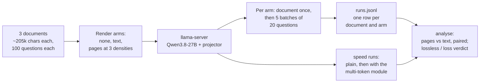
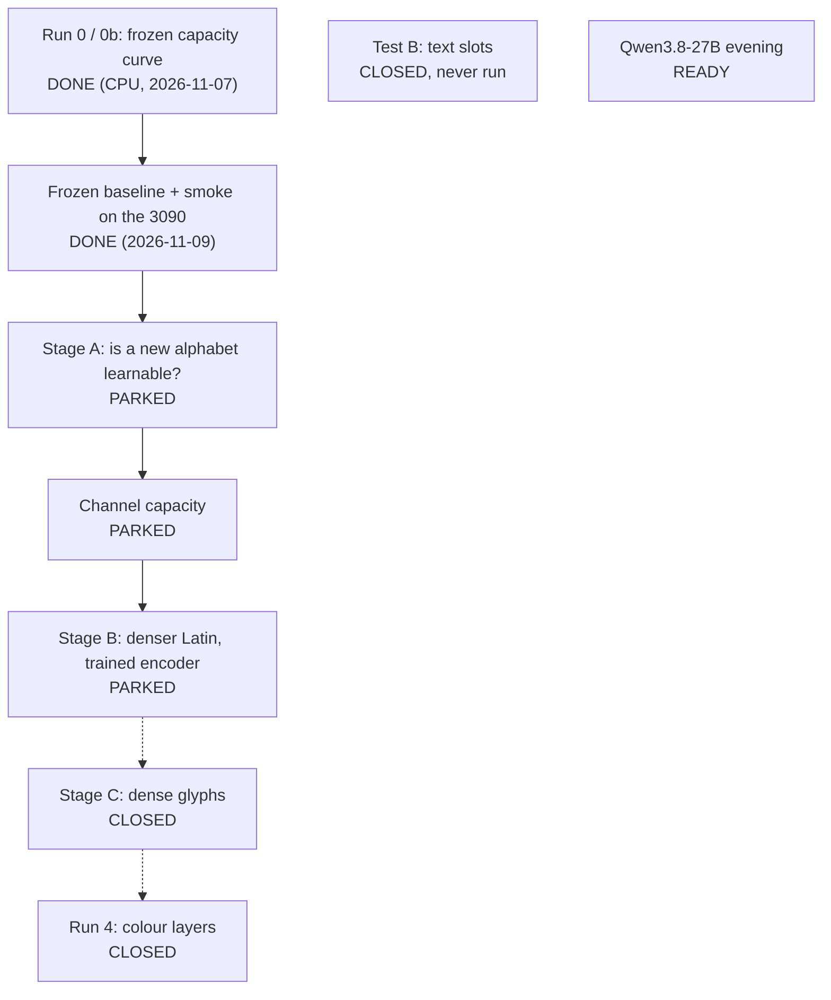

# Hand-off: what is left to run

**State (2026-11-13): the study is finished and wound down; the story is in the [README](../README.md).** One run
is left, on the local GPU: the Claude page-image test in small on a local Qwen3.8-27B, one evening, no training.
Its prompt is the next block. Everything else on the GPU side is parked or closed (table below).

## 1. The prompt to paste into Claude Code on the RTX 3090 PC

It asks one question: does rendering a document as page images let a **local** model hold about twice the text in
the same memory and still answer correctly, as it does on Claude? And a side question: how much faster does the
model write with the multi-token prediction module it ships with? The plan and predictions are pre-registered in
[gpu/LOCAL_QWEN.md](gpu/LOCAL_QWEN.md).

```text
Work in /c/git/visual-bpe-run (Windows, Git Bash; run `. .venv/env.sh` first; use `python`, not `python3`;
PYTHONUTF8=1). This is a measurement session: no training, no Claude API calls, no pull requests.

Read first: AGENTS.md, docs/gpu/LOCAL_QWEN.md (the plan: pre-registered) and the sections "GPU runners" and
"Git / shell" of docs/GOTCHAS.md. Do not change LOCAL_QWEN.md's arms, checks, predictions or outcome table after
seeing data; if something must change, write a dated amendment in that file before the affected rows.

0. State. Show nvidia-smi, free disk (the downloads need ~19 GB) and, if they exist, the tail of
   results/r12_logs/driver.log and results/r12_logs/done.txt. If the Runs 1-2 driver
   (encoder_probe/experiments/run12_driver.py) is running: wait for the current run's next checkpoint (every 250
   steps), stop the driver process first and its python child second, delete results/r12_logs/STOP if the kill
   left one, and commit and push any finished r12 rows to claude/validation-harness. Leave the driver stopped.

1. Code. git fetch origin claude/sharp-mendel-kkhg4g && git merge origin/claude/sharp-mendel-kkhg4g
   (files moved in that branch: docs are now under docs/gpu, docs/claude, ...; scripts under experiments/claude_qa).
   If the merge conflicts, stop and report. Then:
     python -m pytest -q tests/test_local_qa.py                          # 5 tests against a mock server, ~10 s
     python experiments/claude_qa/local_qa.py run --dry-run --doc 0 1 2  # no server needed
   Expect per document ~205,000 chars, 100 questions, and page118 / page88 / page59 = 10 / 8 / 5 pages with about
   23,850 / 17,900 / 11,900 vision tokens, largest page 2450 tokens.

2. Server. Install the newest llama.cpp Windows CUDA release (multi-token prediction needs a build from mid-May
   2026 or later). Download the model files (pip install -U huggingface_hub gives the `hf` command):
     hf download unsloth/Qwen3.8-27B-GGUF Qwen3.8-27B-UD-Q4_K_M.gguf mmproj-F16.gguf MTP/mtp-Qwen3.8-27B-Q4_0.gguf --local-dir models/qwen38
   Add `models/` to .git/info/exclude. Check the flag names below against `llama-server --help` (they have changed
   between builds), then start it in its own terminal:
     llama-server -m models/qwen38/Qwen3.8-27B-UD-Q4_K_M.gguf --mmproj models/qwen38/mmproj-F16.gguf -ngl 99 -c 57344 -np 1 --image-max-tokens 4096 --port 8080
   Record the llama.cpp build, the exact command and nvidia-smi after loading. Send one request with a small image
   to confirm vision works.

3. Document 0, all five arms (no document, text, pages at 117.6 / 88.2 / 58.8 px² per character), thinking off:
     X='--extra {"chat_template_kwargs":{"enable_thinking":false}}'
     python experiments/claude_qa/local_qa.py run --doc 0 $X
     python experiments/claude_qa/local_qa.py analyse
   Check before going on:
   - the text arm scores >= 90%;
   - reasoning_chars is 0 in every call of every row of results/local_qa/qwen38_27b/runs.jsonl (if not, thinking
     was still on: restart the server with --reasoning-budget 0, delete the affected rows, rerun);
   - no arm is marked INVALID. INVALID means the server reported fewer prompt tokens than the pages need, so it
     downscaled them: raise --image-max-tokens, or lower --page-px to a smaller multiple of 32; write that down as
     a dated amendment in LOCAL_QWEN.md, delete the page rows and rerun the page arms.
   If the text arm does not fit in memory (Windows pages GPU memory instead of failing: a sudden slowdown), try in
   this order and record which was used: add --cache-type-k q8_0 --cache-type-v q8_0 to the server; use
   Qwen3.8-27B-UD-Q4_K_S.gguf; close other GPU programs. If the server rejects the text arm for context length,
   restart it with a larger -c and record that. A failed call is never written as a row; rerunning the same
   command retries it and skips finished arms.

4. Documents 1 and 2, then the two speed runs:
     python experiments/claude_qa/local_qa.py run --doc 1 2 $X
     python experiments/claude_qa/local_qa.py speed --label plain $X
   Restart the server with the multi-token module added (flag names from --help; published examples use
   --spec-type mtp or --spec-type draft-mtp, --spec-draft-n-max 3, and the mtp-Qwen3.8-27B-Q4_0.gguf file), then:
     python experiments/claude_qa/local_qa.py speed --label mtp $X
     python experiments/claude_qa/local_qa.py analyse        # writes results/local_qa/qwen38_27b/summary.md
   Optional, only if time is left: text and page118 again with thinking on
   (--run-name qwen38_27b_think --arms text page118 --max-tokens 12000, no --extra).

5. Write-up. Fill the "Results" section of docs/gpu/LOCAL_QWEN.md with the date: the summary.md table; each of the
   five predictions as PASS / FAIL / not evaluable; which row of the outcome table applies; prompt-processing and
   generation speeds; GPU memory used; the llama.cpp build and server command; problems. Add one dated entry to
   docs/FINDINGS.md and change the first row of the table in docs/HANDOFF.md section 3 from "ready" to the result.
   Then:
     git add results/local_qa docs/gpu/LOCAL_QWEN.md docs/FINDINGS.md docs/HANDOFF.md
     git commit -m "Local Qwen3.8-27B: page images vs text, results"
     git pull --rebase origin claude/validation-harness && git push origin HEAD:claude/validation-harness

Stop and ask if: the server cannot load the model or the projector; the text arm scores below 90%; or a result
would change the plan. Report failures as plainly as successes. Do not restart the Runs 1-2 driver.
```

What the session does, end to end:



Every command, path and flag of `local_qa.py` in the prompt was checked against the code on 2026-11-13 (`--help`,
the dry run and `tests/test_local_qa.py`, 5 passed). The harness has only ever talked to a mock server. The
`llama-server` flags and the model file names come from the model's Hugging Face page and published examples and
could not be checked from this repo: step 2 tells the session to check them against `--help`.

## 2. What to send back

1. The table from `results/local_qa/qwen38_27b/summary.md` (accuracy per arm, tokens, the paired difference from
   text with its 95% interval, the verdict).
2. Each of the five predictions of [LOCAL_QWEN.md](gpu/LOCAL_QWEN.md) as PASS, FAIL or not evaluable, and which
   row of its outcome table applies.
3. Speeds: prompt processing and generation in tokens per second per arm, and generation with and without the
   multi-token module.
4. GPU memory after loading and during the text arm, the llama.cpp build, the exact server command, and any
   fallback or amendment that was needed.
5. The commit hash on `claude/validation-harness`.

A cloud session can then pull that branch and fold the result into the README.

## 3. What is left to do on GPU to finalise

"Parked" means stopped part-way with everything needed to resume; "closed" means it will not be run.

| Item | Status | What it would settle | What it takes |
|---|---|---|---|
| **Page images on a local Qwen3.8-27B**, no training ([LOCAL_QWEN.md](gpu/LOCAL_QWEN.md)) | **Ready: the prompt above** | Whether the one thing that worked on Claude carries over to a local model | One evening: ~19 GB of downloads, under an hour of GPU time (estimate) |
| **Stage A** of [PLAN_3090.md](gpu/PLAN_3090.md): train Qwen2.5-VL's vision encoder on plain Latin at 28 characters per vision token and on two low-density learned glyph alphabets | **Parked.** Frozen baseline and smoke done 2026-11-09; no trained row has reached the repo | Whether a new alphabet can be learned through this encoder at all, at a density where capacity is not the limit | 6 training runs of ~6.8 h (3 arms, each with its blind control) |
| **Channel capacity** (PLAN_3090 amendment 6): random bits as colour blocks through the same trained encoder | **Parked**, not started | A measured floor on how many bits per vision token the pipe can carry, with no language involved | 3 runs of ~6.8 h |
| **Stage B**: the same training on denser Latin (about 49 and 70 characters per token) | **Parked**, not started | Whether training the encoder moves the 12.6-bit limit of the frozen model. This is the fair last test of the original idea | 4 runs of ~6.8 h |
| Stage C: dense learned glyphs against Latin at equal density | **Closed** 2026-11-11 | | The goals were reframed: no reader exists that these codes could be used with, so their density is moot |
| Colour Run 4: text in separate colour layers through the trained encoder | **Closed** 2026-11-11 | | Same reason; the earlier colour tests read the layers as one blended text ([COLOUR_GIST.md](gpu/COLOUR_GIST.md)) |
| Test B: text slots against page pixels ([TEXT_SLOTS.md](gpu/TEXT_SLOTS.md)) | **Closed** 2026-11-12: built and tested on a tiny model, never run on a GPU | | It would repeat published work (C3, ARC-Encoder) for a payoff the local model already gets from its architecture |



**Resuming the parked runs** is the user's decision; the prompt above stops the driver and leaves it stopped.
The three parked stages are 13 training runs, about 90 GPU-hours (two weeks of the PC's 6-7 hour evenings), less
whatever `results/r12_logs/done.txt` on the PC already lists. The driver resumes where it stopped:

```bash
cd /c/git/visual-bpe-run && . .venv/env.sh && git pull --rebase origin claude/validation-harness
tail results/r12_logs/driver.log; ls results/r12_logs/STOP 2>/dev/null   # a STOP file = a failed check: read it first
nohup python encoder_probe/experiments/run12_driver.py --steps 6000 --stages A chan B >> results/r12_logs/driver.out 2>&1 &
```

When it logs "all requested stages done", write the results into PLAN_3090.md as step 7 of the Runs 1-2 prompt
describes (that prompt is kept in [history/HANDOFF_2026-11-12.md](background/history/HANDOFF_2026-11-12.md); the
recipe, gates and what has been measured so far are in [PLAN_3090.md](gpu/PLAN_3090.md)).

## 4. Where everything else is

| Need | Go to |
|---|---|
| The findings in date order, with numbers and where the rows are | [FINDINGS.md](FINDINGS.md) |
| The runbook for the 3090 PC (setup, limits, measured speeds) | [gpu/LOCAL_GPU.md](gpu/LOCAL_GPU.md) |
| The runbook for any rented Linux GPU | [gpu/GPU_RUNNER.md](gpu/GPU_RUNNER.md) |
| Commands for every experiment | [RUNNING.md](RUNNING.md) |
| Things that go wrong | [GOTCHAS.md](GOTCHAS.md) |
| The hand-off as it stood before the clean-up: status tables, the Runs 1-2 prompt, the parked colour prompt | [history/HANDOFF_2026-11-12.md](background/history/HANDOFF_2026-11-12.md) |
| Hand-offs of 2026-11-04/05 | [history/HANDOFF_2026-11.md](background/history/HANDOFF_2026-11.md) |

Branches: the 3090 PC works on `claude/validation-harness`; everything since the review of 2026-11-11, including
the directory restructure, is on `claude/sharp-mendel-kkhg4g`, which contains the other branch. Step 1 of the
prompt merges it in.
