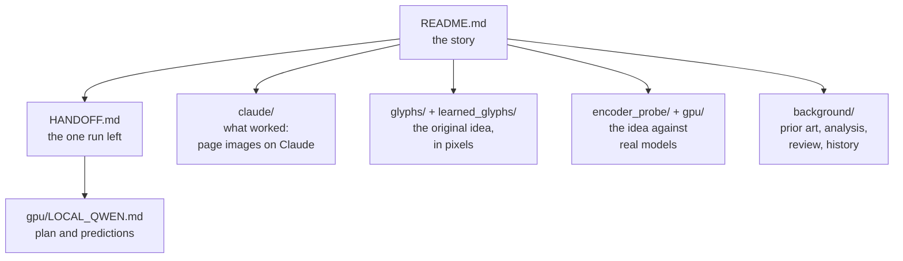

# docs/: a map of every write-up

The story in order is the top-level [README.md](../README.md); setup and working rules are in
[AGENTS.md](../AGENTS.md). **The research is wound down (2026-11-13): one run is left, and its prompt is at the
top of [HANDOFF.md](HANDOFF.md).** Every other document is a record.

Status words: **ready** = to be run; **finished** = ran and written up; **parked** = stopped part-way, can be
resumed; **closed** = will not be run; **record** = kept as written for reference.

## Start here

| Document | What it is | Status |
|---|---|---|
| [HANDOFF.md](HANDOFF.md) | The prompt for the last run (a local Qwen3.8-27B on the RTX 3090), what to send back, and what else is parked or closed on the GPU side | **current** |
| [FINDINGS.md](FINDINGS.md) | Every finding in the order it was made, with its numbers and where the rows are | current |
| [RUNNING.md](RUNNING.md) | The command for every experiment, grouped by area, with what finished and what never ran | current |
| [GOTCHAS.md](GOTCHAS.md) | Things that go wrong, by area: network, Claude as a reader, OCR, rendering, training, GPU machines, the cloud runner, git, headless agents | current |

## claude/: page images as context for Claude (the part that worked)

| Document | What it is | Status |
|---|---|---|
| [CLAUDE_QA.md](claude/CLAUDE_QA.md) | The main write-up: long documents read as page images instead of text. 2.2x fewer input tokens with no measured loss on lookups, chains and counts; the limits (small-word wording, denser pages, Haiku, pruning); every use tried | finished |
| [RAG_PLAN.md](claude/RAG_PLAN.md) | Retrieved passages as pages: plan as pre-registered and what was found (same accuracy, 27-43% cheaper). Rows: [results/rag](../results/rag/README.md) | finished |
| [SWE_IMAGES.md](claude/SWE_IMAGES.md) | Coding agents reading code and command output as pages on SWE-bench: no task lost, no saving | finished |
| [REPO_ATLAS_PLAN.md](claude/REPO_ATLAS_PLAN.md) | A whole repository as page images, read up front: seven tests and one repeat, no arm where it beats a cheaper option | finished, closed |
| [PLAN_QUALITY_TEST.md](claude/PLAN_QUALITY_TEST.md) | An orchestrator that plans from the atlas: not worth its cost | finished |
| [ERB_PLAN.md](claude/ERB_PLAN.md) | EnterpriseRAG-Bench with page images: preparation done ([results/erb](../results/erb/README.md)), test not run | parked |
| [CONTEXT_BUDGET.md](claude/CONTEXT_BUDGET.md) | What each encoding would buy in context, memory and compute on the small local model Qwen2.5-VL-3B (despite the folder, not about Claude) | record, 2026-11-05 |
| [claude-eval-notes.md](claude/claude-eval-notes.md) | Claude as a zero-shot transcriber: image-token formula, legibility threshold, cost | record |

Compaction (the session transcript kept as pages) has no document here: its write-ups are
[results/compaction](../results/compaction/README.md) and
[results/compaction_scale](../results/compaction_scale/README.md).

## glyphs/: the original idea in pixels, Phases 1-2

| Document | What it is | Status |
|---|---|---|
| [PLAN.md](glyphs/PLAN.md) | The first plan: hand-picked glyphs against Latin, with predictions and kill criteria | finished: KILL |
| [RESULTS.md](glyphs/RESULTS.md) | Results of Phases 1-2: plain Latin wins in pixels; Claude cannot be measured on coded text | finished |
| [dictionary-report.md](glyphs/dictionary-report.md) | The chunk dictionary and the first kill check (`scripts/build_data.py --report` writes it) | record |

In the package: [learned_glyphs/PLAN.md](../learned_glyphs/PLAN.md) and
[learned_glyphs/RESULTS.md](../learned_glyphs/RESULTS.md) (the learned glyph alphabet: a qualified go in pixel
space only, 0.57x Latin's pixels at 3% error), and
[learned_glyphs/docs/prior-art.md](../learned_glyphs/docs/prior-art.md) (its literature search, a record).

## encoder_probe/ (in the package): the dense codes against real vision encoders

| Document | What it is | Status |
|---|---|---|
| [RESULTS.md](../encoder_probe/RESULTS.md) | What happened when a pretrained model had to read the dense codes, rounds 1-3: they are lost | finished |
| [PLAN.md](../encoder_probe/PLAN.md) | Round 1 design (SigLIP) | finished; kept as written |
| [ROUND2.md](../encoder_probe/ROUND2.md) | Round 2 design (DeepSeek-OCR's DeepEncoder) | finished; kept as written |
| [ROUND3.md](../encoder_probe/ROUND3.md) | Round 3 (Qwen2.5-VL-3B): pixel ceiling, where the codes are lost, the fine-tune | finished at a short budget, closed |
| [RGB_OVERLAY.md](../encoder_probe/RGB_OVERLAY.md) | Design of the three-colour-layer text code | record; its own grid never ran |

## gpu/: plans and runbooks for GPU work

| Document | What it is | Status |
|---|---|---|
| [LOCAL_QWEN.md](gpu/LOCAL_QWEN.md) | **The one test left:** page images against text, and generation speed, on a local Qwen3.8-27B with no training. Pre-registered plan and runbook; results go here | **ready, not run** |
| [LOCAL_GPU.md](gpu/LOCAL_GPU.md) | Runbook for the Windows RTX 3090 PC: setup, limits, measured speeds, one section per round | reference; section 10 is current |
| [GPU_RUNNER.md](gpu/GPU_RUNNER.md) | Runbook for a rented Linux GPU, time-boxed, with blind controls | reference; used 2026-11-05 |
| [PLAN_3090.md](gpu/PLAN_3090.md) | How much a vision token carries (frozen Qwen2.5-VL: at most 12.6 bits on natural text) and the plan to train the encoder past it. Results first, then the plan and its seven amendments | capacity curve finished; training runs parked; dense-glyph and colour stages closed |
| [TEXT_SLOTS.md](gpu/TEXT_SLOTS.md) | "Test B": text compressed on the text side against page pixels. Pre-registered and built | closed, never run |
| [OWN_ENCODER.md](gpu/OWN_ENCODER.md) | Training an encoder ourselves; the one stage that ran (a text-side compressor) | inconclusive; later stages never run |
| [COLOUR_GIST.md](gpu/COLOUR_GIST.md) | Text in 2-3 colour layers, read for the gist: the model reads the layers as one blend | CPU steps finished; closed |
| [MOONSHOT_BRIEF.md](gpu/MOONSHOT_BRIEF.md) | The brief sent out for an external literature report on glyphs in three colour layers | record, kept as sent |

## background/: prior art, analysis, review, history

| Document | What it is | Status |
|---|---|---|
| [ANALYSIS.md](background/ANALYSIS.md) | The fine-tune against its blind controls: what each page delivered in bits per vision token, and where the glyph pages are lost | record, 2026-11-05 |
| [REVIEW_2026-11-11.md](background/REVIEW_2026-11-11.md) | The review that reframed the goals and proposed Tests A and B | record; acted on, then overtaken |
| [prior-art.md](background/prior-art.md) | Literature search done before the first experiments | record |
| [IDEAS.md](background/IDEAS.md) | Idea backlog with final statuses | closed |
| [research/2026-11-04_rgb3_lg_go_no_go_report.md](background/research/2026-11-04_rgb3_lg_go_no_go_report.md) | The external literature report on the moonshot code | record |
| [history/HANDOFF_2026-11-12.md](background/history/HANDOFF_2026-11-12.md) | The hand-off as it stood before the clean-up: status tables, the prompt for the parked 3090 training runs, the parked colour prompt | record |
| [history/HANDOFF_2026-11.md](background/history/HANDOFF_2026-11.md) | Session hand-offs of 2026-11-04/05 | record |

## Elsewhere

* [results/README.md](../results/README.md): where each stage's rows live; each Claude test has a README with its
  pre-registration and result in its folder under `results/`.
* [experiments/readhook/README.md](../experiments/readhook/README.md): the hooks that show files and command
  output to a coding agent as page images.
* [scripts/README.md](../scripts/README.md): setup, housekeeping and figure scripts. Figures live in `img/` and
  are drawn by `scripts/make_*_figures.py`.

`python3 scripts/check_links.py` checks every link in these files.
