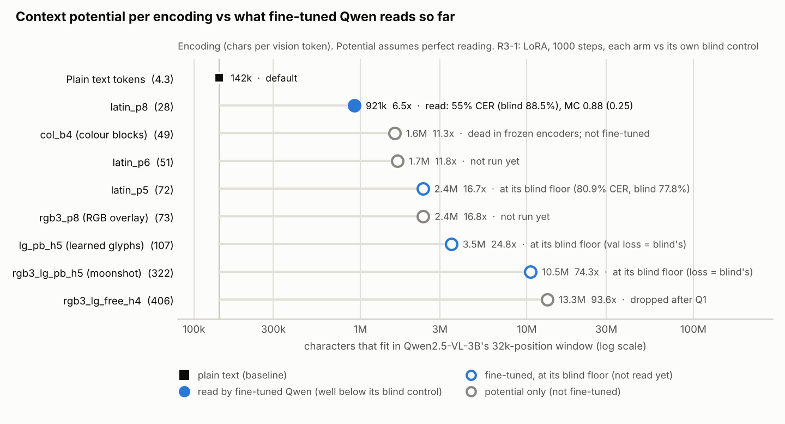

# Visual BPE: results so far (living document)

Status: **2026-11-05.** Current hand-off and next steps: [HANDOFF.md](HANDOFF.md).

| Line of work | Verdict | Section |
|---|---|---|
| Phases 1-2: hand-designed glyph substitution / quadrant packing vs Latin | **KILL**: plain Latin wins | [Kill criteria](#kill-criteria-pre-registered-in-planmd) |
| Learned glyph alphabet (pixel space, own reader) | **qualified GO**: 0.57x Latin's px²/char | [Learned glyphs](#learned-glyph-alphabet-learned_glyphs-qualified-go) |
| Frozen encoders (SigLIP, DeepEncoder) | dense codes lost; colour dead; banks whole-pixel | [Frozen-encoder probe](#frozen-encoder-probe-encoder_probe-colour-pixels-dead-learned-glyphs-whole-pixel) |
| Round 3: Qwen2.5-VL-3B (frozen probes + LoRA fine-tune) | only latin_p8 (28 chars/token) read so far; G3 undecidable | [Round 3](#round-3-qwen25-vl-3b-can-a-small-vlm-learn-to-read-dense-codes) |

Metric throughout: **px²/char** = canvas area / source characters. **P@x** = px²/char at which CER
first reaches x (isotonic fit, log-x interpolation). Lower is better.

## One-paragraph answer

Hand-designed Visual BPE (one CJK proxy glyph per frequent character chain, or Hangul-style quadrant
packing) does **not** beat ordinary condensed Latin text per pixel:
* with a zero-shot OCR reader (PP-OCR), it reaches 10% CER at only 0.89× Latin's pixels (pre-registered bar: 0.80×) and is worse at 3% CER;
* with a reader trained from scratch on each scheme to convergence (Phase 2, CRNN), plain DejaVu Latin is the most pixel-efficient scheme at every error level we measured; substitution needs ≥1.18× its pixels at 3% CER (K3 required ≤0.70×);
* quadrant packing needs about 2× the pixels of Latin.

Claude cannot be used to score any non-natural rendering at all (safety classifiers refuse).

What does work is **learning the glyphs** (`learned_glyphs/`). An alphabet optimised jointly with a reader, with ~300 chain
tokens, needs 0.57× Latin's pixels in the unchanged Phase-2 pipeline and 0.63–0.74× with a fresh reader, and it survives a
harsh channel. Part of the gain is grey-level coding, and the densest alphabets are brittle on unseen degradations.

Through pretrained VLMs the dense codes have not survived so far: frozen SigLIP and DeepEncoder lose every dense
code (`encoder_probe/`), and after a short LoRA fine-tune Qwen2.5-VL-3B reads Latin at 28 chars/token but none of the
denser codes (round 3, below). The longer fine-tune that decides G3 has not run yet.

## Kill criteria (pre-registered in PLAN.md)

| ID | Test | Result | Verdict |
|---|---|---|---|
| K1 | substitution saves ≥15% line width vs condensed Latin (analytic) | 32% at N=1000 → only 1.19× larger em on a fixed page | pass (weak) |
| K2 | zero-shot reader: subst ≥20% fewer px² at 10% CER | PP-OCR: 0.89× at 10%, 1.17× (worse) at 3%; scrambled text gives the same → not a language-prior artefact | **negative** |
| K3 | trained reader: subst P@3% ≥30% below best Latin | converged (10.5k steps): latin 1.73% CER at 7.5 px²/char; subst300 2.26% at 8.9; subst1000 5.75% at 7.8 → subst ≥1.18× **worse** | **KILL** |
| P1 | quadrant needs ≥30% more px² | quad3 ≥3.2×, quad4 ≥3.4× vs converged Latin (quad at 3.5k steps) | confirmed |

## Readers

* **Claude (natural Latin only):** DejaVu Sans P@3% = 29.4 px²/char [28.6, 30.2] ≈ 37 vision tokens per
  1k chars (~6.7× text-token cost). Condensed fonts are *worse* for Claude (1.11–1.2×).
* **PP-OCR (rapidocr, zero-shot):** see `results/phase1b/summary/`.
* **CRNN trained per scheme and em (Phase 2):** see `results/phase2/merged/` (longest run per scheme and em).
  This is far more pixel-efficient than Claude (latin_condensed ≈ 12 px²/char at 3% CER vs Claude's 29), because
  the reader is specialised to a single font and has no "natural image" overhead.

## Phase 2 detail (longest run per scheme/em: `results/phase2/merged/`)

Frontier points (10.5k steps unless noted):

| scheme | em | px²/char | CER |
|---|---|---|---|
| latin (DejaVu) | 3.5 | 7.53 | 1.73% |
| latin | 4 | 9.84 | 0.58% |
| latin | 5 | 15.39 | 0.10% |
| latin_condensed | 4.5 | 9.02 | 2.43% |
| latin_condensed | 5 | 11.15 | 0.92% |
| subst300 | 5 | 8.91 | 2.26% |
| subst300 | 6 | 12.84 | 0.67% |
| subst1000 | 5 | 7.81 | 5.75% |
| subst1000 | 6 | 11.26 | 1.01% |
| quad3 / quad4 (3.5k) | 10 | 26.0 / 23.3 | 2.1% / 3.5% |

Why substitution loses even with a trained reader: a 1000-token dictionary saves ~32% of line *width*
(K1), but each proxy glyph must still be legible at that em. A CJK ideograph has far more detail than a
Latin letter, so it needs a larger em to reach the same symbol error rate, and that eats the width saving.
Each symbol error also costs several characters (a whole token), not one.

Convergence mattered a lot: at 3.5k steps subst1000 em7 had 5.6% CER and 10.5k steps brought it to 0.58%.
But Latin improved just as much (em4 2.5% → 0.58%), so the verdict did not change.

**Bug found and fixed (2026-11-03):** latin em4 first scored 62% CER because its test and val sets came from an old
render cache. That cache was written before per-line heights were stored, so its lines were one pixel row taller
than the training batches. The same checkpoint scores 3.8% on fresh renders. Affected rows are in
`runs_stale_cache.jsonl` and were re-run. Plain DejaVu Latin is the best scheme once this is fixed.

## Learned glyph alphabet (learned_glyphs/): qualified GO

Full report: **`learned_glyphs/RESULTS.md`**. Summary (converged, 10.5k steps; baseline = converged Phase-2 DejaVu, P@3% 6.54, P@1% 8.92 px²/char):

| | P@3% | P@1% | vs Latin (3% / 1%) |
|---|---|---|---|
| learned N=300, bridge (frozen bank, unchanged Phase-2 pipeline) | 3.75 | 5.10 | **0.57 / 0.57** |
| learned N=300, E2 transfer (fresh reader) | 4.83 | 5.66 | 0.74 / 0.63 |
| learned N=300 whole-pixel, bridge | 5.73 | 6.91 | 0.88 / 0.77 |

* Harsh channel (h7): learned 3.45% CER vs DejaVu 42.8%, so the gain grows under degradation.
* Chain tokens add to the better shapes: at ~0.6% CER, N=300 needs 0.74× the pixels of chars-only learned glyphs.
* Caveats: part of the gain is grey-level coding (whole-pixel banks win by only 12–23%); dense banks reach 55–68% CER on unseen
  degradations. ~~No VLM encoder tested~~ (superseded 2026-11-05: frozen VLM encoders lose the banks, and a
  1000-step Qwen fine-tune does not read lg_pb_h5; see the two sections below).
* The round-by-round history (including interim conclusions later reversed) is in this file's git history and `results/queue*.txt`.

## Frozen-encoder probe (encoder_probe/): colour pixels dead, learned glyphs whole-pixel
Question: does a frozen pretrained vision encoder keep the fine pixel and colour detail that colour-pixel encoding
and grey-level learned glyphs depend on? Each 224x224 page is encoded with SigLIP-B/16 (last layer, plus layer 6 as
a post-hoc control) or with identity patches (the ceiling), clean or JPEG q75. An identical CTC probe (with an
auxiliary pixel-reconstruction loss) then reads the text back from the 196 tokens. Details, tables and every probe
change are in encoder_probe/RESULTS.md and PLAN.md.
* Identity ceiling: colour 1x1 blocks 0.06% CER (256 chars/token); lg_free_h4 0.01% vs lg_pb_h4 2.6% at 5.9
  px²/char; Latin C@3% = 34 chars/token. JPEG q75 without an encoder only breaks 1x1 colour (28.8%); 2x2+ colour
  keeps C@3% = 71 chars/token (3x Latin).
* Through SigLIP: colour never below 62% CER (all block sizes, both layers, clean and JPEG). For 1-3 px blocks even
  the training loss stays at the unigram plateau. Last layer: every encoding 58-85%. Layer 6: Latin 4.9% only at
  122 px²/char (2.1 chars/token, below text tokens), lg_pb 53-55% vs lg_free 76-85%.
* Decision rules: colour >= 2x Latin through siglip/jpeg75 **fails** (colour never reaches 3% or 10%). Grey-level
  banks only if they still beat whole-pixel ones through the encoder **fails**, so use whole-pixel banks.
* Caveat: through SigLIP the probe overfits (1000 instead of 200 train pages: latin_p10 61% -> 43%), so these are
  upper bounds on the information lost, not what an LLM reading the tokens would get. VLMs that fine-tune the
  encoder are not covered here (round 3 starts on that).

**Round 2: DeepSeek-OCR's DeepEncoder (OCR-trained, 512 px page, 64 tokens of 1280-d).** SigLIP has no OCR
training, so round 2 repeats the probe on the encoder of an OCR-capable VLM at its own geometry (Qwen2.5-VL was
dropped from round 2 and became the round-3 model; details in encoder_probe/ROUND2.md and RESULTS.md). With raw pixels at the same geometry every encoding is
below 3% CER (colour 1x1 blocks 2.9%, everything else <= 0.5%), so all DeepEncoder rows pass the informativeness
guard. Through the encoder (1000 train pages, clean and JPEG q75) colour blocks (71-73%), rgb3 (83.5%) and both
learned-glyph banks (lg_free_h4 82.2% vs lg_pb_h5 82.4%) sit at the floor at every density, while only latin_p32
(8.5 chars per vision token, about 2x text tokens) is readable (19%, JPEG costs nothing); from 15.4 chars/token up
Latin is at the floor too. No family reaches 10%, so both decision rules apply only in weaker form: colour and the
RGB overlay are dead for DeepEncoder (it would need an encoder trained for them; P2/P3 gated off), and grey-level
banks are not supported (0.2 points, both at the floor), so banks stay whole-pixel. Caveat: this probe is far
weaker than DeepSeek-OCR's own decoder (~10x compression); latin_p32 still improves with data (85% -> 15% CER from
200 to 5000 pages), so the absolute CERs overstate what the encoder loses; only the same-probe comparisons carry
the decisions.

## Round 3, Qwen2.5-VL-3B: can a small VLM learn to read dense codes?
Design, gates and amendments: [encoder_probe/ROUND3.md](../encoder_probe/ROUND3.md); context arithmetic:
[CONTEXT_BUDGET.md](CONTEXT_BUDGET.md). Densities are chars per Qwen vision token (448 px page, 256 tokens; text
tokens are 4.33 chars). The moonshot `rgb3_lg_pb_h5` is an RGB overlay of three learned-glyph pages (322 chars/token).

| Step (2026-11-04/05) | Result | Reading |
|---|---|---|
| G0: moonshot from raw pixels (identity28 probe, 200 pages, CPU) | **1.07% CER** | the page itself is readable (go bar 3%) |
| Q1: linear pixel readout of the frozen Qwen ViT | glyph codes stay pixel-like to the last block (moonshot ink MCC 0.48 final), no colour-channel collapse; **every code collapses linearly at the 2x2 merger** (0.29) | Latin also fails this test and is still read by Qwen, so it is a lower bound, not a readability score |
| G2-lite: CTC probe on frozen ViT states, 3 arms (500 pages, 3000 steps, CPU) | moonshot frozen merger 86.1%, trained merger 84.6% (~15% of chars matched), no merger 71.9% (**~29%** matched); blind floor 99.5% | pre-registered branch **"the ViT output is the wall at this budget"**; the probe under-reads Latin, so no Latin comparison |
| R3-1: LoRA r=16 + merger + last 4 ViT blocks, LLM as reader (1000 steps, RTX 4090, each arm with a blind control) | only **latin_p8** (28) is read: 55.0% CER vs blind 88.5%, MC 0.88 vs 0.25; latin_p5 (72) gets the gist only (val loss 10% below blind, MC 0.56 vs 0.28, p = 0.02; CER at its floor); lg_pb_h5 (107) and the moonshot are not read (loss = blind's) | **G3 undecidable** (no arm near 3% CER); short budget, so the dense codes are undecided, not failed |

* latin_p8 transcribes the first line(s) of each window nearly exactly, then drifts into fluent invented text; its
  loss was still falling at 1000 steps. The moonshot's losses equal its blind run's to 3 decimals.
* Blind floors differ by code (latin_p5 77.8%, latin_p8 88.5%, moonshot 89.9%), so each arm needs its own control.
* Analysis against the blinds (exact tests, bits per vision token, where the information is lost): [ANALYSIS.md](ANALYSIS.md).
* Rows: `encoder_probe/results/{round3_cpu_tp200,quick_q1,g2lite*,round3_ft_gpu3h,round3_ft_gpu3h_blind}/`.
* Since then (2026-11-06): own-encoder Stage 0 was inconclusive ([OWN_ENCODER.md](OWN_ENCODER.md)). The current
  direction is gist through colour channels ([COLOUR_GIST.md](COLOUR_GIST.md)). Untrained Qwen reads 2-stream
  Latin overlays as one blended text (R(2) = 0.51); a CPU LoRA-only fine-tune reached R(2) = 0.72 against the
  > 1 target. Next: a GPU run training the ViT from block 16. See [HANDOFF.md](HANDOFF.md).

