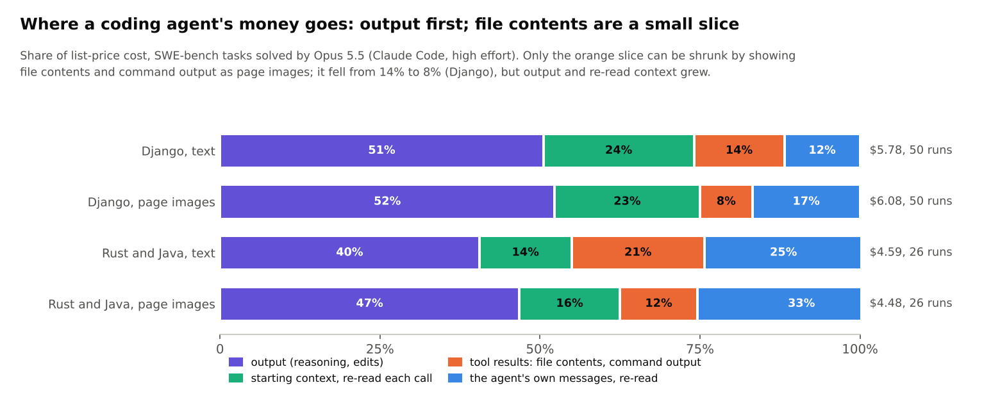
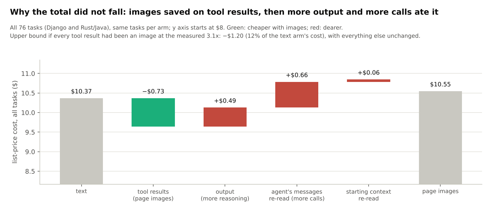

# Coding agents reading page images: SWE-bench results, and why the cost does not fall

*2026-11-11.* Claude Code with Opus 5.5 (high effort) solved real SWE-bench tasks twice: once reading code and command
output as text, once through the vbhook hooks, which show file contents and long command output as page images at
88.2 px² per character (the density where Opus answered document questions as well as from text). Details:
[Django](../results/readhook_swe/README.md), [Rust and Java](../results/readhook_swe_ml/README.md), hooks
[`experiments/readhook/vbhook/`](../experiments/readhook/vbhook/), analysis
[`experiments/readhook/swe/analyse.py`](../experiments/readhook/swe/analyse.py).

## The answer

* **Images cost no tasks.** Django: 50/50 resolved with text and 50/50 with images. Rust and Java: 26/26 and 26/26 so
  far (ruff still running). Every task was one recent Opus models solve, so this rules out a large accuracy loss, not
  a small one.
* **Images were 3.1x cheaper than the text they replaced** (85k image tokens for 265k tokens of text).
* **But the total did not fall: $10.55 with images against $10.37 with text** over the 76 finished tasks. The reason is
  the one you suspected: **coding is not dominated by reading.** File contents and command output are about 17% of
  what the agent costs; even if all of it were 3.1x cheaper, the run would cost at most 12% less. The image arm then
  spent that saving on more output and more calls.

*How to read it:* each bar is 100% of the list-price cost of one arm; the slices are what the money paid for. Orange
is the only slice page images can shrink.

## Where the money goes

Every API call in an agent run re-sends the whole conversation. New content is paid once as a cache write ($5 per
million tokens) and then on every later call as a cache read ($0.20 per million, 0.05x the input price); output costs
$20 per million (prices fitted exactly from the CLI's own cost, 100 runs). Across the 76 text-arm runs:

| slice | share of cost | what it is |
|---|---|---|
| output | **46%** | the model's reasoning, tool calls, edits and answers |
| starting context | 20% | Claude Code's system prompt, tool definitions and the issue: ~6.9k tokens re-read on every call |
| the agent's own messages | 18% | earlier reasoning and tool calls, re-sent as context |
| tool results | **17%** | file contents, test output, grep results: the only part images change |

Three things keep the tool-result slice small:

1. **The agent reads selectively.** A median of 6-7 calls per task, mostly `grep` and `sed -n` of a few dozen lines. Short
   output stays text (an image costs at least ~140 tokens), so only ~2.5 views per task became images.
2. **Re-reading is cheap.** Caching makes every re-read 25x cheaper than the first time content is sent (a cache write), so a file's main cost is the one
   write when it first appears, not the turns it stays in context.
3. **Output is expensive and untouched.** Output tokens cost 5x the input price; reasoning about a fix costs more than
   reading the code it touches.

## Why the image arm did not come out ahead

*How to read it:* the grey bars are the two arms' total cost over the same tasks; the steps between them are the
change in each slice. The y axis does not start at zero.

* **Tool results: −$0.73.** The images did what they should.
* **Output: +$0.49** (263k output tokens against 239k, +10%). The model reasons a little more when it reads images,
  and it re-checks exact text before editing: Claude Code requires an Edit's `old_string` to match the file exactly,
  so the agent sometimes prints lines again (e.g. `sed -n ... | cat -A`) before it edits.
* **Re-read context: +$0.72.** More calls (median 7 against 6), each re-sending the conversation, plus the hooks'
  short format notes.

## Where page images do pay off

The same images save money when reading is most of the input. In the [Claude QA tests](CLAUDE_QA.md), where the model
answers questions about one long document or a set of research sources, the document is ~95% of the input: 2.2x
pages cut the cost per call about in half with no measurable loss for Opus, and in the deep-research variant pages
were lossless (99.7% against 99.4% from text, 360 questions). For coding agents the picture would change with:

* **Reading-heavy work:** repository-scale exploration, large files read whole, long logs, reviews of big diffs.
* **Long sessions:** content that stays in context for hundreds of calls costs more in re-reads than these 7-call tasks.
* **Fewer verification turns:** an Edit that does not need exact text (or a hook-visible fallback) would remove the
  re-check calls.
* **Older context instead of tool results:** rendering the conversation history itself as pages, rather than only new
  tool results, targets the slice that grew (the agent's own messages, 18-24%).

## Method and caveats

* **Tasks:** SWE-bench Verified Django tasks that both newest Opus leaderboard submissions solved (hardest first, 50
  of 56 valid), and SWE-bench Multilingual Rust and Java tasks both Opus submissions solved (47 selected; valid here:
  ripgrep 2, bat 5, axum 3, tokio 8, coreutils 2, ruff 4, Lucene 4, Druid 1). Choosing solvable tasks isolates the
  effect of images on reading, but leaves no room to see a small loss.
* **No Docker:** each task was graded with its own test command in a local environment. The gold patch had to pass
  and the unpatched code to fail; tests that fail even with the gold patch here were left out for both arms. Some
  tasks could not be graded here: Django 3.0-3.2 run on Python 3.8 (SWE-bench uses 3.6); only JDK 21 was available
  (gson, javaparser, RxJava and some Lucene and Druid tasks failed validation); Lombok needs Apache Ant, which could
  not be installed; nushell's tests did not pass with the gold patches.
* **One model, one harness:** Opus 5.5 at high effort in Claude Code. Costs are list prices (subscription quota in
  practice). Text tool-result tokens are estimated from length (2.6 characters per token).
* **Engineering notes:** making the hooks behave took several fixes, each written up in
  [`results/readhook_smoke/README.md`](../results/readhook_smoke/README.md) and the hooks' code: Claude Code checks an
  Edit's `old_string` before hooks run (so code pages are edit-safe: spaces kept, indentation shown as `»`); it does
  not run PostToolUse for failed commands (so every command gets an exit-code line); compound commands that print
  several files are split per file. The harness also had to stop test processes that outlived their test run.
