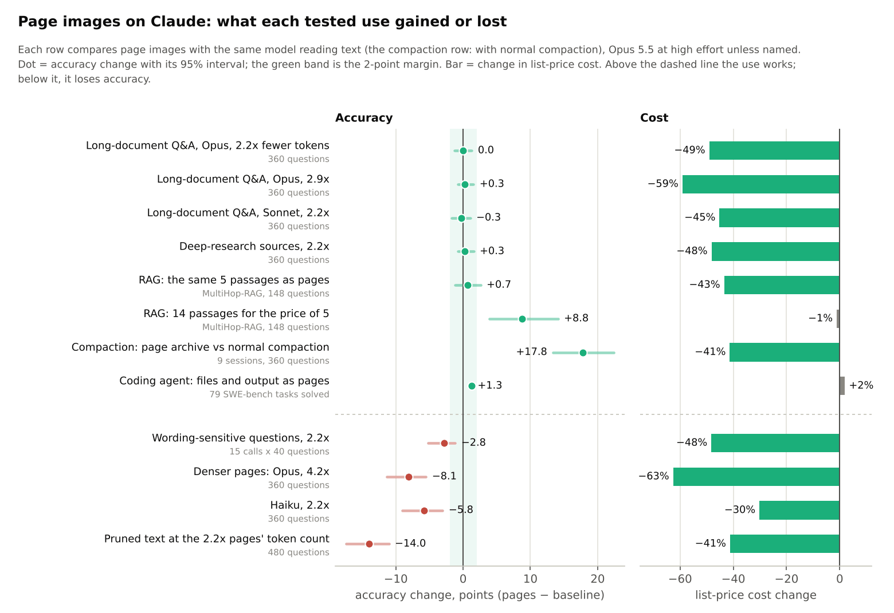
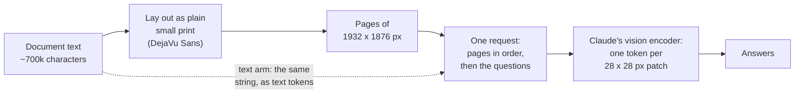
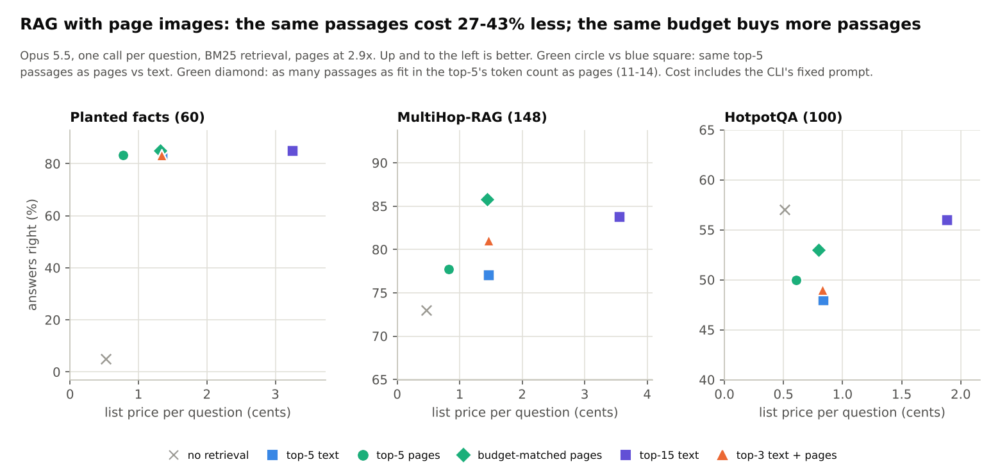
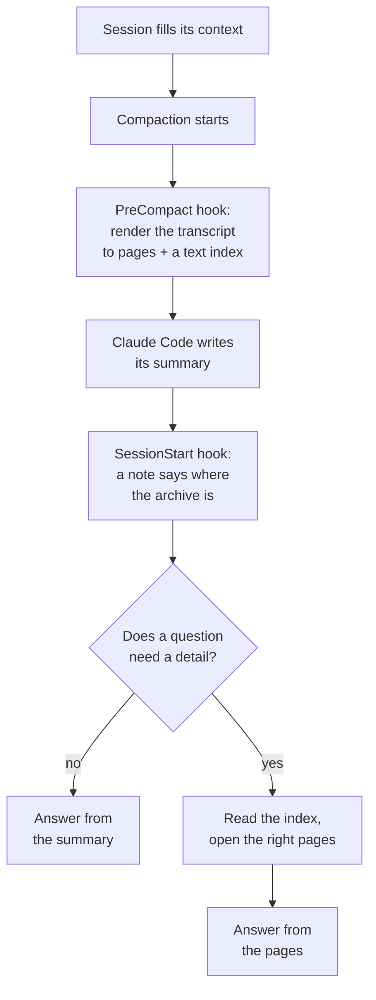
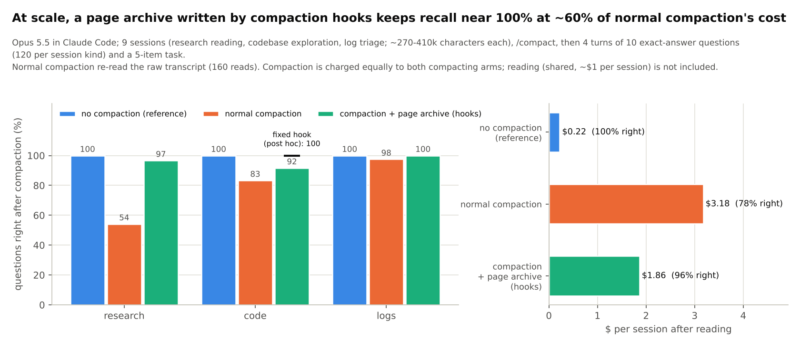
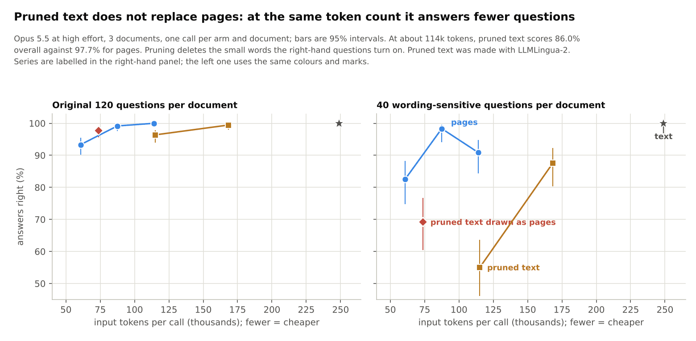
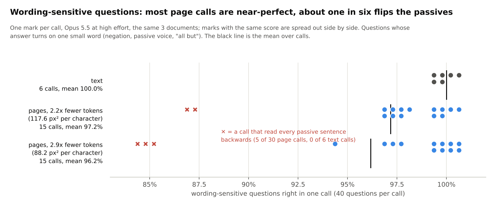
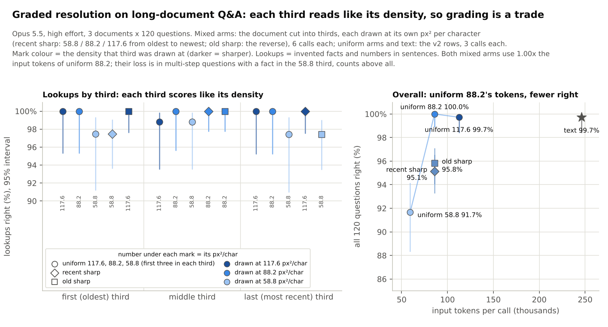
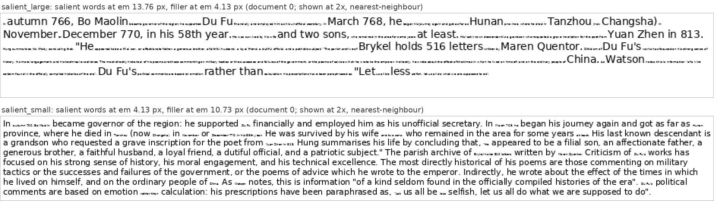
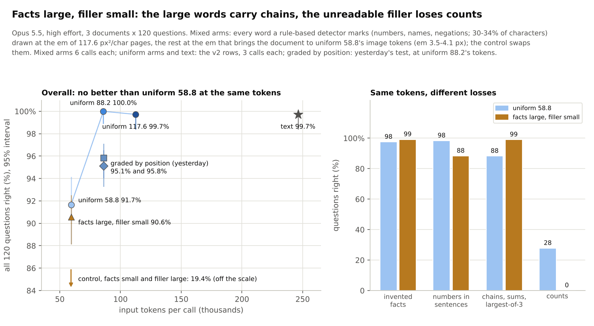

# Page images as context for Claude: what works, what does not

*Status: finished (tests run 2026-11-10 to 2026-11-12; this write-up reorganised 2026-11-12). Nothing here is
waiting to be run. The one open follow-up is the same test on a local model:
[LOCAL_QWEN.md](../gpu/LOCAL_QWEN.md).*

**The question.** A long document can be given to Claude as text, or drawn as page images of ordinary small print.
The images use fewer input tokens. How many fewer before the answers get worse, and for which kinds of work does
the saving hold?

This is the main write-up. It gives the answer, then one table of every use that was tried, then each test in turn.
The full tables are in [Data](#data) at the end.

## The answer

* **Opus 5.5 answers as well from pages as from text at 2.2x fewer input tokens**, at low and at high effort, on
  lookups, chains of facts, sums and counts (360 questions per setting). At high effort it also does at 2.9x.
  At list price a 2.2x page call costs about half a text call ($0.68 against $1.34).
* **Sonnet 5.5 does the same at 2.2x at high effort** ($0.37 against $0.67 per call). At low effort the estimate is
  the same (−0.3 points) but the worst case, 2.2 points, is just outside the margin.
* **Haiku 5.5 loses accuracy at every density tested** (−5.8 points already at 2.2x). For Haiku, text is the
  better input.
* **Denser pages break the links between facts first.** At 4.2x fewer tokens Opus still finds single facts (98%)
  but gets only 67% of three-step chains and 28% of counts right (high effort).
* **One exception at the safe density: questions whose answer turns on one small word** (negation, passive voice,
  "all but"). Pages lose about 3 points on these at 2.2x and 2.9x alike, and in about 1 page call in 6 every
  "A was paid n by B" sentence is read the wrong way round. Text never did that.
* **The saving carries over to other reading-heavy uses:** research sources, retrieved passages (RAG) and, most
  clearly, an archive of the session transcript that survives context compaction. It does not lower the cost of a
  coding agent, because reading is a small part of what a coding agent pays for.
* **Three things that do not work:** pruning words from the text instead of drawing it; a whole repository as page
  images (the "repo atlas"); and coded or scrambled pages, which Claude's safety classifiers refuse.

"As well as" has a precise meaning here, fixed before the runs: the 95% interval excludes a loss larger than
2 points. It is not a claim of exactly zero loss. See [Terms](#terms).

## Every use that was tried



*How to read it:* one row per tested use. The dot is the change in accuracy from using page images, in points, with
its 95% interval; the green band is the 2-point margin. The bar is the change in list-price cost. Rows above the
dashed line keep their accuracy; rows below it lose some. The compaction row compares against normal compaction,
not against text; the coding row counts solved tasks (79 against 78 of 79) and has no interval.

Opus 5.5 at high effort unless the row says otherwise. "Works" means no measured loss against the same model
reading text, at lower cost.

| Use | What was tested | Result | Verdict |
|---|---|---|---|
| Long-document Q&A | 3 documents of ~240k tokens, 120 questions each, pages at 2.2x / 2.9x / 4.2x fewer tokens, three models | 2.2x: no measured loss for Opus (both efforts) and Sonnet (high effort); Opus also at 2.9x (high effort); Haiku loses 5.8 points | **Works** at 2.2x on Opus and Sonnet. [Test 1](#test-1-long-document-qa) |
| Deep-research sources | 3 sets of 34-50 articles, 360 questions | 99.7% from pages against 99.4% from text at half the cost; keeping only notes loses 29 points | **Works.** [Details](#tested-deep-research-sources) |
| Retrieval (RAG) | 308 questions, 3 datasets, BM25 retrieval | the same passages as pages: same accuracy, 27-43% cheaper; the same budget spent on more passages: +8.8 points on multi-hop questions | **Works.** [Details](#tested-retrieval-rag) |
| Context compaction archive | the transcript kept as pages and opened on demand, real Claude Code hooks, 9 sessions | 96-99% of questions answered against 78% after normal compaction; 2.1x cheaper per correct answer | **Works**, the strongest result. [Details](#tested-context-compaction) |
| Coding agents | file contents and command output as pages, 79 SWE-bench tasks | no task lost; total cost unchanged ($10.82 against $10.61) | **Works, does not pay.** [Details](#tested-coding-agents) |
| Questions that turn on one small word | 40 extra questions per document, 15 calls per density | 97.2% (2.2x) and 96.2% (2.9x) against 100% from text; 5 of 30 page calls read every passive backwards | **Limit**: about 3 points lost. [Details](#tested-repeat-calls-on-wording-sensitive-questions) |
| Denser pages | 4.2x fewer tokens; 7.8x in the first exploratory run | Opus −8.1 points (high effort) to −15.3 (low) at 4.2x, chains and counts first; 7.8x fails outright (33-42%) | **Fails** beyond ~3x. [Details](#where-it-breaks) |
| Graded resolution (old text blurrier, or the reverse) | thirds of the document at 4.2x / 2.9x / 2.2x, 12 calls | each third reads like its density; at equal tokens 3-5 points below uniform 2.9x pages | **A trade, not a gain**; [details](#further-work-first-look-graded-resolution-2026-11-13) |
| Facts large, filler small (a rule-based detector picks what to enlarge) | marked words at the 2.2x size, filler shrunk to the 4.2x pages' tokens, 15 calls | 90.6% against 91.7% for uniform 4.2x pages: no gain overall; chains 100%, wording-sensitive questions 100%, counts 0% | **Moves the loss, does not remove it**; [details](#further-work-first-look-facts-large-filler-small-2026-11-13) |
| Pruned text instead of pages, or under them | LLMLingua-2 word pruning, 480 questions | 86.0% against 97.7% for pages at the same tokens; pruned text drawn as pages no better than denser pages | **Fails.** [Details](#tested-pruned-text) |
| Coded or scrambled pages | glyph codes, substitution ciphers, word-scrambled English (the project's original idea) | refused or cut off by safety classifiers | **Not possible** on Claude. [glyphs/RESULTS.md](../glyphs/RESULTS.md) |
| A local model (Qwen3.8-27B) | not run | plan and harness ready | **Planned.** [LOCAL_QWEN.md](../gpu/LOCAL_QWEN.md) |

**A whole repository as page images (the "repo atlas").** Seven tests and one repeat; no arm where the atlas beats
a cheaper option. The full report is [REPO_ATLAS_PLAN.md](REPO_ATLAS_PLAN.md); the rows below were checked against
each test's README and summary.

| Atlas test | What was tested | Result | Verdict |
|---|---|---|---|
| Locating a bug fix | 8 SWE-bench tasks, 5 arms | every arm names every changed file, even a bare file list; a searching agent costs $0.04 per task, the atlas $0.23 | **Not separable** (memorised tasks). [pilot](../../results/atlas/pilot/README.md) |
| Questions about a repository | SWE-QA, 144 questions on requests, flask, pytest | judge score of 100: atlas 75.4, no code at all 75.6; only an agent that searches the checkout beats memory (79.1) | **Fails** on code the model knows. [qa](../../results/atlas/qa/README.md) |
| Finding a security flaw | 12 advisories published after the model's training data | atlas alone 9 of 12, a bare file list 10; agent with the atlas 10 against 7 for the plain agent (p = 0.25), at $0.67 against $0.46 | **Atlas alone fails; with an agent an unrepeated hint.** [sec](../../results/atlas/sec/README.md) |
| Hard coding tasks | 16 SWE-rebench tasks, Claude Code plain / with a repo map / with the atlas, one run each | solved 8 / 9 / 11; 2.6x the cost with the atlas ($0.68 against $0.26) | **A hint that did not repeat** (next row). [swe](../../results/atlas/swe/README.md) |
| The same tasks again, twice | 64 runs, auto-memory off | task-runs solved of 32: plain 19, atlas 17; atlas 3.1x the cost | **No effect; the hint was run-to-run variation.** [swe_rerun](../../results/atlas/swe_rerun/README.md) |
| The same tasks on Sonnet | 64 runs, high effort | plain 14 of 32, atlas 13; atlas 3.7x the cost ($0.26 against $0.07) | **No effect.** [swe_sonnet](../../results/atlas/swe_sonnet/README.md) |
| Migrating C to Rust | 14 CRUST-Bench projects, 3 arms | 12 of 14 pass all tests in every arm, including the arm with only the pages | **No effect.** [migrate](../../results/atlas/migrate/README.md) |
| A larger port, Go to Rust | gitleaks, 22k lines, one run per arm | both pass 35 of 35 hidden tests; $11.32 against $11.20 | **No effect** (an anecdote). [port](../../results/atlas/port/README.md) |
| An orchestrator plans from the atlas | 33 tickets x 4 planners, then 16 tickets given to workers | atlas briefs name 50.1% of the fix's files, a bare file list 48.1%, at 8x the cost ($0.41 against $0.05 per brief) | **Fails as proposed.** [plan_quality](../../results/atlas/plan_quality/README.md) |

## How a document becomes pages



Nothing is encoded or abbreviated: the page is the document's own words in ordinary letters, only small. The
saving comes from the tokenizers. As text, Claude's tokenizer takes about 2.9 characters per token on this
material. As an image, one vision token covers a 28 x 28 pixel patch, and at the 2.2x setting that patch holds
about 6.7 legible characters.


*The top of the first test page of document 1, exactly as sent, at actual pixels.* Each page is 1932 px wide and
1876 px tall and costs 4,626 tokens. 1932 px is the largest side these models read without downscaling (checked
for all three). A document takes 23-24, 18 or 12 pages at the three densities, and the font shrinks from 13.8 px
to 9.8 px. A vision token carries about 6.7 characters at 2.2x and 13.3 at 4.2x.

## Terms

* **Nx fewer tokens:** input tokens of the text call divided by input tokens of the page call. Both include about
  6k tokens of instructions and questions. Measured: 2.19x, 2.87x and 4.15x, written 2.2x, 2.9x and 4.2x. For the
  document alone the savings are 2.26x, 3.0x and 4.5x. Later tests with more questions per call measure 2.18x and
  2.85x for the same pages.
* **px² per character:** page area divided by the characters on the page. Lower means smaller type. The three
  settings are 117.6 (2.2x), 88.2 (2.9x) and 58.8 (4.2x).
* **Effort:** the Claude Code `--effort low|high` setting, which controls how much the model reasons before it
  answers.
* **Lossless:** the test fixed before the runs. The losing end of the 95% interval of the accuracy change is
  smaller than 2 points, so a loss larger than 2 points is excluded. It is a non-inferiority margin, not a claim
  of zero loss.
* **Worst:** that losing end of the interval.
* **Loss:** the 95% interval excludes 0 and the exact McNemar test (a paired test on the questions where the two
  inputs disagree) rejects at p < 0.05.
* **Lookups:** single-fact questions. **Multi-step:** two-hop and three-hop chains, sums, largest-of-three and
  counts across the document. In the result files `needle` and `number` are the lookups and `complex` the
  multi-step questions.
* **Wording-sensitive (small-word) questions:** questions whose answer depends on one small word in the sentence,
  with the wrong reading's number offered as a lure ("A was paid 194 by B": how much did B pay?).
* **List price:** what the calls would cost at published prices. These calls drew on a subscription quota, so no
  figure here is an amount billed.

## Test 1: long-document Q&A

*2026-11-10. Opus 5.5, Sonnet 5.5 and Haiku 5.5; 3 documents; 120 questions per document; pre-registered.*

Each document (~240k tokens of text) is given three ways: as text, as page images at three densities, and not at
all. Every arm gets the same 120 questions with exact numeric answers, scored automatically. Design details are in
[How the tests work](#how-the-tests-work).


*How to read it:* each cell compares page images with text on the same 3 documents and questions. The big number
is the accuracy change in points (image − text: negative means worse than text); "worst" is the losing end of the
95% interval; ✓ marks the pre-registered lossless verdict. Colour runs from green (no loss) through yellow to red
(large loss). Numbers: [A1](#a1-opus-55), [A2](#a2-sonnet-55) and [A3](#a3-haiku-55).

| Model | 2.2x | 2.9x | 4.2x |
|---|---|---|---|
| Opus 5.5, high effort | 0.0, **lossless** | +0.3, **lossless** | −8.1, loss |
| Opus 5.5, low effort | −0.3, **lossless** | −1.1, not shown lossless | −15.3, loss |
| Sonnet 5.5, high effort | −0.3, **lossless** | −1.7, borderline | −13.9, loss |
| Sonnet 5.5, low effort | −0.3, worst case 2.2 points | −3.1, loss | −21.7, loss |
| Haiku 5.5, high effort | −5.8, loss | −11.1, loss | −52.5, loss |

Haiku at low effort is excluded: it did not reason over the text at all, so its text score is not a reading
measurement ([A3](#a3-haiku-55)). On multi-step questions alone Opus showed no loss at 2.2x either (0.0 and +0.8
points), but with 120 such questions a loss of up to about 3 points cannot be excluded.

### How fast it falls


*How to read it:* each line starts at 0 (the model reading text) and shows the accuracy change as the pages get
denser, at high effort. The dashed band is the 2-point margin; the background runs from green (no loss) to red.

* **By point estimate, Opus and Sonnet stay within 2 points up to 2.9x.** By the pre-registered worst case, Opus
  is lossless to 2.9x and Sonnet to 2.2x. Haiku leaves the band at the first step.
* **Multi-step questions lose about 2.5 times as many points as the overall score** for Opus and Sonnet, and 1.5
  times for Haiku: at 4.2x they lose 20, 35 and 81 points.
* **Still denser pages fail.** This repo's earlier transcription test found that Claude reads a page aloud at 3%
  character error down to 29.4 px² per character ([glyphs/RESULTS.md](../glyphs/RESULTS.md)). That density would be
  about 8.5x here. In the exploratory runs it answered 33-42% of questions against 100% from text
  ([A5](#a5-earlier-exploratory-runs)): being able to transcribe a page is not being able to use a document.

### Where it breaks


*How to read it:* columns are question types, one block of rows per model. The grey row is the model reading text;
the coloured rows are the same model reading pages, from green (no loss against the grey row) to red. A small
"+1 q" marks the four cells where pages got 1-2 more questions right than text; that is noise, not a gain.

* **Lookups and sums survive the longest.** At 4.2x and high effort Opus still gets 97.5% of invented facts, 98.3%
  of numbers in sentences and 100% of sums. (Sums and largest-of-three add up facts that are also asked as
  separate questions in the same call, so they partly reuse that work.)
* **Chains and counts fail first.** At 4.2x Opus gets 67% of three-hop and 28% of count questions right. Wrong
  two-hop answers are usually another club's boat count: the facts are read, the link between them is lost. Opus's
  wrong counts are all too low (10 for 12, 5 for 7): occurrences are missed.
* **Text is not perfect on counts either.** Opus and Sonnet each answered 11 for 12 once from text (17 of 18),
  which is why Opus's 2.2x and 2.9x pages, with 18 of 18, appear to beat text by one question.
* **Sonnet sits between Opus and Haiku.** Its first loss is counting (89% at 2.2x, 72% at 2.9x); at 4.2x three-hop
  is at 42%.
* **Haiku fails the same way with fewer tokens saved.** Three-hop falls to 67% already at 2.2x, and at 4.2x even
  single lookups drop to 56-66%.


*How to read it:* only single-fact lookups, grouped by the fifth of the document their fact is in. The dashed line
is the models reading text. 2.2x is left out (near 100% everywhere).

* **No depth effect is visible.** A fact on the last pages is found about as often as one on the first, at both
  densities and for every model (Haiku at 4.2x is low everywhere, 53-65%, not low at the end). With 42-52
  questions per fifth only large trends would show.
* **So the loss is about connecting facts, not reaching them.**

### Does effort help?


*How to read it:* hollow dots are low effort, filled dots high effort, for the same model, pages and questions.

* **At 2.2x effort changes little for Opus and Sonnet.** Their estimates are within 0.3 points of text at both
  efforts.
* **Once the pages are dense, high effort narrows the loss:** by about half for Opus (4.2x: −15.3 to −8.1 points;
  multi-step −37.5 to −20.0) and by a quarter to a third for Sonnet (−21.7 to −13.9; multi-step −46.7 to −35.0).
  It also makes Opus's 2.9x lossless.

### What it costs


*How to read it:* one row per option, low effort (light bar, hollow dot) above high effort (solid bar, filled
dot). The bar is the list-price cost of one call (a ~240k-token document plus 120 questions); the dot is its
accuracy with a 95% interval; ✓ marks no measurable loss against the same model reading text at that effort.
Every input token is priced as a cache write (1.25x the base input price), as on the first call of a document. A
call without caching would pay about 20% less for input, and the ratios between options barely change
([A4](#a4-cost)).

* **Opus:** 2.2x pages cost $0.63 (low effort) or $0.68 (high) against $1.29-1.34 for text, with no measurable
  loss at either effort. 2.9x pages at high effort ($0.55) are lossless too.
* **Sonnet:** 2.2x pages at high effort cost $0.37 against $0.67 for text, with no measurable loss. This is the
  cheapest lossless option of the three models.
* **Effort is cheap where it is not needed and worth it where it is.** For Opus and Sonnet high effort adds 3-9%
  to the cost of text and 2.2x calls. On 4.2x pages it adds 37% (Opus) to 96% (Sonnet) and buys back 7-8 points.
* **Haiku:** reading text at high effort costs $0.18 (98% right). Its 2.9x and 4.2x pages fall into Haiku's
  cheaper price tier for prompts up to 100k tokens ($0.008-0.023 per call) but lose 11-53 points.
* **Pages save tokens, not time.** Page calls took a little longer than text calls (Opus at 2.2x: median 28 s
  against 22 s at low effort, 42 s against 37 s at high).

## Tested: deep-research sources

*2026-11-10. Opus 5.5, high effort; pre-registered; rows and tables in
[`results/claude_qa/research/summary.md`](../../results/claude_qa/research/summary.md).*

A research orchestrator usually holds many fetched sources, or drops them and keeps notes. The test
([`claude_qa_research.py`](../../experiments/claude_qa/claude_qa_research.py)) used 3 sets of 34-50 real Wikipedia
articles each (~270k tokens of text). Each article is a labelled source with invented facts planted in it. Each
set has 120 questions: 60 lookups and 60 that need several sources (which source says this, two sources that
disagree, chains across sources, how many sources mention something, totals across sources). One call per arm and
set, 360 paired questions:

| What the orchestrator gets | Input tokens | Accuracy | Against text (95% interval) | List price per set |
|---|---|---|---|---|
| all sources as text | 273k | 99.4% | (reference) | $1.48 |
| **all sources as 2.2x pages** | **122k** | **99.7%** | **+0.3 (−0.8 to +1.6): lossless** | **$0.77** |
| notes per source, plus the pages | 164k | 99.4% | 0.0 (−1.3 to +1.3): lossless | $3.27 (notes $2.33) |
| notes per source only | 46k | 70.3% | −29.2 (−34.1 to −24.5) | $2.70 (notes $2.33) |
| nothing | 5k | 6.9% | −92.5 | $0.07 |

* **Pages carry the whole job at 2.2x.** Cross-source questions scored 100% from pages (99.4% from text), and
  every question type was at 99-100%.
* **Notes alone, the usual way to save context, lose 29 points**, even though they ran over their 250-word limit
  (~380 words per source). They lose most on what a summary drops: numbers in passing sentences (52%) and how
  many sources mention something (28%).
* **Notes add nothing on top of the pages here** and cost more to write than the text call itself. They would pay
  off only if reused across many queries.
* **Pre-registered verdicts:** notes plus pages lossless, PASS; notes lose at least 10 points, PASS; pages recover
  at least 10 points over notes, PASS; pages lossless on lookups alone, not shown (0.0, worst −2.1 with 180
  questions), though lossless on all 360.
* **Limits:** encyclopedia articles, not mixed web pages with tables; questions with exact answers, not a written
  report; Opus only. Page calls were slower (median 56 s against 42 s for text).

## Tested: retrieval (RAG)

*2026-11-11. Opus 5.5, low effort, one call per question; 1,848 calls, $24.22 at list price. Plan:
[RAG_PLAN.md](RAG_PLAN.md); results: [results/rag](../../results/rag/README.md).*

In retrieval-augmented generation (RAG) the model answers one question from a few retrieved passages. BM25 (a
standard keyword ranking) picked the passages. 308 questions: planted facts (60), MultiHop-RAG (148) and HotpotQA
(100). Pages were drawn at the 2.9x setting (88.2 px² per character); on contexts this short the measured saving
on the passages is 2.2-2.6x.



*How to read it:* one panel per dataset; each mark is one way of giving the model its passages. Up is more answers
right, left is cheaper.

* **The same top-5 passages as pages answer as well as text and cost 27-43% less per question** (accuracy change
  0, +0.7 and +2.0 points on the three sets).
* **The same budget spent on pages buys more passages.** For the tokens of 5 text passages, pages carry 11-14.
  On MultiHop-RAG that gained 8.8 points (p = 0.001), more than 15 passages as text (+6.8) at 2.5x the price.
* **Mixing a text head with paged tails did worse than all pages** (the one pre-registered prediction that
  failed).
* **Limit:** the interval is inside 2 points only on MultiHop-RAG; the other two sets have 60 and 100 questions.

## Tested: context compaction

*2026-11-11. Opus 5.5. Two tests: [results/compaction](../../results/compaction/README.md) (3 sessions) and
[results/compaction_scale](../../results/compaction_scale/README.md) (9 sessions, real hooks).*

When a Claude Code session runs out of context it compacts: the conversation is replaced by a summary. Details
that the summary drops are gone, unless the model goes back to the raw transcript file, which is slow to search.
The idea tested: before compaction, render the whole transcript as page images with an index, and tell the model
afterwards where the archive is.



The two hooks are in [`experiments/compaction/hooks`](../../experiments/compaction/hooks). They change nothing in
the model or the prompt.

| After the session | First test: 3 research sessions | At scale: 9 sessions (research, code, logs) | Cost per correct answer, at scale |
|---|---|---|---|
| no compaction (reference) | 99.2% | 100% | $0.005 |
| normal compaction | 36.9% | 78.3% | $0.090 |
| **compaction + page archive** | **100%** | **96.1%** (98.9% after a hook fix) | **$0.043** ($0.041) |
| compaction + the same archive as text | 99.7% | not run | not run |



*How to read it:* accuracy per kind of session for the three arms, and what each costs per session after the
reading is done.

* **The page archive keeps almost everything:** +17.8 points over normal compaction at scale (95% interval +13.4
  to +22.4), at 2.1x lower cost per correct answer. In the first test it was +63 points and 31% cheaper.
* **Pages beat the same archive as text on cost, not accuracy:** in the first test the text archive answered
  99.7% but cost 2.2x more to answer from ($8.84 against $3.99).
* **Normal compaction is a stronger baseline than it first looked** (78%, not 37%): the model can search its own
  raw transcript, and did so 160 times at scale. It still missed a fifth of the questions, mostly the ones that
  span sources.
* **Two pre-registered predictions failed at scale:** normal compaction lost 21.7 points against no compaction
  (30 predicted), and the archive's lead on the file-writing task was 20 points (30 predicted).
* **The 98.9% is post hoc.** 10 of the archive's 14 misses were questions about line numbers in 7 files that the
  code minifier had refused, so the hook drew them without line numbers. With that fixed and the code sessions
  re-run, accuracy is 98.9%, not significantly different from no compaction (−1.1, −2.8 to +0.1).

## Tested: coding agents

*2026-11-11. Opus 5.5, high effort, Claude Code. Full analysis: [SWE_IMAGES.md](SWE_IMAGES.md).*

Hooks for Claude Code ([`experiments/readhook/vbhook/`](../../experiments/readhook/vbhook/)) show file contents
and long command output as pages at 88.2 px² per character. The code is minified first (40+ languages and output
kinds), in a way that keeps it safe to edit from: spaces inside lines are kept and indentation is shown as `»`
marks. An image is used only when it costs fewer tokens than the text.

| Test | Text | Pages | Details |
|---|---|---|---|
| refactor-for-performance smoke tests (6 tasks x 3 runs) | 18/18 equivalent | 54/54 over 3 hook versions | [results/readhook_smoke](../../results/readhook_smoke/README.md) |
| SWE-bench Verified, 50 hard Django tasks | 50/50 resolved, $5.78 | 50/50, $6.08 | [results/readhook_swe](../../results/readhook_swe/README.md) |
| SWE-bench Multilingual, 29 Rust and Java tasks | 28/29, $4.83 | 29/29, $4.75 | [results/readhook_swe_ml](../../results/readhook_swe_ml/README.md) |

* **No task lost**, and no failed edit in the final hook version: the model edits exactly from page images.
* **The images were 3.1x cheaper than the text they replaced, but the total did not fall** ($10.82 against $10.61
  over the 79 tasks). File contents and command output are only about 17% of what a coding agent costs. Output
  (46%) and the re-read starting context and conversation (37%) are untouched, and the image arm made more calls.

## Tested: pruned text

*2026-11-12 ("Test A"). Opus 5.5, high effort; pre-registered; 24 calls, $17.52 at list price including
calibration. Results: [results/claude_qa/prune](../../results/claude_qa/prune/README.md).*

Can deleting words from the text do what the pages do, or add to them? LLMLingua-2, an off-the-shelf pruner,
removes the words a model is expected to restore. The test used the same 3 documents with 40 new
wording-sensitive questions each, 480 paired questions per arm.



*How to read it:* left to right is more input tokens; up is more answers right. The left panel is the original
120 questions per document, the right panel the 40 wording-sensitive ones. Compare the square at 115k tokens
(pruned text) with the circle beside it (pages at the same token count).

* **No, on both counts.** Pruned text with the same tokens as 2.2x pages scored 86.0% against 97.7% for the pages
  and 100% for text. It lost 3.6 points even on the original 120 questions, where the pages lost nothing.
* **Pruning under the pages does not stack.** Lightly pruned text drawn as pages (3.4x fewer tokens) scored
  90.6%: the same as plain pages at 4.1x, and worse than plain pages at 2.85x (99.0%).
* **The pruner deletes the words that carry the meaning:** "all but", the "was" of a passive, the "not" of "did
  not receive". Claude then answers with the other number in the sentence (42% of the small-word answers from
  pruned text).
* **A side finding started the next test.** Pages at 2.2x scored 90.8% on the wording-sensitive questions, and
  all but one of the misses were passives answered the wrong way round in two of the three calls. The denser 2.85x
  pages scored 98.3%, so density could not be the cause.

## Tested: repeat calls on wording-sensitive questions

*2026-11-12. Opus 5.5, high effort; pre-registered; 27 new calls, $16.17 at list price. Results:
[results/claude_qa/repeat](../../results/claude_qa/repeat/README.md).*

Was the passive flip at 2.2x chance, or an effect of density? The same calls were repeated byte for byte: 5 calls
per document at each of the two page densities, 2 per document for text.



*How to read it:* one mark per call; further right is more of the 40 wording-sensitive questions right. A red
cross is a call that answered all five passive questions with the wrong reading. The black line is the mean.

* **Chance, and it hits both densities.** 5 of 30 page calls (2 of 15 at 2.2x, 3 of 15 at 2.85x) read every "A was
  paid n by B" sentence the wrong way round. The other 25 got 4 or 5 of the 5 passives right. Text never flipped
  (0 of 6 calls). It is all or nothing per call and is not explained by where the sentences fall on the page.
* **Pages lose a little on wording-sensitive questions at both densities:** 97.2% (2.2x) and 96.2% (2.85x)
  against 100% for text, −2.8 points (95% interval −5.2 to −1.2) and −3.8 (−6.3 to −1.7), over whole calls.
* **The lossless result holds over repeats** on the original 120 questions: 99.9% at 2.2x, 99.3% at 2.85x, 100%
  for text.
* **One prediction failed:** the flip was expected in at most 2 of 15 calls at the denser setting; it came in 3.

## Tested: a whole repository as page images (repo atlas)

*2026-11-12. Full report, with every test: [REPO_ATLAS_PLAN.md](REPO_ATLAS_PLAN.md). The orchestrator test has its
own design note: [PLAN_QUALITY_TEST.md](PLAN_QUALITY_TEST.md).*

[`repo_atlas.py`](../../experiments/atlas/repo_atlas.py) minifies every source file and renders the whole
repository as pages with an index, at about 3.5 times fewer tokens than the code as text. It fits one request up
to about 150k image tokens, roughly 1.3M characters of source. Seven tests and one repeat (the second table
[above](#every-use-that-was-tried)) found no arm where the atlas beats a cheaper option. On public repositories the
model already knows the code; a bare file list is enough to locate a fix or a flaw; a searching agent is cheap;
and the two early hints that the atlas gives an agent a head start (3 tasks to 0, one run per task) disappeared
or stayed unrepeated when the tasks were run again. An orchestrator that plans from the atlas wrote briefs no
better than one that saw only the file list.

## Further work, first look: graded resolution (2026-11-13)

**The idea.** The DeepSeek-OCR paper suggests, without testing it, a context memory that forgets: older text is
re-rendered at lower resolution, so recent text is sharp and costly and old text is blurry and cheap.

**The test** (Opus 5.5, high effort, 12 calls, $4.45; pre-registration and rows in
[results/claude_qa/gradient](../../results/claude_qa/gradient/README.md)). The long-document Q&A test again, with
each document cut into thirds drawn at 58.8, 88.2 and 117.6 px² per character: the most recent third sharp
("recent sharp"), and the reverse as a control ("old sharp"). Both use exactly the input tokens of uniform 88.2
pages (2.9x fewer than text).



*Left: lookups by the third of the document their fact is in; each mark is labelled with the density that third
was drawn at. Right: all questions against input tokens per call; the two graded arms sit directly below uniform
88.2, which costs the same.*

| arm | thirds, oldest to newest (px² per char) | all questions | lookups | multi-step | input tokens per call |
|---|---|---|---|---|---|
| text | – | 99.7% | 100.0% | 99.2% | 246,192 |
| uniform 117.6 | 117.6 | 99.7% | 99.6% | 100.0% | 112,470 |
| uniform 88.2 | 88.2 | 100.0% | 100.0% | 100.0% | 85,889 |
| uniform 58.8 | 58.8 | 91.7% | 97.9% | 79.2% | 59,283 |
| recent sharp | 58.8 / 88.2 / 117.6 | 95.1% | 99.2% | 87.1% | 85,913 |
| old sharp | 117.6 / 88.2 / 58.8 | 95.8% | 99.2% | 89.2% | 85,912 |

* **Each third reads like a whole document at its density.** Lookups in the 58.8 third score 97.5% and 97.4%, as
  uniform 58.8 does; the sharper thirds score 100%. Mixing densities costs nothing extra (lookups are near their
  ceiling, so a penalty under about 8 points in one third could not be seen).
* **Position does not matter:** 95.1% with the recent third sharp, 95.8% with the old third sharp.
* **It is a trade, not a gain.** At the same token count both graded arms score 3 to 5 points below uniform 88.2
  (-5.3 and -3.3 points on the first call per document; both intervals exclude 0).
* **The loss is in questions that need a fact from the blurry third:** 13 to 16 points lost on multi-step
  questions with a fact there, none on those whose facts are all in sharper thirds. Most of it is counts across
  the whole document (42% and 58% right).
* All four pre-registered predictions held.

**What it means.** Grading resolution moves accuracy to where it is wanted; it does not add any. At a fixed token
budget uniform pages are better, unless the old text will rarely be asked about, and then it only pays if the
blurry part is not needed for anything that spans the document. Not tested: a real session where old context is
re-rendered as it ages, more than three tiers, and tiers denser than 58.8.

## Further work, first look: facts large, filler small (2026-11-13)

**The idea.** Mixed resolution throughout the page, chosen by content: what must be exact is drawn large and
safe, the rest small and cheap, with a cheap way to find the facts when the page is made.

**The test** (Opus 5.5, high effort, 15 calls, $5.08; pre-registration, detector rules and rows in
[results/claude_qa/salient](../../results/claude_qa/salient/README.md)). A detector made only of regular
expressions and word lists marks numbers, names and words that flip meaning (not, never, except, all but, at
most, by ...): 30-34% of the characters. Marked words are drawn at the size of the safe 117.6 pages; everything
else is shrunk until the document costs exactly the tokens of uniform 58.8 pages (4.2x fewer than text), the
budget where uniform pages lose 8 points. A control swaps the two sizes.



*Top: the tested page. Bottom: the control. Because almost every line holds a marked word and takes the large
line height, the filler had to shrink to about 4 px to hit the token budget: far smaller than anything Claude
transcribes, and unreadable to a person.*



| arm | all questions | invented facts | numbers in sentences | chains, sums, largest | counts | input tokens per call |
|---|---|---|---|---|---|---|
| uniform 88.2 | 100.0% | 100% | 100% | 100% | 100% | 85,889 |
| uniform 58.8 | 91.7% | 97.5% | 98.3% | 88% | 28% | 59,283 |
| facts large, filler small | 90.6% | 99.2% | 88.3% | 99% | 0% | 59,284 |
| control: facts small, filler large | 19.4% | 0% | 55.0% | – | – | 59,238 |

* **No gain overall at equal tokens:** 90.6% against 91.7% for uniform 58.8 pages (-1.1 points, interval -3.5 to
  +1.3). The prediction of a gain of 3 points or more failed.
* **But a different profile.** Every two-hop and three-hop chain is right (uniform 58.8: 90% and 67%), because
  the names and numbers a chain runs on are all large.
* **Wording-sensitive questions: 120 of 120 right**, against 97.2% for the safe 117.6 pages over 15 calls and
  82.5% for 58.8 pages. Drawing the small words large is the first thing that has fixed that weakness. It rests
  on 3 calls, and the word list was written knowing the question types, so it is an upper bound.
* **Counts: 0 of 36.** The things being counted differ only in an ordinary noun, which is filler, so Claude
  finds none. Number-in-sentence questions drop to 88%: the number is large, but the sentence is found from its
  tiny opening words, and sometimes the wrong sentence is found.
* **The detector's choice is what carries the facts:** with the sizes swapped the page scores 19%.

**What it means, and what it does not.** At this budget the idea moves the loss, it does not remove it: what the
detector marks is read perfectly and what it misses is gone. Two things make this a first look only. The planted
facts are numbers and invented names, the detector's best case. And the layout forced the filler to an
unreadable size; a version that keeps the filler legible (for example marked words at the 117.6 size inside 58.8
text, at a budget between the two) or that does not give every line the large height is the obvious next test.
The wording result suggests a cheaper use: keep uniform pages and enlarge only the handful of words that flip
meaning.

## Where to use it, and where not

The results support one pattern: **large amounts of reference text that the model reads and looks things up in,
but does not need to quote exactly.** Only English prose and, in the hooks, source code and logs were tested.

**Use it for**

* **Long-document Q&A** (reports, manuals, filings) on Opus or Sonnet at 2.2x: about half the cost.
* **Research sources** held by an orchestrator, instead of notes.
* **Retrieved passages**, either to cut the cost or to fit more passages into the same budget.
* **A compaction archive**: the transcript as pages that the agent opens when it needs a detail.

**Do not use it for**

* **Text where one small word decides the answer** (contracts, instructions, who paid whom): about 3 points are
  lost at 2.2x and 2.9x, and about 1 call in 6 reads every passive sentence backwards.
* **Counting and aggregation over the whole input** ("how many errors are in this log?"): counts are the first
  thing to fail (Opus 28% at 4.2x), and even text is not perfect on them.
* **Chains of facts** beyond 2.2x (2.9x on Opus at high effort).
* **Text to copy exactly** (quotations, hashes, long literals): the model sees pixels, not characters. Code edits
  worked in the coding tests, but only because the pages keep spacing and show indentation explicitly.
* **Haiku 5.5**, which loses accuracy even at 2.2x.
* **Saving money on a coding agent**: reading is too small a share of its cost.
* **Latency-sensitive calls:** pages save tokens, not time.
* **Very long inputs through the Claude Code command line:** requests above ~175k image tokens may silently lose
  their earliest pages ([Limits](#limits)).

"Lossless" is per model and per release. A harness that adopts page images should re-run a page of planted facts
whenever the model changes.

## How the tests work

* **Calls:** headless Claude Code (`claude -p`, no tools, isolated environment;
  [`vbpe/claude_eval.py`](../../vbpe/claude_eval.py)). One call per arm: the document (as text, or as page images
  in order), then all the questions. The system prompt asks for a number per question and a best guess when
  unsure, so there is no abstaining. The image arm cannot see the source text. Input tokens come from the
  command line's usage report.
* **Documents:** 3 non-overlapping documents of ~700k characters (held-out WikiText-103 test and validation text;
  ~240k tokens each; the text call is ~243-248k tokens with the questions), with invented facts inserted between
  paragraphs.
* **Pages:** the same document string rendered in DejaVu Sans at 117.6, 88.2 and 58.8 px² per character.
* **Questions (120 per document, exact numeric answers):**
  * 40 invented facts ("How many tonnes of granite did Pavo Dekbry use to rebuild the bridge at Rimosk?"), which
    only the document can answer;
  * 40 numbers in real sentences ("Find the sentence that begins '...'. What number does it contain?");
  * 40 multi-step questions over invented facts: 10 two-hop (person, the rowing club that person chairs, its
    number of boats), 8 three-hop (person, club, town of its boathouse, lamp posts), 10 sums, 6 largest-of-three,
    6 counts across the whole document. A chain's facts are at least 1/8 of the document apart.
* **Scoring:** an answer is correct if it equals the expected number after removing commas.
* **Pairing:** each page call is paired, question by question, with the text call of the same document and effort
  (one text call per document and effort, shared by the three densities), pooled over the 3 documents: 360 pairs.
* **Pre-registered** (in [`results/claude_qa/summary.md`](../../results/claude_qa/summary.md), committed before
  any call, the same for each model): (1) lossless at 2.2x at each effort, by Newcombe's paired score interval
  with a 2-point margin; (2) a loss on multi-step questions at ~4x at low effort; (3) the effect of effort,
  reported without a threshold.
* **Engagement check** (added after the Haiku run): a call that leaves questions unanswered or says it did not
  look things up is not a reading measurement, and its rows are marked "not comparable".
* **Reproduce:** [`claude_qa_render.py`](../../experiments/claude_qa/claude_qa_render.py) makes the calls (one run
  per document, density, effort and model; the commands are in `results/claude_qa/summary.md`). The analysis and
  figures need no calls:
  ```bash
  python3 experiments/claude_qa/analyse_claude_qa.py results/claude_qa/qav2_d*                                              # Opus
  python3 experiments/claude_qa/analyse_claude_qa.py results/claude_qa/qav2s_d* --out results/claude_qa/analysis_v2_sonnet  # Sonnet
  python3 experiments/claude_qa/analyse_claude_qa.py results/claude_qa/qav2h_d* --out results/claude_qa/analysis_v2_haiku   # Haiku
  python3 scripts/make_claude_qa_figures.py      # the Test 1 figures
  python3 scripts/make_claude_docs_figures.py    # overview, repeat calls, pruned text
  ```

## Limits

* **Ceiling:** text scores 98-100%, so losses below about 1 point cannot show.
* **One call per arm and document in Test 1:** its intervals cover question-to-question variation, not
  run-to-run variation of the model. The [repeat calls](#tested-repeat-calls-on-wording-sensitive-questions) later measured the run-to-run part for Opus at
  2.2x and 2.85x: within 0.7 points on the original questions.
* **Length:** ~240k tokens of text per document. Through the command line, a request with many image tokens
  silently loses its earliest pages: ~175k image tokens arrived whole, ~345k arrived as ~145-157k; nothing in
  between was tested, and the vision documentation does not mention it. Longer documents need a direct API test.
* **Scope:** three models (Opus, Sonnet and Haiku 5.5), one font and layout, English Wikipedia.
* **Questions:** planted facts and numbers with exact answers, not open-ended understanding or summaries.

---

## Data

The tables use the same sign as the figures: **image − text** in accuracy points, negative means pages worse.
Every number in A1-A3 was recomputed from the rows with the commands above during the 2026-11-12 clean-up and
matches the committed summaries.

### A1. Opus 5.5

[analysis_v2/summary.md](../../results/claude_qa/analysis_v2/summary.md) has every question type; no call was
flagged by the engagement check.

| Effort | Fewer tokens | Text | Image | Image − text (95% interval) | Lookups: text / image | Multi-step: text / image | Verdict |
|---|---|---|---|---|---|---|---|
| high | 2.2x (2.19x) | 99.7% | 99.7% | 0.0 (−1.3 to +1.3) | 100.0% / 99.6% | 99.2% / 100.0% | **lossless** |
| high | 2.9x (2.87x) | 99.7% | 100.0% | +0.3 (−0.8 to +1.6) | 100.0% / 100.0% | 99.2% / 100.0% | **lossless** |
| high | 4.2x (4.15x) | 99.7% | 91.7% | −8.1 (−11.3 to −5.5) | 100.0% / 97.9% | 99.2% / 79.2% | loss |
| low | 2.2x (2.19x) | 100.0% | 99.7% | −0.3 (−1.6 to +0.8) | 100.0% / 99.6% | 100.0% / 100.0% | **lossless** |
| low | 2.9x (2.87x) | 100.0% | 98.9% | −1.1 (−2.8 to +0.1) | 100.0% / 99.2% | 100.0% / 98.3% | not shown lossless |
| low | 4.2x (4.15x) | 100.0% | 84.7% | −15.3 (−19.4 to −11.8) | 100.0% / 95.8% | 100.0% / 62.5% | loss |

No document: 6.9% (high effort), 5.0% (low), from years and other guessable numbers. Pre-registered verdicts:
(1) lossless at 2.2x: **PASS** at both efforts; (2) a loss on multi-step questions at ~4x, low effort: **PASS**
(−37.5 points, interval −46.4 to −28.8); (3) effort: high effort narrows the 4.2x loss from −15.3 to −8.1 points
and makes 2.9x lossless.

### A2. Sonnet 5.5

[analysis_v2_sonnet/summary.md](../../results/claude_qa/analysis_v2_sonnet/summary.md); no call was flagged by the
engagement check.

| Effort | Fewer tokens | Text | Image | Image − text (95% interval) | Lookups: text / image | Multi-step: text / image | Verdict |
|---|---|---|---|---|---|---|---|
| high | 2.2x (2.19x) | 99.7% | 99.4% | −0.3 (−1.7 to +1.1) | 100.0% / 100.0% | 99.2% / 98.3% | **lossless** |
| high | 2.9x (2.87x) | 99.7% | 98.1% | −1.7 (−3.7 to 0.0) | 100.0% / 99.6% | 99.2% / 95.0% | not shown lossless |
| high | 4.2x (4.15x) | 99.7% | 85.8% | −13.9 (−17.8 to −10.6) | 100.0% / 96.7% | 99.2% / 64.2% | loss |
| low | 2.2x (2.19x) | 98.9% | 98.6% | −0.3 (−2.2 to +1.6) | 99.6% / 99.6% | 97.5% / 96.7% | not shown lossless |
| low | 2.9x (2.87x) | 98.9% | 95.8% | −3.1 (−5.7 to −0.8) | 99.6% / 98.8% | 97.5% / 90.0% | loss |
| low | 4.2x (4.15x) | 98.9% | 77.2% | −21.7 (−26.2 to −17.5) | 99.6% / 90.4% | 97.5% / 50.8% | loss |

At 2.9x and high effort the interval only just reaches 0 (its upper end is −0.04 points) and the McNemar test
does not reject (p = 0.07): borderline, not a shown loss. No document: 1.9% at both efforts. Pre-registered
verdicts: (1) lossless at 2.2x: **PASS** at high effort, not shown at low effort (worst case −2.2 points); (2) a
loss on multi-step questions at ~4x, low effort: **PASS** (−46.7 points, interval −55.4 to −37.4); (3) effort:
high effort narrows the 4.2x loss from −21.7 to −13.9 points and the 2.9x loss from −3.1 to −1.7.

### A3. Haiku 5.5

[analysis_v2_haiku/summary.md](../../results/claude_qa/analysis_v2_haiku/summary.md).

| Effort | Fewer tokens | Text | Image | Image − text (95% interval) | Lookups: text / image | Multi-step: text / image | Verdict |
|---|---|---|---|---|---|---|---|
| high | 2.2x (2.19x) | 98.1% | 92.2% | −5.8 (−9.0 to −3.0) | 99.2% / 99.2% | 95.8% / 78.3% | loss |
| high | 2.9x (2.87x) | 98.1% | 86.9% | −11.1 (−14.9 to −7.9) | 99.2% / 98.8% | 95.8% / 63.3% | loss |
| high | 4.2x (4.15x) | 98.1% | 45.6% | −52.5 (−57.6 to −47.1) | 99.2% / 60.8% | 95.8% / 15.0% | loss |
| low | 2.2x (2.19x) | 39.2% | 88.3% | +49.2 (+43.7 to +54.1) | 58.8% / 97.5% | 0.0% / 70.0% | not comparable* |
| low | 2.9x (2.87x) | 39.2% | 80.8% | +41.7 (+36.2 to +46.7) | 58.8% / 97.1% | 0.0% / 48.3% | not comparable* |
| low | 4.2x (4.15x) | 39.2% | 14.4% | −24.7 (−30.1 to −19.2) | 58.8% / 20.4% | 0.0% / 2.5% | not comparable* |

No document: 0.6% (high effort), 0.3% (low). Pre-registered verdicts: (1) lossless at 2.2x: **FAIL** at high
effort (−5.8 points, worst −9.0); not evaluable at low effort; (2) a loss on multi-step questions at ~4x, low
effort: not evaluable (at high effort: −80.8 points, interval −86.4 to −72.1); (3) effort: at low effort Haiku
does not reason over long text (below).

\* **Low effort is excluded** (decided after the run, from the model's own output). Haiku answered the text arm
with 424-821 output tokens, that is, without reasoning (33-45% correct; one call declined 80 of 120 questions: "I
haven't worked those out ... I can go through them in batches"). It spent 8-15k output tokens on its 2.2x and
2.9x page calls (0.8-2.3k on the 4.2x pages), which therefore "won" by up to 49 points. That measures how much
Haiku chooses to think per input type, not how well it reads. Opus used ~3-4k output tokens on both arms at low
effort, and no Opus or Sonnet call was flagged.


*How to read it:* one mark per call on a log scale (squares: text, 3 per row; circles: pages, 9 per row: 3
densities x 3 documents). The shaded row is Haiku at low effort, the excluded one: 424-821 output tokens on text
against 0.8-15k on pages. Opus and Sonnet spend thousands of output tokens on both.

### A4. Cost

Per call, list price with every input token priced as a cache write (1.25x the base input price, as on the first
call of a document), mean of the 3 documents. Recomputed from each call's logged tokens; for the calls that wrote
their whole prompt to the cache this matches the logged cost to within $0.00001.

| Option | Opus low | Opus high | Sonnet low | Sonnet high | Haiku low | Haiku high |
|---|---|---|---|---|---|---|
| text (~246k input tokens) | $1.29 | $1.34 | $0.66 | $0.67 | $0.16 | $0.18 |
| pages, 2.2x (~112k) | $0.63 | $0.68 | $0.34 | $0.37 | $0.097 | $0.13 |
| pages, 2.9x (~86k) | $0.51 | $0.55 | $0.29 | $0.34 | $0.016 | $0.023 |
| pages, 4.2x (~59k) | $0.36 | $0.50 | $0.20 | $0.40 | $0.008 | $0.012 |

Prices used (as charged by the command line for these models): Opus 5.5 $4 / $20 and Sonnet 5.5 $2 / $10 per
million input / output tokens; Haiku 5.5 $0.10 / $0.50 for prompts up to 100k tokens, $0.50 / $2.50 above (its
2.9x and 4.2x pages fall in the cheaper tier). High effort adds thinking tokens (Opus 4.2x pages: 9-12k output
tokens against ~3-4k at low effort).

Total spend of the long-document and deep-research experiments, from the command line's `total_cost_usd` (list price; some
calls read their document from the prompt cache, so logged figures can be lower than the table above):

| Experiment | Calls (cached repeats excluded) | List-price cost |
|---|---|---|
| 500k chars, 80 questions, 4 densities | 6 | $2.27 |
| 781k tokens, 80 questions, small pages | 5 (one arm lost pages) | $6.14 |
| 783k tokens, 100 questions, first attempt (count questions leaked; discarded) | 3 | $4.49 |
| 783k tokens, 100 questions, 1932-px pages | 5 (one arm lost pages) | $6.18 |
| 700k chars, 100 questions | 5 | $3.15 |
| **Test 1, pre-registered, Opus 5.5: 3 documents x 2 efforts** | 30 | **$11.48** |
| Test 1, Haiku 5.5 | 30 | $1.24 |
| Test 1, Sonnet 5.5 | 30 | $10.05 |
| Deep-research sources, Opus 5.5: 120 note calls + 15 arms (55 note calls failed once and were retried) | 135 | $17.89 |
| **Total** | 249 | **$62.89** |

Not counted: eight small probes (large-page and payload tests), under ~$0.35 together, and the first attempt of
one Sonnet call that timed out after 30 minutes and was retried: the no-document arm at high effort on document
3. The retry used 114,591 input and 129,627 output tokens (the command line apparently ran several internal
turns; every other no-document call used ~6k input tokens) and cost $1.58, included above; the timed-out
attempt's spend is not logged. The later tests list their own spend: RAG $24.22, pruned text $17.52, repeat
calls $16.17.

### A5. Earlier exploratory runs

The same harness before the pre-registered design; one document and one call per arm, so "no loss detected"
rather than lossless (with 100 questions and no disagreement, a gap up to 3.7 points cannot be excluded).
Densities are given as token savings; the page sizes differ from Test 1, so the same px² per character gives a
slightly different saving. Run log: [`results/claude_qa/summary.md`](../../results/claude_qa/summary.md).

| Document | Questions | Result |
|---|---|---|
| 500k chars (175k tokens), small pages | 80 simple | 7.8x fewer tokens (the density of 3% transcription error): 33-42% against 100%; 4.3x: 85-95%; 2.2x and 1.5x: 100% |
| 2.3M chars (781k tokens), small pages | 80 simple | 4.5x: 97% / 93% (4 misses); 8.7x: 20% / 57%; the 117.6 px²/char arm (~2.3x fewer tokens) lost pages |
| 2.3M chars (783k tokens), 1932-px pages | 100 incl. 20 multi-step | 4.4x: lookups 90-95%, multi-step 60% against 80% from text; 8.6x fails; the 117.6 px²/char arm lost pages |
| 700k chars (245k tokens), 1932-px pages | 100 incl. 20 multi-step | 2.2x and 1.5x: 100% on all; 4.2x: lookups 97%, multi-step 70% |

### A6. Problems found on the way

* The first count questions leaked: they counted fact types that the 40 invented-fact questions enumerate, and
  the no-document arm got 3 of 3 by counting questions. Replaced with fact types no other question mentions (rows
  kept as `qa800kc_v1_countleak`).
* A sentence opening with a double quote broke the anchor lookup (fixed; earlier question sets unchanged).
* The first analysis used a bootstrap interval, which collapses to zero width when text and image never disagree;
  replaced with Newcombe's score interval before the pre-registered runs.
* Pages were silently dropped somewhere between ~175k and ~345k image tokens per request (Limits); every run now
  checks input tokens against the image-token formula.
* Haiku at low effort did not engage with the text (A3); the engagement check was added after that run.
* Repeats of a call need a cache salt (`claude_eval.transcribe(..., cache_salt=...)`), or the response cache
  returns the first answer.
