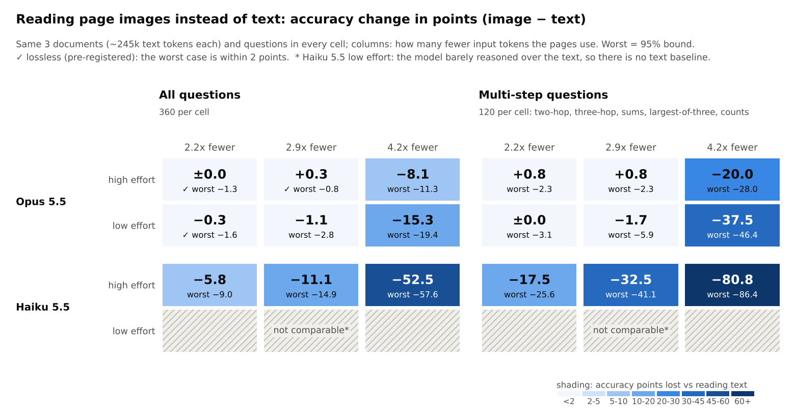
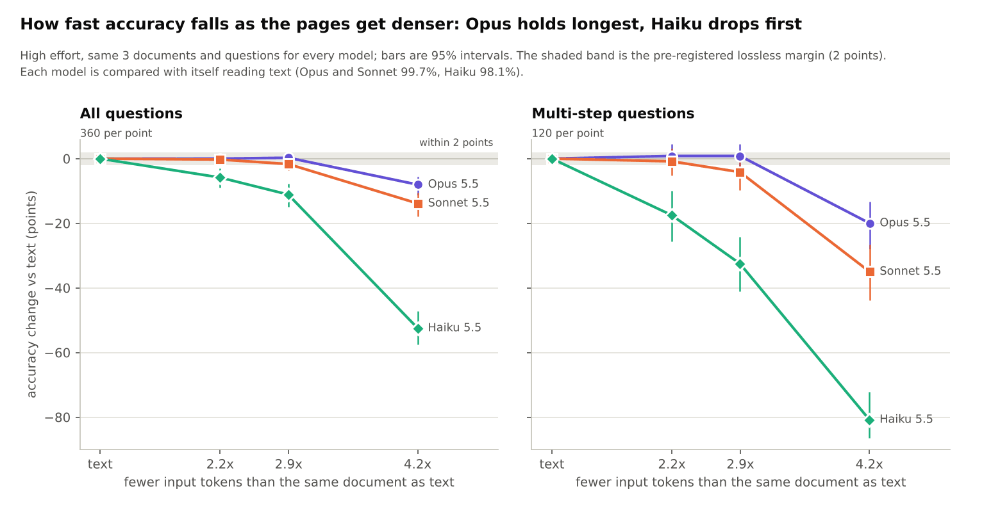
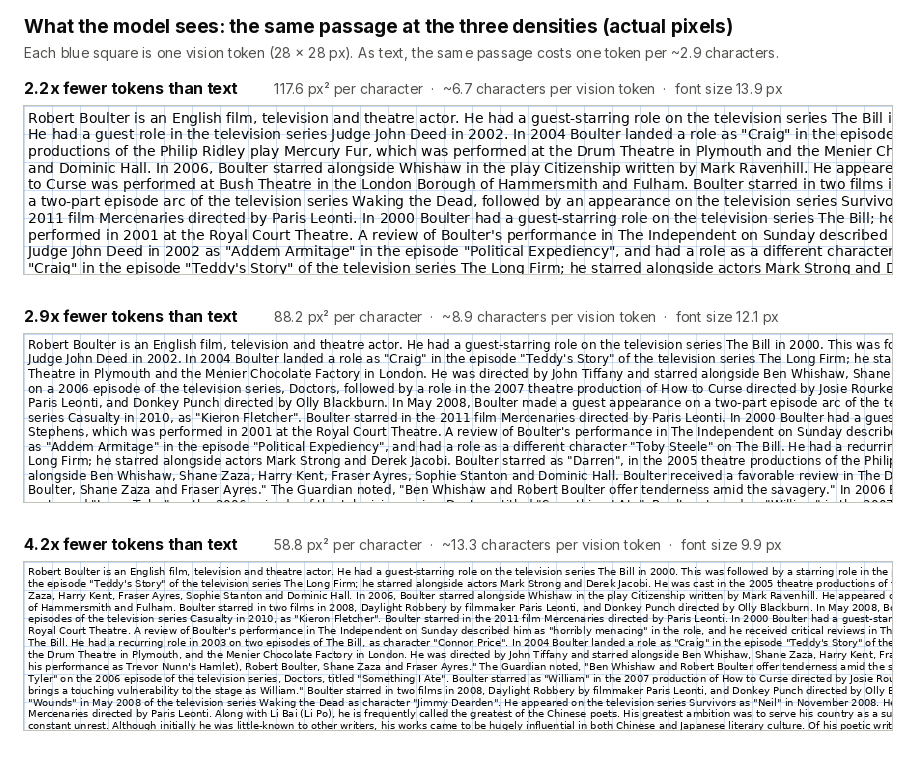
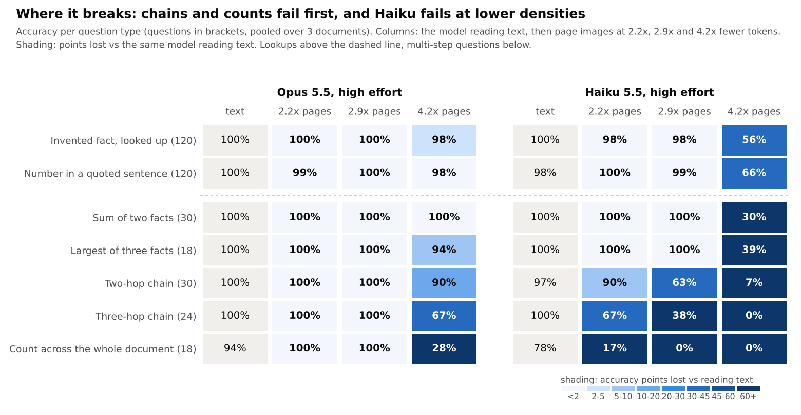
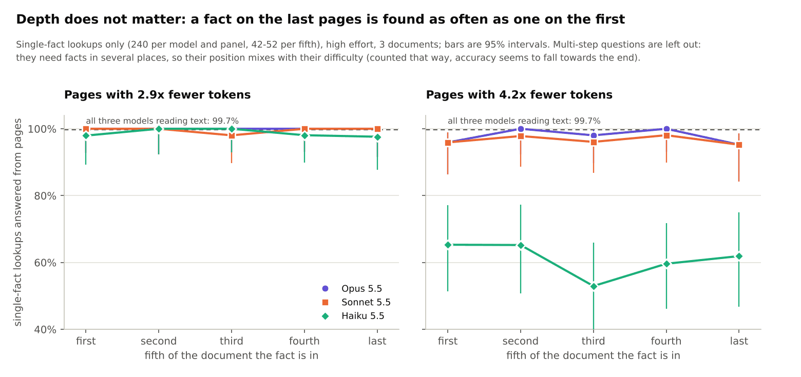
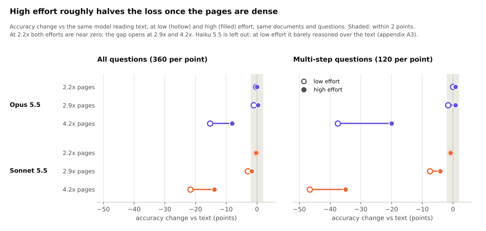
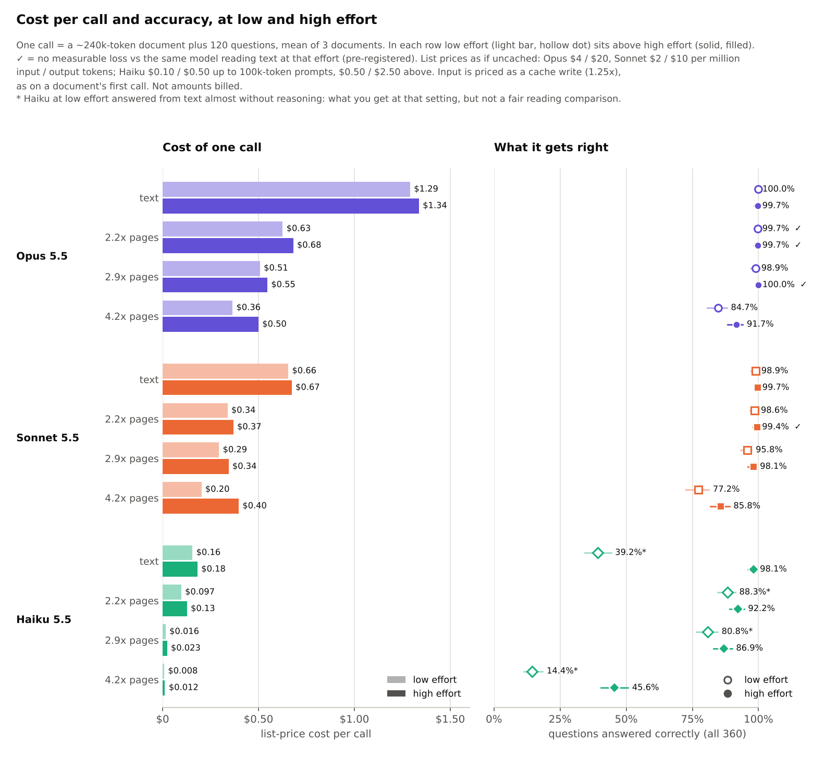
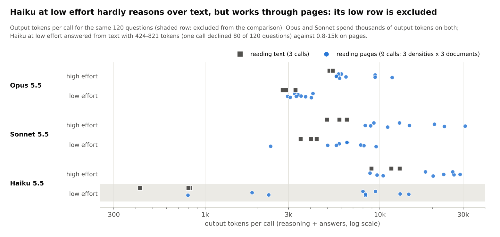

# Claude QA: can Claude answer questions from page images as well as from text?

*2026-11-10.* Each long document (~240k tokens of text) is given to Claude three ways: as text, as rendered page
images at three densities, and not at all. Every arm gets the same 120 questions, scored automatically. The question:
how many fewer input tokens can pages use before the answers get worse? Three models were tested: Opus 5.5,
Sonnet 5.5 and Haiku 5.5.

## The answer

* **Opus 5.5: pages with 2.2x fewer tokens lose nothing measurable, at low and high effort.** On multi-step questions
  alone no loss was seen either (0.0 and +0.8 points), but with 120 of them a loss up to about 3 points cannot be
  excluded. At 2.9x Opus is still lossless at high effort.
* **Sonnet 5.5: lossless at 2.2x at high effort.** At low effort the estimate is the same (-0.3 points) but the worst
  case is 2.2 points, just outside the margin. At 2.9x it is no longer shown lossless (-1.7 points at high effort,
  borderline; -3.1 at low effort, a measurable loss).
* **Haiku 5.5 is not lossless at any density tested.** It loses multi-step accuracy already at 2.2x; for Haiku, text
  is the better input.
* **Denser pages break the links between facts first.** Past ~3x, Opus and Sonnet still find single facts but lose
  chains and counts (Opus at 4.2x, high effort: three-hop 67%, counts 28%). Haiku loses single facts too (56-66%).
* **Exception found later (2026-11-12): wording-sensitive questions lose about 3 points from pages, at 2.2x and
  2.9x alike** (Opus, high effort, 15 calls per density: -2.8 and -3.8 points against text at 100%; the original
  120 questions stay within 0.7 points). In about 1 page call in 6 every "A was paid n by B" sentence is read the
  wrong way round; text never did that in 6 calls. "Lossless" above therefore covers lookups, chains, sums and
  counts, not sentences whose answer turns on a small word.
  [Details](#tested-repeat-calls-on-wording-sensitive-questions).
* **Cost:** at list price, 2.2x pages cost about half as much as text for the same answers (Opus $0.68 vs $1.34,
  Sonnet $0.37 vs $0.67 per call at high effort; not amounts billed).

**Terms used throughout**

* **Nx fewer tokens:** input tokens of the text call ÷ input tokens of the page call (both include ~6k tokens of
  instructions and questions): measured 2.19x, 2.87x and 4.15x, shown as 2.2x, 2.9x and 4.2x. For the document alone
  the savings are 2.26x, 3.0x and 4.5x.
* **px² per character:** page area ÷ characters on the page; lower means smaller type and denser pages
  (117.6, 88.2 and 58.8 px² here).
* **Effort:** the Claude Code `--effort low|high` setting, which controls how much the model reasons before answering.
* **Lossless:** the pre-registered test. The upper 95% bound of the accuracy loss (text − image) is below 2 points:
  no loss larger than 2 points can be shown. This is a non-inferiority margin, not a claim of zero loss.
* **Worst:** that bound, the losing end of the 95% interval.
* **Loss:** the 95% interval excludes 0 and the exact McNemar test rejects (p < 0.05).
* **Lookups:** single-fact questions (invented facts and numbers in quoted sentences). **Multi-step:** two-hop,
  three-hop, sums, largest-of-three and counts across the document. (In the result files: `needle` and `number` are
  the lookups, `complex` the multi-step questions.)
* **Phase 1:** this repo's earlier transcription test, where Claude read pages of natural text aloud
  ([RESULTS.md](../glyphs/RESULTS.md)).



*How to read it:* each cell compares page images with text on the same 3 documents and questions. The big number is
the accuracy change in points (image − text: negative = worse than text); "worst" is the losing end of the 95%
interval; ✓ marks the pre-registered lossless verdict. Colour runs from green (no loss) through yellow to red (large loss). Numbers: [A1](#a1-opus-55),
[A2](#a2-sonnet-55) and [A3](#a3-haiku-55).

## Use cases: what was tried and how it went

Every use tested so far, in one table (2026-11-12; Opus 5.5 unless noted). "Works" means no measured loss against
the same model reading text, at lower cost.

| Use case | What was tested | Result | Verdict |
|---|---|---|---|
| Long-document Q&A | 3 documents of ~240k tokens, 120 questions each, pages at 2.2x / 2.9x / 4.2x fewer tokens | 2.2x: no loss on lookups, chains and counts (Opus, Sonnet at high effort); Haiku loses 5.8 points | **Works** at 2.2x (Opus, Sonnet); [A1-A3](#a1-opus-55) |
| Text where one small word decides | 40 extra questions per document (negation, passive, "all but"), 15 calls per density | 97.2% (2.2x) and 96.2% (2.9x) against 100% from text; 1 page call in 6 reads every passive backwards | **Limit**: about 3 points lost; [details](#tested-repeat-calls-on-wording-sensitive-questions) |
| Denser pages | 4.2x fewer tokens, and 7.8x in the exploratory runs | −8 to −15 points at 4.2x, chains and counts first; 7.8x fails outright | **Fails** beyond ~3x |
| Deep-research sources | 3 corpora of 34-50 articles, 360 questions | 99.7% from pages against 99.4% from text at half the cost; notes alone lose 29 points | **Works**; [details](#tested-deep-research-sources) |
| RAG | 308 questions, 3 datasets, BM25 | same passages as pages: same accuracy, 27-43% cheaper; same budget: +8.8 points on MultiHop-RAG | **Works**; [results/rag](../../results/rag/README.md) |
| Context compaction archive | transcript as pages opened on demand, real hooks, 9 sessions | 96-99% against 78% for normal compaction, 2.1x cheaper per correct answer | **Works**, the strongest result; [results/compaction_scale](../../results/compaction_scale/README.md) |
| Coding agents: file contents and command output as pages | 79 SWE-bench tasks | no task lost; total cost unchanged ($10.82 against $10.61): reading is ~17% of an agent's cost | **Works, does not pay**; [details](#tested-coding-agents) |
| Pruned text in place of pages, or under them | LLMLingua-2, 480 questions | 86.0% against 97.7% for pages at the same tokens; pruned pages no better than denser pages | **Fails**; [details](#tested-pruned-text) |
| Coded or scrambled pages (glyph codes, substitution) | Phase 1 | refused or cut off by safety classifiers | **Not possible** on Claude; [RESULTS.md](../glyphs/RESULTS.md) |
| Repo atlas: locating a bug fix | 8 SWE-bench tasks, 5 arms | every arm, even a bare file list, names the files; searching agent $0.04 per task | **Not separable** (memorised tasks); [details](#tested-a-whole-repository-as-page-images-repo-atlas) |
| Repo atlas: questions about a repository | SWE-QA, 144 questions on requests, flask, pytest | atlas 75.4 = no code 75.6 (of 100); only the searching agent beats memory (79.1) | **Fails** on code the model knows |
| Repo atlas: finding a security flaw | 12 fresh advisories in small libraries | atlas alone 9 of 12 against 10 for a bare file list; agent with atlas 10 against 7 for the plain agent, in half the turns, 45% dearer (p = 0.25) | **Atlas alone fails; with an agent: a hint, not settled** |
| Repo atlas: hard coding tasks solved end to end | 16 SWE-rebench tasks (3 or more files in the fix, not located by a bare file list), Claude Code plain / with a repo map / with the atlas | solved: plain 8, map 9, atlas 11 (3 tasks to 0 for the atlas, p = 0.25); fewer turns with the atlas (median 10 against 12.5, p = 0.006) at 2.6x the cost ($0.68 against $0.26) | **A hint that did not repeat** (next row): one run per task; [results/repo_atlas_swe](../../results/repo_atlas_swe/README.md) |
| Repo atlas: migrating C to Rust | 14 CRUST-Bench projects, Claude Code with the C files / with files and atlas / with the atlas only | identical on every project: 12 of 14 pass all tests in each arm; turns and cost the same within noise | **No effect**; pages alone were enough to translate from, but the projects are small and the tests carry much of the behaviour; [results/repo_atlas_migrate](../../results/repo_atlas_migrate/README.md) |
| Repo atlas: hard coding tasks again, auto-memory off | the same 16 tasks, plain against atlas, two fresh runs each (64 runs) | task-runs solved of 32: plain 19, atlas 17 (atlas higher on 1 task, plain on 2); turns lower with the atlas on 10 of 15 tasks (p = 0.30); atlas 3.1x the cost. The earlier 11 against 8 and "fewer turns" do not repeat | **No effect; the earlier hint was noise**; [results/repo_atlas_swe_rerun](../../results/repo_atlas_swe_rerun/README.md) |
| Repo atlas: a larger port with concurrency | RepoMod-Bench, gitleaks Go to Rust (22k lines, 35 hidden tests), Claude Code plain against atlas, one run each | both ports build and pass 35 of 35; 102 against 99 turns, $11.32 against $11.20, about 40 minutes each; neither port scans concurrently (the Go original does) | **No effect** (an anecdote: one run per arm, and both agents checked their port against the built Go original); [results/repo_atlas_port](../../results/repo_atlas_port/README.md) |
| Repo atlas for a cheaper model | the 16 hard coding tasks, Claude Code on Sonnet at high effort, plain against atlas, two runs each; first a check that Sonnet reads the pages (20 of 20 lookups) | task-runs solved of 32: plain 14, atlas 13 (15 tasks tie); turns lower with the atlas on 11 of 14 tasks (p = 0.057); atlas 3.7x the cost ($0.26 against $0.07) | **No effect**; Sonnet reads the atlas but does not solve more with it; [results/repo_atlas_swe_sonnet](../../results/repo_atlas_swe_sonnet/README.md) |
| Orchestrator reads the atlas once, workers get briefs | plan-quality test: 33 tickets x 4 planners (file list, repo map, atlas, searching agent), then 16 tickets given to workers on three tiers | atlas briefs name 50% of the fix's files, the same as file-list (48%) and scout briefs (50%), at 8x and 2.7x their cost; the planner cannot size the work or pick the worker (its choice solved 8 of 16 against 11 for always-Opus); an Opus worker with a brief solved 11 (atlas brief) or 10 (file-list brief) against 8 without (p = 0.25) | **Fails as proposed**: a brief may help, the atlas is not what makes it good; [details](#tested-an-orchestrator-that-reads-the-atlas-once-plan-quality) |
| A local model (Qwen3.8-27B) | not run | plan and harness ready | **Planned**; [LOCAL_QWEN.md](../gpu/LOCAL_QWEN.md) |

## How fast it falls



*How to read it:* each line starts at 0 (the model reading text) and shows the accuracy change as the pages get denser,
at high effort; the dashed band is the 2-point lossless margin, and the background runs from green (no loss)
to red (large loss).

* **By point estimate, Opus and Sonnet stay within 2 points up to 2.9x;** by the pre-registered worst case, Opus is
  lossless to 2.9x and Sonnet to 2.2x. Haiku leaves the band at the first step.
* **Multi-step questions lose about 2.5 times as many points as the overall score** for Opus and Sonnet (1.5 times for
  Haiku): at 4.2x, -20, -35 and -81 points.

## What the pages look like



*The top of the first test page of document 1, exactly as sent, at actual pixels.* Pages are 1932 px wide and 1876 px
tall (4,626 tokens each; 1932 px is the largest side these models read without downscaling, checked for all three);
23-24, 18 and 12 pages per document at the three densities. A vision token carries ~6.7 characters at 2.2x and ~13.3
at 4.2x; the font shrinks from 13.8 px to 9.8 px. As text, Claude's tokenizer takes ~2.9 characters per token.
Phase 1's densest readable setting (29.4 px² per character, 3% transcription error) would be ~8.5x on these pages; in
the exploratory runs that density failed outright ([A5](#a5-earlier-exploratory-runs)).

## Where it breaks



*How to read it:* columns are question types, one block of rows per model: the grey row is the model reading text,
the coloured rows the same model reading pages, from green (no loss against the grey row) to red. A small "+1 q" marks the
four cells where pages got 1-2 more questions right than text; that is noise, not a gain (see the counts bullet).

* **Lookups and sums survive the longest.** Opus keeps 98-100% on them even at 4.2x. (Sums and largest-of-three add
  up facts that are also asked as separate questions in the same call, so they partly reuse that work.)
* **Chains and counts fail first.** At 4.2x, Opus gets 67% of three-hop and 28% of count questions right. Wrong
  two-hop answers are usually another club's boat count: the facts are read, the link between them is lost. Opus's
  wrong counts are all too low (10 for 12, 5 for 7): occurrences are missed. Text is not perfect
  on counts either: Opus and Sonnet each answered 11 for 12 once from text (17 of 18), which is why Opus's 2.2x and
  2.9x pages, with 18 of 18, appear to beat text by one question.
* **Sonnet sits between Opus and Haiku:** its first loss is counting (89% at 2.2x, 72% at 2.9x); at 4.2x three-hop is
  at 42%.
* **Haiku fails the same way with fewer tokens saved:** three-hop falls to 67% already at 2.2x, and at 4.2x even single
  lookups drop to 56-66%.



*How to read it:* only single-fact lookups, grouped by the fifth of the document their fact is in; the dashed line is
the models reading text. 2.2x is left out (near 100% everywhere).

* **No depth effect is visible:** a fact on the last pages is found about as often as one on the first, at both
  densities and for every model (Haiku at 4.2x is low everywhere, 53-65%, not low at the end). With 42-52 questions
  per fifth only large trends would show.
* **So the loss is about connecting facts, not reaching them.** Counting all questions makes accuracy appear to fall
  towards the end, but that is because multi-step questions, placed by their latest fact, cluster there.

## Does effort help?



*How to read it:* hollow dots are low effort, filled dots high effort, for the same model, pages and questions.

* **At 2.2x effort changes little for Opus and Sonnet:** their estimates are within 0.3 points of text at both
  efforts, but only Opus (both efforts) and Sonnet at high effort are shown lossless (Sonnet at low effort: worst
  case 2.2 points).
* **Once the pages are dense, high effort narrows the loss:** by about half for Opus (4.2x: -15.3 -> -8.1 points;
  multi-step -37.5 -> -20.0) and by a quarter to a third for Sonnet (-21.7 -> -13.9; multi-step -46.7 -> -35.0). It
  also makes Opus's 2.9x lossless.
* High effort costs more output tokens: see the cost figure below and [A4](#a4-cost).

## What it costs



*How to read it:* one row per option, low effort (light bar, hollow dot) above high effort (solid bar, filled dot).
The bar is the list-price cost of one call (a ~240k-token document plus 120 questions), the dot its accuracy with a
95% interval; ✓ marks no measurable loss against the same model reading text at that effort. Costs are list prices
with every input token priced as a cache write (1.25x the base input price), as on the first call of a document; a call
without caching would pay ~20% less for input, and the ratios between options barely change ([A4](#a4-cost)). These
calls drew on a subscription quota, so they are not amounts billed.

* **Opus:** 2.2x pages cost $0.63 (low effort) or $0.68 (high) against $1.29-1.34 for text, with no measurable loss at
  either effort; 2.9x pages at high effort ($0.55) are lossless too.
* **Sonnet:** 2.2x pages at high effort cost $0.37 against $0.67 for text, with no measurable loss: the cheapest
  lossless option of the three models. At low effort ($0.34) the worst case is just outside the margin.
* **Effort is cheap where it is not needed and worth it where it is:** for Opus and Sonnet, high effort adds 3-9% to
  the cost of text and 2.2x calls; on 4.2x pages it adds 37% (Opus) to 96% (Sonnet), and buys back 7-8 points.
* **Haiku:** reading text at high effort costs $0.18 (98% right). Its 2.9x and 4.2x pages fall into Haiku's cheaper
  tier for prompts up to 100k tokens ($0.008-0.023) but lose 11-53 points; at low effort it barely reasons over text
  (39%, marked *).

## Where this could be used

The result supports one pattern: **large amounts of reference text that the model reads and looks things up in, but
does not need to quote exactly or reason across as a whole.** Only English prose was tested; the uses below are
candidates to test, ordered from closest to the test to furthest from it.

* **RAG: tested** ([results/rag](../../results/rag/README.md); Opus 5.5, BM25, 308 questions on planted facts,
  MultiHop-RAG and HotpotQA). The same top-5 passages as pages at 2.9x answered as well as text and cost 27-43% less per
  question; the same budget as pages carried 11-14 passages instead of 5 and gained 8.8 points on MultiHop-RAG
  (p = 0.001), more than top-15 as text at 2.5x the price. Mixing a text head with paged tails did worse than all pages.
* **Deep research: tested, and it holds at 2.2x** ([below](#tested-deep-research-sources)).
* **Long-document Q&A** (reports, contracts, manuals, filings). The test is closest to this. At 2.2x, Opus and Sonnet
  answer as well from pages as from text, at about half the cost.
* **Context compaction: tested twice, and it is the strongest result so far.** After `/compact`, Claude Code keeps a
  summary and the path of the raw transcript. A PreCompact hook that renders the whole transcript as page images with
  an index, and a SessionStart hook that tells the model where it is, keep almost everything: on 3 research sessions,
  100% against 37% for normal compaction at 31% lower cost ([results/compaction](../../results/compaction/README.md));
  at scale, on 9 sessions of research reading, codebase exploration and log triage with the real hooks and nothing in
  the prompt, 96.1% (98.9% after fixing a hook bug) against 78.3% for normal compaction and 100% without compaction,
  at 2.1x (2.2x with the fix) lower cost per correct answer ([results/compaction_scale](../../results/compaction_scale/README.md)).
* **Coding agents: tested, no accuracy lost but no money saved** ([below](#tested-coding-agents)). Claude Code with
  file contents and command output shown as pages at 2.9x solved every SWE-bench task it solved from text, but
  coding spends little on reading, so the total cost did not fall.
* **A whole repository read up front (repo atlas): tested three ways so far, no gain by itself**
  ([below](#tested-a-whole-repository-as-page-images-repo-atlas)); as a one-time read for an orchestrator that
  briefs workers it was [tested and did not beat a bare file list](#tested-an-orchestrator-that-reads-the-atlas-once-plan-quality).

### Tested: deep-research sources

A research orchestrator usually holds many fetched sources, or drops them and keeps notes. The test
([`experiments/claude_qa_research.py`](../../experiments/claude_qa_research.py), pre-registered) used 3 corpora of
34-50 real Wikipedia articles each (~270k tokens of text), each article a labelled source with invented facts
planted in it, and 120 questions per corpus: 60 lookups and 60 that need several sources (which source says this,
two sources that disagree, chains across sources, how many sources mention something, totals across sources).
Opus 5.5, high effort, one call per arm and corpus, 360 paired questions:

| what the orchestrator gets | input tokens | accuracy | vs text (95% CI) | list price per corpus |
|---|---|---|---|---|
| all sources as text | 273k | 99.4% | (reference) | $1.48 |
| **all sources as 2.2x pages** | **122k** | **99.7%** | **+0.3 (−0.8 to +1.6): lossless** | **$0.77** |
| notes per source + the pages | 164k | 99.4% | 0.0 (−1.3 to +1.3): lossless | $3.27 (notes $2.33) |
| notes per source only | 46k | 70.3% | −29.2 (−34.1 to −24.5) | $2.70 (notes $2.33) |
| nothing | 5k | 6.9% | −92.5 | $0.07 |

* **Pages carry the whole job at 2.2x:** cross-source questions scored 100% from pages (99.4% from text), and every
  question type was at 99-100%.
* **Notes alone, the usual way to save context, lose 29 points**, even though they ran over their 250-word limit
  (~380 words per source). They lose most on the questions a summary drops: numbers in passing sentences (52%) and
  how many sources mention something (28%).
* **Notes add nothing on top of the pages here** and cost more to write than the text call itself; they would pay off
  only if reused across many queries.
* Pre-registered verdicts: notes + pages lossless, PASS; notes lose at least 10 points, PASS; pages recover at least 10
  points over notes, PASS; pages lossless on lookups alone, not shown (0.0, worst −2.1 with 180 questions), though
  lossless on all 360 questions. Details in [`results/claude_qa/research/summary.md`](../../results/claude_qa/research/summary.md).
* **Limits:** encyclopedia articles, not mixed web pages with tables; questions with exact answers, not a written
  report; Opus only. Page calls were slower (median 56 s against 42 s for text).

### Tested: coding agents

Hooks for Claude Code ([`experiments/readhook/vbhook/`](../../experiments/readhook/vbhook/)) show file contents and long
command output as minified pages at 88.2 px² per character (2.9x for prose): minifiers for 40+ languages and output
kinds, edit-safe for code (spaces kept, indentation as `»`), and an image only when it costs fewer tokens than the text.
Opus 5.5 at high effort, text vs pages, same tasks:

| test | text | pages | details |
|---|---|---|---|
| refactor-for-performance smoke tests (6 tasks x 3) | 18/18 equivalent | 54/54 over 3 hook iterations | [results/readhook_smoke](../../results/readhook_smoke/README.md) |
| SWE-bench Verified, 50 hardest Django tasks recent Opus models solve | 50/50 resolved, $5.78 | 50/50, $6.08 | [results/readhook_swe](../../results/readhook_swe/README.md) |
| SWE-bench Multilingual, 29 Rust and Java tasks | 28/29, $4.83 | 29/29, $4.75 | [results/readhook_swe_ml](../../results/readhook_swe_ml/README.md) |

* **No task lost**, and no failed edit in the final hook version: the model edits exactly from page images.
* **The images were 3.1x cheaper than the text they replaced**, but the total cost did not fall ($10.82 against
  $10.61 over the 79 tasks). File contents and command output are only ~17% of what a coding agent costs; output (46%)
  and the re-read starting context and conversation (37%) are untouched, and the image arm made more calls (mostly
  extra Reads and smaller Edits the hooks' notes induced). Full analysis, figures and the remaining levers:
  [SWE_IMAGES.md](SWE_IMAGES.md).

### Tested: pruned text

Can deleting words from the text (LLMLingua-2, off the shelf) do what the pages do, or add to them? Pre-registered,
same 3 documents plus 40 new questions each whose answer depends on small words ("did not", "all but", "was paid
by"), Opus 5.5 at high effort, 480 paired questions per arm ([results/claude_qa/prune](../../results/claude_qa/prune/README.md)):

* **No, on both counts.** Pruned text with the same tokens as 2.2x pages scored 86.0% against 97.7% for the pages and
  100% for text, and lost 3.6 points even on the original 120 questions, where the pages lost nothing. Lightly pruned
  text drawn as pages (3.4x fewer tokens) scored 90.6%: no better than pages alone at 4.1x, worse than at 2.85x.
* **The pruner deletes the words that carry the meaning:** "all but" in every sentence, "was" in every passive, the
  "not" of "did not receive" 29 times in 30. Claude then answers with the other number in the sentence (42% of small-word answers at 2.2x).
* Pages at 117.6 px² per character also lost points on the small-word questions (90.8%), all but one of them passives
  answered the wrong way round in two of the three calls; text and the 88.2 pages did not.
* Cost $17.52 at list price for 24 calls and calibration.

### Tested: repeat calls on wording-sensitive questions

Was the 2.2x pages' passive flip in Test A chance or density? Pre-registered: the same calls repeated byte for byte,
5 per document at 117.6 and at 88.2 px² per character, 2 per document for text (27 new calls, $16.17 at list price;
[results/claude_qa/repeat](../../results/claude_qa/repeat/README.md)):

* **Chance, and it hits both densities.** About 1 page call in 6 (2 of 15 at 117.6, 3 of 15 at 88.2) reads every
  "A was paid n by B" sentence the wrong way round; the other calls get the passives right. Text never did (0 of 6).
* **Pages lose a little on wording-sensitive questions at both densities:** small-word accuracy 97.2% (2.2x) and
  96.2% (2.85x) against 100% for text, −2.8 points (95% CI −5.2 to −1.2) and −3.8 (−6.3 to −1.7) over calls.
* **The lossless headline holds over repeats** on the original 120 questions: 99.9% at 2.2x, 99.3% at 2.85x, 100%
  for text.

### Tested: a whole repository as page images (repo atlas)

`experiments/repo_atlas.py` minifies every source file and renders the whole repository as pages with an index.
It fits one request up to ~150k image tokens, about 1.3M characters of source (requests 24k tokens, bat 67k, axum
120k; pytest is at the limit; anything Django-sized is far over), at about 3.5 times fewer tokens than the code as
text. Plan and all results: [REPO_ATLAS_PLAN.md](REPO_ATLAS_PLAN.md). Seven tests and one repeat, each run by an Opus subagent with
a pre-registration (the sixth, the plan-quality test for the orchestrator use, has its own section below):

| Test | Tasks | What the arms scored | Spend |
|---|---|---|---|
| Locate the files of a bug fix ([pilot](../../results/repo_atlas/README.md)) | 8 SWE-bench tasks | all changed files named: file list 8/8, repo map 8/8, atlas 8/8, text 4/4, searching agent 8/8 | $7.49 |
| Answer questions about a repository ([SWE-QA](../../results/repo_atlas_qa/README.md)) | 144 questions | judge score of 100: no code 75.6, repo map 76.1, atlas 75.4, text 75.5, searching agent 79.1 | $20.83 |
| Find a security flaw ([fresh advisories](../../results/repo_atlas_sec/README.md)) | 12 advisories | fixed file in the top 5: file list 10, atlas 9, searching agent 7, agent with atlas 10 | $20.70 |
| Solve hard coding tasks ([SWE-rebench](../../results/repo_atlas_swe/README.md)) | 16 | tasks solved: plain agent 8, with a repo map 9, with the atlas 11; median turns 12.5 / 12 / 10; cost per task $0.26 / $0.49 / $0.68 | $28.45 |
| Hard coding tasks again, memory off ([re-run](../../results/repo_atlas_swe_rerun/README.md)) | the same 16, 2 runs each | task-runs solved of 32: plain 19, atlas 17; run 1: 10 / 9, run 2: 9 / 8; cost per run $0.27 / $0.83 | $35.07 |
| Hard coding tasks on Sonnet ([Q3](../../results/repo_atlas_swe_sonnet/README.md)) | the same 16, 2 runs each | task-runs solved of 32: plain 14, atlas 13; median turns 7.5 / 6; cost per run $0.07 / $0.26 | $11.38 |
| Migrate C to Rust ([CRUST-Bench](../../results/repo_atlas_migrate/README.md)) | 14 projects | all tests pass: with the C files 12, with files and atlas 12, atlas only (no C files) 12; median turns 6.5 / 6 / 6.5; cost per project $0.54 / $0.57 / $0.60 | $24.01 |
| Port a larger concurrent tool, Go to Rust ([RepoMod-Bench gitleaks](../../results/repo_atlas_port/README.md)) | 1 project, 1 run per arm | hidden tests passed: plain 35 of 35, atlas 35 of 35; turns 102 / 99; cost $11.32 / $11.20 | $23.14 |

* **The atlas alone has not beaten a cheaper option anywhere.** On public repositories the model answers from
  memory (with no code it already names 71% of the code entities in the reference answers), and a bare file list
  is enough to locate a fix or a flaw, even for flaws published after its training data, because file names give
  them away.
* **A searching agent is cheap.** Claude Code with read-only tools found the files of a fix in ~3 turns for $0.04,
  against $0.23 for the atlas and $1.18 for the same code as text.
* **The hint that the atlas gives an agent a head start did not repeat.** In the security test the agent with the
  atlas found 3 flaws the plain agent missed and lost none, in a median of 8 turns instead of 18, at $0.67 against
  $0.46 per task. On the hard coding tasks it solved 11 against 8 of 16, in fewer turns (p = 0.006), at $0.68
  against $0.26. Each was 3 to 0 with one run per task (exact p = 0.25). **The hard coding tasks were then run
  again, twice, with auto-memory off** ([results/repo_atlas_swe_rerun](../../results/repo_atlas_swe_rerun/README.md),
  64 runs, $35.07): plain solved 19 of 32 task-runs and the atlas 17 (run 1: 10 against 9; run 2: 9 against 8),
  turns were lower with the atlas on 10 of 15 untied tasks (p = 0.30), and the atlas cost 3.1x. The plain agent
  alone moved from 8 to 10 solved between the two tests, which is the size of the earlier gap. The first test's
  runs had not shared memory (each had its own store), so the earlier result was variation between runs.
  The security hint (12 tasks, one run) has not been repeated and should be read the same way.
* **A migration did not need the atlas, and did not miss the source.** On 14 small C libraries the three arms
  tied on every project. The agent with the atlas still opened the C files, so the pages saved about one tool call;
  the agent with only the pages translated just as well. The atlases there were 2-13k image tokens: small enough
  that reading the files costs almost nothing.
* **A cheaper model does not gain from it either.** Sonnet at high effort reads the atlas as well as Opus (20 of
  20 lookups each, the 1932-px pages not downscaled), but on the same 16 tasks it solved 14 of 32 task-runs plain
  and 13 with the atlas, at 3.7x the cost. Turns lean lower with the atlas (11 of 14 tasks, p = 0.057), as they
  did for Opus (10 of 15, p = 0.30): the atlas may save a few exploration turns, never enough to pay for itself.
  Opus plain solves 19 of 32 at $0.27 per run, about the price of Sonnet with the atlas ($0.26, 13 of 32).
* **A larger port did not need it either.** gitleaks (22k lines of Go, atlas 82k image tokens) was ported to Rust
  by both arms in about 40 minutes and $11, and both ports pass all 35 hidden tests. Both agents built the Go
  original and compared outputs, which makes the tests close to a formality; neither port kept the original's
  concurrent scan (the tests do not ask for it). One run per arm: an anecdote.
* **The benchmark's tasks are not newer than the model** (created 2025-07 to 2026-05; nothing later exists in
  SWE-rebench or SWE-bench-Live), so memorised tasks were screened out instead: 12 of 37 candidates were dropped
  because a call with only the file list named every file of the fix.
* **The existing repository-level security benchmark (VulnGym) cannot be used:** its smallest measured repository
  is 246k image tokens. Real services are mostly too large for one atlas.

### Tested: an orchestrator that reads the atlas once (plan quality)

**The use.** A backlog of tickets against one service. One orchestrator session loads the atlas, reads every
ticket and writes a short brief per ticket (files, functions, approach, a size S / M / L and a worker: model and
reasoning level). Worker subagents get their brief, not the atlas, and run in parallel; when a batch has merged
the atlas is rebuilt and the next phase is planned.

**Why this shape.** A cache read costs a tenth of the input price but is charged on every turn of every session
that carries the atlas. At Opus list prices an 80k-token atlas costs ~$0.40 to load and ~$0.03 per turn. For 20
tickets of ~30 turns: ~$19 if every worker carries it, ~$1 if only the orchestrator does.

**The test** (2026-11-12, Opus 5.5 at high effort as planner, $44.25, run by an Opus subagent; design
[PLAN_QUALITY_TEST.md](PLAN_QUALITY_TEST.md), pre-registration, rows and caveats
[results/plan_quality](../../results/plan_quality/README.md)). Tickets are SWE-rebench issues with a known fix, in
repositories whose atlas fits, not located by a bare file list in a closed-book screen.

*Briefs against the real fix, 33 tickets, four planners with the same instruction:*

| planner reads | fix files named | named files not in the fix | fix functions named | names that do not exist | cost per brief |
|---|---|---|---|---|---|
| the file list | 48.1% | 38.2% | 44.6% | 2.5% | $0.05 |
| the repo map | 47.6% | 35.4% | 49.2% | 0.4% | $0.16 |
| the atlas | 50.1% | 24.7% | 50.3% | 0.4% | $0.41 |
| the checkout, with search tools (scout) | 49.8% | 12.5% | 50.0% | 0.8% | $0.15 |

*Workers on 16 tickets, graded by the ticket's own tests (Claude Code with edit tools):*

| worker | solved | median turns | cost per ticket |
|---|---|---|---|
| Opus high, no brief (rows of the hard-coding-task test) | 8 | 12.5 | $0.26 |
| Opus high, atlas brief | 11 | 12.5 | $0.32 |
| Opus high, file-list brief | 10 | 15 | $0.42 |
| Sonnet medium, atlas brief | 8 | 6 | $0.05 |
| Haiku low, atlas brief | 8 | 8.5 | $0.01 |

* **The atlas does not write a better brief.** It names the same share of the fix's files as a bare file list
  (they tie on 21 tickets and split 6 to 6) and as a scout. It names fewer wrong files than the file list, but
  the scout names half as many again and costs under half as much. A blind judge of the approach scored every
  planner 5.4-5.7 of 6 and could not separate them.
* **Reading pages did not make it invent things:** 1 of 246 named paths and functions does not exist.
* **The planner cannot size the work.** Its S / M / L against the real fix's size: rank correlation 0.24 (scout
  0.38; the bar was 0.3).
* **It cannot pick the worker either.** Told to choose the cheapest worker that would solve the ticket, the atlas
  planner chose Sonnet 13 times, Haiku 3 times and Opus never. Against the cheapest tier that did solve each
  ticket it was right on 2, too large on 6, too small on 3 (5 tickets no tier solved). Following it solved 8 of
  16 for $0.73; always Opus solved 11 for $5.17; always Haiku solved the same 8 for $0.10.
* **The tiers split cleanly, which the brief did not predict:** Haiku at low effort solved 8 tickets, Sonnet at
  medium the same 8 and no more, and Opus at high 3 more. Starting every ticket on Haiku and sending failures to
  Opus would solve 11; that needs a check that tells a failed ticket from a solved one (here the tests did).
* **A brief may help the worker, whichever context wrote it.** Opus solved 11 with the atlas brief and 10 with
  the file-list brief against 8 with none: 3 tickets to 0 for the brief, exact p = 0.25, one run per ticket. This
  is the third 3-to-0 hint of this kind (atlas in the agent's context: security flaws, hard coding tasks), and
  the file-list brief nearly matching it says the gain, if real, comes from planning before editing, not from
  the atlas. Turns did not fall.
* **Colliding tickets could not be tested:** the benchmark has one repository with three or more usable tickets;
  the design needed three.
* Predictions: 2 held (few invented names; scout and atlas name as many files), 4 failed (atlas over file list
  on files; sizing; right-sizing by the planner; fewer turns with a brief), 1 not evaluable (collisions).

**What this means for the use:** an orchestrator that plans from the atlas is not worth its cost on these
tickets. A file-list brief at $0.05 does as well, and for model choice a fixed rule (cheapest first, escalate on
a failed check) beat the planner's own estimate. Not tested: private code the model has never seen, a real
backlog with collisions, and repeat runs.

**Where not to use it**

* **Text where one small word decides the answer** (contracts, instructions, who-paid-whom): pages lose about 3
  points on such questions at 2.2x and 2.9x, and about 1 call in 6 reads every passive sentence backwards.
* **Counting and aggregation over the whole input** ("how many errors are in this log?"): counts are the first thing
  to fail (Opus 28% at 4.2x), and even text is not perfect on them.
* **Chains of facts** (three-hop questions) beyond 2.2x.
* **Text to copy exactly** (quotations, hashes, long literals): the model sees pixels, not characters. Code edits
  worked in the coding tests above, but only because the pages keep spacing and show indentation explicitly.
* **Haiku 5.5**, which loses accuracy even at 2.2x.
* **Latency-sensitive calls:** pages save tokens, not time. Page calls took slightly longer than text calls (median
  Opus 2.2x: 28 s against 22 s at low effort, 42 s against 37 s at high).
* **Very long inputs through the CLI:** requests above ~175k image tokens may silently lose their earliest pages
  (Limits).

## How the test works

* **Calls:** headless Claude Code (`claude -p`, no tools, isolated environment; [`vbpe/claude_eval.py`](../../vbpe/claude_eval.py)).
  One call per arm: the document (as text, or as page images in order), then all 120 questions. The system prompt
  asks for a number per question and a best guess when unsure, so there is no abstaining. The image arm cannot see
  the source text. Input tokens come from the CLI's usage report.
* **Documents:** 3 non-overlapping documents of ~700k characters (held-out WikiText-103 test and validation text;
  ~240k tokens each; the text call is ~243-248k tokens with the questions), with invented facts inserted between
  paragraphs.
* **Pages:** the same document string rendered as DejaVu Sans Latin (Phase 1's renderer) at 117.6, 88.2 and 58.8 px²
  per character (see "What the pages look like").
* **Questions (120 per document, exact numeric answers):**
  * 40 invented facts ("How many tonnes of granite did Pavo Dekbry use to rebuild the bridge at Rimosk?"), which only
    the document can answer;
  * 40 numbers in real sentences ("Find the sentence that begins '...'. What number does it contain?");
  * 40 multi-step questions over invented facts: 10 two-hop (person -> chairs a rowing club -> how many boats),
    8 three-hop (person -> club -> town of its boathouse -> lamp posts), 10 sums, 6 largest-of-three, 6 counts across
    the whole document. A chain's facts are at least 1/8 of the document apart.
* **Scoring:** an answer is correct if it equals the expected number after removing commas.
* **Pairing:** each page call is paired, question by question, with the text call of the same document and effort (one
  text call per document and effort, shared by the three densities), pooled over the 3 documents: 360 pairs.
* **Pre-registered** (in [`results/claude_qa/summary.md`](../../results/claude_qa/summary.md), committed before any call,
  the same for each model): (1) lossless at 2.2x at each effort, by Newcombe's paired score interval with a 2-point
  margin; (2) a loss on multi-step questions at ~4x at low effort; (3) the effect of effort, reported without a
  threshold. The Sonnet and Haiku suites were registered the same way before their runs.
* **Engagement check** (added after the Haiku run): a call that leaves questions unanswered or says it did not look
  things up is not a reading measurement, and its rows are marked "not comparable".
* **Reproduce:** [`experiments/claude_qa_render.py`](../../experiments/claude_qa_render.py) (one run per document,
  density, effort and model; the commands are in `results/claude_qa/summary.md`), then
  [`experiments/analyse_claude_qa.py`](../../experiments/analyse_claude_qa.py):
  ```bash
  python3 experiments/analyse_claude_qa.py results/claude_qa/qav2_d*                                              # Opus
  python3 experiments/analyse_claude_qa.py results/claude_qa/qav2s_d* --out results/claude_qa/analysis_v2_sonnet  # Sonnet
  python3 experiments/analyse_claude_qa.py results/claude_qa/qav2h_d* --out results/claude_qa/analysis_v2_haiku   # Haiku
  python3 scripts/make_claude_qa_figures.py                                                                       # figures
  ```

## Limits

* **Ceiling:** text scores 98-100%, so losses below ~1 point cannot show.
* **One call per arm and document:** the intervals cover question-to-question variation, not run-to-run variation of
  the model, and each document's text call is shared by its three densities.
* **Length:** ~240k tokens of text per document. Through the CLI, a request with many image tokens silently loses
  its earliest pages: ~175k image tokens arrived whole, ~345k arrived as ~145-157k; nothing in between was tested,
  and the vision docs do not mention it. Longer documents need a direct API test.
* **Scope:** three models (Opus, Sonnet and Haiku 5.5), one font and layout, English Wikipedia.
* **Questions:** planted facts and numbers with exact answers, not open-ended understanding or summaries.

---

## Data

The tables use the same sign as the figures: **image − text** in accuracy points, negative = pages worse.

### A1. Opus 5.5

[analysis_v2/summary.md](../../results/claude_qa/analysis_v2/summary.md) has every question type; no call flagged by the
engagement check.

| effort | fewer tokens | text | image | image − text (95% CI) | lookups: text / image | multi-step: text / image | verdict |
|---|---|---|---|---|---|---|---|
| high | 2.2x (2.19x) | 99.7% | 99.7% | 0.0 (−1.3 to +1.3) | 100.0% / 99.6% | 99.2% / 100.0% | **lossless** |
| high | 2.9x (2.87x) | 99.7% | 100.0% | +0.3 (−0.8 to +1.6) | 100.0% / 100.0% | 99.2% / 100.0% | **lossless** |
| high | 4.2x (4.15x) | 99.7% | 91.7% | −8.1 (−11.3 to −5.5) | 100.0% / 97.9% | 99.2% / 79.2% | loss |
| low | 2.2x (2.19x) | 100.0% | 99.7% | −0.3 (−1.6 to +0.8) | 100.0% / 99.6% | 100.0% / 100.0% | **lossless** |
| low | 2.9x (2.87x) | 100.0% | 98.9% | −1.1 (−2.8 to +0.1) | 100.0% / 99.2% | 100.0% / 98.3% | not shown lossless |
| low | 4.2x (4.15x) | 100.0% | 84.7% | −15.3 (−19.4 to −11.8) | 100.0% / 95.8% | 100.0% / 62.5% | loss |

No document: 6.9% (high effort), 5.0% (low), from years and other guessable numbers. Pre-registered verdicts:
(1) lossless at 2.2x: **PASS** at both efforts; (2) a loss on multi-step questions at ~4x, low effort: **PASS**
(−37.5 points, CI −46.4 to −28.8); (3) effort: high effort narrows the 4.2x loss from −15.3 to −8.1 points and makes
2.9x lossless.

### A2. Sonnet 5.5

[analysis_v2_sonnet/summary.md](../../results/claude_qa/analysis_v2_sonnet/summary.md); no call flagged by the engagement
check.

| effort | fewer tokens | text | image | image − text (95% CI) | lookups: text / image | multi-step: text / image | verdict |
|---|---|---|---|---|---|---|---|
| high | 2.2x (2.19x) | 99.7% | 99.4% | −0.3 (−1.7 to +1.1) | 100.0% / 100.0% | 99.2% / 98.3% | **lossless** |
| high | 2.9x (2.87x) | 99.7% | 98.1% | −1.7 (−3.7 to 0.0) | 100.0% / 99.6% | 99.2% / 95.0% | not shown lossless |
| high | 4.2x (4.15x) | 99.7% | 85.8% | −13.9 (−17.8 to −10.6) | 100.0% / 96.7% | 99.2% / 64.2% | loss |
| low | 2.2x (2.19x) | 98.9% | 98.6% | −0.3 (−2.2 to +1.6) | 99.6% / 99.6% | 97.5% / 96.7% | not shown lossless |
| low | 2.9x (2.87x) | 98.9% | 95.8% | −3.1 (−5.7 to −0.8) | 99.6% / 98.8% | 97.5% / 90.0% | loss |
| low | 4.2x (4.15x) | 98.9% | 77.2% | −21.7 (−26.2 to −17.5) | 99.6% / 90.4% | 97.5% / 50.8% | loss |

At 2.9x and high effort the interval only just reaches 0 (its upper end is −0.04 points) and the McNemar test does
not reject (p = 0.07): borderline, not a shown loss. No document: 1.9% at both efforts. Pre-registered verdicts:
(1) lossless at 2.2x: **PASS** at high effort, not shown at low effort (worst case −2.2 points); (2) a loss on
multi-step questions at ~4x, low effort: **PASS** (−46.7 points, CI −55.4 to −37.4); (3) effort: high effort narrows
the 4.2x loss from −21.7 to −13.9 points and the 2.9x loss from −3.1 to −1.7.

### A3. Haiku 5.5

[analysis_v2_haiku/summary.md](../../results/claude_qa/analysis_v2_haiku/summary.md).

| effort | fewer tokens | text | image | image − text (95% CI) | lookups: text / image | multi-step: text / image | verdict |
|---|---|---|---|---|---|---|---|
| high | 2.2x (2.19x) | 98.1% | 92.2% | −5.8 (−9.0 to −3.0) | 99.2% / 99.2% | 95.8% / 78.3% | loss |
| high | 2.9x (2.87x) | 98.1% | 86.9% | −11.1 (−14.9 to −7.9) | 99.2% / 98.8% | 95.8% / 63.3% | loss |
| high | 4.2x (4.15x) | 98.1% | 45.6% | −52.5 (−57.6 to −47.1) | 99.2% / 60.8% | 95.8% / 15.0% | loss |
| low | 2.2x (2.19x) | 39.2% | 88.3% | +49.2 (+43.7 to +54.1) | 58.8% / 97.5% | 0.0% / 70.0% | not comparable* |
| low | 2.9x (2.87x) | 39.2% | 80.8% | +41.7 (+36.2 to +46.7) | 58.8% / 97.1% | 0.0% / 48.3% | not comparable* |
| low | 4.2x (4.15x) | 39.2% | 14.4% | −24.7 (−30.1 to −19.2) | 58.8% / 20.4% | 0.0% / 2.5% | not comparable* |

No document: 0.6% (high effort), 0.3% (low). Pre-registered verdicts: (1) lossless at 2.2x: **FAIL** at high effort
(−5.8 points, worst −9.0); not evaluable at low effort; (2) a loss on multi-step questions at ~4x, low effort: not
evaluable (at high effort: −80.8 points, CI −86.4 to −72.1); (3) effort: at low effort Haiku does not reason over
long text (below).

\* **Low effort is excluded** (decided after the run, from the model's own output). Haiku answered the text arm with
424-821 output tokens, i.e. without reasoning (33-45% correct; one call declined 80 of 120 questions: "I haven't
worked those out ... I can go through them in batches"), but spent 8-15k output tokens on its 2.2x and 2.9x page calls
(0.8-2.3k on the 4.2x pages), which therefore "won" by up to 49 points. That measures how much Haiku chooses to think
per input type, not how well it reads. Opus used ~3-4k output tokens on both arms at low effort, and no Opus or
Sonnet call was flagged.



*How to read it:* one mark per call on a log scale (squares: text, 3 per row; circles: pages, 9 per row: 3 densities
x 3 documents). The shaded row is Haiku at low effort, the excluded one: 424-821 output tokens on text against
0.8-15k on pages. Opus and Sonnet spend thousands of output tokens on both.

### A4. Cost

Per call, list price with every input token priced as a cache write (1.25x the base input price, as on the first call
of a document), mean of the 3 documents. Recomputed from each call's logged tokens; this reproduces the logged cost of
all 63 uncached calls of the three models exactly.

| option | Opus low | Opus high | Sonnet low | Sonnet high | Haiku low | Haiku high |
|---|---|---|---|---|---|---|
| text (~246k input tokens) | $1.29 | $1.34 | $0.66 | $0.67 | $0.16 | $0.18 |
| pages, 2.2x (~112k) | $0.63 | $0.68 | $0.34 | $0.37 | $0.097 | $0.13 |
| pages, 2.9x (~86k) | $0.51 | $0.55 | $0.29 | $0.34 | $0.016 | $0.023 |
| pages, 4.2x (~59k) | $0.36 | $0.50 | $0.20 | $0.40 | $0.008 | $0.012 |

Prices: Opus 5.5 $4 / $20 and Sonnet 5.5 $2 / $10 per million input / output tokens; Haiku 5.5 $0.10 / $0.50 for
prompts up to 100k tokens, $0.50 / $2.50 above (its 2.9x and 4.2x pages fall in the cheaper tier). High effort adds
thinking tokens (Opus 4.2x pages: 9-12k output tokens against ~3-4k at low effort).

Total spend of all QA experiments, from the CLI's `total_cost_usd` (list price; some calls read their document from
the prompt cache, so logged figures can be lower than the table above):

| experiment | calls (cached repeats excluded) | list-price cost |
|---|---|---|
| 500k chars, 80 questions, 4 densities | 6 | $2.27 |
| 781k tokens, 80 questions, small pages | 5 (one arm lost pages) | $6.14 |
| 783k tokens, 100 questions, first attempt (count questions leaked; discarded) | 3 | $4.49 |
| 783k tokens, 100 questions, 1932-px pages | 5 (one arm lost pages) | $6.18 |
| 700k chars, 100 questions | 5 | $3.15 |
| **v2 pre-registered, Opus 5.5: 3 documents x 2 efforts** | 30 | **$11.48** |
| v2, Haiku 5.5 | 30 | $1.24 |
| v2, Sonnet 5.5 | 30 | $10.05 |
| Deep-research variant, Opus 5.5: 120 note calls + 15 arms (55 note calls failed once and were retried) | 135 | $17.89 |
| **Total** | 249 | **$62.89** |

Not counted: eight small probes (large-page and payload tests), under ~$0.35 together, and the first attempt of one
Sonnet call that timed out after 30 minutes and was retried: the no-document arm at high effort on document 3. The
retry used 114,591 input and 129,627 output tokens (the CLI apparently ran several internal turns; every other
no-document call used ~6k input tokens) and cost $1.58, included above; the timed-out attempt's spend is not logged.

### A5. Earlier exploratory runs

Same harness before the pre-registered design; one document and one call per arm, so "no loss detected" rather than
lossless (with 100 questions and no disagreement, a gap up to 3.7 points cannot be excluded). Densities are given as
token savings, like the rest of this document; the page sizes differ from v2, so the same px² per character gives a
slightly different saving.

| document | questions | result |
|---|---|---|
| 500k chars (175k tokens), small pages | 80 simple | 7.8x fewer tokens (Phase 1's 3% CER density): 33-42% vs 100%; 4.3x: 85-95%; 2.2x and 1.5x: 100% |
| 2.3M chars (781k tokens), small pages | 80 simple | 4.5x: 97% / 93% (4 misses); 8.7x: 20% / 57%; the 117.6 px²/char arm (~2.3x fewer tokens) lost pages |
| 2.3M chars (783k tokens), 1932-px pages | 100 incl. 20 multi-step | 4.4x: lookups 90-95%, multi-step 60% vs 80% from text; 8.6x fails; the 117.6 px²/char arm lost pages |
| 700k chars (245k tokens), 1932-px pages | 100 incl. 20 multi-step | 2.2x and 1.5x: 100% on all; 4.2x: lookups 97%, multi-step 70% |

### A6. Problems found on the way

* The first count questions leaked: they counted fact types that the 40 invented-fact questions enumerate, and the
  no-document arm got 3 of 3 by counting questions. Replaced with fact types no other question mentions (rows kept as
  `qa800kc_v1_countleak`).
* A sentence opening with a double quote broke the anchor lookup (fixed; earlier question sets unchanged).
* The first analysis used a bootstrap interval, which collapses to zero width when text and image never disagree;
  replaced with Newcombe's score interval before the v2 runs.
* Pages were silently dropped somewhere between ~175k and ~345k image tokens per request (Limits); every run now
  checks input tokens against the image-token formula.
* Haiku at low effort did not engage with the text (A3); the engagement check was added after that run.
