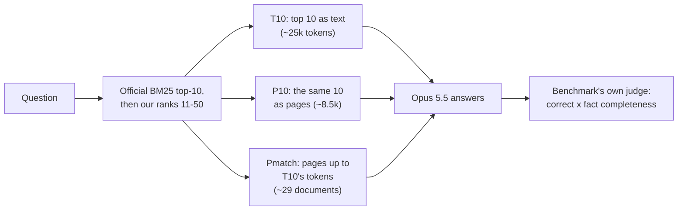

# EnterpriseRAG-Bench with page images: plan (prepared, not run)

*Status: parked. The preparation was done on 2026-11-11 (corpus parsed, retrieval rebuilt and checked, runner and
judge written); no Claude call was made, and the study was wound down on 2026-11-12 before the pilot was approved
(its cost, ~$75-85 for 50 questions, is mostly the judge). The retrieval figures below were recomputed from
[`results/erb/retrieval.jsonl`](../../results/erb/README.md) in the clean-up and match. What page images do for
retrieval was measured instead on three smaller sets: [RAG_PLAN.md](RAG_PLAN.md),
[results/rag](../../results/rag/README.md). Statements about the benchmark and its leaderboard are as read on
2026-11-11 and were not re-checked.*

**In one paragraph.** EnterpriseRAG-Bench is a public benchmark of 500 questions over about half a million
synthetic company documents. The plan was to give Opus 5.5 the benchmark's own top-10 retrieved documents either as
text or as page images, and to test whether pages lose nothing (the same 10 documents at about a third of the
tokens) and whether spending the saved tokens on more documents (about 29 instead of 10) raises the score. Terms:
BM25 is a standard keyword ranking; recall@10 is the share of the right ("gold") documents among the first 10
retrieved.



The rest of this file is the plan as written on 2026-11-11.

## Why this benchmark

[EnterpriseRAG-Bench](https://github.com/onyx-dot-app/EnterpriseRAG-Bench) (Onyx, arXiv 2605.05253, MIT): 511,962
synthetic company documents (Slack, Gmail, Linear, Drive, HubSpot, Fireflies, GitHub, Jira, Confluence) and 500
questions in 10 types. Synthetic, so no model has memorised it (our HotpotQA closed-book arm scored 57%, MultiHop-RAG
73%). Public [leaderboard](https://huggingface.co/spaces/onyx-dot-app/EnterpriseRAG-Bench-Leaderboard), 42 systems
(2026-11-03), ranked by **overall = mean over questions of correct (0/1) x fact completeness**. No Opus 5.5 entry;
the only Claude entry is Mixedbread (+ Opus 5), 9th, 86.6. Our counterpart is the official one-shot baseline
**BM25 + GPT-5.4: overall 50.6, correct 68.8%, recall@10 68.4%** (27th). Cost is not on the board.

## Question

With the official BM25 retrieval and the benchmark's own answer prompt, does Opus 5.5:
1. lose anything reading the same top-10 as **2.9x page images** (88.2 px²/char) instead of text, at ~1/3 of the
   context tokens (P10 vs T10)?
2. gain from reading **more documents as pages within the text arm's token budget** (Pmatch: ~29 documents instead
   of 10; gold-document recall 66% -> 76% on the pilot set, 68% -> ~77% on all 500)?

## Prep done (2026-11-11, no calls)

| item | where | result |
|---|---|---|
| benchmark repo (commit d36685e2), corpus 3.7 GB | `data/erb/repo` (git-ignored) | 511,958 documents parsed, 0 failures |
| official BM25 top-10 per question + Onyx's per-question scores | `data/erb/leaderboard/` (`fetch_leaderboard.py`) | 500 x 10 ids |
| deeper BM25 ranking (Lucene BM25 reimplemented: standard tokenizer approximation, lower case, k1 1.2, b 0.75, one-byte length norms) | `experiments/erb/build_bm25.py` -> `results/erb/retrieval.jsonl` | **overlap@10 with the official top-10 99.2%** (463/500 identical sets, same top-1 on 499/500); recall of gold docs @10 68.4% (= leaderboard), @20 73.4%, @30 77.2%, @40 79.2%, @50 80.4% |
| ranking used | official top-10, then our ranks 11-50 | - |
| answer runner (resumable, cached) | `experiments/erb/run_erb.py` | dry run below |
| provisional judge = Onyx's own `metrics_based_eval.py`, LLM calls through the Claude CLI | `experiments/erb/judge.py` | plumbing tested end to end with canned replies (`--fake`) |
| analysis | `experiments/erb/analyse_erb.py` | - |
| pilot questions: 50, stratified by type (>= 3 per type) | `results/erb/pilot_qids.json` | fixed |

OpenSearch itself (the baseline's engine) was downloaded but **not run**: starting it was blocked by the session's
permission check (an external binary). Using the published top-10 plus a validated reimplementation for ranks 11-50
avoids needing it.

## Arms (Opus 5.5, effort low, one call per question, no tools)

| arm | context | pilot dry run (50 q) |
|---|---|---|
| `closed` | the answer prompt with no documents (check: should be near 0; also gives the CLI's fixed input for the budget) | - |
| `T10` | official BM25 top-10, formatted exactly as the baseline (`--- Document i (ID: ...) ---`, title, content) | 73k chars, ~25k tokens (estimated at 2.9 chars/token) |
| `P10` | the same formatted text as page images (whitespace flowed) | ~8.5k image tokens (0.34x) |
| `Pmatch` | ranked documents as pages until the **measured** T10 context tokens of the same question are used (T10 input - closed input), 10-50 docs | ~29.5 docs, recall 0.66 -> 0.76 |

Submitted `document_ids` = the documents the arm read (Pmatch lists ~29: recall rises; invalid-extra-docs rises too,
but it does not enter the ranking).

## Judge

Onyx's evaluator, unchanged except for transport: citation stripping, correctness, each answer fact checked
separately, and the three-judge gold-document check (sends gold + up to 20 candidate documents as JSON, ~92k
characters per call; ~85% of the judge's tokens). Judge model: Sonnet 4.6 (the evaluator's Anthropic default) if the
CLI serves it; otherwise the nearest available model, recorded. Changes for reproducibility and cost: the
evaluator's candidate sample and shuffles are seeded per document set, so T10, P10 and the official baseline (same 10
documents) build identical gold-document prompts and share one cached judgment; identical repeated prompts get
separate cache slots, so the three consensus runs stay independent.

**Calibration:** our judge also scores GPT-5.4's published BM25 answers on the pilot questions, against Onyx's
published verdicts. This tells us how far our provisional numbers can be compared with the board.

## Pre-registered predictions (pilot reports them; the full run tests them)

1. **Calibration:** our judge agrees with Onyx's correctness verdicts on >= 85% of the official answers, mean
   correctness within 5 points.
2. **closed** scores <= 10% correct (synthetic corpus).
3. **T10 >= BM25 + GPT-5.4** on overall score (same documents), judged by our judge on both.
4. **P10 is within 3 points of T10** on correctness (full run; the pilot, n = 50, can only exclude a large loss),
   at <= 0.4x the context tokens.
5. **Pmatch beats T10 by >= 3 points** on correctness and overall (full run), at about T10's answer cost.
6. Reported without a threshold: cost per answer and per correct answer, by question type, judge cost.

## Pilot (50 questions): commands, in order

```bash
python3 experiments/erb/run_erb.py --pilot                                   # 200 answer calls, resumable
python3 experiments/erb/run_erb.py --export                                  # results/erb/answers_<arm>.jsonl
python3 experiments/erb/judge.py --answers data/erb/leaderboard/answers_bm25.jsonl --name official_bm25 --only-pilot --resume
for a in T10 P10 Pmatch; do python3 experiments/erb/judge.py --answers results/erb/answers_$a.jsonl --name $a --resume; done
python3 experiments/erb/judge.py --answers results/erb/answers_closed.jsonl --name closed --no-correction --resume
python3 experiments/erb/analyse_erb.py
```

Every step resumes: answers skip finished (question, arm) rows and read the response cache; the judge's `--resume`
skips judged questions and every judge call is cached. If the usage limit hits mid-run, failed calls are not
recorded; re-running the same command continues.

**Gates before the full run:** the judge model is served and < 5% of judge outputs are unparseable; calibration
agreement >= 80%; P10's measured context tokens <= 0.45x T10's; P10 not > 10 points below T10 on correctness (else
re-plan at 2.2x); Pmatch reads >= 20 documents on average.

## Cost (list prices, drawn from the subscription quota)

| stage | answers | judge (Sonnet-class) | total |
|---|---|---|---|
| pilot, 50 q (4 arms + calibration) | ~$22 (dry-run estimate: T10 $0.16, P10 $0.08, Pmatch $0.16, closed $0.035 per call) | ~$50-60 | **~$75-85** |
| full, remaining 450 q (closed, T10, P10, Pmatch) | ~$195 | ~$450-500 (Pmatch's gold-document check ~60% of it) | ~$650-700 |
| full without P10 (if the pilot shows no loss) | ~$160 | ~$430 | ~$590 |

The earlier ~$40 pilot estimate assumed ~11k-token contexts; the measured top-10 is ~25k tokens. Disk: 7 GB free
after prep (corpus 3.7 GB + postings 1 GB); runs add < 100 MB.

## Submitting (the user's call)

Onyx accepts submissions by email and requires reproducibility (an open-source guide, so these scripts would need to
be public). The board re-judges with its own setup; our numbers are a forecast.
