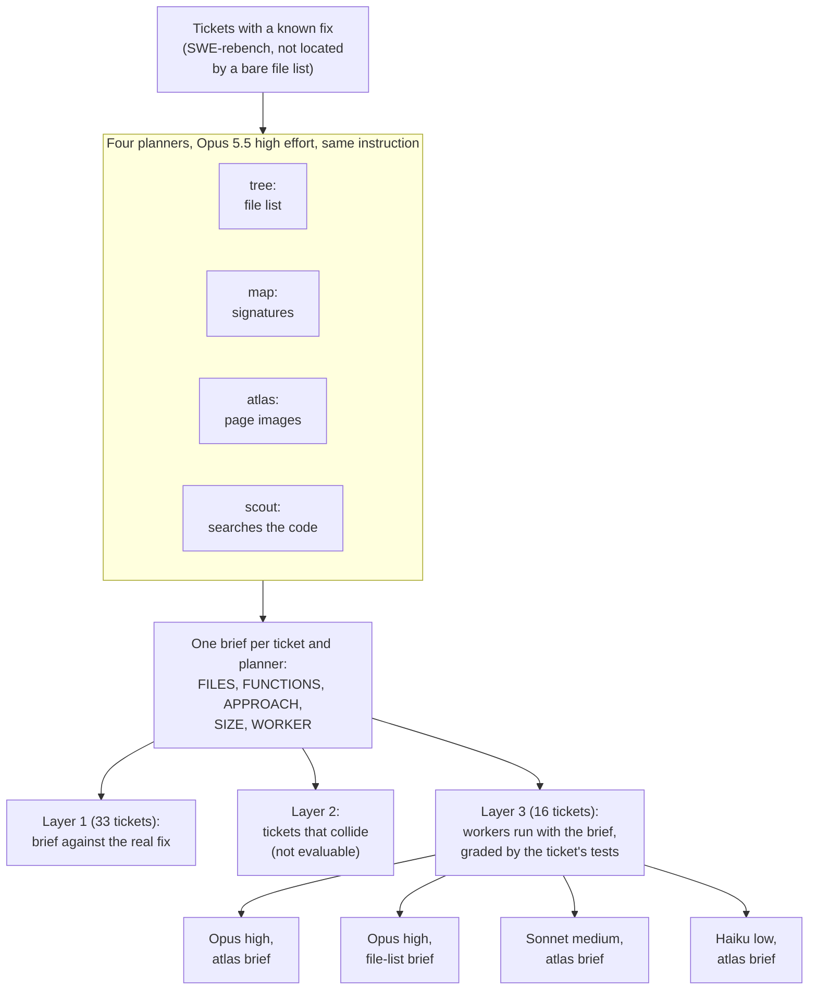
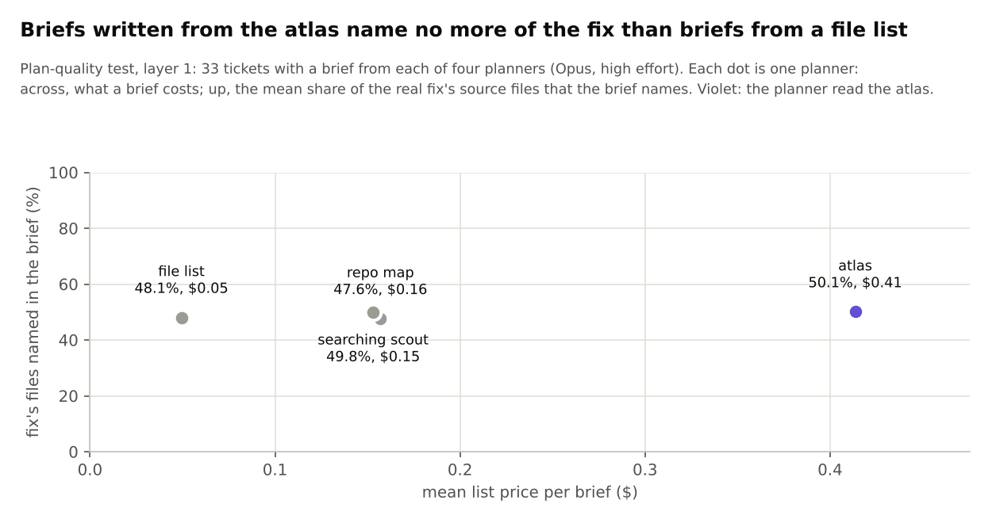
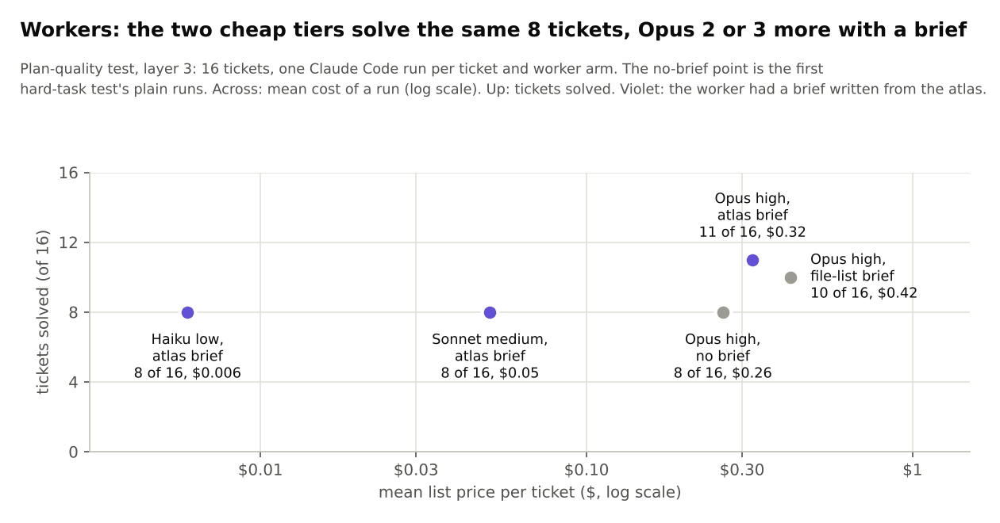

# Plan-quality test: an orchestrator that reads the atlas once (result and design)

**Status: finished, 2026-11-12. The use fails as proposed.** Run by an Opus subagent for $44.25 of a $45 cap. The
design below was approved by the user before the run and is kept unchanged at the end. Pre-registration, full
tables, checks and problems: [results/atlas/plan_quality/README.md](../../results/atlas/plan_quality/README.md).
The atlas itself and its other tests: [REPO_ATLAS_PLAN.md](REPO_ATLAS_PLAN.md).

*Every number below was recomputed from the rows in `results/atlas/plan_quality/` during the clean-up of
2026-11-13 (`python3 experiments/atlas/plan_quality.py analyse` reproduces `summary.md` exactly). Figures:
`python3 scripts/make_atlas_figures.py`.*

## In short

* **The use.** A backlog of tickets against one service. One orchestrator session loads the repo atlas (the whole
  repository as page images), reads every ticket and writes a brief per ticket: which files and functions to
  change, how, how big the job is, and which worker (model and reasoning level) should do it. Workers get the
  brief, not the atlas, and run in parallel.
* **The question.** Are briefs written from the atlas good enough to replace scouting (a worker searching the code
  before it starts), and do they size the work well enough to pick the right worker?
* **The answer.** No on both counts.
  1. Briefs from the atlas name 50.1% of the files the real fix changes; briefs from a bare file list name 48.1%
     and a searching scout's briefs 49.8%. The atlas brief costs $0.41, the file-list brief $0.05, the scout's $0.15.
  2. The planner's size estimate barely tracks the real fix (rank correlation 0.24; the bar was 0.3), and its
     choice of worker solved 8 of 16 tickets against 11 for "always Opus at high effort". It never chose Opus.
  3. A brief may help an Opus worker (11 solved with the atlas brief, 10 with the file-list brief, 8 with none),
     but that is 3 tickets to 0 from one run each (p = 0.25), and the file-list brief does nearly as well. If the
     gain is real, it comes from planning, not from the atlas.
* **What to do instead.** The two cheap tiers solved the same 8 tickets and Opus 3 more. Trying the cheapest worker
  first and moving up when the ticket's check fails beats asking a planner to guess.

## The design at a glance



Terms: a **ticket** is a real GitHub issue with its real fix. A **planner** is one Opus call (or, for the scout,
one read-only Claude Code session) that sees the ticket and one view of the repository. A **brief** is its answer
in a fixed format. A **worker** is Claude Code with edit tools that gets the ticket and a brief. **SIZE** is the
planner's estimate, S, M or L. The **measured tier** of a ticket is the cheapest worker that solved it.

## Results

### Layer 1: the brief against the real fix

33 tickets have a brief from all four planners (35 from tree, map and atlas; the last two scout briefs did not fit
under the cap).



*How to read it: one dot per planner. Across, what one brief costs; up, the mean share of the real fix's source
files that the brief names. All four sit at the same height (48-50%); the atlas (violet) is far to the right.*

| Planner | Fix's files named | Named files not in the fix | Fix's functions named | Invented paths and functions | Judge score (0-6) | Cost per brief |
|---|---|---|---|---|---|---|
| tree (file list) | 48.1% | 38.2% | 44.6% | 6 of 239 (2.5%) | 5.48 | $0.05 |
| map (signatures) | 47.6% | 35.4% | 49.2% | 1 of 283 (0.4%) | 5.42 | $0.16 |
| atlas (page images) | 50.1% | 24.7% | 50.3% | 1 of 246 (0.4%) | 5.67 | $0.41 |
| scout (searching agent) | 49.8% | 12.5% | 50.0% | 2 of 255 (0.8%) | 5.73 | $0.15 |

* **No better at finding the fix.** Paired over the 33 tickets, atlas minus tree is +2.0 points (atlas higher on 6
  tickets, lower on 6); scout minus atlas is -0.3.
* **Fewer wrong files than a file list, more than a scout.** A quarter of the files an atlas brief names are not
  in the fix; for the scout it is an eighth.
* **Almost nothing invented.** One of the 246 paths and functions the atlas planner named does not exist in the
  repository. Misread pages did not show up as made-up names.
* **The judge cannot separate the planners.** A blind judge (planner names removed, order shuffled) scored each
  brief against the real fix on right cause, right place and "would lead to the fixed behaviour"; every planner is
  near the ceiling of 6.

### Sizing

Every fix here changes at least 3 source files, so by the design's own rule each ticket is really M or L (16 M, 17
L).

| Planner | Rank correlation of SIZE with the real fix's size | SIZE given: S / M / L | SIZE equals the rule's class |
|---|---|---|---|
| tree | 0.32 | 6 / 22 / 5 | 17 of 33 |
| map | 0.27 | 6 / 20 / 7 | 17 of 33 |
| atlas | 0.24 | 7 / 19 / 7 | 15 of 33 |
| scout | 0.38 | 6 / 20 / 7 | 18 of 33 |

The real size is a composite of files, functions and lines changed. Reading all of the code did not make the
estimate better than reading the file names.

### Layer 2: tickets that collide

Not evaluable. Only one repository (sqlglot) had three or more tickets; the design needed three such groups.

### Layer 3: workers

16 tickets, one Claude Code run per ticket and arm, graded by the ticket's own tests. The "no brief" rows are the
plain runs of the first hard-task test ([results/atlas/swe](../../results/atlas/swe/README.md)), made earlier the
same day.



*How to read it: one dot per worker arm. Across, the mean cost of one run on a log scale; up, tickets solved of
16. The two cheap tiers sit at 8 solved for 1 to 5 cents; the three Opus arms sit at 8 to 11 for 26 to 42 cents.*

| Worker | Solved (of 16) | Median turns | Mean cost per ticket |
|---|---|---|---|
| Opus high, no brief | 8 | 12.5 | $0.26 |
| Opus high, atlas brief | 11 | 12.5 | $0.32 |
| Opus high, file-list brief | 10 | 15 | $0.42 |
| Sonnet medium, atlas brief | 8 | 6 | $0.05 |
| Haiku low, atlas brief | 8 | 8.5 | $0.006 |

* **A brief may help, whichever view wrote it.** Atlas brief against no brief: 3 tickets solved only with the
  brief, none only without (exact p = 0.25). Atlas brief against file-list brief: 1 to 0. Turns did not fall
  (lower on 5 of 14 untied tickets). This is the third "3 to 0" of its kind in the atlas work; the one that was
  repeated vanished ([REPO_ATLAS_PLAN.md](REPO_ATLAS_PLAN.md), test 6), so read it as unsettled.
* **Haiku and Sonnet solved exactly the same 8 tickets; Opus solved those and 3 more.** Five tickets were solved by
  no tier.

### Right-sizing: the planner's choice of worker

The atlas planner chose Sonnet at medium effort for 13 of the 16 tickets, Haiku for 3 and Opus for none, although
its own default for a ticket it sized L was Opus.

| Against the measured tier | Tickets |
|---|---|
| right | 2 |
| too large (Haiku already solved it) | 6 |
| too small (only Opus solved it) | 3 |
| solved by no tier | 5 |

| Policy | Solved (of 16) | Total worker cost |
|---|---|---|
| always Opus high | 11 | $5.17 |
| always Sonnet medium | 8 | $0.81 |
| always Haiku low | 8 | $0.10 |
| the planner's choice | 8 | $0.73 |
| *Haiku first, Opus on the tickets Haiku fails (computed from the same rows, not a separate run)* | *11* | *$1.99* |

The planner's choice costs 14% of always-Opus and loses 3 of its 11 tickets; it solves no more than always-Haiku
at seven times the price. The last row assumes a failed ticket is detected by its tests, which a real backlog may
not have.

### Predictions

| # | Prediction (made before any row) | Outcome |
|---|---|---|
| 1 | The atlas brief names more of the fix's files than the file-list brief, by at least 5 points | **FAIL** (+2.0) |
| 2 | Invented names: at most 2% of what the atlas brief names, and not more than 2 points above the scout | **PASS** (0.4% against 0.8%) |
| 3 | The scout names at least as many fix files as the atlas, within 5 points | **PASS** (49.8% against 50.1%) |
| 4 | Collisions: the atlas planner finds more true colliding pairs than the file list | not evaluable |
| 5 | The atlas planner's SIZE rises with the real size (rank correlation at least 0.3) | **FAIL** (0.24) |
| 6 | Following the planner's WORKER solves within 1 ticket of always-Opus at no more than 70% of its cost | **FAIL** (8 against 11, at 14% of the cost) |
| 7 | A worker with the atlas brief uses fewer turns than one with no brief and solves within 2 tickets of it | **FAIL** (turns equal; 3 more solved, in the brief's favour) |

### Spend

$44.25 at list price: atlas briefs $14.12, map briefs $5.38, scout briefs $5.19, file-list briefs $1.71, judge
$4.51, Opus workers $5.17 (atlas brief) and $6.76 (file-list brief), Sonnet workers $0.81, Haiku workers $0.11,
selection screens $0.50, a smoke call $0.01.

## Limits

* 33 tickets can show a difference of about 5 points in files named; the gaps found are inside that.
* Layer 3 is 16 tickets and one run per arm; run-to-run variation on these tasks turned out to move a result by
  1 to 2 tickets (test 6 of the atlas report). The no-brief rows come from a different run earlier in the day, and
  the first four of them ran before the package index was blocked.
* The tickets are public (created 2025-05 to 2026-05) and older than the model's knowledge cutoff; a
  file-list-only screen removed the ones the model could locate from memory (18 of 58 screened).
* Layer 1 on all 40 selected tickets was estimated at $42-50, so it could not fit under the cap with layer 3.
  Lesson: cost a design per layer before fixing a cap.
* Planner and judge are the same model (Opus 5.5).

## The design, as approved before the run

Kept as written on 2026-11-12, apart from link paths. Where the run differed: 40 tickets were selected and 33-35
briefed (not "40 or more"); the layer-3 tickets numbered 16; ticket dates run from 2025-05, not 2025-07.

### The use case

A backlog of tickets against one service. One orchestrator session loads the repo atlas
(`experiments/atlas/repo_atlas.py`), reads every ticket and writes a brief per ticket. Worker subagents get their brief,
not the atlas, and run in parallel; after a batch merges the atlas is rebuilt and the next phase is planned. Cost
reasoning and what earlier tests showed: [CLAUDE_QA.md](CLAUDE_QA.md), "Proposed, not tested".

**Question:** are briefs written from the atlas good enough to replace scouting, and do they size the work well
enough to pick the right worker (model and reasoning level) per ticket?

### The brief (fixed structure, asked for in the prompt)

```
TICKET: <id>
SUMMARY: <one sentence>
FILES: <path> : <what changes>            (at most 6, most important first)
FUNCTIONS: <names>
APPROACH: <at most 3 sentences>
RISKS: <at most 2>
COLLIDES_WITH: <ticket ids that touch the same files, or none>
ORDER: <tickets that should land first, or none>
SIZE: S | M | L
WORKER: <haiku | sonnet | opus> / <low | medium | high>
CONFIDENCE: low | medium | high
```

Sizes, defined in the prompt: **S** one file, a local change, no design choice; **M** two or three files, or one
decision that is not obvious; **L** four or more files, or a change across modules. Default worker per size:
S = Haiku 5.5 at low effort, M = Sonnet 5.5 at medium, L = Opus 5.5 at high; the planner may choose otherwise and
must then say why in RISKS.

### Tasks

Fresh tickets with a known fix, from the benchmark the fresh-task test uses (SWE-rebench; its selection, clones
and validation records are in `results/atlas/swe/`), in repositories whose atlas fits and not located by a
bare file list. They are not newer than the model (created 2025-07 to 2026-05; nothing later exists in the
benchmark), so the bare-file-list screen is the guard against memorised tickets. Layers 1 and 2 need only the real fix, so they use
every such ticket (target 40 or more). Layer 3 needs tests that run here, so it uses the tickets that test
validated and compared (16; its environments were deleted and must be rebuilt from its selection records).

### Planners (Opus 5.5, high effort; the same instruction and brief format)

1. `tree`: the file list only;
2. `map`: the repo map (signatures per file);
3. `atlas`: the page images and their index, one call;
4. `scout`: Claude Code with read-only tools on the checkout (what a worker does today before it starts).

### Layer 1: the brief against the real fix (no execution)

* files: share of the fix's source files named; share of named files that are not in the fix;
* functions: share of the functions the fix changes that are named;
* **things that do not exist:** named paths and symbols absent from the repository (what a misread page would
  produce);
* approach: judged blind (planner names removed, order shuffled) against the real fix by a fixed rubric: right
  cause, right place, would lead to the fixed behaviour; one call per brief;
* **sizing:** predicted SIZE against the real fix's size (files, functions and lines changed), rank correlation
  and a confusion table;
* cost and seconds per brief.

### Layer 2: tickets that collide (what only an orchestrator can do)

Groups of three or more tickets in one repository, planned together on one commit. The planner fills
COLLIDES_WITH and ORDER. Scored against the overlap of the real fixes' files (pairs found, pairs wrongly flagged).
If the benchmark has fewer than three usable groups, this layer is reported as not evaluable.

### Layer 3: does the brief help the worker, and is the worker right-sized?

Workers are Claude Code with edit tools, graded by the ticket's own tests (the fresh-task runner).

* **Brief or scouting:** an Opus high-effort worker with the `atlas` brief, with the `tree` brief, and with no
  brief (rows from the fresh-task test): resolved, turns, cost, seconds.
* **Right-sizing:** with the `atlas` brief, each ticket is also run on Haiku at low effort and Sonnet at medium.
  The cheapest tier that resolves a ticket is its measured tier. Scores: the planner's WORKER against the measured
  tier (right, too small, too large); and three policies compared on tickets resolved and total cost: always Opus
  at high effort, always the cheapest tier, and the planner's choice.

### Predictions (before any row)

1. The `atlas` brief names more of the fix's files than the `tree` brief (paired, at least 5 points).
2. Things that do not exist: at most 2% of what the `atlas` brief names, and not more than 2 points above `scout`.
3. `scout` names at least as many of the fix's files as `atlas` (within 5 points either way).
4. Collisions: the `atlas` planner finds more true colliding pairs than `tree` at no more false ones.
5. Sizing: the `atlas` planner's SIZE rises with the real fix's size (rank correlation at least 0.3).
6. Right-sizing: following the planner's WORKER choice resolves within 1 ticket of always-Opus-high at no more
   than 70% of its cost.
7. A worker with the `atlas` brief uses fewer turns than one with no brief (paired median) and resolves within 2
   tickets of it.

Predictions 1, 4 and 6 are the uncertain ones: on every earlier test the atlas alone did not beat a file list.

### Budget and order (estimates)

Layers 1-2: ~$20 (atlas briefs are the main cost). Layer 3: ~$14 for the two Opus brief arms and ~$4 for the
Haiku and Sonnet runs. Cap $45. Order: layer 1 pilot on 6 tickets, then layers 1-2 in full, then layer 3 while
whole tickets fit under the cap. With 17 tickets layer 3 can only show large differences; say so in the write-up.
