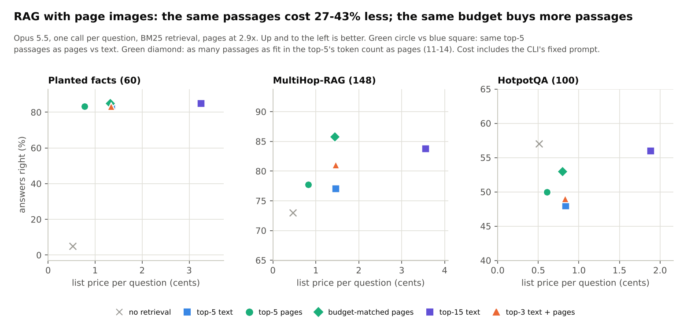
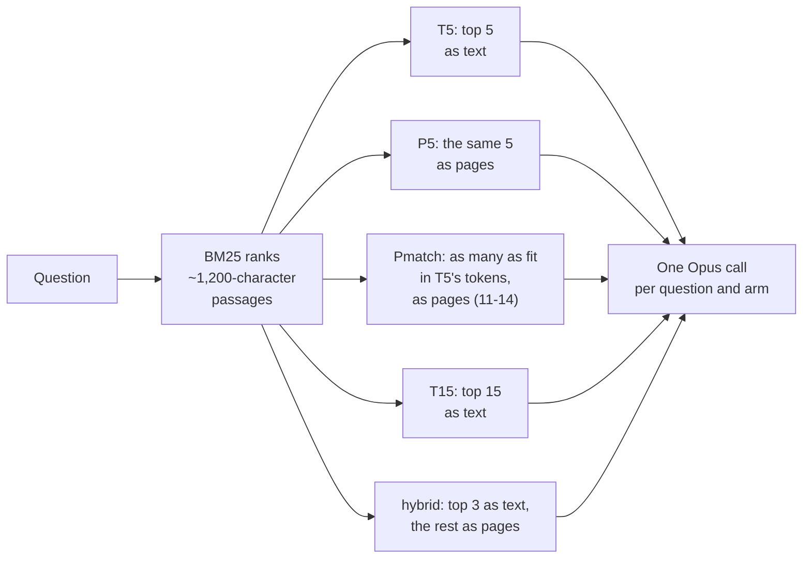

# RAG with page images: the plan as pre-registered, and what was found

*Status: run and finished on 2026-11-11 (1,848 calls, $24.22 at list price against an estimate of ~$105). Rows,
tables and the scoring fixes: [results/rag](../../results/rag/README.md). Summary in context:
[CLAUDE_QA.md](CLAUDE_QA.md#tested-retrieval-rag).*

RAG (retrieval-augmented generation) means the model answers a question from a few passages that a search step
retrieved. The question here: do those passages work as well as page images, and what does the token saving buy?

## What was found

*How to read it:* one panel per dataset; each mark is one way of giving the model its passages. Up is more answers
right, left is cheaper. Compare the green circle (top-5 passages as pages) with the blue square (the same passages
as text), and the green diamond (as many passages as fit in the same tokens, as pages) with both.

| Prediction (numbered as below) | Outcome |
|---|---|
| 1. The top-5 as pages are within 2 points of the top-5 as text, with at least 2x fewer context tokens | **PASS** on point estimates (0, +0.7, +2.0 points) and tokens (2.6x, 2.6x, 2.2x fewer). The 95% interval is inside 2 points only on MultiHop-RAG; the other sets have 60 and 100 questions |
| 2. Budget-matched pages beat the top-5 as text by at least 3 points on MultiHop-RAG and HotpotQA | **PASS on MultiHop-RAG** (+8.8, p = 0.001). HotpotQA +5.0, not significant (p = 0.18) |
| 3. Text head plus paged tail is at least as accurate as budget-matched pages | **FAIL** on all three sets |
| 4. On planted facts, budget-matched pages and the top-5 as text tie | **PASS** (+1.7, p = 1) |
| 5. Cost, reported without a threshold | the same passages as pages cost 27-43% less per question, including the command line's fixed ~5k-token prompt |

Deviations from the plan: all three stages were run; the planted-fact set used 60 questions, not 120; MultiHop-RAG
has 148 usable questions, not 150; the scorer was fixed twice after the first stage, for every arm, from the cached
responses ([results/rag](../../results/rag/README.md) explains both fixes). Dense retrieval was not run.

## The plan as pre-registered

*Written 2026-11-11 as a draft for approval, before any call, and committed (9810725) before the first one. Kept as
written.*

## Question

In retrieval-augmented generation the model answers one question from a handful of retrieved passages. Two ways page
images could help, and both need testing because RAG differs from the long-document tests done so far:

1. **Same passages, cheaper:** send the top-k passages as pages instead of text. The document tests say Opus loses
   nothing at 2.2x and, at high effort, 2.9x, but those were 240k-token documents; RAG contexts are 2-10k tokens, where
   an image's minimum size and the per-call overhead matter.
2. **Same budget, more passages:** for the tokens of the top-5 as text, pages carry ~13-15 passages. If the answer's
   evidence is often ranked 6-15 (multi-hop questions), recall rises, and accuracy should with it.

What is new here: small contexts, one call per question (no shared prompt cache), real retrieval with imperfect
recall, and questions whose answers are not numbers.

## Datasets (all checked reachable from this session)

| set | why | questions used | scoring |
|---|---|---|---|
| **Planted facts** (the deep-research corpora, `claude_qa_research.py`) | no memorisation possible; exact numeric answers; lookups and cross-source questions | 120 (40 per corpus, half cross-source) | exact number |
| **MultiHop-RAG** (`yixuantt/MultiHopRAG`, 609 news articles from late 2023, after much training data) | realistic multi-document questions: inference, comparison, temporal, and null ("insufficient information") | 150, stratified by type | normalised exact match (short answers: names, yes/no, insufficient) |
| **HotpotQA** distractor (`hotpotqa/hotpot_qa`) | standard multi-hop benchmark with gold supporting paragraphs; widely memorised, so a closed-book arm is the control | 100 hard questions; corpus = the paragraphs of 2,000 questions pooled (~20k) | normalised EM and F1 |

## Retrieval

Passages of ~1,200 characters at sentence boundaries, each with a header `[Doc i: title]`. BM25 in pure Python (no
install needed). Dense retrieval (a small embedding model from the Hugging Face Hub) only as a robustness check if
BM25 recall is very low. Recall@k of the gold passages is logged for every question (MultiHop-RAG and HotpotQA give
gold evidence; planted facts know where they were planted).

## Arms (one call per question, Opus 5.5, single-shot, no tools)

| arm | context |
|---|---|
| `closed` | no passages (memorisation floor) |
| `T5` | top-5 passages as text (the reference) |
| `P5` | the same top-5 as pages at 2.9x: equal information, fewer tokens |
| `Pmatch` | as many top-ranked passages as fit in **T5's token count** as pages at 2.9x (~13-15) |
| `T15` | top-15 as text: what `Pmatch` buys, at text prices (upper reference) |
| `hybrid` | top-3 as text + ranks 4-15 as pages, within T5's token count |

All passages of one call go into one image sequence (packed, not one image per passage), so the image minimum (~140
tokens) is paid once. Density 2.9x (88.2 px²/char), with 2.2x as a fallback if the pilot shows a loss.

## Metrics

* **Accuracy** per arm, paired against `T5` (Newcombe 95% interval, exact McNemar), by question type.
* **Cost per question**, computed from each call's usage at Opus list prices, two ways: as run (including the
  Claude Code CLI's fixed ~5-6k-token prompt per call, which dilutes any saving on small contexts) and context-only
  (input minus a no-passage call's input; what an API caller without that overhead would pay).
* **Cost per correct answer**, and recall@k against accuracy.

## Pre-registered predictions (to be committed before the first call)

1. `P5` is within 2 points of `T5` (lossless at equal information) on every dataset, with context tokens >= 2x fewer.
2. `Pmatch` beats `T5` by at least 3 points on MultiHop-RAG and HotpotQA (where recall@5 is below ~80%), at about
   the same cost.
3. `hybrid` is at least as accurate as `Pmatch`.
4. On planted facts, where BM25 finds the passage easily, `Pmatch` and `T5` tie (recall is not the bottleneck).
5. Reported without a threshold: cost per correct answer for every arm; the CLI-inclusive and context-only savings.

## Budget and staging

Rough cost per call with the CLI: $0.03-0.07 (most of it the fixed prompt). Run in stages, stopping if a stage
answers the question:

| stage | questions x arms | calls | est. list price | time (8 parallel calls) |
|---|---|---|---|---|
| A: pilot on planted facts | 60 x 6 | 360 | ~$20 | ~15 min |
| B: MultiHop-RAG | 150 x 6 | 900 | ~$50 | ~35 min |
| C: HotpotQA (optional) | 100 x 6 | 600 | ~$35 | ~25 min |

Calls are cached (re-runs are free) and resumable; disk and memory needs are small.

## Risks and how the plan handles them

* **Memorisation** (HotpotQA, some MultiHop-RAG): the `closed` arm measures it; conclusions rest on paired
  differences between arms, and on the planted-fact set, which cannot be memorised.
* **Answer scoring on free text:** normalised exact match (lower case, articles and punctuation removed) plus F1 for
  HotpotQA; no model judge, so scores are deterministic. The system prompt asks for the shortest exact answer.
* **Fixed CLI overhead:** reported separately, as above. An API-direct run would avoid it but needs an API key.
* **Small contexts:** a single top-5 context (~6k characters) fills less than one page, so the image is cropped to
  its height; the pilot checks that `P5` actually uses fewer tokens than `T5`.
