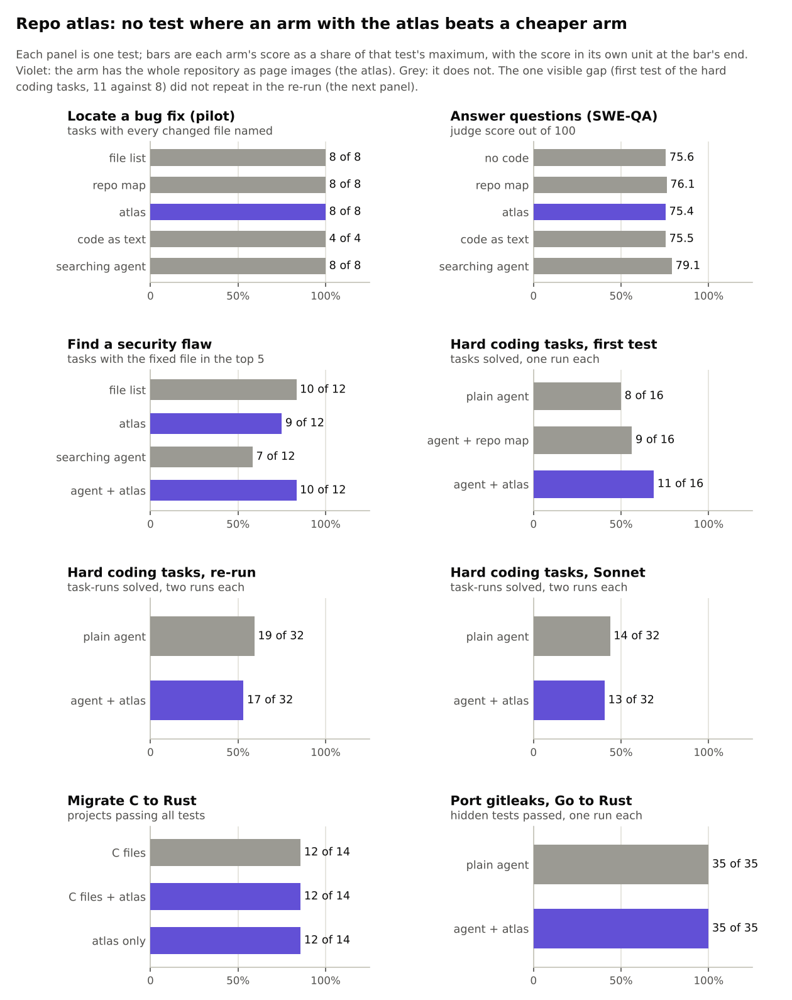
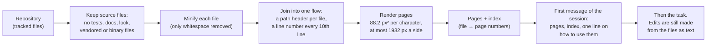
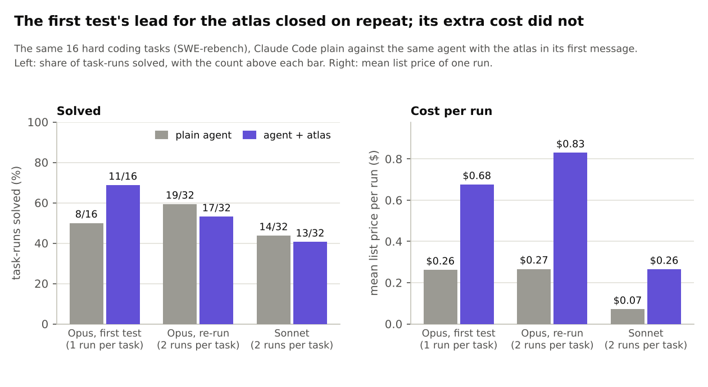

# Repo atlas: a whole repository as page images (report)

**Status: finished and closed, 2026-11-12.** Seven tests of the atlas and one repeat, plus the plan-quality test of
an orchestrator that plans from it ([PLAN_QUALITY_TEST.md](PLAN_QUALITY_TEST.md)). **No arm that holds the atlas
beat a cheaper arm in any of them.** Total spend $171.07 at list price for the atlas tests and $44.25 for the
plan-quality test. This file began as the plan (hence its name); the plan and the later designs are kept unchanged
at the end, under "As pre-registered".

*Every number below was recomputed from the rows in `results/atlas/*/` during the clean-up of 2026-11-13 (each
runner's `analyse` or `report` command reproduces its `summary.md` exactly). Figures:
`python3 scripts/make_atlas_figures.py`.*

## In short

* **The idea.** Minify every source file of a repository, draw the whole thing as page images, and give it to the
  model before it starts, so that it has read all of the code. As text that is too expensive; as pages it takes
  about 3.5 times fewer tokens.
* **What was hoped.** Better decisions about code (where a change goes, what an answer is, where a flaw sits), or
  the same decisions in fewer steps, because nothing has to be searched for.
* **What was found.** Nothing gained. Where the code is public, the model already knows it, and a bare list of file
  names does as well as the atlas. Where a coding agent can search, searching is cheaper and at least as good. An
  agent given the atlas solves no more tasks and pays 2.6 to 3.7 times as much per run.
* **The one lean that remains.** An agent with the atlas tends to take a few fewer turns. It never came close to
  paying for the pages.
* **Two early "3 tasks to 0" hints for the atlas** (security flaws, hard coding tasks) were each from one run per
  task. The second was repeated twice and vanished. The first was never repeated and should be read the same way.

*How to read it: one panel per test. Each bar is one arm's score as a share of that test's maximum; the number at
the bar's end is the score in the test's own unit. Violet bars are arms that hold the atlas, grey bars do not. If
the atlas helped, a violet bar would be longer than the grey bars in its panel. That happens once (hard coding
tasks, first test) and is gone in the re-run next to it.*

## What the atlas is

A repo map (as in the tool aider) gives a model the names and signatures in a repository: a few thousand tokens.
The atlas goes further and gives it all of the code.

* **Code:** `experiments/atlas/repo_atlas.py` (`stats` for sizes, `build` for pages and index; tests
  `tests/test_repo_atlas.py`). It reuses the minifiers and the renderer of the coding hooks in
  `experiments/readhook/vtchook`.
* **Density:** 88.2 px² per character, the setting at which Opus reads 2.9 times fewer tokens than the same text
  ([CLAUDE_QA.md](CLAUDE_QA.md)). A file header looks like `▶path◀`; every tenth line carries its line number as
  `§n`.
* **Left out:** tests, docs, examples, lock files, vendored directories, files over 200 kB, and files no minifier
  covers. Files that contain the marker characters `§` or `▶` are dropped too (found in the security test).
* **It cannot be one image.** A page is at most 1932 px a side, and a request above about 175,000 image tokens
  silently loses its first pages ([GOTCHAS.md](../GOTCHAS.md)). So the limit used everywhere is **150,000 image
  tokens, about 1.3 million characters of source.**

### Which repositories fit

Sizes at each repository's HEAD on 2026-11-12, source only (`repo_atlas.py stats`; the clones were not kept, so this
table is as measured then and was not re-run in the clean-up). "As text" is an estimate of the same files as text
tokens.

| Repository | Files | Source chars | Pages | Image tokens | As text (est.) | Fits one request |
|---|---|---|---|---|---|---|
| requests | 29 | 225k | 5 | 23,736 | 78k | yes |
| gin | 67 | 261k | 7 | 31,119 | 113k | yes |
| flask | 33 | 361k | 8 | 37,536 | 125k | yes |
| click | 25 | 463k | 11 | 47,748 | 160k | yes |
| preact | 138 | 453k | 12 | 55,062 | 189k | yes |
| axios | 104 | 564k | 14 | 64,170 | 223k | yes |
| bat | 121 | 622k | 15 | 67,137 | 261k | yes |
| fmt | 38 | 731k | 18 | 81,903 | 339k | yes |
| jq | 53 | 818k | 20 | 91,287 | 386k | yes |
| seaborn | 58 | 1.04M | 23 | 106,881 | 359k | yes |
| gson | 142 | 1.01M | 24 | 114,057 | 393k | yes |
| axum | 128 | 1.14M | 26 | 120,405 | 464k | yes |
| pytest | 118 | 1.56M | 35 | 162,633 | 544k | no (just over) |
| ripgrep | 120 | 1.62M | 37 | 172,983 | 657k | no (just over) |
| pylint, xarray, caddy, sphinx | 141-456 | 2.1M-4.8M | 46-102 | 215k-482k | 0.75M-1.75M | no |

Django, sympy, scikit-learn and the like are far too large. Most real services are too.

### What it costs to carry

The atlas is written to the prompt cache once and then re-read on every turn of the session.

| Measured (list price, Opus 5.5 unless noted) | Without the atlas | With the atlas |
|---|---|---|
| One call that names the files of a fix (pilot, atlases of 29-78k image tokens) | $0.015 with the file list; $0.038 for a searching agent | $0.23 |
| One agent run on a hard coding task (re-run, 32 runs per arm) | $0.27 | $0.83 (3.1 times) |
| The same on Sonnet 5.5 | $0.07 | $0.26 (3.7 times) |
| One brief for a ticket (plan-quality test) | $0.05 from the file list; $0.15 for a searching scout | $0.41 |

The plan estimated $0.30 to load a 60,000-token atlas and $0.024 per further turn, taking a cache read at a tenth
of the input price. The port test later found that the command-line tool charges Opus cache reads at a twentieth
($0.20 per million tokens), so the per-turn figure was about twice too high; the measured costs in the table are
what count.

## All tests at a glance

All on 2026-11-12, each run by an Opus subagent with a pre-registration written before the first scored call and a
hard spend cap. Models: Opus 5.5 at high effort except where Sonnet is named. "Plain agent" is Claude Code with its
normal tools and no atlas.

| # | Test | Tasks | Arms | Result | Spend | Rows and pre-registration |
|---|---|---|---|---|---|---|
| 1 | Name the files a bug fix changes (pilot) | 8 SWE-bench tasks | file list, repo map, atlas, code as text, searching agent | every arm 8 of 8 (text 4 of 4): cannot separate the arms | $7.49 | [pilot](../../results/atlas/pilot/README.md) |
| 2 | Answer questions about a repository (SWE-QA) | 144 questions on requests, flask, pytest | no code, repo map, atlas, code as text, searching agent | judge score of 100: 75.6 / 76.1 / 75.4 / 75.5 / 79.1: the atlas adds nothing over memory | $20.83 | [qa](../../results/atlas/qa/README.md) |
| 3 | Find a published, fixed security flaw | 12 advisories newer than the model | file list, atlas, searching agent, agent with atlas | fixed file in the top 5: 10 / 9 / 7 / 10 of 12 | $20.70 | [sec](../../results/atlas/sec/README.md) |
| 4 | Solve hard coding tasks | 16 SWE-rebench tasks, one run each | plain agent, with a repo map, with the atlas | solved: 8 / 9 / 11 (3 tasks to 0 for the atlas, p = 0.25) | $28.45 | [swe](../../results/atlas/swe/README.md) |
| 5 | Migrate C to Rust | 14 CRUST-Bench projects | C files, C files and atlas, atlas only | all tests pass on 12 of 14 in every arm | $24.01 | [migrate](../../results/atlas/migrate/README.md) |
| 6 | **Repeat of test 4**, two runs each, auto-memory off ("Q1") | the same 16 tasks, 64 runs | plain agent, with the atlas | task-runs solved of 32: 19 / 17: the lead of test 4 is gone | $35.07 | [swe_rerun](../../results/atlas/swe_rerun/README.md) |
| 7 | Port a larger tool, Go to Rust ("Q2") | gitleaks, 22k lines, one run each | plain agent, with the atlas | hidden tests passed: 35 of 35 / 35 of 35 | $23.14 | [port](../../results/atlas/port/README.md) |
| 8 | Test 6 on a cheaper model ("Q3") | the same 16 tasks, 64 runs, Sonnet 5.5 | plain agent, with the atlas | task-runs solved of 32: 14 / 13; Sonnet reads the pages (20 of 20 lookups) | $11.38 | [swe_sonnet](../../results/atlas/swe_sonnet/README.md) |
| | **Atlas tests, total** | | | | **$171.07** | |
| 9 | Plan-quality test: an orchestrator writes briefs from the atlas | 33 tickets x 4 planners; 16 tickets x 4 worker arms | planners: file list, repo map, atlas, searching scout | fix's files named: 48.1% / 47.6% / 50.1% / 49.8%; the planner cannot size the work or pick the worker | $44.25 | [PLAN_QUALITY_TEST.md](PLAN_QUALITY_TEST.md), [plan_quality](../../results/atlas/plan_quality/README.md) |

Counting: tests 1-5, 7 and 8 are the "seven tests", test 6 is the "one repeat". The plan-quality test (run between
tests 5 and 6) is counted separately here; some summaries count it among the tests.

## Conclusions

**1. On code the model has seen, the atlas adds nothing to memory.** In the pilot a bare file list (about 2,000
tokens) named every changed file on all 8 tasks, and the model described the real fixes from the file list alone.
On SWE-QA the model scored 75.6 of 100 with no code at all and 75.4 with the atlas. Only an agent that searched the
checkout did better (79.1; 3.3 points above the atlas, interval 2.3 to 4.4).

**2. On code the model cannot have seen, file names still give most of it away.** The security flaws were
published after the model's training data. A bare file list still put the fixed file in its top 5 on 10 of 12
tasks (`security.ts`, `ZipUtil.java`); the atlas alone did so on 9.

**3. An agent with the atlas does not solve more.** Three paired comparisons on the same 16 hard tasks:

*How to read it: three pairs of bars per panel, grey for the plain agent and violet for the agent with the atlas.
Left, the share of task-runs solved (counts above the bars). Right, the mean list price of a run. In the first
test the atlas bar is higher (11 of 16 against 8 of 16); in the re-run and on Sonnet it is slightly lower. On the
right the atlas bar is 2.6 to 3.7 times the plain bar every time.*

The first test's 11 against 8 was one run per task. Run twice more with nothing else changed, plain solved 19 of 32
task-runs and the atlas 17. Its transcripts were checked for a shared memory store (the suspected cause) and none
was shared or written, so the first result was run-to-run variation: the plain agent alone moved from 8 to 10 and 9.

**4. The lean that remains: a few fewer turns.** It shows in most tests, is significant in one, and is small.

| Test | Turns with the atlas against without | Cost with the atlas |
|---|---|---|
| Security flaws (agent arms) | median 8 against 18; fewer on 11 of 12 tasks | 1.5 times ($0.67 against $0.46) |
| Hard tasks, first test | median 10 against 12.5; fewer on 11 of 12 untied tasks, p = 0.006 | 2.6 times ($0.68 against $0.26) |
| Hard tasks, re-run | fewer on 10 of 15 untied tasks, p = 0.30 | 3.1 times ($0.83 against $0.27) |
| Hard tasks, Sonnet | median 6 against 7.5; fewer on 11 of 14 untied tasks, p = 0.057 | 3.7 times ($0.26 against $0.07) |
| Migration | 7 projects fewer, 6 more, p = 1.0 | 1.05 times ($0.57 against $0.54) |
| Port | 99 against 102 (one run each) | the same ($11.20 against $11.32) |

A turn saved is worth a few cents; the atlas costs tens of cents to load and is re-read on every turn that
remains. Wall-clock time did not fall in any test.

**5. Pages can stand in for the source, where that was tested.** In the migration test the arm with only the pages
(no C files) passed exactly the projects the other arms passed. Sonnet and Opus each answered 20 of 20 lookups of
names, argument lists and constants from atlas pages. So the failure is not legibility: the model reads the atlas
and has no use for it.

**6. As a one-time read for an orchestrator it fails too.** Briefs written from the atlas name the same share of
the fix's files as briefs from a file list, at 8 times the price ([PLAN_QUALITY_TEST.md](PLAN_QUALITY_TEST.md)).

## What was not tested

* **Private or truly new repositories.** Every repository here is public. The coding benchmarks hold nothing newer
  than 2026-05, a month before the model's stated knowledge cutoff, so memorised tasks were screened out with a
  file-list-only call instead (12 of 37 candidates dropped). Only the security flaws were certainly new, and only
  their fixes, not the repositories.
* **Large repositories.** The limit is 150,000 image tokens. An atlas of one package of a large service is a
  different test and was not run. VulnGym, the existing repository-level security benchmark, could not be used:
  its smallest measured repository is 246,000 image tokens.
* **Scores finer than "the right file".** The pilot and the security test hit a ceiling on file-level scores.
  Function- or line-level scoring was proposed and not run.
* **Repeats of the security hint** (agent with atlas 10, plain agent 7 of 12; 3 tasks to 0, p = 0.25).
* **Haiku.** Not run: it already loses 5.8 points reading ordinary pages ([CLAUDE_QA.md](CLAUDE_QA.md)).
* **More than one run of the port**, and a port whose tests check concurrency.
* **Colliding tickets** in the plan-quality test (only one repository had three or more tickets).

## The tests one by one

Each section gives the design in two lines, the result, and the pre-registered predictions with their outcome.
The full pre-registration, tables, checks and problems are in each test's README under `results/atlas/`.

### 1. Pilot: where does the change go?

*8 SWE-bench tasks (2 each from requests, gin, bat, preact). One call per task and arm: the issue text, then "list
the files that must change, most likely first, at most 5". Arms: `tree` (file paths only), `map` (signatures per
file), `atlas`, `text` (the same files as text; requests and gin only), `agent` (Claude Code with read-only tools).
36 calls, $7.49. [results/atlas/pilot](../../results/atlas/pilot/README.md); runner
`experiments/atlas/repo_atlas_eval.py`.*

* **Every arm found every changed source file on every task**, the file list alone included (tree, map, atlas and
  agent 8 of 8; text 4 of 4). The score is at its ceiling and cannot tell the arms apart.
* With only the file list, the model described the real fixes in detail (`to_native_string`, `bigint` in
  `diffChildren`, `noRoute`): these tasks are memorised, or the issue gives the location away.
* **The searching agent is the cheapest arm that reads code:** 2 to 5 turns and $0.038 per task on average, against
  $0.23 for the atlas (3 to 15 times more on each task) and $1.18 for the text arm.
* All atlas pages arrived (input tokens 103-108% of the image-token formula).
* Predictions: P1 (atlas at least as high as map), P2 (atlas and text agree) and P3 (agent at least as high as the
  atlas) pass only as ties at the ceiling; P4 (atlas cheaper than the agent on the small repositories) fails.
* The full stage 1 (about 48 tasks, re-estimated at $40-45) was not run: it would most likely have bought another
  tie. Stage 2 of the plan became test 4.

### 2. SWE-QA: questions about a repository

*SWE-QA (Peng et al., arXiv 2509.14635): all 144 questions on requests, flask and pytest, the three of its
repositories whose atlas fits at the benchmark's pinned commits (20k / 36k / 141k image tokens). Answers judged by
Opus 5.5 with the benchmark's rubric, 5 to 100. Arms: no code ("closed-book"), repo map, atlas, code as text (96
questions; pytest does not fit as text), searching agent (72 questions). $20.83 of a $22 cap.
[results/atlas/qa](../../results/atlas/qa/README.md); runner `experiments/atlas/repo_atlas_qa.py`.*

| Arm | Questions | Judge score (95% interval) | Cost per question |
|---|---|---|---|
| no code | 144 | 75.6 (74.5-76.6) | $0.012 |
| repo map | 144 | 76.1 (75.2-76.9) | $0.016 |
| atlas | 144 | 75.4 (74.4-76.4) | $0.023 |
| code as text | 96 | 75.5 (74.2-76.7) | $0.028 |
| searching agent | 72 | 79.1 (77.8-80.3) | $0.045 |

* **The atlas adds nothing over memory.** Paired on the same questions: atlas minus no code -0.1 (-0.9 to +0.6);
  atlas minus map -0.6 (-1.3 to +0.0); atlas minus text +1.1 (+0.4 to +1.8). With no code the model already names
  71% of the code entities in the reference answers.
* **Only searching the checkout beats memory:** +3.5 over no code and +3.3 (2.3 to 4.4) over the atlas, at about
  twice the atlas's cost per question. The first four arms answer 8 questions per call with the context read from
  the prompt cache. A control that asked the no-code question one per call gained only +1.0, so the agent's lead
  comes mostly from reading code, and partly from tests, which the atlas leaves out.
* Predictions: S1 (any context at least 10 points over no code) FAIL; S2 (atlas above map) FAIL; S3 (atlas within
  3 points of text) PASS, but both sit at the no-code level; S4 (atlas within 3 of the agent and cheaper) FAIL; S5
  (atlas gain largest on cross-file questions) FAIL.
* All pages arrived (102-109% of the formula). In `claude -p` a context is read from the prompt cache only when it
  is its own first user message, separate from the questions.

### 3. Security flaws: can it find a fixed flaw?

*12 flaws from the GitHub Advisory Database, published 2026-11-09 to 11-11 with fixes committed 2026-07-01 or
later (after the model's training data), in 10 small libraries (filegator, zt-zip, nuxt/content, fast-xml-parser,
shadow, ag-psd, compose-lint, kiwi, urwid, forge; atlases 27k-118k image tokens). Each arm audits the vulnerable
commit and reports up to 5 findings (file, function, weakness class; no exploit code). $20.70 of a $25 cap; the
usage limit ended the run during task 13 of 14, so it closed on 12.
[results/atlas/sec](../../results/atlas/sec/README.md); runner `experiments/atlas/repo_atlas_sec.py`.*

| Arm | Fixed file in the top 5 (of 12) | Fixed file first | Mean cost | Median turns |
|---|---|---|---|---|
| file list only | 10 | 6 | $0.03 | 1 |
| atlas, one call | 9 | 5 | $0.42 | 1 |
| searching agent | 7 | 4 | $0.46 | 18 |
| agent with the atlas | 10 | 6 | $0.67 | 8 |

* **The atlas did not help find the flaw.** File names point at it even on code the model cannot know, so the
  file-level score sits near its ceiling. Stricter scores (fixed file first, function, weakness class) are flat too.
* **A hint, not repeated:** the agent with the atlas beat the plain agent by 3 tasks to 0 (exact p = 0.25) in about
  half the turns (fewer on 11 of 12 tasks). The plain agent lost one task to its 40-turn limit and one to reporting
  the repository's other advisory. After test 6 this should be read as one run per task: unsettled.
* Predictions: V1 (file list right on at most 30% of tasks) FAIL (83%); V2 (atlas beats the file list by 3 tasks)
  FAIL; V3 (agent at least as good as the atlas) FAIL (7 against 9); V4 (agent with atlas within 1 task of the
  agent, and fewer turns) FAIL on tasks, PASS on turns.
* All pages arrived (102-127% of the formula); no refusals; no tool call left the export.

### 4. Hard coding tasks, first test

*17 Python tasks from the SWE-rebench leaderboard (created 2025-07 to 2026-05), each with a fix over at least 3
source files, an atlas of at most 150k image tokens, local validation without Docker, and not located by a
file-list-only call (that screen dropped 12 of 37). Claude Code solved each task once per arm: `plain`, `map` (a
repo map before the task), `atlas` (the pages in the first message). Graded by each task's own tests. One task is
left out because a run read the fix from a later PyPI release, leaving 16. $28.45 of a $35 cap.
[results/atlas/swe](../../results/atlas/swe/README.md); runner `experiments/atlas/repo_atlas_swe.py`.*

| Arm | Solved (of 16) | Median turns | Mean cost |
|---|---|---|---|
| plain | 8 | 12.5 | $0.26 |
| repo map | 9 | 12 | $0.49 |
| atlas | 11 | 10 | $0.68 |

* **The atlas arm solved the most, not significantly:** all 3 tasks on which the two arms differ went to the atlas
  (exact McNemar p = 0.25). Test 6 showed this was run-to-run variation.
* **Fewer turns, higher cost:** fewer turns on 11 of 12 untied tasks (p = 0.006); dearer on all 16 (2.6 times).
  Wall time did not change. The repo map changed nothing measurable.
* Predictions: H1 (atlas within 2 tasks of plain) FAIL (3 apart), not significant; H2 (fewer turns) PASS; H3
  (dearer) PASS; H4 (map within 1 of plain) PASS; H5 (fix files touched at least as often) PASS.
* All pages arrived (106-194% of the formula). After the leak, agents had no package index.

### 5. Migration, C to Rust

*CRUST-Bench: C projects with hand-written Rust interfaces and tests, graded by `cargo test`. 14 projects (the 2
largest validated ones, 3,759-3,889 C lines, then the 12 smallest, 806-1,083; atlases 2k-13k image tokens) x 3
arms of Claude Code: `plain` (C source and Rust skeleton), `atlas` (the same plus the C source as 1-3 pages),
`atlas_only` (skeleton and pages, no C files). $24.01 of a $30 cap.
[results/atlas/migrate](../../results/atlas/migrate/README.md); runner `experiments/atlas/repo_atlas_migrate.py`.*

| Arm | Projects passing all tests (of 14) | Median turns | Mean cost |
|---|---|---|---|
| C files | 12 | 6.5 | $0.54 |
| C files and atlas | 12 | 6 | $0.57 |
| atlas only | 12 | 6.5 | $0.60 |

* **The atlas changes nothing:** every arm has the same outcome on every project (lib2bit fails its one test and
  Genetic 1 of 23 in every arm). The agents with the atlas still opened the C files in all 14 runs, usually with
  one `cat`: at 1,000-4,000 lines, reading everything costs a plain agent about one tool call.
* **Pages stood in for the source:** `atlas_only` matched `plain` on every project. This says little about page
  fidelity, since the Rust interfaces and tests carry much of the behaviour and the benchmark has been public
  since 2025.
* Predictions: M1 (plain and atlas within 1 project) PASS; M2 (fewer turns with the atlas) PASS on the letter only
  (7 fewer, 6 more); M3 (atlas_only worse) FAIL; M4 (atlas cost within 20%) PASS (+5%).
* Found here: Claude Code's auto-memory under `~/.claude/projects/` is readable by every headless run; one `atlas`
  run read another project's notes. Later tests turned it off (`CLAUDE_CODE_DISABLE_AUTO_MEMORY=1`).

### 6. Hard coding tasks again, auto-memory off (the repeat, "Q1")

*The 16 tasks of test 4, arms `plain` and `atlas`, two fresh runs per task and arm (64 runs), auto-memory off,
package index blocked from the start, run order shuffled. $35.07 of a $40 cap.
[results/atlas/swe_rerun](../../results/atlas/swe_rerun/README.md); runner
`experiments/atlas/repo_atlas_swe_rerun.py`. A container restart interrupted the run at 54 runs; the last 10 ran
later the same day with the same code.*

| | plain | atlas |
|---|---|---|
| Task-runs solved (of 32) | 19 | 17 |
| Run 1 / run 2 (of 16) | 10 / 9 | 9 / 8 |
| Tasks solved in both runs / one / neither | 9 / 1 / 6 | 8 / 1 / 7 |
| Median turns per run | 11 | 11.5 |
| Mean cost per run | $0.27 | $0.83 |

* **The hint does not survive.** The atlas is higher on 1 task and plain on 2 (13 tie). Turns are lower with the
  atlas on 10 of 15 untied tasks (p = 0.30). Cost is 3.1 times.
* **Not contamination:** the first test's 51 transcripts show each run had its own memory store and none was
  written or read. Its 11 against 8 was a lucky draw on a few borderline tasks.
* Predictions: A1 (atlas solves at least as many task-runs) FAIL; A2 (gap smaller than the first test's) PASS; A3
  (fewer turns, p < 0.05) FAIL; A4 (atlas at least twice the cost) PASS.

### 7. A larger port: gitleaks, Go to Rust ("Q2")

*RepoMod-Bench (whole-repository ports graded by hidden tests that drive the built command-line tool). Project:
gitleaks, a secret scanner, 22.4k lines of Go, 35 tests, atlas 82k image tokens. One Claude Code run per arm:
`plain` and `atlas`. $23.14 of a $50 cap. [results/atlas/port](../../results/atlas/port/README.md); runner
`experiments/atlas/repo_atlas_port.py`.*

| Arm | Hidden tests passed | Turns | Cost | Hours |
|---|---|---|---|---|
| plain | 35 of 35 | 102 | $11.32 | 0.69 |
| atlas | 35 of 35 | 99 | $11.20 | 0.59 |

* **Both arms port it completely, which leaves nothing to compare.** One run per arm on a well-known project is an
  anecdote. Both agents built the Go original as a local reference and compared outputs with it.
* Neither port scans concurrently, although the original does (a 40-wide semaphore group); the tests do not check.
  (The automatic counter in `summary.md` marks the plain port "concurrent" for one thread that reads a pipe; read
  by hand, neither is.)
* Predictions: B1 (neither arm passes every test) FAIL; B2 (shares differ by under 15 points) PASS (0); B3 (atlas
  uses fewer turns) PASS on the letter only (99 against 102).
* A cost guard that priced cache reads at twice the tool's rate stopped both runs early at about $10.7; both were
  resumed once and finished within minutes. A second project (jmespath) did not fit the cap rule.

### 8. Sonnet with the atlas ("Q3")

*Asked by the user: a cheaper model explores and plans less, so the atlas might matter more to it. First a gate:
can Sonnet read the atlas at all (20 lookups with known answers on two atlases)? Then test 6 again with Claude
Code on Sonnet 5.5 at high effort, 64 runs. $11.38 of a $20 cap.
[results/atlas/swe_sonnet](../../results/atlas/swe_sonnet/README.md); runner
`experiments/atlas/repo_atlas_swe_sonnet.py`.*

| | Sonnet plain | Sonnet atlas | Opus plain (test 6) | Opus atlas (test 6) |
|---|---|---|---|---|
| Task-runs solved (of 32) | 14 | 13 | 19 | 17 |
| Median turns per run | 7.5 | 6 | 11 | 11.5 |
| Mean cost per run | $0.07 | $0.26 | $0.27 | $0.83 |

* **Gate passed:** Sonnet and Opus each answered 20 of 20, every page arrived, and Sonnet reads the 1932-px pages
  without downscaling (its input equals Opus's to within 4 tokens).
* **The atlas does not help Sonnet either:** 15 of 16 tasks tie; one goes to plain. Turns lean lower (fewer on 11
  of 14 untied tasks, p = 0.057). Cost is 3.7 times.
* Sonnet with the atlas costs about what Opus costs without it ($0.26 against $0.27) and solves 6 task-runs fewer.
  Sonnet's plain runs are already short (median 41 seconds), so there is little exploring for a map to save.
* Predictions: S1 (gate passes without re-rendering), S2 (atlas solves no more than plain), S3 (Sonnet with the
  atlas stays below Opus plain), S4 (atlas at least 3 times Sonnet's cost): all PASS.

## Lessons for running agent tests (found along the way)

These are recorded in [GOTCHAS.md](../GOTCHAS.md) and [FINDINGS.md](../FINDINGS.md); in brief:

* One run per task cannot carry a 3-task difference on 16 tasks. Repeat before believing.
* Turn Claude Code's auto-memory off in headless runs, or runs can read each other's notes.
* Block the package index for agents: one run downloaded a later release that held the fix.
* A background job in an agent run produces several result events: sum turns and tokens over all of them.
* Screen public tasks with a file-list-only call first; it costs about 2 cents per task and removes memorised ones.

## As pre-registered

The text below is the plan as written on 2026-11-12 before any Claude call, and the three later designs (Q1-Q3) as
written before their runs. It is kept unchanged apart from link paths; the results that used to sit between and
after these sections are the per-test sections above. Each test's own README holds its full pre-registration.

The original plan (2026-11-12, before any call; draft for approval)

*2026-11-12. Nothing here has called Claude. Built and tested: `experiments/atlas/repo_atlas.py`
(`tests/test_repo_atlas.py`). The test below needs approval of its spend.*

**The idea.** A repo map (aider-style) gives the model the names and signatures in a repository, a few thousand
tokens. The coding hooks in this repo can go further: minify every source file (only whitespace is removed) and
draw the whole repository as pages, so the model starts a task having read all of the code. As text that costs too
much; as pages it costs about 3.5 times less.

**What `repo_atlas.py` does:** every tracked source file (tests, docs, lock files, vendored and binary files left
out) is minified with the hooks' minifiers, joined with a `▶path◀` header per file, and rendered at the hooks'
density (88.2 px² per character). It also writes an index (file -> pages) of a few hundred text tokens.

**It cannot be one image.** A page is at most 1932 px wide, and a request above ~175k image tokens silently loses
its first pages. So a repository fits if its atlas is at most ~150k image tokens: about 1.3M characters of source.
(The size table is under "Which repositories fit" above.)

**What the repo already knows that bears on this**

* **Reading is not where a coding agent's cost or failures are.** Tool results were 17% of the cost, and Opus
  solved the same tasks from pages and from text ([SWE_IMAGES.md](SWE_IMAGES.md)). An agent already finds the right
  files by searching. So the likely gain is fewer exploration turns, and better choices only where a task needs
  knowledge of code the agent would not think to open.
* **Pages are safe for looking things up and connecting facts, less so where one small word or symbol decides**
  (about 3 points lost on wording-sensitive questions, [CLAUDE_QA.md](CLAUDE_QA.md)). Edits must still be made from
  the file as text: the atlas is for deciding, not for copying.
* **Cost of carrying it:** the atlas is re-read on every turn at the cached price (a tenth of the input price). A
  60k-token atlas costs about $0.30 to load and about $0.024 per further turn at Opus list prices.

**Test (two stages, the second only if the first earns it)**

**Stage 1: where does the change go?** One call per task and arm, no agent loop, scored automatically.

* **Tasks:** SWE-bench Verified and Multilingual tasks in repositories whose atlas fits at the task's base commit
  (pool: requests, flask, seaborn, gin, preact, axios, bat, fmt, jq, gson, axum: 86 tasks). At most 6 per
  repository, tasks whose fix touches two or more source files first: about 48 tasks.
* **Question put to the model:** the issue text, then "list the files that must change to fix this, most likely
  first, at most 5, and one sentence on the approach".
* **Arms:**
  1. `tree`: the list of file paths only (floor);
  2. `map`: a repo map: every class, function and method signature per file (about 5-20k tokens);
  3. `atlas`: the whole repository as pages, with its index;
  4. `text`: the whole repository as text, on the repositories where that is under ~130k tokens (requests, gin,
     flask), to separate "has the whole code" from "has it as images";
  5. `agent`: Claude Code on a checkout with its search and read tools, no edits, asked the same question. This is
     what the atlas has to beat in practice.
* **Scores:** all changed source files named in the top 5 (primary; changelogs and docs in the fix are not
  counted); the first file right; functions changed by the fix named in the answer; cost, turns and seconds per
  task. Paired exact tests, atlas against map and atlas against agent.
* **Predictions:** (1) atlas beats map by at least 5 points on the primary score, more on multi-file tasks;
  (2) atlas is within 3 points of text; (3) atlas and agent are within 5 points of each other, and the atlas is
  cheaper per task on repositories under ~60k image tokens and dearer above.
* **Go to stage 2 only if** the atlas is not more than 3 points below the agent and is either cheaper at equal
  quality or at least 5 points better on multi-file tasks.

**Stage 2: does it solve more, or solve as much for less?** Claude Code with the atlas read at the start against
plain Claude Code, on the multi-file tasks of stage 1, graded by each task's own tests (the no-Docker runners of
the earlier coding tests). Scores: resolved, turns, cost, overlap of the changed files with the fix. To be
pre-registered after stage 1.

**Cost (list price, estimates)**

| Step | Calls | Estimate |
|---|---|---|
| Pilot: 8 tasks (requests, gin, bat, preact), all arms | ~35 | ~$7 |
| Stage 1 in full: ~48 tasks | ~205 | ~$55 (atlas ~$17, agent ~$17, text ~$7, map and tree ~$4, output ~$10) |
| Stage 2 | to be estimated from stage 1 | |

The agent arm's cost is the least certain; the pilot measures it.

**Use outside a test.** A hook cannot put images into a session by itself. In Claude Code the atlas would be a
folder of pages with its index, built once per commit, and a session-start note telling the model to read the pages
before planning (5 to 26 image reads for the repositories above), the same pattern as the compaction archive.

*What became of it:* the pilot ran as planned (test 1). Stage 1 in full was not run. Stage 2 ran in a changed form
as test 4, on newer tasks. Tests 2, 3 and 5 were added the same day, each with its own pre-registration.

Q1-Q3 as queued (2026-11-12, after test 5; each written before its run)

Both go to an Opus subagent, one at a time, each with a pre-registration before its first agent run. Lessons from
today apply to both: Claude Code's auto-memory is shared between headless runs and must be off (or each run's store
deleted); no package index or web for agents where a later release could leak the fix; turns and tokens summed over
every result event; a clean stop on a usage-limit error.

**Q1. Hard coding tasks again, with auto-memory off (cap $40)**

*Why:* atlas 11, repo map 9, plain 8 of 16 was one run per task, and those runs may have shared auto-memory. This
repeats the comparison clean and twice.

* Same 16 SWE-rebench tasks, environments rebuilt from `results/atlas/swe/` records.
* Arms: `plain` and `atlas` (the repo map changed nothing and is dropped). Two fresh runs per task and arm, auto-memory
  off, package index blocked for every task from the start, run order shuffled. 64 runs, about $30.
* First, free: check the first test's transcripts (if still on disk) for any read of the auto-memory store, and report it.
* Scores: resolved per run; per task the number of resolved runs of 2 per arm; turns; cost. Tests: sign test over tasks
  on resolved runs, exact McNemar on "resolved in both runs", sign test on turns. The first test's rows are reported
  beside the new ones, not pooled.
* Predictions: (A1) the atlas resolves at least as many task-runs as plain; (A2) the gap is smaller than the first
  test's 3 of 16 (under 19 points of task-runs); (A3) fewer turns with the atlas (sign test p < 0.05); (A4) the atlas
  costs at least twice plain.

**Q2. A larger port with concurrency: Go to Rust on RepoMod-Bench (cap $50)**

*Why:* the C-to-Rust projects were small (atlases of 2-13k image tokens) and every arm tied. The user asked for
something bigger and harder, with concurrency and locks, such as Java to Rust.

* **No existing benchmark ports whole Java projects to Rust with runnable tests** (RepoTransBench has Java to C#, Go
  and Python; RustRepoTrans has Java to Rust only function by function). The closest existing fit is RepoMod-Bench
  (KDD 2026, `github.com/Modelcode-ai/mcode-benchmark`): 21 whole-repository ports graded by tests that do not depend
  on the implementation language (they drive the built CLI or REST API), with published pass rates falling from 91%
  under 10k lines to 15% above 50k. (Claims about these benchmarks are as found on 2026-11-12; not re-checked.)
* **Project:** `gitleaks`, Go to Rust, 22.4k lines, 35 tests: a secret scanner whose Go source scans concurrently
  (goroutines, wait groups, mutexes). If its two runs leave enough budget for both arms of a second project:
  `jmespath`, Go to Rust, 19.3k lines, 888 tests.
* Arms: `plain` (Claude Code with the Go repository) and `atlas` (the same, with the Go source as page images in the
  first message). The benchmark's own prompt and rule that tests stay hidden from the agent. Each run has a budget
  guard of $15 and a wall-clock limit; cargo may fetch crates, and every download command is logged and checked for
  an existing Rust port.
* Grading without Docker: build with cargo, run the benchmark's pytest suite against the binary. Scores: share of tests
  passing; builds; whether the port is concurrent at all (threads, rayon, channels, `Mutex` / `Arc` counted) or a
  single-threaded rewrite; `unsafe` blocks; turns; cost; hours.
* One or two projects are an anecdote, not a measurement: the write-up must say so. Predictions: (B1) neither arm
  passes every test on gitleaks; (B2) the two arms' test shares differ by less than 15 points; (B3) the atlas arm uses
  fewer turns.

**Q3. Sonnet with the atlas on the hard coding tasks (cap $20; asked by the user 2026-11-12)**

*Why:* every atlas test so far used Opus, which solves these tasks about as often with or without the atlas. A
cheaper model explores and plans less, so a map of the whole repository could matter more to it. Haiku was
considered first and dropped by the user: it loses 5.8 points reading pages at 2.2x. Sonnet read pages without loss
at 2.2x at high effort only, and the atlas is rendered denser (2.9x), so legibility is checked first.

* **Gate first (under $1): can Sonnet read the atlas?** 20 lookups with known answers on two atlases (the name
  defined at a tagged line of a named file, a constant's value, an argument list), Sonnet against Opus. Under 80%
  for Sonnet: re-render for it (117.6 px² per character, pages of at most 1568 px, if the repository still fits
  150k image tokens) and ask again. Still under 80%: stop; "Sonnet cannot read the atlas" is the result.
* Same 16 SWE-rebench tasks, environments and runner as Q1 (`experiments/atlas/repo_atlas_swe_rerun.py`), auto-memory off,
  package index blocked. Worker: Claude Code on Sonnet 5.5 at high effort. Arms `plain` and `atlas`, 2 runs per
  task and arm = 64 runs.
* Scores and tests as Q1 (resolved task-runs, paired over tasks; turns; cost). Beside them, not pooled: Opus plain
  and Opus with the atlas from Q1, and Sonnet at medium effort with an atlas brief from the plan-quality test (8 of 16).
* Predictions: (S1) the gate passes without re-rendering; (S2) Sonnet with the atlas solves no more task-runs than
  Sonnet plain (difference under 3 of 32); (S3) Sonnet with the atlas stays below Opus plain; (S4) the atlas
  multiplies Sonnet's cost per run by at least 3.

