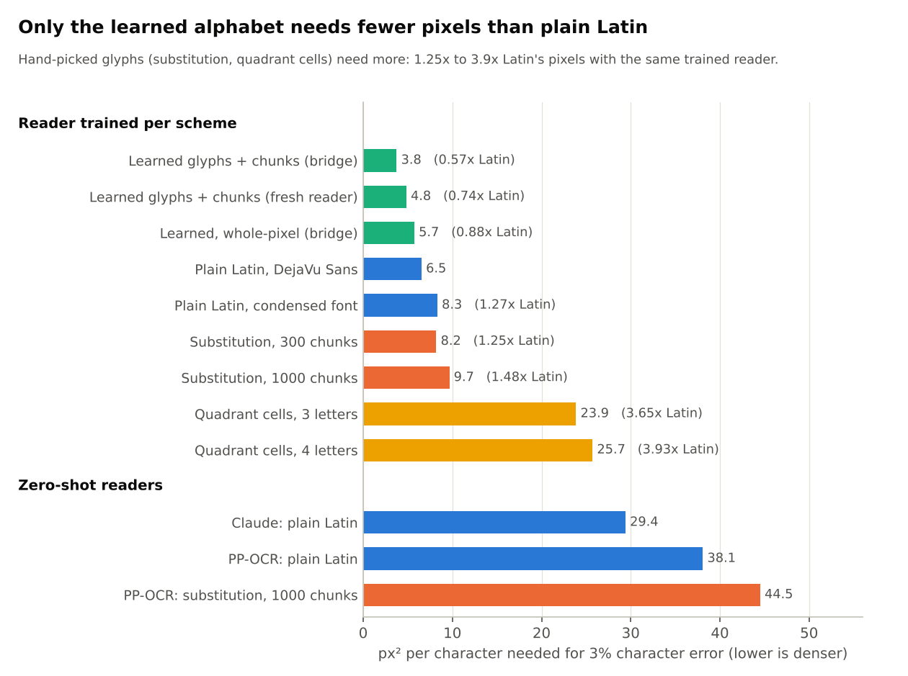
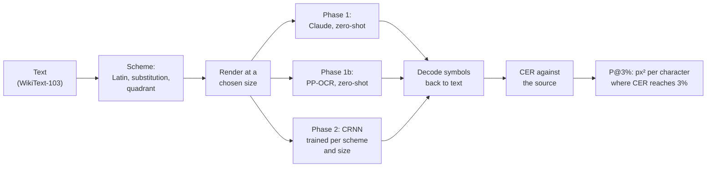
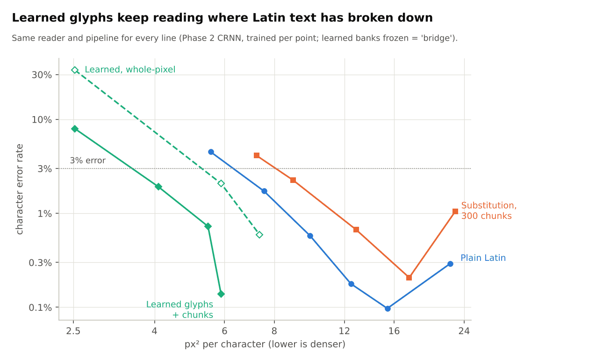
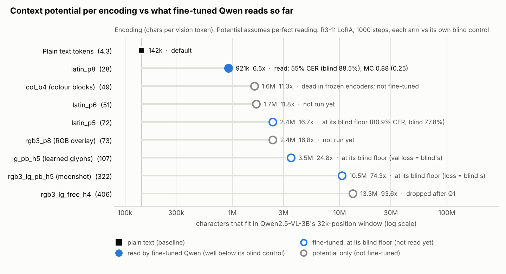

# The original idea in pixel space: results of Phases 1-2

**Status: finished (Phases 1-2 ran 2026-11-02/03; this page was re-checked against the rows and rewritten in the
clean-up of 2026-11-13).** Nothing here is still running. The plan as pre-registered is [PLAN.md](PLAN.md); the
learned alphabet that followed has its own report, [learned_glyphs/RESULTS.md](../../learned_glyphs/RESULTS.md).
The story this belongs to is section 2, idea 1 of the [README](../../README.md).

## In brief

The idea: braille is readable at very low resolution, so why draw text for a model in Latin letters? And once
the alphabet is ours to choose, why stop at letters: frequent runs such as ` the ` or `ing ` could each get one
glyph, the way byte-pair encoding (BPE) gives them one token.

Phases 1-2 tested the cheap version of that idea, with **hand-picked glyphs**, against plain Latin text:

* **Substitution:** each of the 300 or 1000 most useful character runs ("chunks") is drawn as one Chinese
  character standing in for it.
* **Quadrant packing:** 2 to 4 letters are packed into one square cell, as Korean Hangul packs letters into a
  syllable block.

**Result: killed.** With a reader trained from scratch on each scheme, plain Latin needs the fewest pixels at
every error level measured. Substitution needs 1.25x (300 chunks) to 1.48x (1000 chunks) Latin's pixels for the
same 3% character error, and quadrant cells 3.7x to 3.9x. The reason is simple: a chunk glyph saves line width, but
a Chinese character has far more detail than a Latin letter, so it must be drawn larger to stay legible, and that
costs more than the saved width.

**What did work** was not picking the glyphs but *learning* them together with a reader: 0.57x Latin's pixels at
the same error ([learned_glyphs/RESULTS.md](../../learned_glyphs/RESULTS.md)). And what ended the whole line
later is that no pretrained vision model reads any of these codes ([below](#what-happened-next)).



*How to read it: each bar is the page area per character at which a reader's error first falls to 3%; shorter is
denser. Top group: one small reader trained per scheme (Phase 2 and the learned alphabet), so all schemes are on
equal terms. Bottom group: readers used as they come (Phases 1 and 1b). Drawn by
`scripts/make_glyphs_figures.py` from the result rows.*

## Terms

| Term | Meaning |
|---|---|
| **px² per character** | page (or line) area in pixels divided by the number of source characters. Lower is denser. One 28x28-px vision token is 784 px², so 784 / (px² per character) = characters per vision token |
| **CER** | character error rate: edit distance between the reader's text and the source, divided by the source length |
| **P@3%** | the px² per character at which CER first reaches 3% (monotone fit of the measured points, interpolated on a log axis). P@10% and P@1% likewise |
| **em** | the font size in pixels. Line pitch is 1.2 em |
| **zero-shot** | a reader used as it comes, with no training on the scheme |
| **CRNN** | the small reader trained here: a convolutional network, a recurrent layer and CTC decoding, about 1.1M parameters, reading one rendered line at a time |
| **PP-OCR** | an off-the-shelf OCR model (via `rapidocr-onnxruntime`), used zero-shot |
| scheme names | `latin` = DejaVu Sans; `latin_condensed` = Archivo Narrow; `subst300` / `subst1000` = substitution with 300 / 1000 chunks; `quad3` / `quad4` = quadrant cells of 3 / 4 letters |

## How it was measured



Every scheme goes through the same steps; only the reader changes between phases. Phase 2 is the decisive one,
because a reader trained from scratch gives no scheme the benefit of a language or script it already knows.

| Phase | Reader | Text | Rows |
|---|---|---|---|
| 1 | Claude Opus 5.5, low effort | 6 natural passages of ~3,000 characters (84 calls, $1.92); pilot of 1 passage with all schemes (96 calls, $1.29) | `results/phase1/latin_natural/`, `pilot/` |
| 1b | PP-OCR | 6 natural and 3 word-scrambled passages, 13 sizes, 5 schemes (585 pages) | `results/phase1b/ocr_natural/`, `ocr_scrambled/`; tables in `summary/` |
| 2 | CRNN, one per scheme and font size, 3,500 or 10,500 training steps | single lines, 1,000 held-out test lines | `results/phase2/merged/` (the longest run per scheme and size: 32 rows) |

## The kill criteria and how each came out

The plan fixed three kill criteria (K1-K3) and three predictions (P1-P3) before any run
([PLAN.md section 4](PLAN.md#4-pre-registered-predictions--kill-criteria)).

| ID | Pre-registered test | Result | Verdict |
|---|---|---|---|
| **K1** (arithmetic, no reader) | substitution with 1000 chunks must make lines at least 15% narrower than condensed Latin at the same font size | 32.0% narrower ([dictionary report](dictionary-report.md)). On a fixed page that lets the font grow only 1.19x, because a page fills in two dimensions | **passes its bar, weakly**: the most the scheme could ever gain is small |
| **K2** (Phase 1b, zero-shot) | substitution must need at least 20% fewer px² per character than the best Latin at 10% CER | best case `subst1000`: 0.89x Latin's pixels at 10% CER (interval 0.85 to 0.91; the bar was 0.80x), and 1.17x, that is worse, at 3%. Word-scrambled text gives 0.90x, so this is not Latin being helped by the language | **fails** |
| **K3** (Phase 2, decisive) | substitution must reach 3% CER with at least 30% fewer px² per character than the best Latin | Latin P@3% = 6.54 px² per character; `subst300` 8.20 (1.25x); `subst1000` 9.66 (1.48x). Substitution is worse, not 30% better | **KILL** |
| P1 | quadrant packing needs at least 30% more pixels than Latin | Phase 2: `quad3` 23.9 and `quad4` 25.7 px² per character at 3% CER, 3.65x and 3.93x Latin (quadrant readers had 3,500 steps, Latin 10,500) | confirmed |
| P2 | `subst300` lands within ±20% of condensed Latin | 0.92x at 10% CER with PP-OCR; 0.99x at 3% CER with the trained reader | confirmed |
| P3 | Latin's advantage shrinks on word-scrambled text | substitution's best ratio is 0.89x on natural and 0.90x on scrambled text | not confirmed |

K2 was run with PP-OCR and not with Claude, as the plan intended, because **Claude cannot be scored on anything
but natural text**: substitution pages, quadrant pages and even word-scrambled English are refused or cut off by
its safety classifiers (the pilot's substitution and quadrant rows sit at 87-99% CER at every size, which is
refusal, not reading). Prompts were not reworded to get around that.

## The three readers

* **Claude, natural Latin only.** DejaVu Sans reaches 3% CER at **29.4 px² per character** (95% interval 28.6 to
  30.2), which is 37.5 vision tokens per 1,000 characters. The condensed font is worse for Claude: 1.11x the
  pixels in the main sweep, 1.20x in the pilot. This is a transcription threshold only. Answering questions over a
  long document needs much larger text (117.6 px² per character, [CLAUDE_QA.md](../claude/CLAUDE_QA.md)).
* **PP-OCR, zero-shot.** Latin 38.1 px² per character at 3% CER; the K2 row above. Tables:
  `results/phase1b/summary/summary.md`.
* **CRNN trained per scheme and size.** Far denser than either: Latin 6.54 px² per character at 3% CER, against
  Claude's 29.4, because the reader is trained for one font at one size and nothing else.

## Phase 2 in detail



*How to read it: left is denser, down is more accurate; a line further left at the 3% mark needs fewer pixels.
Substitution (orange) lies to the right of Latin (blue) everywhere. The green lines are the learned alphabet,
scored in this same pipeline (see the next section). The upturn at the right end of the blue and orange lines is
where the points switch from 10,500-step to 3,500-step runs.*

The densest points per scheme (`results/phase2/merged/runs.jsonl`; 10,500 steps unless noted):

| Scheme | em | px² per character | CER |
|---|---|---|---|
| `latin` (DejaVu Sans) | 3 | 5.54 | 4.51% |
| `latin` | 3.5 | 7.53 | 1.73% |
| `latin` | 4 | 9.84 | 0.58% |
| `latin` | 5 | 15.39 | 0.10% |
| `latin_condensed` | 4 | 7.14 | 4.06% |
| `latin_condensed` | 4.5 | 9.02 | 2.43% |
| `latin_condensed` | 5 | 11.15 | 0.92% |
| `subst300` | 4.5 | 7.22 | 4.12% |
| `subst300` | 5 | 8.91 | 2.26% |
| `subst300` | 6 | 12.84 | 0.67% |
| `subst1000` | 5 | 7.81 | 5.75% |
| `subst1000` | 6 | 11.26 | 1.01% |
| `quad3` / `quad4` (3,500 steps) | 10 | 26.0 / 23.3 | 2.12% / 3.46% |

| Scheme | P@3% | P@1% | P@3% against Latin |
|---|---|---|---|
| `latin` | 6.54 | 8.92 | 1 |
| `latin_condensed` | 8.32 | 17.1 | 1.27x |
| `subst300` | 8.20 | 11.9 | 1.25x |
| `subst1000` | 9.66 | 11.3 | 1.48x |
| `quad3` | 23.9 | 35.9 | 3.65x |
| `quad4` | 25.7 | not reached | 3.93x |

**Why substitution loses even with a trained reader.** A 1000-chunk dictionary makes lines 32% narrower (K1),
but each stand-in glyph must still be legible at that size. A Chinese character has far more strokes than a Latin
letter, so it needs a larger font to reach the same error per symbol, and that uses up the width it saved. An
error on a chunk glyph also costs a whole chunk of characters, not one.

**Training length mattered, but equally for both sides.** At 3,500 steps `subst1000` at em 7 had 5.62% CER; 10,500
steps brought it to 0.58%. Latin improved as much (em 4: 2.54% to 0.58%), so the ranking did not change.

**A bug that was found and fixed (2026-11-03).** Latin at em 4 first scored 62% CER because its test lines came
from an old render cache whose lines were one pixel row taller than the training lines. The affected rows are
kept in `results/phase2/phase2_main/runs_stale_cache.jsonl` and were re-run. (The session log says the same
checkpoint scored 3.8% on fresh renders; that figure has no row in the repo.)

## What worked instead: learning the glyphs

Full report: [learned_glyphs/RESULTS.md](../../learned_glyphs/RESULTS.md). In one table, against the same
Phase 2 Latin baseline (P@3% 6.54, P@1% 8.92 px² per character):

| Alphabet of 395 symbols (95 characters + 300 chunks), 10,500 steps | P@3% | P@1% | against Latin (3% / 1%) |
|---|---|---|---|
| learned, scored by the **bridge** | 3.75 | 5.10 | **0.57x / 0.57x** |
| learned, scored by a fresh reader in its own pipeline ("transfer") | 4.83 | 5.66 | 0.74x / 0.63x |
| learned, **whole-pixel** glyphs, bridge | 5.73 | 6.91 | 0.88x / 0.77x |

* **Bridge** means: the learned glyphs are frozen, exported as a bitmap font and put through the Phase 2 pipeline
  above with no change, so they are trained on and scored exactly like `latin` and `subst300`.
* **Whole-pixel** means every glyph is made of full black or white pixels at the final resolution. Glyphs without
  that restriction use grey levels and sub-pixel detail, which is part of why they score better and the first
  thing lost to JPEG, resampling or a vision model's patch grid.
* The chunks add to the better shapes: at about 0.6% CER the 395-symbol alphabet needs 0.74x the pixels of a
  learned alphabet of the 95 characters alone.
* The verdict was a **qualified go**: the densest alphabets break on degradations they were not trained on.

## What happened next

The learned alphabet was the last positive result on this line. Each later step is written up where it ran; the
numbers below were re-checked against `encoder_probe/results/*/runs.jsonl`.

| Step | What was found | Write-up |
|---|---|---|
| Frozen SigLIP (a general vision encoder), a small probe reading its tokens | colour-block codes never get below 62% CER; grey-level learned glyphs no better than whole-pixel ones | [encoder_probe/RESULTS.md](../../encoder_probe/RESULTS.md) |
| Frozen DeepEncoder (DeepSeek-OCR's encoder) | only large Latin (8.5 characters per vision token) is read, at 19% CER; colour blocks (71-73%), the RGB overlay (84%) and learned glyphs (82%) are at the floor | [encoder_probe/ROUND2.md](../../encoder_probe/ROUND2.md) |
| Qwen2.5-VL-3B fine-tuned for 1,000 steps, each arm with a blind control (same run, images shuffled between pages) | only Latin at 28 characters per token is read (55.0% CER against 88.5% blind). Learned glyphs at 107 and the three-layer "moonshot" page at 322 end at their blind controls, although the moonshot page reads at 1.07% CER from raw pixels | [encoder_probe/ROUND3.md](../../encoder_probe/ROUND3.md), [ANALYSIS.md](../background/ANALYSIS.md) |
| Everything after | the limit is what one vision token can carry, not legibility; the dense-glyph stages were closed | [README section 4](../../README.md#4-what-i-finally-understood), [FINDINGS.md](../FINDINGS.md) |



*Context-window arithmetic for Qwen2.5-VL-3B as of the 1,000-step fine-tune (2026-11-05): how many characters
would fit if each code were readable, and which were read. Drawn by `scripts/make_docs_figures.py`; details in
[CONTEXT_BUDGET.md](../claude/CONTEXT_BUDGET.md).*

## Reproduce

```bash
python3 scripts/build_data.py --report                         # dictionaries and the K1 report
python3 experiments/phases/phase1b_ocr.py --variant natural --n-passages 6      # Phase 1b (CPU, free)
nohup python3 experiments/phases/phase2_driver.py > results/phase2_driver.log 2>&1 &   # Phase 2 grid, ~4.5 h on 4 cores
python3 scripts/merge_phase2.py && python3 -m vtc.analysis results/phase2/merged/runs.jsonl --out results/phase2/merged
python3 scripts/make_glyphs_figures.py                         # the two charts above
```

Phase 1 calls Claude and costs money (about $2 for the Latin sweep); the command is in
[RUNNING.md](../RUNNING.md).

## Corrections made in the 2026-11-13 clean-up

The verdicts did not change; these numbers did, after recomputing from the rows.

* `results/phase2/merged/` had been summarised when it held 28 rows. Re-running `scripts/merge_phase2.py` gives 32:
  it adds Latin at em 3 and 4.5, condensed Latin at em 4 and `subst300` at em 4.5 from the long run. With them
  Latin's P@3% is 6.54 px² per character (the old summary could only say "at most 7.5"), and K3's ratios are 1.25x
  and 1.48x (this page used to say "at least 1.18x").
* Quadrant against Latin at 3% CER is 3.65x and 3.93x (was "at least 3.2x and 3.4x", and "about 2x" in the
  summary paragraph).
* The trained reader's condensed Latin needs 8.3 px² per character at 3% CER (this page said "about 12").
* K1 was described as "negative" in the plan's status note and "pass (weak)" here. It passed its pre-registered
  bar (32% against 15%); what is weak is the gain it allows (1.19x font size).
