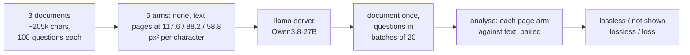

# Does any of this help a local model? One evening on Qwen3.8-27B (RTX 3090)

**Status (2026-11-13): pre-registered, not run. This is the one run left in the repo.** The prompt to paste into
a session on the RTX 3090 PC is at the top of [HANDOFF.md](../HANDOFF.md); this file is the plan it follows and
where its results go.

*Pre-registered 2026-11-12, before any row. No training. Code: `experiments/claude_qa/local_qa.py` (tests
`tests/test_local_qa.py`, against a mock server: it has not talked to a real model yet). The design, predictions
and outcome table below are unchanged since then; the clean-up of 2026-11-13 added this status block, the diagram,
the source notes on model facts, and replaced a second copy of the session prompt with the link above.*

**In one paragraph.** On Claude, a long document rendered as page images of small text is answered as well as the
text itself at 2.2x fewer input tokens ([CLAUDE_QA.md](../claude/CLAUDE_QA.md)). This test asks whether the same
holds on a model you run yourself, where the saving would be memory and prompt-processing time instead of money:
three documents, 100 questions each, read as text and as pages at three densities, by Qwen3.8-27B served by
llama.cpp. It also times the model's built-in multi-token prediction module.



## Why this test, and why only this

On your own GPU nothing is billed per token. What costs is how much text fits in memory, how long the prompt
takes to process, and how fast the answer is written. Qwen3.8-27B already attacks all three inside the model:

| What costs locally | What Qwen3.8-27B already does (source: its config and model card on Hugging Face, read 2026-11-12; not re-checkable from this repo) |
|---|---|
| Memory per token of context | Only 16 of its 64 layers are full attention; the other 48 keep a fixed-size state. About 64 KB per token at 16 bits (my arithmetic from the config: 16 layers x 2 x 4 heads x 256 dims x 2 bytes), a quarter of a same-size all-attention model |
| Speed of writing | A multi-token prediction module ships with the model; llama.cpp can use it to draft several tokens per pass |
| Context length | 262,144 tokens natively; on 24 GB the limit is memory, not the model |

So training our own compressor for it (Test B, [TEXT_SLOTS.md](TEXT_SLOTS.md)) would repeat published work for a
benefit the model mostly has. What is still unknown, and cheap to measure, is whether the one thing that worked on
Claude carries over **with no training**:

1. **Do page images let it hold more text?** It has a vision encoder with one token per 32 x 32 px. At the density
   Claude reads without loss (117.6 px² per character) a vision token carries 8.6 characters against about 4.3 for
   a text token: 2.0x fewer positions, so twice the document in the same memory and half the prompt-processing
   time. Whether it still answers correctly is the question.
2. **How much faster does it write with its multi-token module?** One published figure for the previous 27B model on
   a 3090 is 38 to 65 tokens per second; that is a blog measurement, not ours (not re-checked).

## Design

Same test as [CLAUDE_QA.md](../claude/CLAUDE_QA.md), smaller, against a local server.

* **Model:** `unsloth/Qwen3.8-27B-GGUF`: `Qwen3.8-27B-UD-Q4_K_M.gguf` (16.6 GB), `mmproj-F16.gguf` (0.9 GB, the
  vision projector), and for the speed check `MTP/mtp-Qwen3.8-27B-Q4_0.gguf` (1.4 GB). File names and sizes are
  from the repository's file list on Hugging Face (read 2026-11-12, not re-checked). Server: llama.cpp's
  `llama-server` (OpenAI-compatible; any other such server works with `--base-url`).
* **Documents:** 3 non-overlapping documents of ~205k characters of held-out WikiText (~48k text tokens each, the
  smallest size the question generator supports and about what fits next to the weights), with invented facts.
* **Questions:** 100 per document, exact numeric answers: 40 invented facts, 40 numbers in real sentences, 20
  multi-step (8 two-hop, 6 sums, 3 largest-of-three, 3 counts). 300 paired questions per arm.
* **Arms:** no document; text; pages at 117.6, 88.2 and 58.8 px² per character (10, 8 and 5 pages of 1600 px;
  23.9k, 17.9k and 11.9k vision tokens: 2.0x, 2.7x and 4.0x fewer positions than text by the formula). In the
  harness the arms are named `none`, `text`, `page118`, `page88` and `page59`. (Checked with the dry run,
  2026-11-13: a full page is 1600 x 1568 px, 2450 tokens.)
* **Calls:** the document first, then the questions in batches of 20, so the server processes the document once
  per arm and reuses it. Temperature 0. Thinking off for the main run (it is on by default in this model).
* **Checks:** the prompt tokens the server reports must cover the pages' tokens (otherwise the server downscaled
  them and the arm is invalid); unanswered questions are counted; a failed call is never recorded as a row.
* **Scoring and verdicts:** as in the Claude test. Lossless = the 95% upper bound of the loss against text is
  below 2 points (Newcombe's paired interval); loss = the interval excludes 0.
* **Speed:** prompt-processing and generation tokens per second from the server's timings, per arm; and a
  generation-speed run with and without the multi-token module.

## Predictions (before any row)

1. Text scores at least 95% and no-document below 10%. If text is below 90%, the model is not doing the task at
   this size and nothing else can be read from the run.
2. Pages at 117.6 px² per character: lookups within 5 points of text, multi-step questions at least 5 points
   below text; not shown lossless overall.
3. Pages at 58.8: at least 15 points below text overall.
4. The measured saving in positions is within 10% of the formula (2.0x, 2.7x, 4.0x).
5. The multi-token module raises generation speed by at least 1.3x.

Prediction 2 is the uncertain one: Claude was lossless at this density, the small Qwen2.5-VL-3B read text at this
density at 1.5% error, and nobody has measured this model.

## What each outcome means

| Outcome at 117.6 px² per character | Meaning |
|---|---|
| Lossless on all 300 questions | Page images work locally as they do on Claude: about twice the text in the same memory, with no training. Worth a local version of the hooks |
| Lookups within 5 points, multi-step worse | Usable as an archive to look things up in (as in the compaction test), not as working context |
| Lookups more than 5 points down | The trick does not carry over to this model without training. The local question is closed |

If the text arm does not fit in memory but the page arms do, that is itself the result for long documents: report
it as such, with the largest text document that did fit.

## Runbook (Windows, Git Bash)

```bash
cd /c/git/visual-token-compression-run && . .venv/env.sh
git fetch origin claude/sharp-mendel-kkhg4g && git merge origin/claude/sharp-mendel-kkhg4g
python -m pytest -q tests/test_local_qa.py                    # mock server, ~10 s
python experiments/claude_qa/local_qa.py run --dry-run --doc 0 1 2      # page and token counts, no server
```

**Server.** Use the newest llama.cpp Windows CUDA release (multi-token prediction needs a build from mid-May 2026
or later) and check `llama-server --help` for the flag names below; they have changed between builds.

```bash
hf download unsloth/Qwen3.8-27B-GGUF Qwen3.8-27B-UD-Q4_K_M.gguf mmproj-F16.gguf MTP/mtp-Qwen3.8-27B-Q4_0.gguf --local-dir models/qwen38
llama-server -m models/qwen38/Qwen3.8-27B-UD-Q4_K_M.gguf --mmproj models/qwen38/mmproj-F16.gguf \
  -ngl 99 -c 57344 -np 1 --image-max-tokens 4096 --port 8080
```

* **Memory (estimate):** 16.6 GB weights + 0.9 GB projector + ~3.7 GB of cache for 57k tokens = ~21 GB plus
  working buffers. Read `nvidia-smi` once the server is up and again during the text arm. Windows pages GPU memory
  instead of failing: a sudden slowdown means it no longer fits. If it does not fit, in this order: add
  `--cache-type-k q8_0 --cache-type-v q8_0`; use `Qwen3.8-27B-UD-Q4_K_S.gguf` (15.4 GB); close other GPU programs.
  Write down which was used.
* **Thinking off:** pass `--extra '{"chat_template_kwargs": {"enable_thinking": false}}'` to `local_qa.py`. Every
  row records `reasoning_chars`; if it is not 0, thinking was still on: start the server with
  `--reasoning-budget 0` instead.

**Runs.** One document first, look at it, then the other two. Finished arms are skipped when a command is rerun.

```bash
X='--extra {"chat_template_kwargs":{"enable_thinking":false}}'
python experiments/claude_qa/local_qa.py run --doc 0 $X          # none, text, page118, page88, page59
python experiments/claude_qa/local_qa.py analyse
python experiments/claude_qa/local_qa.py run --doc 1 2 $X
python experiments/claude_qa/local_qa.py speed --label plain $X
# restart the server with the multi-token module (flag names from --help; the published examples use
#   --spec-type mtp  or  --spec-type draft-mtp, --spec-draft-n-max 3, and the mtp-*.gguf file), then:
python experiments/claude_qa/local_qa.py speed --label mtp $X
python experiments/claude_qa/local_qa.py analyse                 # -> results/local_qa/qwen38_27b/summary.md
```

Optional, if the main run leaves time: the text and 117.6 arms again with thinking on
(`--run-name qwen38_27b_think`, no `--extra`, `--max-tokens 12000`), since on Claude more reasoning narrowed the
loss on dense pages.

**Time (estimate, nothing measured):** ~19 GB of downloads; then about 2-4 minutes per arm with thinking off, so
under an hour of GPU time for 15 arms, plus the speed runs.

## Prompt for the 3090 session

The prompt is kept in one place, the top of [HANDOFF.md](../HANDOFF.md), so that the two copies cannot drift
apart. It follows the runbook above step by step: state, code and tests, server, document 0 with its checks,
documents 1 and 2, the two speed runs, the write-up.

## Results

Not run yet (2026-11-13). The session fills this section: the `summary.md` table, each prediction as PASS / FAIL /
not evaluable, the row of the outcome table that applies, speeds, memory, the llama.cpp build and server command,
and problems.
