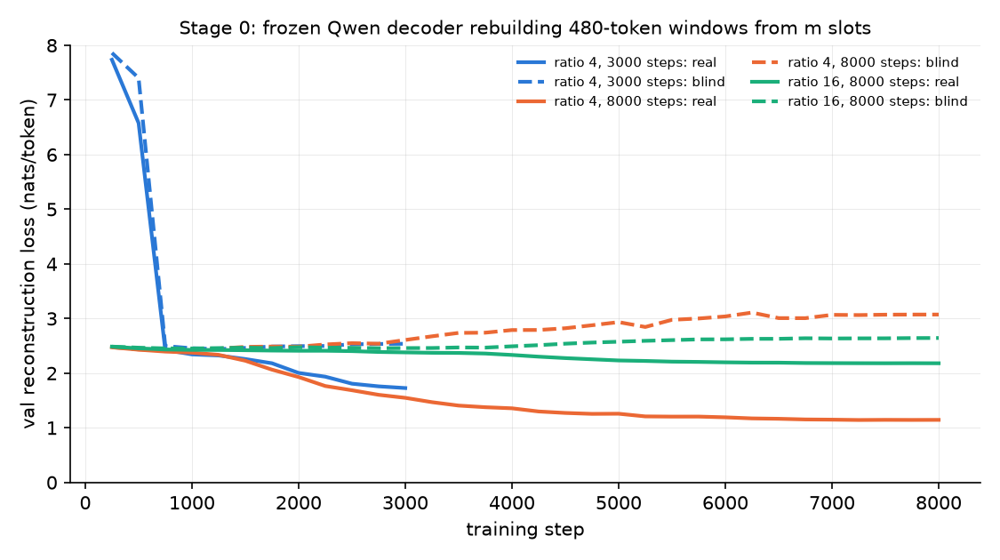

# Training an encoder ourselves: the plan, and the one experiment that ran (Stage 0)

**Status: Stage 0 ran on 2026-11-05/06 on a rented RTX 4090 and was inconclusive. Stages 1 and 2 were never run.
Closed 2026-11-12.** The follow-up design on the text side (Test B, [TEXT_SLOTS.md](TEXT_SLOTS.md)) was built but
not scheduled.

## The result

**The control that was supposed to work did not, so nothing can be concluded about density.**

* **Why this was tried.** Qwen2.5-VL-3B's pretrained vision tower loses the glyph pages
  ([ANALYSIS.md](../background/ANALYSIS.md)), so the remaining route for the moonshot (learned glyphs in three
  colour channels, 322 characters per vision token) was an encoder trained for it.
* **The observation that reshaped it.** Once the encoder is ours, the pixels do no work: we would render text we
  already have and train a network to undo the rendering. Whether one vector can carry 75 text tokens' worth of
  content can be asked without images. That is Stage 0: a compressor on the text side packs a 480-token window
  into a few vectors ("slots"), and the unmodified language model has to rebuild the text from them.
* **What happened.** At 4 text tokens per slot, which published work reports as nearly lossless, the rebuilt text
  had 64.0% character error after 8000 steps (its blind control: 77.8%). At 16 tokens per slot: 78.1% (blind
  80.3%). The model writes fluent text on the right topic and keeps some names, but does not copy: gist, not
  reconstruction, at both ratios. The moonshot's ratio (80) was not run.
* **How to read it.** The pre-registered rule for a failed control says: conclude nothing about density. The
  recipe learns too slowly at this budget; that is not evidence for or against any ratio.
* **The other own-encoder attempt** was a small vision encoder trained from scratch on CPU (S1, in
  [COLOUR_GIST.md](COLOUR_GIST.md#s1-small-vlm-with-a-from-scratch-vision-encoder-cpu-pre-registered-2026-11-06-before-any-s1-row)).
  Its one-layer control never became readable either.

| Text tokens per slot | Steps | Characters per slot | Character error (blind control) | Loss (blind), nats per token |
|---:|---:|---:|---:|---:|
| 4 | 3000 | 17.6 | 74.8% (79.0%) | 1.64 (2.48) |
| 4 | 8000 | 17.6 | 64.0% (77.8%) | 1.09 (3.04) |
| 16 | 8000 | 70.2 | 78.1% (80.3%) | 2.12 (2.54) |

Rows: `encoder_probe/results/stage0/runs.jsonl`; full results under
[Stage 0 results](#stage-0-results-2026-11-06-runpod-rtx-4090).

**Terms.** *Slot:* one vector placed in the language model's input in place of several text tokens. *Ratio:* text
tokens per slot. *Blind control:* the same trained model rebuilding each window from another window's slots, so
the slots say nothing about the text; it shows what the decoder writes from its knowledge of English alone.
*CER:* character error rate; unrelated fluent text scores about 80%. *LoRA:* small trainable matrices added to a
frozen model. *KV cache:* the memory a language model keeps per context position; fewer positions per character
was the saving being chased. *ICAE, C3, gist tokens:* published text-side compressors (figures quoted from their
papers below are not re-checked here).

The rest of this page is the plan as written on 2026-11-05 (what an own encoder involves, what it would cost),
then the pre-registered Stage 0 design, its runbook, the amendment and the full results. Time, memory and cost
figures are **estimates** unless marked measured.

## What an own encoder is
The current pipeline is: moonshot page → Qwen ViT (32 blocks) → 2x2 merger → 256 vectors → Qwen LLM. An own encoder
replaces the ViT and merger and keeps the LLM. It has three parts:

| Part | Job | Status |
|---|---|---|
| Stem built for the code | recognise glyphs on a known grid: 5-px rows, whole-pixel glyphs, 3 independent colour channels | essentially solved: a small reader gets 1.07% CER from raw moonshot pixels (G0) |
| Compressor | pool the recognised glyphs into one vector per ~322 chars | **the hard part**, and the real research question |
| Projector | map those vectors into the LLM's 2048-d input space, like image tokens | standard |

**The catch.** Once the encoder is ours, the pixels do no work. We render text we already have, then train a
network to undo the rendering. Whether one vector can carry ~75 text tokens' worth of content that the LLM can use
is a question about the compressor alone. It can be asked without images, more cheaply, and the answer caps any
pixel version: a page holds the same information and is harder to read. That is Stage 0. Pixels win only if the
LLM must stay an off-the-shelf VLM, or if the inputs are already images (scans, PDFs).

## How the LLM would use it
The LLM gets the vectors as soft tokens in place of text. It has to answer from them directly: transcribing first
would refill the KV cache and cancel the saving. The standard recipe (ICAE, gist tokens, C3):

| Stage | Trains | Task | Teaches |
|---|---|---|---|
| 1. Align | encoder + projector, LLM frozen | rebuild the original text from the soft tokens | the vectors carry the content |
| 2. Continue | + LoRA on the LLM | predict the text that follows a compressed context | use compressed text as context, not as something to copy |
| 3. Use | LoRA | QA over compressed documents, needles (random names and numbers), questions spanning several pages | answer from compressed memory |

* **Exact recall fails first.** At high compression the encoder must drop something, and arbitrary details (names,
  numbers, IDs) go before the gist.
* **Hybrid design for the demo:** recent context stays as text and distant context is compressed. When the model
  needs exact wording, it fetches the original passage (we have the text). Compressed memory then works as an
  index, which is how a multi-million-char demo can still answer exact questions.

**Literature calibration.** C3 (an LLM as the compressor) reports ~98% reconstruction at 20x (~86 chars per slot)
and ~93% at 40x (~170). Kuratov et al. find that trained encoders rarely exceed ~10x lossless. The moonshot's 322
chars per slot is ~75x. Realistic targets: reliable reading at **~40-90 chars/slot** (10-20x Qwen's default
context); gist only at 322.

## Hardware, time and money
Throughput is scaled from one measurement: R3-1 on an RTX 4090 processed ~12k samples per hour (batch 4, 1.2
s/step, 3B LLM with LoRA). Assumed: a 3090 does ~60% of a 4090, one H100 ~3-4x.

| | 3090 / 4090 (24 GB) | 48 GB (A40, L40S, A6000) | 8x H100 (rented) |
|---|---|---|---|
| 3B LLM frozen or LoRA + ~300M encoder | fits (R3-1 peak: 11.4 GB, measured) | fits, larger batches | fits |
| Full fine-tune of the 3B LLM (~60 GB with AdamW) | no | barely (8-bit optimiser) | yes |
| 1M samples (proof of concept) | ~3.5 days (4090), ~6 days (3090) | ~2-3 days | ~3-4 h |
| 10M samples (credible result) | ~5 weeks (4090) | ~3 weeks | ~1-2 days |
| Demo inference (small encoder, 32k soft tokens ≈ 1.2 GB KV) | yes | yes | overkill |

* **Rent before applying for grants.** Marketplace prices (late 2026, they move):
  * RTX 4090: ~$0.30-0.50/h on Vast.ai or RunPod Community Cloud.
  * H100: ~$1.50-2.70/h.

  That puts Stage 0 at ~$5, a 1M-sample run on a 4090 at ~$25-45, and a 10M-sample run on H100s at ~$400-800. The
  training scripts checkpoint and resume exactly, so cheaper interruptible instances are fine.
* **Grants open to independent researchers:**
  * Prime Intellect fast compute grants ($500-100k, open-source work);
  * Nebius research grants;
  * CloudRift ($100-1k);
  * Google TPU Research Cloud (free TPUs, but the code is PyTorch/CUDA, so a port is needed).

  Public programs need an institution in their country: NAIRR / NSF ACCESS (US), EuroHPC AI Factories (EU),
  Isambard-AI (UK; the 2026 call closed in July). Verify terms on each program's own page.
* **Overall timeline:** ~1-2 months part-time for a credible result (each stage: 1-2 weeks of engineering plus
  GPU-days).

## Stages and gates
*(2026-11-12: only Stage 0 ran. Stages 1 and 2 were not started.)*
1. **Stage 0: text-side ceiling (this page, below).** How many chars per slot survive a learned compressor into
   Qwen's frozen LLM? This sets the density target for everything after it.
2. **Stage 1: the pixel encoder** at the density Stage 0 supports, run head-to-head with the Stage-0 compressor at
   the same size, data and steps. If text wins, pixels are a detour for the 3090 demo; report it and build the demo
   on the text-side compressor.
3. **Stage 2: use.** Continuation, QA and needles, then the R3-2 long-context benchmark at matched KV bytes, with
   the retrieval hybrid for exact recall.

## Stage 0: pre-registered design (2026-11-05, before any row)
**Question.** At what compression ratio can a learned encoder pack text into Qwen2.5-VL-3B's LLM input space, so
that the **unmodified, frozen** LLM rebuilds it at ≤ 3% CER (and ≤ 10%)?

**Setup** (`encoder_probe/experiments/text_compress.py`, ICAE-style):
* **Encoder:** the LLM itself with LoRA (r = 64, alpha 128) on every attention and MLP projection. It reads
  [L text tokens][m learned memory embeddings]. Its last hidden states at the memory positions, through a projector
  (identity init) and a gain (matched to token-embedding scale), are the m slots.
* **Decoder:** the same LLM with the adapter switched off, reading [m slots]["Repeat the text exactly:"] and
  rebuilding the L tokens plus end-of-text. A frozen decoder means the result says what an unmodified Qwen can read.
* **Data:** contiguous 480-token windows of WikiText-103. Training uses `data/train.txt`, ~9M tokens, so 3000 steps
  x batch 4 is under one epoch. Held-out windows come from `data/test.txt`: 16 for the val curve, 64 for eval.
* **Arms (ratio r = text tokens per slot; L = 480 for all):**

  | Ratio r | Slots m | Chars/slot (at ~4.3 chars/token) | Role |
  |---|---|---|---|
  | 4 | 120 | ~17 | positive control (ICAE: ~4x is near-lossless) |
  | 8 | 60 | ~35 | |
  | 16 | 30 | ~69 | latin_p5's density |
  | 32 | 15 | ~139 | |
  | 80 | 6 | ~346 | **moonshot density** (322) |

* **Fairness:** every arm has the same L, 3000 steps, batch 4, LR 1e-4 (5% warmup, cosine to 0), LoRA, seed and
  eval windows (one `fair_hash`). Only `--ratio` differs.
* **Metrics per arm:**
  * greedy-reconstruction CER on 64 held-out windows, with the op split, exact-prefix share and exact-window rate;
  * teacher-forced loss;
  * **blind control:** the same trained model decoding each window from another window's slots (the frozen
    decoder's prior alone), as both CER and loss;
  * val-loss curve every 250 steps, real and blind;
  * chars per slot and KV bytes per 1M chars (36,864 B per position) are recorded in the row.

**Predictions (priors, before any run).**
1. r = 4 reaches ≤ 5% CER at 3000 steps.
2. CER rises steeply with r: r = 16 between 10% and 50%; r = 80 above 60%, but its loss still clearly below blind
   (gist survives).
3. Every arm's loss is well below its blind loss.

**Decision rules.**
* **Density targets:** D3 / D10 = the largest chars per slot whose CER is ≤ 3% / ≤ 10%.
  * Stage 1 targets D10 for gist use and D3 for exact use.
  * If r = 80 reaches ≤ 10%, the moonshot density is representable and Stage 1 runs at full density.
  * Otherwise the moonshot is redesigned to D10 (e.g. one glyph layer, or lower density), not run at 322.
* **Demo path:** if D3 ≥ ~70 chars/slot (r ≥ 16), the text-side compressor alone is a ~16x context path for the
  3090 demo, to be tested in Stage 2.
* **Positive-control failure:** if r = 4 misses 10%:
  * loss still falling → rerun r = 4 and r = 16 at 12k steps before concluding anything;
  * loss flat → suspect the pipeline, debug, and conclude nothing.
* **Choosing:** never on test-window CER. Curves are on the val windows; every arm is reported against its blind.

**What Stage 0 does not show.** Reconstruction is not use. A slot the decoder can copy from may still be useless
for QA, which is Stage 2. And 3000 steps is a short budget: the measured D3 / D10 are lower bounds on what this
recipe can reach.

## Runbook: RunPod RTX 4090
* **Pod:** a PyTorch/CUDA template (CUDA 12.x). Put a **network volume of ≥ 50 GB on `/workspace`** and keep the
  repo and the Hugging Face cache there, so a stopped pod keeps them. Space needed:
  * Qwen weights: 7.5 GB;
  * a checkpoint: ~1.5 GB each, deleted when its arm finishes;
  * the WikiText token cache: under 0.1 GB.
* **Measured on a 4090** (R3-1, a similar workload): 1.2 s/step, 11.4 GB peak.
* **Stage 0 estimates:** ~1-1.5 s/step and ~12-15 GB peak, so ~1-1.3 h per arm plus ~5 min of eval. Five arms are
  ~6-7 h, ~$3-5 on Community Cloud. The smoke measures the real numbers.
* **Setup:**
  ```bash
  cd /workspace && git clone https://github.com/StephenFlavin/visual-bpe && cd visual-bpe
  git checkout claude/validation-harness
  export HF_HOME=/workspace/hf
  pip install -r requirements.txt "peft>=0.17"            # keep the pod's CUDA torch; check torch.cuda.is_available()
  scripts/fetch_fonts.sh && python3 scripts/build_data.py   # data/train.txt, data/test.txt (~5 min)
  OMP_NUM_THREADS=1 python3 -m pytest -q encoder_probe/tests/test_text_compress.py encoder_probe/tests/test_round3.py
  python3 encoder_probe/experiments/text_compress.py --ratio 16 --smoke     # s/step, peak memory, a real row
  ```
* **Arms**, one at a time in this order (the positive control first, then the moonshot density):
  ```bash
  nohup bash -c 'for r in 4 80 16 32 8; do
    python3 encoder_probe/experiments/text_compress.py --ratio $r --steps 3000 --run-name stage0 || break
    git add encoder_probe/results/stage0 && git commit -qm "Stage 0: ratio $r" && git push -q
  done' > results/archive/logs/stage0.log 2>&1 &
  ```
  Rerunning the same command resumes the current arm from its last checkpoint (every 250 steps) and skips
  finished arms.

## Prompt for the RunPod session
*(Kept as sent on 2026-11-05. The branch name and paths in it are those of that date.)*
```text
Pull branch claude/validation-harness. Read AGENTS.md (gotchas), then docs/gpu/OWN_ENCODER.md: the Stage 0 design,
its predictions and decision rules are pre-registered there, and its runbook is for this RunPod RTX 4090 pod.

1. Setup as in the runbook: repo and HF_HOME on /workspace, requirements + peft (keep the pod's CUDA torch;
   confirm torch.cuda.is_available() and torch.cuda.is_bf16_supported()), fonts, scripts/build_data.py, then the
   CPU tests encoder_probe/tests/test_text_compress.py and test_round3.py. Note nvidia-smi, free disk and the
   torch/transformers/peft versions in your first commit.
2. Smoke: python3 encoder_probe/experiments/text_compress.py --ratio 16 --smoke. Check device=cuda bf16=True,
   the loss falls, generation returns text; record s/step and peak GPU memory. If it OOMs, stop and tell me
   (do not change the recipe for one arm only).
3. Size: at the measured s/step, five arms x 3000 steps + eval. If that exceeds ~8 h, tell me before starting and
   propose fewer arms (keep ratios 4, 16 and 80) rather than fewer steps.
4. Run the arms in order 4, 80, 16, 32, 8 (run name stage0, 3000 steps, defaults otherwise) under nohup, one at a
   time; after each arm commit and push encoder_probe/results/stage0/runs.jsonl. Keep >= 5 GB disk free.
5. When all arms are done: a results table (ratio, chars/slot, CER and blind CER, loss and blind loss, prefix_frac,
   exact windows, s/step, peak memory), the val curves, D3 and D10, and which decision rule in OWN_ENCODER.md
   applies. Add it as a dated "Stage 0 results" section at the end of docs/gpu/OWN_ENCODER.md and a line in
   docs/HANDOFF.md. Never choose anything on test-window CER.

Stop and ask me if the smoke fails, if the ratio-4 control misses 10% CER, or if a result would change the plan.
Record design changes as dated amendments in docs/gpu/OWN_ENCODER.md before running them. No PRs, no Claude API
calls, no model IDs in commits. Stop the pod (or tell me to) when finished: it bills by the hour.
```

## Amendment 1 (2026-11-05, after the ratio-4 arm, before any rerun)
* **Trigger:** the ratio-4 positive control missed 10% CER at 3000 steps: CER 74.8% (blind 79.0%), loss 1.64
  (blind 2.48). Its val loss was still falling (1.81 → 1.76 → 1.73 over the last 500 steps), so the
  pre-registered rule applies: rerun r = 4 and r = 16 longer before concluding anything.
* **Change: 8000 steps instead of 12k**, because the pod has a 5 h budget. 12k would need ~6.2 h at the measured
  0.93 s/step (r = 4) and ~0.82 (r = 16). Both arms get the same 8000 steps and the same recipe otherwise. The
  cosine schedule spans the full 8000, so these are new runs, not a continuation of the 3000-step one.
* **Checkpoints every 1000 steps instead of 250**, to save writes to the network volume. This does not change
  the result: `--ckpt-every` is not a fair key.
* **Speed options checked and rejected:**
  * no gradient checkpointing: runs out of memory at r = 4 (24 GiB);
  * two arms on the GPU at once: no gain, the GPU is already at 88-100% utilisation;
  * SDPA attention is already on.
* **Reading:** if r = 4 still misses 10% at 8000 steps with its loss still falling, the recipe is too slow for
  this budget. That is not evidence against the ratio, and the next step would be a recipe amendment
  (e.g. a higher LR for the slots and projector), not a conclusion.

## Stage 0 results (2026-11-06, RunPod RTX 4090)
**Environment:**
* torch 2.8.0+cu128, transformers 5.22.1, peft 0.21.2;
* bf16 autocast, SDPA attention, gradient checkpointing.

Rows: `encoder_probe/results/stage0/runs.jsonl`. Table and curves: `python3
encoder_probe/experiments/analyse_stage0.py`. Logs: `results/archive/logs/stage0.log` (3000 steps), `results/archive/logs/stage0_8k.log`.
Every row has 64 test windows, 480 tokens each.

**Arms that ran:**
* r = 4 at 3000 steps, as pre-registered. Ratio 80 was started, then stopped at step 1 when the control failed.
* r = 4 and r = 16 at 8000 steps (amendment 1).
* r = 8, 32 and 80 were not run.

| ratio | steps | chars/slot | CER | blind CER | loss | blind loss | gain (nats/tok) | prefix_frac | exact windows | s/step | peak GiB |
|---|---|---|---|---|---|---|---|---|---|---|---|
| 4 | 3000 | 17.6 | 74.8% | 79.0% | 1.644 | 2.477 | 0.833 | 0.002 | 0/64 | 0.93 | 10.1 |
| 4 | 8000 | 17.6 | 64.0% | 77.8% | 1.094 | 3.038 | 1.945 | 0.003 | 0/64 | 0.93 | 10.1 |
| 16 | 8000 | 70.2 | 78.1% | 80.3% | 2.115 | 2.537 | 0.422 | 0.003 | 0/64 | 0.79 | 10.0 |

Op split (sub / ins / del), as a share of reference chars:
* r = 4, 3000 steps: 48.3 / 12.5 / 14.1%;
* r = 4, 8000 steps: 35.4 / 11.7 / 16.9%;
* r = 16, 8000 steps: 51.3 / 12.9 / 13.9%.

Hypothesis length is 95-99% of the reference in every arm.



Val curves (16 val windows, real / blind loss in nats per token):

| step | r = 4, 3000 steps | r = 4, 8000 steps | r = 16, 8000 steps |
|---|---|---|---|
| 1000 | 2.34 / 2.46 | 2.38 / 2.43 | 2.43 / 2.45 |
| 2000 | 2.00 / 2.49 | 1.93 / 2.49 | 2.41 / 2.48 |
| 3000 | 1.73 / 2.54 | 1.55 / 2.61 | 2.38 / 2.46 |
| 4000 | | 1.36 / 2.79 | 2.33 / 2.49 |
| 6000 | | 1.19 / 3.04 | 2.20 / 2.62 |
| 8000 | | 1.15 / 3.07 | 2.18 / 2.64 |

**D3 = none, D10 = none.** No arm reaches 10% CER at either step budget.

**Which rule applies.** The positive-control-failure rule.
* At 3000 steps, r = 4 missed 10% with its loss still falling, so it was rerun longer (amendment 1: 8000 steps,
  not 12k, for the 5 h budget).
* At 8000 steps it still misses 10%, by a wide margin. Its val loss is flat over the last 1500 steps (1.15), but
  that is where the cosine schedule takes the LR to zero, so it is no evidence of a pipeline fault.
* The pipeline carries information: r = 4's loss is 1.9 nats/token below its blind control. The blind loss also
  rises above the decoder's prior (3.07 vs ~2.45), so the decoder relies on the slots.
* As pre-registered for this case, **nothing is concluded about density.** D3 and D10 are not measured. The
  moonshot rule (r = 80 ≤ 10%) and the demo-path rule (D3 ≥ ~70) cannot be evaluated.

**Predictions:**
1. r = 4 ≤ 5% CER at 3000 steps: **wrong** (74.8%).
2. CER rises steeply with r: r = 16 is 78.1% at 8000 steps, outside the predicted 10-50%. Ratio 80 did not run.
3. Every arm's loss is well below its blind: **true for r = 4** (0.83 and 1.95 nats/token). For r = 16 the gap
   is smaller but clear: 0.42, against ~0.005 noise.

**What the outputs look like.** The decoder writes fluent text on the right topic and keeps some names and
phrases, but it does not copy; prefix_frac is 0.003. r = 4 at 8000 steps:
* reference: "Robert Boulter is an English film, television and theatre actor. … This was followed by a starring
  role in the play Herons written by Simon Stephens";
* output: "Boulton is an English television, film and stage actor. … This was followed by a starring role in the
  1990s play Heroin, written by Simon Stephens".

r = 16 at 8000 steps keeps only fragments: "Robert … actor Boulton … television series". This is gist, not
reconstruction, at both ratios.

**Reading.** The recipe learns too slowly for these budgets.
* r = 4 improved from loss 1.64 to 1.09 between the 3000- and 8000-step runs, so steps help, but 8000 steps
  (32k windows, ~15M tokens) is far from ICAE's near-lossless 4x.
* r = 16's gain over blind only opens after step ~3500.
* Candidate levers for an amendment, not tested here:
  * a higher LR for the slots and projector (e.g. 1e-3), with LoRA kept at 1e-4;
  * a longer budget on a faster GPU;
  * a short warm-up stage that trains only the slots and projector;
  * the encoder reading from a mid-layer instead of the last hidden state.
* Each lever should be tested first on r = 4 against the 8000-step row, at a fixed step budget.

**Run costs (measured):**
* 0.93 s/step at r = 4 and 0.79 at r = 16;
* 10.0-10.1 GiB peak with gradient checkpointing (without it, r = 4 runs out of memory at 24 GiB);
* ~2 min eval per arm;
* about 5.5 GPU-hours in total, smoke and benchmarks included.
