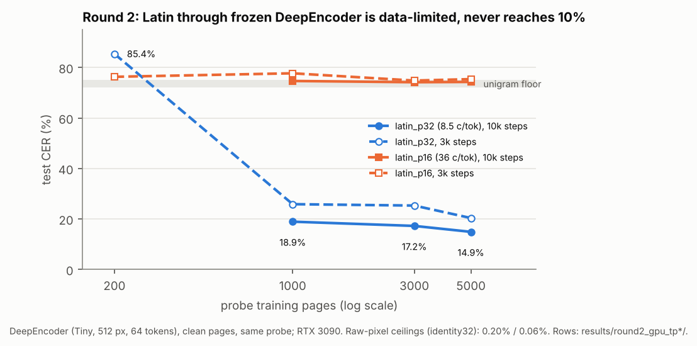
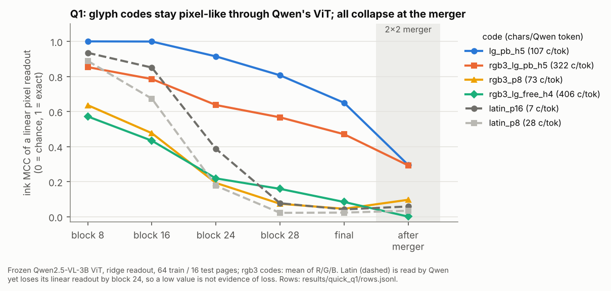
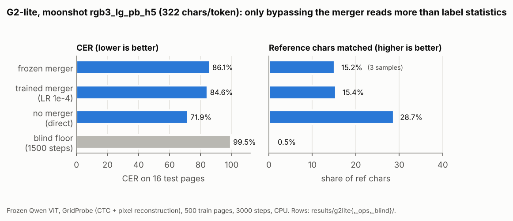
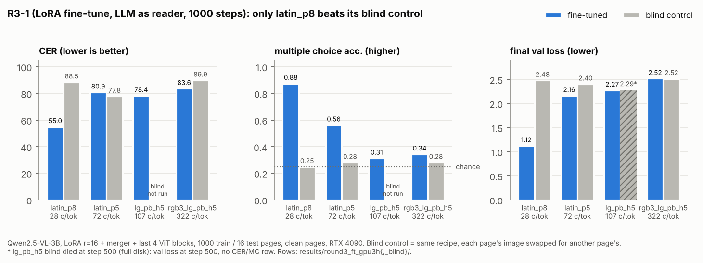

# Encoder probe: results (rounds 1-3)

## Status (2026-11-05)
Can dense pre-rendered codes (colour blocks, RGB overlay, learned glyph banks) get through a VLM's image encoder,
and can a VLM learn to read them? Three rounds, each with a raw-pixel ceiling and same-probe Latin baselines:

| round | encoder / reader | result | verdict |
|---|---|---|---|
| 1 ([below](#round-1-siglip-b16-2026-11-03)) | frozen SigLIP-B/16, 224 px; small probe | every dense code at the floor (62-85% CER); Latin needs ~2 chars/token for 5% (layer 6) | colour pixels dead; banks must be whole-pixel |
| 2 ([below](#round-2-deepseek-ocrs-deepencoder-at-its-own-geometry-2026-11-04)) | frozen DeepEncoder, 512 px, 64 tokens; small probe | dense codes 71-84% (floor); only latin_p32 (8.5 chars/token) reads, 19% -> 14.9% with 5000 pages | colour / RGB overlay dead; grey-level banks unsupported |
| 3 ([below](#round-3-qwen25-vl-3b-can-a-vlm-learn-to-read-the-codes-2026-11-05)) | Qwen2.5-VL-3B: frozen-ViT probes (Q1, G2-lite), then LoRA fine-tune with the LLM as reader (R3-1) | moonshot page reads at 1.07% from raw pixels; after 1000 fine-tuning steps only latin_p8 (28 chars/token) is read; latin_p5 (72), lg_pb_h5 (107) and the moonshot (322) sit at their blind floors | G3 undecidable at this budget; glyph codes not read yet |

**What this means.** The raw pages are readable (ceilings < 3%), but every frozen encoder output tried (SigLIP,
DeepEncoder, Qwen after its merger) loses what dense codes carry; in Qwen the glyph codes survive the ViT blocks and
are lost at the merger. After 1000 fine-tuning steps Qwen's LLM starts reading Latin at 28 chars/token (6.5x the
4.33 chars of a text token; 55% CER, read-then-drift) but no denser code. **Next:** latin_p8 / p6 / p5 at 5000 steps
with their own blind controls; a vision-side diagnostic for the glyph codes (higher vision LR, more unfrozen ViT
blocks, loss vs blind); the long-context benchmark R3-2 only after a code passes G3. Pre-registrations: [PLAN.md](PLAN.md) (round 1),
[RGB_OVERLAY.md](RGB_OVERLAY.md), [ROUND2.md](ROUND2.md), [ROUND3.md](ROUND3.md).

**Caveat for rounds 1-2 and G2-lite:** a small probe trained from scratch on frozen tokens is data-limited
(round 2: latin_p32 85% -> 15% from 200 to 5000 pages), so its absolute CERs are upper bounds on what an encoder
loses; the decisions rest on same-probe comparisons. R3-1 removes the probe: the VLM's own LLM is the reader.

# Round 1: SigLIP-B/16 (2026-11-03)

Design, pre-registered predictions, decision rules and **every probe change** are in [PLAN.md](PLAN.md).
Rows: `results/main/` (grid), `results/controls/` (post-hoc controls incl. the SigLIP layer-6 set),
`results/controls_tmlp2/`, `results/controls_tp1000/` (probe-capacity controls). Tables below come from
`python3 encoder_probe/experiments/analyse.py` (main + controls).

## Verdict
* **Colour pixels: dead for VLMs with a frozen pretrained encoder.** With raw pixels (identity) the probe reads
  1×1 colour blocks almost perfectly (col_b1 0.06% CER = 256 chars per token). Through frozen SigLIP-B/16 no colour
  encoding gets below 62% CER at any block size (1-4 px), at the last layer or at layer 6, clean or JPEG q75.
  For 1-3 px blocks even the *training* CTC stays near the unigram plateau (2.4-2.8 nats/char), so the colour
  codes are not decodable from the tokens by this probe at all, not just badly generalised; col_b4 at layer 6
  fits its training pages (CTC 0.7) but does not generalise (62%). Plain Latin through the same encoder and probe does reach
  4-9% CER (at large text), so the encoder/probe pair is informative for shapes but not for colours.
  Decision rule 1 (colour ≥ 2× best Latin chars/token at 3% through siglip/jpeg75): **fails**; colour never
  reaches 3% (or 10%) anywhere through SigLIP.
* **Learned glyphs: constrain to whole pixels.** At the identity ceiling grey-level banks win (lg_free_h4 0.01% vs
  lg_pb_h4 2.6% at the same 5.9 px²/char), but through SigLIP layer 6 the whole-pixel banks keep far more
  (lg_pb_h4 54.7% vs lg_free_h4 75.9% clean). Decision rule 2 (use grey-level only if lg_free still beats lg_pb
  through siglip/jpeg75): **fails** -> whole-pixel banks for the GPU plan.
* **Frozen SigLIP-B/16 at 224 px destroys almost all fine text detail for this probe.** Last layer: every encoding
  58-85% CER, Latin included up to 306 px²/char. Layer 6: Latin needs ≈ 122 px²/char (2.1 chars per vision
  token) for 5% CER, i.e. *fewer* characters per token than text tokens (≈ 4). Nothing reaches 3%.
  Interesting side result: learned whole-pixel glyphs survive layer 6 better than DejaVu at a third of the area
  (lg_pb_h4 54.7% at 5.9 px²/char vs latin_p6 62.5% at 16 px²/char).

**Caveat (applies to every number through SigLIP):** a small probe trained from scratch on 200 pages of frozen
tokens is not an LLM reading them. Through SigLIP the probe overfits badly (latin_p8 last layer: train CTC 0.13,
test 58%; latin_p24: train 0.002, test 40%), and 5× more training pages took latin_p10 from 61% to 43%, a
2-block token MLP to 52%. So the SigLIP CERs are upper bounds on the information the encoder destroys, and
absolute levels are probe-limited. The *comparisons* (colour vs Latin vs learned glyphs, same probe, same data)
are what the decisions rest on: colour (1-3 px) stays at the unigram floor even in training while Latin and lg_pb
learn, which more probe data would not obviously reverse. VLMs that fine-tune the encoder (PaliGemma, Qwen-VL) are outside
this test.

## Pre-registered predictions
| # | prediction | result | verdict |
|---|---|---|---|
| 1 | identity/clean col_b1 < 3% | 0.06% (256 chars/token) | **pass** |
| 2 | identity/jpeg75 col_b1 > 20%; col_b2 also degrades | col_b1 28.8% (from 0.06%); col_b2 0.92% (from 0.00%) | **pass** |
| 3 | siglip/clean col_b1 > 20%; far below 256 chars/token | 72.6% (unigram level); no colour encoding below 62% through SigLIP at any layer | **pass** |
| 4 | through siglip, lg_free's grey-level advantage over lg_pb shrinks or reverses | identity: lg_free_h4 0.01% vs lg_pb_h4 2.57%; siglip: 79.7% vs 75.1%; siglip_l6: 75.9% vs 54.7% (jpeg75: 75.3% vs 58.7%) | **pass (reverses)** |

## What survives the encoder (same encoding, identity/clean ceiling vs through the encoder)
Best (lowest-CER) encoding per family; unigram-level CER on this text is ≈ 72-75%.

| family | identity/clean | identity/jpeg75 | siglip/clean | siglip_l6/clean | siglip_l6/jpeg75 |
|---|---:|---:|---:|---:|---:|
| latin | 0.02% (p8) | 0.09% (p10) | 26.8% (p16, 2.1 c/tok) | 4.9% (p16) | 4.0% (p16) |
| lg_free | 0.01% (h4) | 0.07% (h4) | 79.7% (h4) | 75.9% (h4) | 75.3% (h4) |
| lg_pb | 0.75% (h5) | 0.76% (h5) | 75.1% (h4) | 53.4% (h5) | 56.4% (h5) |
| colour | 0.00% (b2) | 0.07% (b4) | 72.6% (b1) | 62.5% (b4) | 67.0% (b4) |

* **JPEG alone is not what kills colour.** Without an encoder, colour blocks survive q75 well from 2×2 up
  (col_b2 0.92%, col_b3 0.88%, col_b4 0.07%); only 1×1 blocks break (28.8%, chroma subsampling). Identity/jpeg75
  colour reaches C@3% = 71 chars/token vs 23.5 for Latin (3×): a pixel-level reader could use colour codes. The
  pretrained encoder is what removes them.
* Through SigLIP the ranking flips relative to the ceiling: lg_pb > latin (per area) > colour ≈ lg_free.
  Grey-level detail (lg_free, colour) is what the encoder discards; binary-ish shapes survive best.
* Last layer vs layer 6: layer 6 keeps far more (latin_p16 26.8% -> 4.9%, lg_pb_h5 75% -> 53%), consistent with the
  last layer being shaped by the pooled contrastive objective. JPEG q75 on top of layer 6 costs little
  (≤ 5 points) — the encoder, not compression, is the bottleneck.
* Probe-capacity controls on siglip/clean latin_p10 (61.3%): 2 token-MLP blocks 52.2%, 1000 train pages 43.5%.
  More data helps a lot, so absolute SigLIP numbers are probe/data-limited (see caveat).

## Probe and protocol notes
* Probe (identical for every row): tokens -> 3×3 conv map + linear skip -> unpatchified 3-channel page with an
  auxiliary pixel-reconstruction loss (×10, training pages only) -> column-shared dilated-conv CTC line reader;
  3000 steps, 200 train / 16 test pages. Four probe versions were tried on identity/pilot runs before this one
  (PLAN.md "Probe changes"); none was chosen on SigLIP results.
* Colour rows are scored with unstripped hypotheses (`score_v: 2`); the first 4 identity/clean colour rows had a
  0.4% scoring floor and were re-run.
* siglip (last layer)/jpeg75 was not run: siglip/clean is already at the floor for every encoding. The
  layer-6 set (post-hoc control, PLAN.md) stands in for it in the decision rules.
* C@x = chars per vision token (256 / px²/char) at which the isotonic CER curve crosses x; `>=` = already below x at
  the densest encoding of the family (left-censored), `-` = never reached.

## Tables

### CER by encoding

| encoding | px²/char | chars/token | identity/clean | siglip/clean | siglip_l6/clean | siglip_l6/jpeg75 | identity/jpeg75 |
|---|---:|---:|---:|---:|---:|---:|---:|
| latin_p24 | 306.42 | 0.8 | 0.11% | 39.50% | 7.14% | 8.74% |  |
| latin_p16 | 122.01 | 2.1 | 0.12% | 26.75% | 4.88% | 3.98% |  |
| latin_p10 | 46.26 | 5.5 | 0.05% | 61.34% | 37.27% | 34.96% | 0.09% |
| latin_p8 | 28.68 | 8.9 | 0.02% | 58.02% | 26.37% | 29.70% | 0.13% |
| latin_p6 | 16.03 | 16.0 | 0.17% | 74.66% | 62.51% |  | 0.39% |
| latin_p5 | 11.14 | 23.0 | 0.62% | 74.98% | 71.96% |  | 2.28% |
| latin_p4 | 6.97 | 36.8 | 3.49% | 73.62% | 68.37% |  | 18.39% |
| lg_free_h4 | 5.86 | 43.7 | 0.01% | 79.68% | 75.94% | 75.31% | 0.07% |
| lg_free_w23_h3 | 4.10 | 62.4 | 0.08% | 84.82% | 85.45% | 85.76% | 0.82% |
| lg_pb_h5 | 7.46 | 34.3 | 0.75% | 75.25% | 53.41% | 56.35% | 0.76% |
| lg_pb_h4 | 5.86 | 43.7 | 2.57% | 75.13% | 54.65% | 58.68% | 2.62% |
| col_b4 | 16.00 | 16.0 | 0.04% | 75.32% | 62.47% | 66.98% | 0.07% |
| col_b3 | 9.16 | 27.9 | 0.01% | 75.21% | 70.78% | 72.51% | 0.88% |
| col_b2 | 4.00 | 64.0 | 0.00% | 75.05% | 70.74% | 70.97% | 0.92% |
| col_b1 | 1.00 | 256.0 | 0.06% | 72.63% | 71.90% | 72.06% | 28.77% |

### C@10% (chars per vision token; text tokens ≈ 4 chars/token)

| family | identity/clean | siglip/clean | siglip_l6/clean | siglip_l6/jpeg75 | identity/jpeg75 |
|---|---:|---:|---:|---:|---:|
| latin | >=36.8 | - | 2.4 | 2.4 | 28.8 |
| lg_free | >=62.4 | - | - | - | >=62.4 |
| lg_pb | >=43.7 | - | - | - | >=43.7 |
| colour | >=256.0 | - | - | - | 100.6 |

### C@3% (chars per vision token; text tokens ≈ 4 chars/token)

| family | identity/clean | siglip/clean | siglip_l6/clean | siglip_l6/jpeg75 | identity/jpeg75 |
|---|---:|---:|---:|---:|---:|
| latin | 33.9 | - | - | - | 23.5 |
| lg_free | >=62.4 | - | - | - | >=62.4 |
| lg_pb | >=43.7 | - | - | - | >=43.7 |
| colour | >=256.0 | - | - | - | 71.0 |

### C@1% (chars per vision token; text tokens ≈ 4 chars/token)

| family | identity/clean | siglip/clean | siglip_l6/clean | siglip_l6/jpeg75 | identity/jpeg75 |
|---|---:|---:|---:|---:|---:|
| latin | 24.5 | - | - | - | 17.9 |
| lg_free | >=62.4 | - | - | - | >=62.4 |
| lg_pb | 35.5 | - | - | - | 35.4 |
| colour | >=256.0 | - | - | - | 64.3 |

# Round 2: DeepSeek-OCR's DeepEncoder at its own geometry (2026-11-04)

Design, encoders, geometry, pre-registered predictions (a)-(f), decision rules and the run log are in
[ROUND2.md](ROUND2.md); the local-GPU runbook (P0/P1) is [../docs/LOCAL_GPU.md](../docs/LOCAL_GPU.md). Qwen2.5-VL was
dropped before any of its jobs ran (user decision), so round 2 is DeepEncoder only: 512 px page (Tiny mode),
8x8 = 64 tokens of 1280-d, so chars/token = 4096 / px²/char. (Units: the identity32 ceiling rows store `chars_per_token` per 32-px patch, 1/4 of these; every table here quotes chars per 64-px DeepEncoder token.) Rows: `results/round2_gpu_tp{200,1000,3000,5000}/`
(RTX 3090, the rows used below) and `results/round2/` (cloud CPU, 200 pages, a cross-check only). Tables come from
`python encoder_probe/experiments/analyse2.py encoder_probe/results/round2_gpu_tp1000/runs.jsonl encoder_probe/results/round2_gpu_tp200/runs.jsonl`.

## Verdict
* **Colour pixels and the RGB overlay are dead for DeepEncoder.** Through deepencoder (clean or jpeg75, 1000
  pages) col_b2 sits at 71.5%, col_b4 at 72.5% and rgb3 at 83.5% CER, the floor, while their identity32 ceilings
  are 0.0-0.4%: the information is destroyed by the encoder. The colour/rgb3 decision rule cannot be applied as
  written (no Latin reaches 3% or 10%), so the evidence is the weaker form, but nothing about it is close. Using
  them would need an encoder trained for them. **P2/P3 are gated off.**
* **Learned glyphs: no support for grey-level banks.** lg_free_h4 82.2% vs lg_pb_h5 82.4% through deepencoder/jpeg75:
  it technically "beats" by 0.2 points, but both are at the floor, so the result is uninformative and recorded as
  not supported. Keep banks whole-pixel (round-1 status quo). Neither bank survives the encoder at 560-710
  chars/token.
* **Only latin_p32 (8.5 chars/token, about 2x text tokens) is readable (19%).** There is a cliff between 8.5 and
  15.4 chars/token: latin_p24 and every denser Latin/mono encoding is at 72-77%. jpeg75 costs nothing at 8.5
  chars/token (19.1% vs 18.9%). This is far below DeepSeek-OCR's own reported ~10x compression; the probe is
  probably still the limit for Latin (see P0), so absolute levels are upper bounds on the loss, and the decisions
  rest on the relative result: no dense code does better than Latin.

* **The 200-page probe was data-limited; with more data Latin gets off the floor, but not to 3%.** latin_p32
  (8.5 chars/token, far below the ~40 at which DeepSeek-OCR itself decodes) went from 85.4% CER at 200 pages to
  18.9% at 1000 pages and 14.9% at 5000 (10k steps). That is the round-1 pattern again (memorisation at 200 pages,
  train CTC 0.03), only larger. No Latin rendering reaches 3% (or 10%) through DeepEncoder with this probe at any
  page count tried.
* **At 36 chars/token (latin_p16) Latin sits at the floor whatever the data.** 74-78% CER at 200-5000 pages and 3k
  or 10k steps, and the probe does not even fit its training pages (train CTC ~2.8 nats/char). The DeepSeek-OCR
  operating point is out of reach for a small probe trained from scratch on frozen tokens.
* **The informativeness guard passes for every encoding.** identity32/clean ceilings (same 512 px pages, 200 train
  pages) are all < 3%: col_b1 2.9%, every other encoding <= 0.5%. So every DeepEncoder row below is interpretable;
  what is missing from the tokens was lost in the encoder (or is beyond the probe), not in the page or the reader.

**Caveat (as round 1, stronger here):** a 40M-parameter probe trained from scratch on 1000 pages of frozen tokens
is not DeepSeek-OCR's 3B decoder reading them. DeepSeek-OCR reads ~40 chars/token at ~97% precision; this probe
cannot read 8.5 chars/token below 15% CER. Absolute CERs through DeepEncoder are therefore far above what the
encoder actually preserves, and the decisions rest on the *comparisons* (same probe, same pages, same N). Because
no Latin reaches 3% or 10%, the decision rules can only be applied in their weaker form (see below).

## P0: data scaling (latin through deepencoder/clean)

Test CER (16 test pages) / final logged train CTC (nats/char).

| train pages | latin_p32 (8.5 c/tok), 3k steps | latin_p32, 10k steps | latin_p16 (36 c/tok), 3k steps | latin_p16, 10k steps |
|---:|---:|---:|---:|---:|
| 200 | 85.4% / 0.027 (cloud CPU: 89.0% / 0.04) | | 76.3% / 1.52 (cloud CPU: 78.3%) | |
| 1000 | 25.8% / 0.61 | 18.9% / 0.036 | 77.7% / 2.83 | 74.7% / 2.8 |
| 3000 | 25.3% / 0.78 | 17.2% | 74.8% | 74.2% |
| 5000 | 20.4% / 0.70 | 14.9% | 75.4% | 74.3% |

* 200 -> 1000 pages is the big step (latin_p32 85% -> 26% at 3k steps). More steps help at every N, but at 1000
  pages 10k steps memorise again (train CTC 0.04, test 19%).
* **N = 1000 for P1.** 1000 -> 3000 pages improves latin_p32 at 10k steps by 9% relative (18.9% -> 17.2%), under the
  runbook's "about a fifth" rule; it also fits the time budget. Strictly, the runbook's P0 condition (latin_p32
  < 3%) was not met; P1 went ahead because latin_p32 is far off the floor, so DeepEncoder tokens are readable by
  this probe, just not at low error. 10k steps planned for all P1 DeepEncoder jobs (curves still falling at 3k).
* GPU vs cloud CPU at 200 pages agree within a few points (85.4% vs 89.0%, 76.3% vs 78.3%) despite different
  precision and slightly different page layout (notes below).

## P1: the grid at N = 1000 (deepencoder clean and jpeg75)
All 28 DeepEncoder rows (14 encodings x clean/jpeg75; col_b1 not run) finished 2026-11-04. jpeg75 block 10k
steps; clean block: latin_p32 and latin_p16 10k (from P0), rgb3_p8 10k, all other clean rows 5000 steps (cut for
time; the decision rules use jpeg75 only). Ceilings 3000 steps, 200 pages. A 5-job GPU run stalled when VRAM
filled (Windows pages GPU memory instead of raising OOM); it was restarted at 3 jobs from checkpoints, with no
effect on results.

### Pre-registered predictions
| # | prediction | result | verdict |
|---|---|---|---|
| (a) | Latin through Qwen < 3% at latin_p10; identity28 < 3% for latin_p >= 6 | Qwen dropped before any run | **not tested** |
| (b) | col_b1, col_b2 > 50% through deepencoder (clean incl.); col_b4 > 50% through deepencoder | col_b2 71.68% / 71.49%, col_b4 72.57% / 72.52% (clean / jpeg75); col_b1 not run through deepencoder (text supply) | **confirmed** |
| (c) | jpeg75 - clean increase for col_b4 and rgb3_p8 >= 3x that of the nearest-density Latin; rgb3 loses its advantage over mono | jpeg75 - clean: col_b4 -0.05, latin_p6 +0.53, rgb3_p8 -0.02, latin_p5 -4.03 points; all at the floor, jpeg75 - clean ~0 everywhere | **untestable** |
| (d) | gap lg_pb_h5 - lg_free_h4 smaller through deepencoder/jpeg75 than through identity/clean (+0.47 points: 0.52% vs 0.05%), or reverses | deepencoder/jpeg75: lg_pb_h5 82.43% vs lg_free_h4 82.23% (+0.20 points), both at the floor | **confirmed** (the gap collapses to noise) |
| (e) | DeepEncoder Latin C@3% between 10 and 40 chars/token; latin_p8 (143 c/tok) > 30% | no Latin reaches 3% even at 8.5 chars/token and 5000 pages (P0); latin_p8 76.91% / 74.08% (clean / jpeg75) | **fails** (first part); second part **confirmed** |
| (f) | rgb3 no better than mono in chars/token at equal CER through the encoder; 2.5-3x better through identity/clean | identity32: rgb3_p6 0.01% at 677 c/tok vs mono_p6 0.20% at 226 (3.0x, both below 3%); deepencoder: rgb3 83.5% at both pitches vs mono 72-73% (worse) | identity part **pass**; encoder part **confirmed** |

### Decision rules
* **Colour / rgb3 >= 2x the best Latin C@3% through deepencoder/jpeg75.** No Latin reaches 3%, so per ROUND2.md
  the comparison uses C@10% and is weaker evidence. C@10% is undefined for every family too (best Latin 19.1%), so the rule cannot be applied as written. Post hoc:
  no colour/rgb3 encoding gets below the best Latin CER at any density (col_b2 71.5%, col_b4 72.5%, rgb3 83.5% vs
  latin_p32 19.1%), while the identity ceilings read all of them at <= 0.4% -> **fails (weaker evidence)**: colour
  and RGB overlay dead for DeepEncoder; P2/P3 gated off.
* **Grey-level banks only if lg_free_h4 beats lg_pb_h5 through deepencoder/jpeg75.** lg_free_h4 82.23% vs lg_pb_h5 82.43%, both at
  the floor -> **not supported**: keep whole-pixel banks.
* **Guard:** passes for all 16 encodings (identity32/clean, 200 pages; table below). A 200-page ceiling only gets
  better with more pages, so it also covers the 1000-page DeepEncoder rows.

### CER by encoding
identity32 = raw 32x32 patches of the same 512 px page (the ceiling, 200 train pages, 3k steps), read on
DeepEncoder's 64-px token axis. Unigram-level CER on this text is about 72-75%.

| encoding | px²/char | chars/token | identity32/clean (tp200) | deepencoder/clean (tp1000) | deepencoder/jpeg75 (tp1000) |
|---|---:|---:|---:|---:|---:|
| latin_p32 | 483.16 | 8.5 | 0.20% | 18.91% | 19.13% |
| latin_p24 | 266.63 | 15.4 | 0.09% | 76.64% | 75.09% |
| latin_p16 | 113.84 | 36.0 | 0.06% | 74.66% | 74.71% |
| latin_p10 | 43.01 | 95.2 | 0.13% | 73.74% | 73.04% |
| latin_p8 | 28.57 | 143.4 | 0.04% | 76.91% | 74.08% |
| latin_p6 | 15.50 | 264.3 | 0.25% | 72.40% | 72.93% |
| latin_p5 | 10.93 | 374.6 | 0.27% | 76.88% | 72.85% |
| mono_p8 | 32.00 | 128.0 | 0.00% | 75.60% | 73.07% |
| mono_p6 | 18.14 | 225.8 | 0.20% | 72.01% | 72.18% |
| rgb3_p8 | 10.67 | 384.0 | 0.42% | 83.58% | 83.56% |
| rgb3_p6 | 6.05 | 677.3 | 0.01% | 83.56% | 83.54% |
| lg_pb_h5 | 7.26 | 564.1 | 0.52% | 82.91% | 82.43% |
| lg_free_h4 | 5.78 | 708.1 | 0.05% | 82.77% | 82.23% |
| col_b4 | 16.00 | 256.0 | 0.29% | 72.57% | 72.52% |
| col_b2 | 4.00 | 1024.0 | 0.02% | 71.68% | 71.49% |
| col_b1 | 1.00 | 4096.0 | 2.91% (7 test pages) | not run | not run |

(The latin_p32 and latin_p16 deepencoder/clean cells are the P0 10k-step rows at 1000 pages; P1 skips them. Other
clean cells are 5000 steps except rgb3_p8 (10k). At 200 pages deepencoder/clean: latin_p32 85.42%, latin_p16 76.31%.)

### C@10% / C@3% (chars per DeepEncoder token; text tokens ≈ 4 chars/token)
identity32/clean (200 pages): every family is already below 3% at its densest encoding, so all are left-censored:
latin >= 374.6, mono >= 225.8, rgb3 >= 677.3, lg_pb >= 564.1, lg_free >= 708.1, colour >= 4096.

Through deepencoder no family reaches 10% (only latin_p32 gets below ~70%, at 19%).

| family | C@10% clean | C@10% jpeg75 | C@3% clean | C@3% jpeg75 |
|---|---:|---:|---:|---:|
| latin | - | - | - | - |
| mono | - | - | - | - |
| rgb3 | - | - | - | - |
| lg_pb | - | - | - | - |
| lg_free | - | - | - | - |
| colour | - | - | - | - |

## Round-2 notes (local GPU, Windows)
* **Renderer.** The 3090 PC runs Windows. Its Pillow has no raqm layout (the FriBiDi DLL is not installed), so glyph
  advances are hinted and some Latin pitches lay out slightly differently from the Linux runner: latin_p32 483.2 vs
  479.5 px²/char on the 16 test pages, latin_p16 113.8 vs 113.9, latin_p8 28.6 vs 27.8; the test-page digests
  differ. All local rows share one renderer, so local comparisons are internally consistent; comparisons with cloud
  rows are approximate. The one failing test, `test_rgb3_unsupported_pitch` (mono cells 149/112 vs 148/111), fails
  for this reason only.
* **Precision.** DeepEncoder runs in fp32 on CUDA with TF32 off: CUDA bf16 gave corr 0.9974 (relative L2 7.2%) vs
  CPU fp32, CUDA fp32 0.999998. Token caches record `enc_compute: cuda/float32`. The probe uses bf16 autocast on
  CUDA (`bf16: true`), unlike the fp32 cloud rows.
* **Speed.** Probe 0.015-0.06 s/step on the 3090 (vs ~3 s/step on the cloud CPU): a 10k-step job is ~10 min.
  DeepEncoder tokens ~0.05 s/page; page rendering ~45 s per 1000 Latin pages (CPU, cached with `EP_PAGE_CACHE=1`).
* **Reading rows.** Final CER is on all 16 test pages; the last `curve` point is on 4 test pages and can differ by
  ~0.5 points (latin_p32 tp1000 10k: curve 19.4%, test 18.9%). `analyse2.py` keys rows by (encoder, cond, train
  pages, encoding), not steps: the later row in the file wins, so a 3k and a 10k row for the same encoding do not
  both show. Pass cloud `round2/` rows separately: their 200-page setting collides with `round2_gpu_tp200`.

# Round 3: Qwen2.5-VL-3B, can a VLM learn to read the codes? (2026-11-05)

Design, gates G0-G4, pre-registered predictions, decision rules and every dated amendment are in
[ROUND3.md](ROUND3.md); the GPU session log is [../docs/history/HANDOFF_2026-11.md](../docs/history/HANDOFF_2026-11.md) (current hand-off: [../docs/HANDOFF.md](../docs/HANDOFF.md)). Geometry: 448 px page,
28-px tokens, 256 vision tokens per page; Qwen text tokens hold 4.33 chars on this text. Figures:
`python3 encoder_probe/experiments/make_figures.py`.

| code | chars/token | what it is |
|---|---:|---|
| latin_p8 | 28.1 | DejaVu Sans, 8-px lines (the Latin baseline) |
| latin_p5 | 72.4 | DejaVu Sans, 5-px lines (Latin pushed, amendment 1) |
| lg_pb_h5 | 107.3 | converged whole-pixel learned glyph bank, N=300 ([learned_glyphs/](../learned_glyphs/RESULTS.md)) |
| rgb3_lg_pb_h5 ("moonshot") | 321.6 | three lg_pb_h5 text streams, one per RGB channel |

## Verdict
* **G0 passes:** the moonshot page is readable from raw pixels (identity28, 1.07% CER).
* **Q1:** whole-pixel glyph codes stay linearly pixel-like through all 32 ViT blocks; every code collapses at the
  2x2 merger.
* **G2-lite (frozen ViT, CPU):** by the pre-registered rule, **the ViT output is the wall at this budget** (moonshot
  trained 84.6%, direct 71.9%, both > 30%). Post hoc, bypassing the merger reads ~29% of reference characters vs
  ~15% for the merger arms.
* **R3-1 (fine-tune, LLM as reader, 1000 steps):** **only latin_p8 is read** (55.0% CER vs blind 88.5%). latin_p5,
  lg_pb_h5 and the moonshot sit at their own blind floors. **G3 is undecidable** (no arm near 3%); the glyph codes
  are not read at this budget, which is "not reached yet", not "impossible".

## G0: raw-pixel ceiling of the moonshot
identity28/clean, 200 train / 16 test pages, 3000 steps, cloud CPU (`results/round3_cpu_tp200/`).

| code | chars/token | test CER | val curve (steps 500-3000, 4 pages) |
|---|---:|---:|---|
| rgb3_lg_pb_h5 | 321.6 | **1.07%** | 15.1 / 2.3 / 1.5 / 1.2 / 1.1 / 1.1% |
| rgb3_lg_free_h4 | 405.5 | not finished (OOM-killed at ~step 400; dropped after Q1) | 37.0% at step 500 (earlier partial run) |

Passes the 3% go bar. Steps 1-2400 ran in fp32, 2401-3000 in bf16 after a host change (ROUND3.md).

## Q1: linear pixel readout of the frozen ViT

Closed-form ridge from each hidden state to the clean pixels it covers; 64 train / 16 test pages
(`results/quick_q1/`, v=2 rows; rgb3 codes: mean of R/G/B). Ink MCC, 0 = chance:

| code (chars/token) | block 8 | block 16 | block 24 | block 28 | final | after merger |
|---|---:|---:|---:|---:|---:|---:|
| lg_pb_h5 (107) | 1.00 | 1.00 | 0.91 | 0.81 | 0.65 | 0.30 |
| rgb3_lg_pb_h5 (322) | 0.85 | 0.79 | 0.64 | 0.57 | 0.47 | 0.29 |
| rgb3_p8 (73) | 0.64 | 0.48 | 0.19 | 0.07 | 0.04 | 0.10 |
| rgb3_lg_free_h4 (406) | 0.57 | 0.43 | 0.22 | 0.16 | 0.08 | 0.00 |
| latin_p16 (6.8) | 0.93 | 0.85 | 0.39 | 0.08 | 0.04 | 0.06 |
| latin_p8 (28) | 0.89 | 0.67 | 0.18 | 0.02 | 0.02 | 0.03 |

* Qwen reads Latin, yet Latin loses its linear readout by block 24: **a linear readout is a lower bound**, not a
  readability score.
* The whole-pixel glyph codes stay pixel-like to the last block, with no colour-channel collapse for the moonshot,
  and drop to ~0.29 after the merger (the DeepEncoder calibration gives the same 0.29: coarse ink density only).
* The grey-level rgb3_lg_free_h4 fades early, like Latin: dropped (consistent with rounds 1-2).

## G2-lite: does a trained merger let the moonshot through? (frozen ViT, CPU)

Frozen 32-block ViT; the same GridProbe reads (a) the pretrained merger frozen, (b) the merger trained (LR 1e-4,
amendment 2), (c) the four pre-merger patch states directly. 500 train / 16 test pages, 3000 steps, bf16 probe.
Blind = frozen-merger features of a different page (the probe's floor). "correct" = share of reference characters
the alignment matches. Rows: `results/g2lite/`, op splits `results/g2lite_ops/`, floors `results/g2lite_blind/`.

| code (chars/token) | arm | CER | sub / del, len ratio | correct | train CTC |
|---|---|---:|---|---:|---:|
| rgb3_lg_pb_h5 (322) | frozen | 86.1% | 2 / 83, 0.17 (3 samples) | ~15% | 4.55 |
| | trained (LR 1e-4) | 84.6% | 2 / 82, 0.18 | 15% | 4.51 |
| | direct (no merger) | **71.9%** | 25 / 46, 0.55 | **29%** | 3.31 |
| | blind (1500 steps) | 99.5% | 0 / 99, 0.005 | 1% | 4.73 |
| latin_p8 (28) | trained (LR 1e-4) | 79.2% | 5 / 74, 0.26 | 21% | 2.79 |
| | trained (LR 2e-3, as registered; merger collapsed) | 77.8% | | | 2.77 |
| latin_p16 (6.8; 100 pages, 1000 steps) | frozen (diagnostic) | 75.5% (run_probe2 cross-check 74.5%) | len 0.31 (3 samples) | ~27% | 0.82 |
| | blind | 87.3% | 6 / 81, 0.19 | 13% | 1.07 |

* Pre-registered predictions: trained beats frozen by >= 20 points **fail** (1.5); direct <= trained + 2
  **fail** (12.7 points better); latin_p8 trained < 5% **fail**; moonshot trained not < 10% **pass**.
* Amendments that matter beyond G2-lite: **at the probe's LR 2e-3 the pretrained merger collapses** (76% dead dims,
  token cosine 0.91 vs 0.10), so pretrained modules get LR <= 1e-4; **every CER is quoted against its own blind
  floor with its op split**, because CERs of 75-86% can come from label statistics alone.
* GridProbe reads through a pixel reconstruction, so it under-reads Latin through Qwen; no comparison with Latin is
  made here. That comparison is R3-1.

## R3-1: fine-tune Qwen, its LLM as the reader (gate G3)

LoRA r=16 on all 36 LLM layers + merger + last 4 ViT blocks (LR 2e-4 / 2e-5), batch 4, **1000 steps** (5000
planned), 1000 train / 16 test pages; 60% windowed transcription, 40% questions (cloze, 4-way multiple choice). One
fair_hash (`05dc0c9e8507`) for every arm; blind = the same recipe with each page's image swapped for another page's.
RTX 4090, 1.2 s/step, 11.4 GB peak. Rows: `results/round3_ft_gpu3h{,_blind}/`.

| arm (chars/token) | cond | CER (blind) | cloze (blind) | MC (blind) | val loss (blind) |
|---|---|---:|---:|---:|---:|
| latin_p8 (28) | clean | **55.0%** (88.5%) | 0.52 (0.22) | 0.88 (0.25) | 1.12 (2.48) |
| | jpeg75 | 57.5% (86.3%) | 0.48 (0.23) | 0.91 (0.25) | |
| latin_p5 (72) | clean | 80.9% (77.8%) | 0.31 (0.30) | 0.56 (0.28) | 2.16 (2.40) |
| | jpeg75 | 79.0% (79.9%) | 0.33 (0.31) | 0.53 (0.28) | |
| lg_pb_h5 (107) | clean | 78.4% (blind died at step 500) | 0.17 | 0.31 | 2.27 (2.29 at step 500) |
| | jpeg75 | 78.5% | 0.17 | 0.34 | |
| rgb3_lg_pb_h5 (322) | clean | 83.6% (89.9%) | 0.22 (0.22) | 0.34 (0.28) | 2.518 (2.517) |
| | jpeg75 | 87.6% (88.6%) | 0.19 (0.23) | 0.38 (0.31) | |

* **latin_p8 is read** on every metric. Its CER is high because it transcribes the first line(s) of a window nearly
  exactly, then drifts into fluent invented text; its loss was still falling at 1000 steps.
* **latin_p5 does not transcribe yet:** its blind control gets lower CER (77.8% vs 80.9%) and the same cloze; only
  MC and val loss show some use of the image.
* **Neither glyph code is read.** The moonshot's losses equal its blind run's to 3 decimals and its generations are
  the same generic text whatever the page; lg_pb_h5 (107) is at its floor too, so density alone does not explain
  the moonshot's failure. Blind floors differ by code (77.8% to 89.9%), so every arm needs its own.
* **G3** (best code's chars/token at < 3% CER >= 1.5x the densest Latin's) is **undecidable**: no arm is near 3%.

## Next
1. latin_p8, latin_p6, latin_p5 at 5000 steps, each with its own blind control (where does the drift go?).
2. A vision-side diagnostic for the glyph codes before any long run: higher vision LR or more unfrozen ViT blocks,
   judged on loss vs blind (ROUND3.md R3-1b).
3. R3-2 (needle / QA over long encoded context vs KV-cache bytes) only for a code that passes G3.
