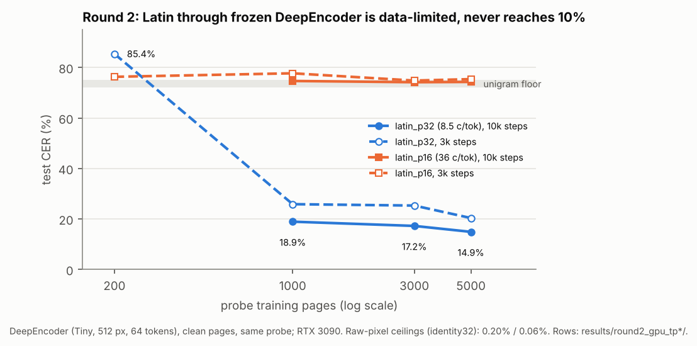

# Frozen-encoder probe, round 2: OCR-capable VLM encoders at their own token geometry

## Status and summary (2026-11-05)
**Finished; DeepEncoder only.** Qwen2.5-VL was dropped on 2026-11-04 before any of its jobs ran (user decision); Qwen
work moved to [ROUND3.md](ROUND3.md). The grid ran on the user's RTX 3090 (`results/round2_gpu_tp{200,1000,3000,5000}/`);
the cloud rows (`results/round2/`, 200 pages) are a CPU cross-check. Full tables:
[RESULTS.md, round 2](RESULTS.md#round-2-deepseek-ocrs-deepencoder-at-its-own-geometry-2026-11-04). Everything below
is the pre-registered record, unchanged except for short pointers.

* **Result.** Through frozen DeepEncoder (512 px, 64 tokens; 1000 train pages, jpeg75) every dense code sits at the
  floor: col_b2 71.5%, col_b4 72.5%, rgb3 83.5%, lg_free_h4 82.2%, lg_pb_h5 82.4%, while their identity32 ceilings
  are all <= 0.52%. Only latin_p32 (8.5 chars/token) is readable: 18.9% clean / 19.1% jpeg75, 14.9% with 5000 pages;
  latin_p24 (15.4) and denser are at 72-77% whatever the data.
* **Predictions:** (a) not tested (Qwen dropped); (b) confirmed; (c) untestable (everything at the floor);
  (d) confirmed (the gap collapses to noise); (e) first part fails (no Latin reaches 3%), second part confirmed;
  (f) identity part passes (rgb3 3.0x mono), encoder part confirmed.
* **Decision rules:** colour / rgb3 **fails** (weaker evidence: no Latin reaches 3% or 10%), so P2/P3 are gated off;
  grey-level banks **not supported**, so banks stay whole-pixel; the informativeness guard passes for all 16 encodings.
* **Limit.** The probe is data-limited (latin_p32 85% -> 15% from 200 to 5000 pages), so absolute CERs are upper
  bounds on what the encoder loses; the decisions rest on same-probe comparisons.

---

Written 2026-11-03, before any non-smoke round-2 run. Round 1 (PLAN.md, RGB_OVERLAY.md) is unchanged and still
running; round 2 lives in new files only.

## Why
Round 1 used frozen SigLIP-B/16 at 224 px, a contrastive caption-matching encoder with no OCR training. Through
its last layer every dense encoding sits at the unigram floor (60-85% CER). Through layer 6, plain DejaVu Latin
reaches only 4.9% CER at 16-px lines (latin_p16, 2.1 chars per 16-px token), and colour blocks, learned glyph banks
and small Latin stay at 62-85%. That shows a low-resolution caption encoder destroys dense codes. It does not
show what the encoder of an OCR-capable VLM does. Round 2 asks: do dense pre-rendering codes (learned glyphs,
colour blocks, RGB overlay) survive the image encoder of an OCR-capable VLM, measured at that encoder's own
token geometry?

## Encoders (frozen, bf16 = checkpoint dtype) and the exact tokens used
| name | checkpoint | page S | token cell P | tokens | d | tokens used |
|---|---|---|---|---|---|---|
| `qwen25vl` | Qwen/Qwen2.5-VL-3B-Instruct, vision tower (rev 66285546) | 448 | 28 | 16x16 = 256 | 2048 | patch-merger output (`pooler_output` of the vision tower = what the LLM receives): 14-px patches (the still image repeated to 2 temporal frames, as the processor does), 32 ViT blocks (window attention, full attention in blocks 7/15/23/31), RMSNorm + 2-layer MLP over each 2x2 patch group |
| `deepencoder` | deepseek-ai/DeepSeek-OCR, DeepEncoder (rev 9f30c71f) | 512 (Tiny mode) | 64 | 8x8 = 64 | 1280 | projector output (what the LLM receives): SAM ViT-B/16 (12 blocks, window 14, global blocks 2/5/8/11) -> neck -> 2 stride-2 convs (16x compressor, 1024-d) -> CLIP-L/14 fed with those features (24 blocks, no final LN) -> concat(CLIP tokens 1..64, SAM tokens) 2048-d -> linear projector 1280-d. The LLM also gets a learned newline token after each of the 8 rows and one view separator (73 positions); these carry no image information and are not counted |
| `identity28` | - | 448 | 28 | 256 | 2352 | raw 28x28x3 patches: ceiling for the Qwen geometry |
| `identity32` | - | 512 | 32 | 256 | 3072 | raw 32x32x3 patches: ceiling for the DeepEncoder page (see "Probe changes" 4) |

*(qwen25vl and identity28 were not run in round 2: Qwen was dropped; it is round 3's model.)*

* **Native mode, verified.** Qwen: 448 is a multiple of 28 and inside min/max pixels, so `smart_resize` keeps it.
  Our patch layout equals `Qwen2VLImageProcessorPil` output exactly (tested), and `image_grid_thw` = [1, 32, 32] ->
  1024 patches -> **256 tokens of 2048 measured**. DeepEncoder: Tiny mode resizes to 512x512 (a no-op here) and
  normalises with mean = std = 0.5. **64 tokens of 1280 measured.**
* **Loading.** Only the vision tensors are downloaded, by HTTP range requests on the safetensors shards
  (`ep/hf_partial.py`): Qwen `visual.*` = 1.34 GB (one contiguous run of shard 1 of 2), DeepSeek-OCR `sam_model.*`,
  `vision_model.*`, `projector.*` = 0.80 GB of a 6.7 GB file. Qwen uses the transformers 5.22.1 class
  `Qwen2_5_VisionTransformerPretrainedModel` (`strict=True` load). DeepEncoder is vendored as plain torch in
  `ep/deepencoder.py` (MIT, from the checkpoint's `deepencoder.py`, no trust_remote_code), with checkpoint names
  (`strict=True`). Checked against the original module code in fp32 on a latin_p8 page: SAM output max |diff| 9e-6;
  final tokens mean |diff| 2e-4 (std 0.19).
* **bf16 vs fp32** (one page): Qwen corr 0.9992, DeepEncoder corr 0.99985. Batched vs single-image inference
  differs only at bf16 noise level, so images do not leak into each other.
* Features are extracted once per (encoder, cond, encoding) by one sequential process and cached as bf16
  (`encoder_probe/cache/tokens/`, git-ignored, see "Run order").

## Geometry and measured chars per vision token
Measured on the 16 test pages (col_b1: 10 / 7 pages, see "Probe changes" 3). chars/token = chars on page / tokens
= P^2 / px^2 per char. Round 1 used 16-px tokens (256 / px^2 per char).

| encoding | px²/char @448 | lines @448 | **Qwen chars/token** (28 px) | px²/char @512 | **DeepEncoder chars/token** (64 px) | identity32 chars/token | round-1 chars/token (16 px) |
|---|---:|---:|---:|---:|---:|---:|---:|
| latin_p5 | 10.83 | 89 | 72.4 | 10.79 | 379.8 | 95.0 | 23.0 |
| latin_p6 | 15.69 | 74 | 50.0 | 15.58 | 263.0 | 65.8 | 16.0 |
| latin_p8 | 27.86 | 56 | 28.1 | 27.75 | 147.6 | 36.9 | 8.9 |
| latin_p10 | 44.61 | 44 | 17.6 | 43.77 | 93.6 | 23.4 | 5.5 |
| latin_p16 | 114.85 | 28 | 6.8 | 113.89 | 36.0 | 9.0 | 2.1 |
| latin_p24 (anchor) | 274.89 | 18 | 2.9 | 266.63 | 15.4 | 3.8 | - |
| latin_p32 (anchor, 512 only) | - | - | - | 479.46 | 8.5 | 2.1 | - |
| col_b1 | 1.00 | 448 | 784.0 | 1.00 | 4096.0 | 1024.0 | 256 |
| col_b2 | 4.00 | 224 | 196.0 | 4.00 | 1024.0 | 256.0 | 64 |
| col_b4 | 16.00 | 112 | 49.0 | 16.00 | 256.0 | 64.0 | 16 |
| lg_free_h4 | 5.80 | 112 | 135.1 | 5.78 | 708.1 | 177.0 | 43 |
| lg_pb_h5 | 7.31 | 89 | 107.3 | 7.26 | 564.1 | 141.0 | 34 |
| rgb3_p6 | 6.11 | 74 | 128.3 | 6.05 | 677.3 | 169.3 | 41.9 |
| rgb3_p8 | 10.76 | 56 | 72.8 | 10.75 | 381.0 | 95.3 | 23.6 |
| mono_p6 | 18.33 | 74 | 42.8 | 18.14 | 225.8 | 56.5 | 14.0 |
| mono_p8 | 32.29 | 56 | 24.3 | 32.25 | 127.0 | 31.8 | 7.9 |

Text tokens are about 4 chars each. The DeepSeek-OCR paper's ~97% precision at ~10x compression is about 40 chars
per vision token, close to latin_p16 here. That is why the lower-density anchors latin_p24/p32 were added for the
DeepEncoder page, so that "best Latin at 3% CER" can exist there. For the identity ceilings compare **per
encoding** (same pages, same px²/char). Rows also store `chars_per_vlm_token` = the paired VLM's P² / px²/char, so
identity32 rows can be read on DeepEncoder's 64-px token axis.

## Probe and changes vs round 1
The probe is the final round-1 probe (3 pixel channels, no free channels; PLAN.md explains why), generalised to a
G x G grid of P-px tokens of dimension d (`ep/probe_grid.py`): tokens (standardised per dim on train tokens) ->
[3x3 conv d->1024 -> GELU -> 1x1 conv 1024 -> P*P*3] + 1x1 skip d -> P*P*3 -> unpatchify -> S x S x 3 page
reconstruction (aux MSE x10 against the clean page, training pages only) -> per-line strip -> the same dilated Conv1d
CTC reader, 3 frames per column (T = 3S). With G=14 and P=16 it has the same modules and parameter shapes as
round 1's `Probe` and gives identical outputs (tested). **Unchanged:** AdamW (fused) lr 2e-3, OneCycle (5% warm-up),
3000 steps, 2 pages x 16 lines per step, 200 train pages, 16 test pages, weight decay 1e-4, grad clip 5, bf16
autocast, seed 0, eval on 4 test pages every 500 steps plus all test pages at the end, round-1 `evaluate()` and
scoring (`score_v` 2).

Changes, all decided before any non-smoke run and none tuned on results:
1. **Page and token geometry** are parameters (S, P, G = S/P). Pages hold 4x (448) or 5.2x (512) the pixels of
   round 1, so the probe is larger: 26M (qwen), 30M (identity28), 40M (deepencoder), 41M (identity32) parameters,
   against about 9M in round 1.
2. **Page renderers take a page size** (`ep/geom.py`: sized subclasses of the round-1 Latin/learned-glyph, colour,
   mono and rgb3 encodings, identical layout; at S = 224 they reproduce round-1 pages exactly, tested).
3. **Text supply fixed.** Round 1's `make_pages` budget (n_lines·(W+8)·1.05 chars) could run out and silently restart
   at page 1 (RGB_OVERLAY.md). Now every encoding declares an upper bound on chars per page, a page is only rendered
   when that many unread chars remain, pages never wrap, and `make_pages_s` asserts that all pages are distinct and
   every line is filled. The 4-5x larger pages need far more text:
   * train text: data/train.txt (40M chars) where it suffices. **col_b1 alone** needs 40.1M (448) / 52.4M (512)
     chars for 200 pages, so it uses data/train_r2.txt (same cleaning of WikiText-103 train, 64M-char cap, identical
     prefix; built on demand);
   * test text: data/test.txt followed by data/val.txt (2.06M held-out chars). **col_b1 gets 10 (448) / 7 (512) test
     pages** (2.0M / 1.8M test chars) instead of 16. Every other encoding has 16 full test pages.
4. **DeepEncoder ceiling uses identity32, not raw 64x64 patches.** A raw 64x64x3 token is 12288-d, which makes the
   probe's 1x1 skip alone 151M parameters (277M in total, ~4.4 GB with AdamW state per job). Four such jobs do not fit
   in 15 GB. identity32 tokens are the same pixels of the same 512 px page on a 16x16 grid. For identity, the skip
   carries everything (the token-to-pixel map is an exact permutation, tested), so the ceiling is a ceiling for the
   page and reader, not for the token size.
5. **VLM tokens come from a cache** (bf16, standardised in fp32 as in round 1). Identity tokens are computed in the
   job as in round 1.
6. **Encodings**: the requested set (latin_p{5,6,8,10,16}, col_b{1,2,4}, lg_free_h4, lg_pb_h5, rgb3_p{6,8},
   mono_p{6,8}) plus the Latin anchors latin_p24 (both geometries) and latin_p32 (512 only), 15 / 16 encodings.
7. Rows carry `round: 2`, S, P, G, n_tokens, d, `px_per_char`, `budget` = px_per_char (so `vbpe.analysis.p_at`
   works), `chars_per_token`, `chars_per_vlm_token`, test_pages and a test-page digest. C@x for a VLM =
   P²/P@x (Qwen 784, DeepEncoder 4096).

## Pre-registered predictions (before any non-smoke run)
1. **(a) Latin through Qwen** reaches < 3% CER at well above round-1 SigLIP density. Concretely, qwen25vl/clean
   latin_p10 (17.6 chars/token, 8x the 2.1 chars/token at which siglip_l6 reached 4.9%) is < 3%, and the Latin
   C@3% through Qwen is >= 15 chars/token. identity28 reaches < 3% for every latin_p >= 6.
2. **(b) Colour blocks**: col_b1 and col_b2 stay near the floor (> 50% CER) through both qwen25vl and deepencoder, clean
   included. col_b4 may partly survive through Qwen (between 3% and 50% CER clean). Through DeepEncoder (256
   chars/token) it stays > 50%.
3. **(c) JPEG q75** hurts colour and rgb3 much more than Latin. For each real encoder, the CER increase
   jpeg75 - clean for col_b4 and rgb3_p8 is >= 3x the increase for the Latin encoding of nearest chars/token, and
   rgb3 loses its chars/token advantage over mono at equal CER.
4. **(d) Learned glyphs**: the lg_free advantage over lg_pb shrinks through the real encoders. The CER gap
   lg_pb_h5 - lg_free_h4 (positive = lg_free better despite 1.26x density) is smaller through
   qwen25vl/jpeg75 and deepencoder/jpeg75 than through identity/clean, or reverses.
5. **(e) DeepEncoder vs Qwen for Latin**: DeepEncoder, trained for optical compression, keeps Latin at more chars per
   vision token than Qwen. Its Latin C@3% lies between 10 and 40 chars/token (latin_p16 to latin_p24 range), and
   latin_p8 (148 chars/token) is > 30% CER.
6. **(f) rgb3 through real encoders** is no better than mono in chars/token at equal CER (as RGB_OVERLAY.md
   prediction 3 for SigLIP). Through identity/clean it is 2.5-3x better (RGB_OVERLAY.md prediction 1).

## Decision rules (carried over from PLAN.md / RGB_OVERLAY.md; "real encoder" = qwen25vl or deepencoder)
* **Colour blocks / rgb3 are worth GPU work only if**, through a real encoder with jpeg75, they reach **>= 2x the
  chars per vision token of the best Latin rendering at 3% CER** (C@3%, same encoder, same condition). Otherwise
  the idea is dead for VLMs with a pretrained encoder: it would need an encoder trained for it.
* **Grey-level learned banks** go into the GPU plan only if **lg_free_h4 still beats lg_pb_h5** through a real
  encoder with jpeg75. "Beats" means lower CER at its 1.26x higher density. Otherwise banks are constrained to whole
  pixels.
* **Informativeness guard** (as PLAN.md's positive controls): an encoding's row through an encoder is interpreted
  only if its identity ceiling for that geometry is < 10% CER. If no Latin encoding reaches 3% through an encoder,
  that encoder's comparisons use C@10% and are reported as weaker evidence.
* Caveat (unchanged): a probe trained on frozen tokens is not an LLM reading them. A positive result means "the
  information survives the encoder", not "the VLM will read it".

## Run order, queue and cost
*History (superseded 2026-11-04): the cloud queue below was trimmed and the grid moved to the RTX 3090; Qwen was
dropped. See the status block at the top.*

**Local GPU runbook (RTX 3090): [docs/gpu/LOCAL_GPU.md](../docs/gpu/LOCAL_GPU.md)** (`--device`, page cache, the prioritised
P0-P3 list with commands, decision rules, analysis with `experiments/analyse2.py`).

`results/queue_probe_c.txt` (one command per line, logs in `results/queue_logs/probe_c/`, 94 lines), started by a
waiter only after round 1's queue (`results/queue_probe_b.txt`) has exited:
1. `build_tokens2.py --encoders deepencoder qwen25vl --conds clean jpeg75`: one process, holds the global VLM lock
   (`encoder_probe/cache/tokens/.vlm.lock`), writes caches in queue order: DeepEncoder clean (16), DeepEncoder
   jpeg75 (16), Qwen clean (15), Qwen jpeg75 (15).
2. identity32/clean anchors (latin_p16, latin_p8, col_b2, lg_free_h4) -> deepencoder/clean x 16 ->
   deepencoder/jpeg75 x 16 -> remaining identity32/clean x 12 -> identity28/clean x 15 -> qwen25vl/clean x 15 ->
   qwen25vl/jpeg75 x 15.
   **2026-11-04: Qwen dropped (user decision; DeepSeek-OCR is the target).** The identity28 and qwen25vl blocks were
   removed from the queue before any of their jobs ran. Probe jobs now save a resume checkpoint every 200 steps
   (`--ckpt-every`; the container restarts when the session resumes, see AGENTS.md).
   **2026-11-04 ~08:40: precision switched to fp32 on this host.** After the 06:17 restart the new host had no native
   bf16 (no AMX/AVX512-BF16), so emulated bf16 ran 4-10x slower (probe 1.8 -> 8.4 s/step, DeepEncoder 1 -> 10 s/page).
   Encoders and probe autocast now pick bf16 only on CPUs with native bf16 (`vlm_encoders.cpu_has_bf16`,
   `run_probe2.py --bf16 auto`). Mixed precision across caches: deepencoder/clean x 15 and jpeg75 latin_p5/6/8/10 are
   bf16, the other jpeg75 caches fp32. Check on 2 latin_p8 test pages: fp32 vs cached bf16 tokens differ by 3.5%
   (relative L2), a fresh bf16 run vs the same cache by 4.7%, so the switch adds no more noise than bf16 itself.
   Rows record the probe's precision in `bf16`; the 3 identity32 anchors resumed from bf16 checkpoints in fp32.
   **~09:20: denormals.** fp32 alone was not enough: the latin anchors still ran at ~17 s/step (col_b2 4.3) because
   of fp32 denormals in the backward pass. `torch.set_flush_denormal(True)` in run_probe2/run_probe: 3.1 s/step on the
   real resumed latin_p16 job. Queue restarted as probe_c6 with the 6 key deepencoder/clean runs first, then the
   3 identity32 anchors (resume from checkpoints), then the jpeg75 token build, then the rest.
   **~13:10: cloud queue trimmed; the rest moves to the user's RTX 3090 ([docs/gpu/LOCAL_GPU.md](../docs/gpu/LOCAL_GPU.md)).**
   All 200-page deepencoder rows sit near the floor (latin_p32 89% with train CTC 0.04 = memorisation), so the probe
   is data-limited. The cloud finishes only the claimed jobs: rgb3_p8 and latin_p8 (200 pages) and latin_p32 with 1000
   (`round2_tp`) and 2000 (`round2_tp2000`) train pages, ~18:00 UTC; it is a CPU cross-check for the GPU sweep.
   The untrimmed queue is kept in results/queue_probe_c_full_backup.txt.
   **Reordered 2026-11-03, before round 2 started:** DeepSeek-OCR's encoder is the primary target (user), so its
   geometry runs first. The 4 identity32 anchors come first so a probe failure at this geometry shows within ~1.5 h.
* A probe job whose cache is not there yet waits for it while the builder holds the lock. If no builder is alive
  (crash), the job takes the lock and builds its own cache. Only the lock holder ever loads a VLM, so no two VLM
  copies are ever in memory.
* **Timings** (smoke, 1 thread, measured while round 1 kept all 4 cores busy): probe 1.21 s/step (identity28),
  1.03 (qwen25vl), 1.68 (identity32), 0.875 (deepencoder). Round 1 took about 0.36 s/step. Extraction: Qwen 3.49
  s/page, DeepEncoder 0.95 s/page.
* **Estimate**: probe jobs 15.9 + 13.7 + 13.7 core-h (Qwen geometry) + 23.2 + 12.5 + 12.5 core-h (DeepEncoder
  geometry) = 91.5 core-h, plus about 9 h of builder (6.3 h Qwen + 1.8 h DeepEncoder + page rendering) on one
  slot. The builder keeps ahead of the probe jobs (Qwen clean caches are done after about 3.2 h, while the 15
  identity28 jobs take about 5.3 h on the other 3 slots), so slots should never idle. **Wall time is about 25 h
  after round 1 ends.** After the reorder, the milestones are roughly 6 h (DeepEncoder clean complete), 10 h
  (DeepEncoder jpeg75), about 14 h (all identity32 ceilings), and 25 h (Qwen).
* **Disk**: weights 2.1 GB (encoder_probe/cache/weights/), token caches about 6.8 GB (Qwen: 30 x 226 MB) + 1.1 GB
  (DeepEncoder), data/train_r2.txt 64 MB. **RAM**: about 2 GB per probe job, plus up to 3 GB for the builder.

## Smoke runs (sanity only, not results; `results/round2_smoke/`, rows have `smoke: true`)
20 train / 4 test pages, 1 thread. qwen25vl/clean latin_p16 at 200 steps: 98.5% CER (CTC 5.2 -> 3.3, recon 1.58 ->
0.58, still falling). deepencoder/clean latin_p32 at 200 steps: 96.9% (CTC 3.6 -> 3.2). identity28 and identity32
latin_p16, 60-step timing runs only: 97.8% / 92.5%. At this stage round 1 was also near the floor (identity/latin_p8:
71% at step 500, 0.13% at 3000). The smokes exercised rendering, VLM extraction, the cache with its self-build path,
the probe at both geometries, scoring and row writing end to end. They are not used for any prediction or decision.

## Files
`ep/geom.py` (sized pages, text supply), `ep/vlm_encoders.py` (encoders, geometry table, Qwen pixel layout),
`ep/deepencoder.py` (vendored DeepEncoder), `ep/hf_partial.py` (range-request tensor fetch), `ep/probe_grid.py`
(GridProbe), `ep/token_cache.py` (cache + lock), `experiments/build_tokens2.py`, `experiments/run_probe2.py`
(`--print-queue` writes the queue), `experiments/wait_then_launch.sh` (waiter), `experiments/analyse2.py` (round-2 tables), `tests/test_round2.py`.
