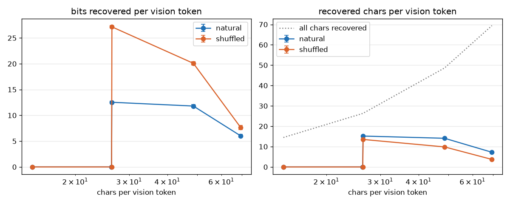

# Capacity curve: r12_frozen

bits/vtok = conservative-blind gap (min of swap, blank) in bits per vision token, extrapolated from the scored window to the page; recovered chars/vtok = chars/vtok x recovered fraction (gap / blind loss); 95% page-bootstrap CIs. CER = greedy transcription of the window (first pages only).

| encoding | text | pages | chars/vtok | window chars | gap nats/text tok | bits/vtok | recovered frac | recovered chars/vtok | CER (pages) | CER cut to window |
|---|---|---|---|---|---|---|---|---|---|---|
| lg_n0_pb_c7_h7 | natural | 200 | 14.5 | 1941 | -0.000 (-0.001-0.000) | -0.00 (-0.00-0.00) | -0.00 (-0.00-0.00) | -0.00 (-0.00-0.00) | 93.1% (4) | 93.1% |
| lg_n0_pb_c4_h7 | natural | 200 | 26.3 | 1923 | -0.000 (-0.001-0.000) | -0.00 (-0.01-0.00) | -0.00 (-0.00-0.00) | -0.00 (-0.01-0.00) | 92.8% (4) | 92.8% |
| latin_p8 | natural | 200 | 26.3 | 1942 | 1.373 (1.343-1.404) | 12.53 (12.31-12.76) | 0.58 (0.57-0.58) | 15.18 (15.07-15.29) | 68.0% (4) | 65.1% |
| latin_p6 | natural | 162 | 48.6 | 1875 | 0.711 (0.690-0.732) | 11.80 (11.55-12.06) | 0.29 (0.28-0.30) | 14.09 (13.83-14.36) | 92.3% (4) | 78.4% |
| latin_p5 | natural | 113 | 69.4 | 1837 | 0.259 (0.245-0.272) | 6.01 (5.74-6.29) | 0.10 (0.10-0.11) | 7.22 (6.87-7.58) | 89.7% (4) | 89.7% |
| lg_n0_pb_c7_h7 | shuffled | 200 | 14.5 | 1939 | -0.000 (-0.001-0.000) | -0.00 (-0.00-0.00) | -0.00 (-0.00-0.00) | -0.00 (-0.00-0.00) | 93.2% (4) | 93.2% |
| lg_n0_pb_c4_h7 | shuffled | 200 | 26.3 | 1922 | -0.000 (-0.001-0.000) | -0.00 (-0.01-0.00) | -0.00 (-0.00-0.00) | -0.00 (-0.00-0.00) | 92.7% (4) | 92.7% |
| latin_p8 | shuffled | 200 | 26.4 | 1945 | 2.977 (2.940-3.012) | 27.15 (26.90-27.39) | 0.51 (0.51-0.52) | 13.51 (13.45-13.58) | 69.2% (4) | 68.7% |
| latin_p6 | shuffled | 162 | 48.6 | 1877 | 1.220 (1.195-1.245) | 20.08 (19.78-20.38) | 0.20 (0.20-0.21) | 9.85 (9.69-10.01) | 90.9% (4) | 83.4% |
| latin_p5 | shuffled | 113 | 69.4 | 1826 | 0.327 (0.309-0.345) | 7.65 (7.24-8.05) | 0.05 (0.05-0.06) | 3.71 (3.52-3.91) | 84.6% (4) | 84.6% |

## Run 0 checks (PLAN_3090 amendment 2b)

* natural: sparsest recovered fraction -0.00 (needs >= 0.8); max bits/vtok 12.53 at latin_p8 (interior: True); densest point CI upper 6.29 vs max 12.53
* gap per text token vs CER over 10 points: Spearman rho = -0.84 (permutation p = 0.0043; needs <= -0.8)
* (added after the first rows, amendment 2c) the same with CER cut to the window: rho = -0.93 (p = 0.0008)
* shuffled recovered fraction below natural at 3 of 5 pitches (needs >= 4 of 6): latin_p8 0.58/0.51, latin_p6 0.29/0.20, latin_p5 0.10/0.05, lg_n0_pb_c4_h7 -0.00/-0.00, lg_n0_pb_c7_h7 -0.00/-0.00
