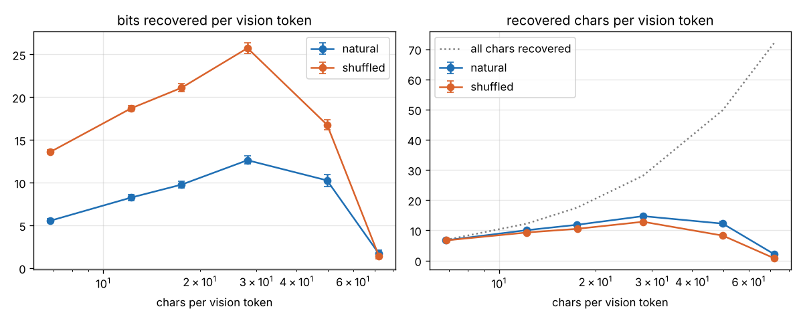

# Capacity curve: run0_cpu

bits/vtok = conservative-blind gap (min of swap, blank) in bits per vision token, extrapolated from the scored window to the page; recovered chars/vtok = chars/vtok x recovered fraction (gap / blind loss); 95% page-bootstrap CIs. CER = greedy transcription of the window (first pages only).

| encoding | text | pages | chars/vtok | window chars | gap nats/text tok | bits/vtok | recovered frac | recovered chars/vtok | CER (pages) | CER cut to window |
|---|---|---|---|---|---|---|---|---|---|---|
| latin_p16 | natural | 32 | 6.8 | 1748 | 2.122 (1.973-2.274) | 5.54 (5.29-5.77) | 0.98 (0.98-0.98) | 6.69 (6.67-6.71) | 1.5% (3) | 1.5% |
| latin_p12 | natural | 32 | 12.2 | 1941 | 1.874 (1.755-1.989) | 8.25 (7.89-8.59) | 0.82 (0.81-0.83) | 10.05 (9.95-10.15) | 72.8% (3) | 46.9% |
| latin_p10 | natural | 32 | 17.5 | 1937 | 1.562 (1.463-1.658) | 9.76 (9.36-10.15) | 0.68 (0.67-0.69) | 11.84 (11.66-12.02) | 72.3% (3) | 54.5% |
| latin_p8 | natural | 32 | 28.1 | 1934 | 1.280 (1.215-1.346) | 12.62 (12.17-13.10) | 0.52 (0.51-0.53) | 14.70 (14.43-14.99) | 76.5% (3) | 76.5% |
| latin_p6 | natural | 32 | 49.8 | 1893 | 0.590 (0.533-0.646) | 10.26 (9.54-10.99) | 0.25 (0.23-0.26) | 12.22 (11.58-12.89) | 86.6% (3) | 75.9% |
| latin_p5 | natural | 32 | 72.2 | 1869 | 0.069 (0.053-0.086) | 1.70 (1.32-2.11) | 0.03 (0.02-0.03) | 2.04 (1.61-2.50) | 81.4% (3) | 79.6% |
| latin_p16 | shuffled | 32 | 6.8 | 1752 | 5.197 (5.018-5.378) | 13.60 (13.39-13.82) | 0.97 (0.97-0.98) | 6.67 (6.65-6.68) | 1.5% (3) | 1.5% |
| latin_p12 | shuffled | 32 | 12.2 | 1935 | 4.176 (4.030-4.316) | 18.69 (18.37-19.00) | 0.76 (0.75-0.77) | 9.28 (9.20-9.36) | 55.4% (3) | 50.3% |
| latin_p10 | shuffled | 32 | 17.5 | 1933 | 3.347 (3.252-3.439) | 21.11 (20.64-21.57) | 0.60 (0.59-0.60) | 10.50 (10.37-10.61) | 76.0% (3) | 73.6% |
| latin_p8 | shuffled | 32 | 28.1 | 1929 | 2.592 (2.509-2.677) | 25.74 (25.08-26.40) | 0.46 (0.45-0.46) | 12.84 (12.66-13.01) | 76.5% (3) | 76.5% |
| latin_p6 | shuffled | 32 | 49.8 | 1898 | 0.969 (0.926-1.014) | 16.76 (16.17-17.36) | 0.17 (0.16-0.17) | 8.24 (7.94-8.55) | 84.5% (3) | 80.5% |
| latin_p5 | shuffled | 32 | 72.2 | 1870 | 0.059 (0.044-0.075) | 1.43 (1.07-1.81) | 0.01 (0.01-0.01) | 0.70 (0.53-0.88) | 84.4% (3) | 84.4% |

## Run 0 checks (PLAN_3090 amendment 2b)

* natural: sparsest recovered fraction 0.98 (needs >= 0.8); max bits/vtok 12.62 at latin_p8 (interior: True); densest point CI upper 2.11 vs max 12.62
* gap per text token vs CER over 12 points: Spearman rho = -0.78 (permutation p = 0.0047; needs <= -0.8)
* (added after the first rows, amendment 2c) the same with CER cut to the window: rho = -0.71 (p = 0.0125)
* shuffled recovered fraction below natural at 6 of 6 pitches (needs >= 4 of 6): latin_p16 0.98/0.97, latin_p12 0.82/0.76, latin_p10 0.68/0.60, latin_p8 0.52/0.46, latin_p6 0.25/0.17, latin_p5 0.03/0.01
