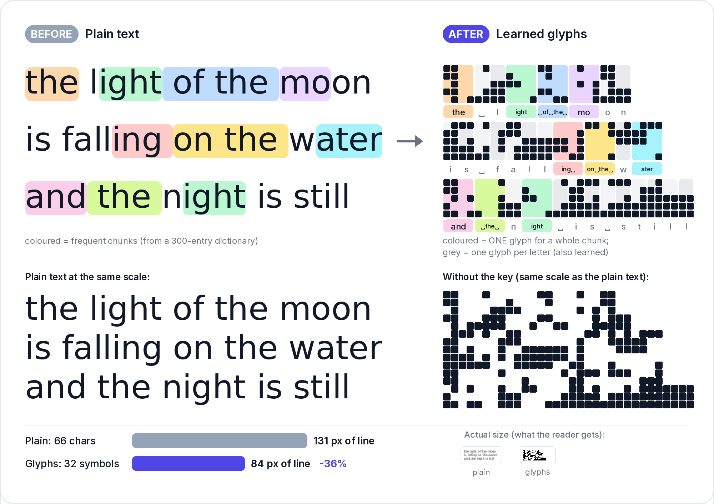
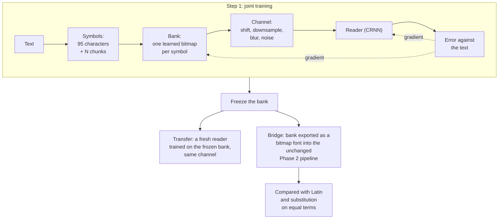
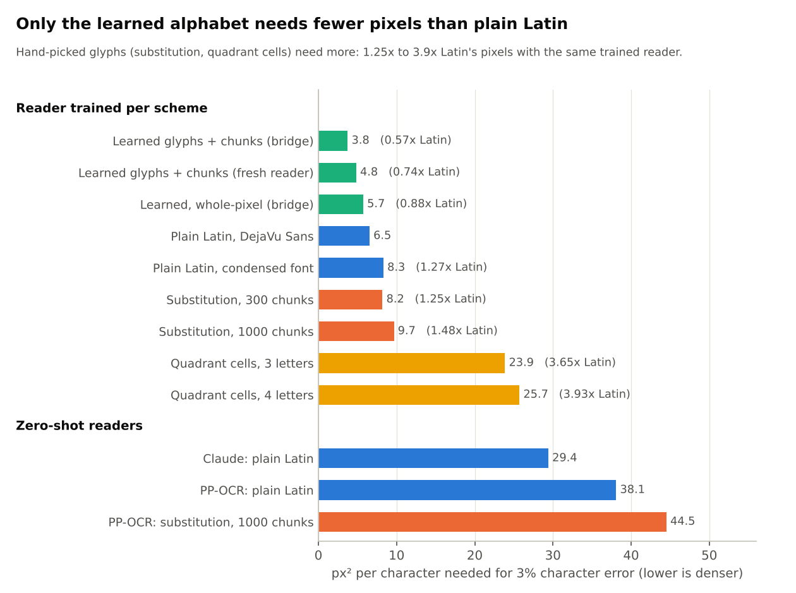
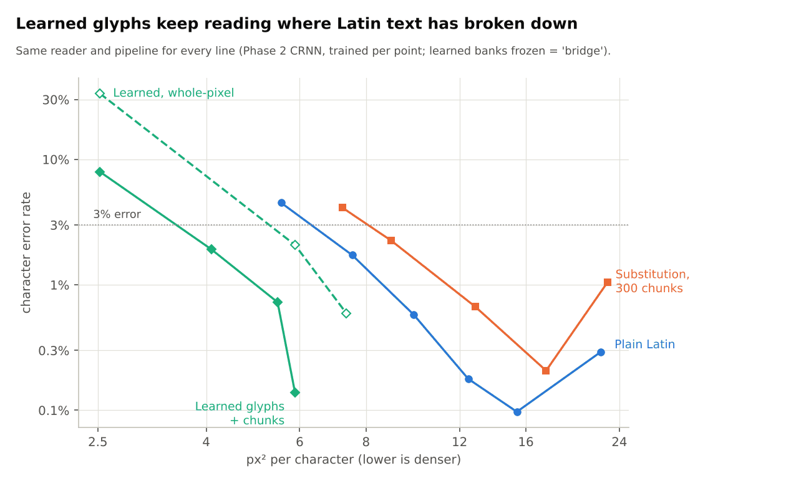
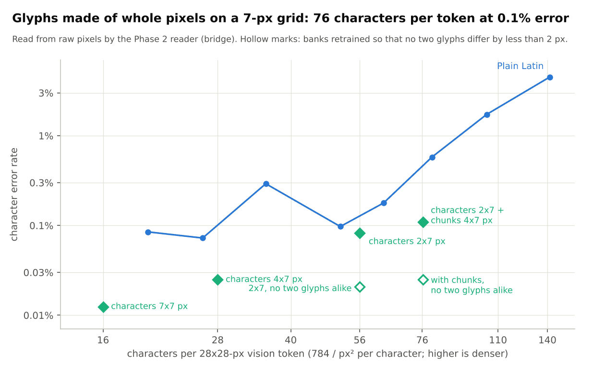

# Learned glyph alphabet: results

**Status: finished. Verdict (2026-11-03): qualified go, in pixel space only.** Later additions: the bigram check
and the grid-aligned banks (2026-11-07). The line was closed on 2026-11-12 because no pretrained vision model
reads these glyphs ([below](#what-happened-when-a-vision-model-had-to-read-them)). Re-checked against the rows and
rewritten result-first in the clean-up of 2026-11-13. Design and pre-registered rule: [PLAN.md](PLAN.md).

## In brief

The question, from the [README](../README.md) (section 2, idea 1): braille is readable at very low resolution,
so why draw text for a model in Latin letters? And once the alphabet is ours to design, why not give frequent
character runs ("chunks", as in byte-pair encoding) a glyph each?

Hand-picked glyphs had just failed that test ([docs/glyphs/RESULTS.md](../docs/glyphs/RESULTS.md)). Here the
glyphs are **learned**: a table of small bitmaps (the "bank") is trained together with a reader, so that each
symbol gets the shape that best survives low resolution.

* **It works in pixels.** An alphabet of 395 symbols (the 95 printable characters plus 300 chunks) needs **0.57x
  the pixels of plain Latin** for the same 3% character error: 3.75 against 6.54 px² per character, scored in the
  unchanged pipeline that was built for Latin (the "bridge", explained below).
* **The chunks are part of the gain,** on top of the better shapes: 0.74x the pixels of a learned alphabet of
  characters alone at the same error.
* **Two things qualify it.** Part of the gain comes from grey levels: glyphs restricted to whole pixels win by
  only 12% (at 3% error) to 23% (at 1%). And the densest banks break on degradations they never saw in training
  (35-68% error on real JPEG and an unseen resize filter).
* **Whole-pixel glyphs on a 7-px grid,** made to line up with a vision model's patches, carry 76 characters per
  vision token at 0.11% error, where plain Latin in the same area gets 0.58%.
* **None of it reaches a pretrained model.** Frozen encoders lose the banks and a fine-tuned Qwen2.5-VL-3B does not
  read them. The result stands as a statement about pixels and a purpose-trained reader, nothing more.



*The alphabet in use (`e1long`, whole-pixel, 5-px lines): the haiku's 66 characters become 32 symbols and its
lines get 36% shorter. Drawn by `scripts/make_readme_figures.py`.*

## Terms

| Term | Meaning |
|---|---|
| **bank** | the learned alphabet: one small bitmap per symbol. Saved under `results/<run>/banks/` |
| **symbol** | one of the 95 printable ASCII characters or one of N chunks. N = 0 is characters only; N = 300 gives 395 symbols |
| **chunk** | a frequent character run (` the `, `ing `) from the dictionary of [docs/glyphs/dictionary-report.md](../docs/glyphs/dictionary-report.md), drawn as a single glyph |
| **px² per character** | line pitch x line width / source characters. Lower is denser. 784 / (px² per character) = characters per 28x28-px vision token |
| **CER** | character error rate: edit distance to the source text over its length |
| **P@3%**, P@1% | px² per character at which CER first reaches 3% (1%): monotone fit, log-axis interpolation, the same code as Phases 1-2 |
| **h** | line pitch in pixels (`h4` = 4-px lines). Cell widths are given as character / chunk, e.g. 2/4 px |
| **channel** | the simulated degradation between glyphs and reader: random sub-pixel shift, downsampling, blur, contrast, noise, 8-bit rounding. `harsh` adds rescaling with random filters, stronger blur and noise, and JPEG |
| **whole-pixel** | every glyph pixel is fully ink or fully background at the final resolution (`--pixel-block`, `_pb` in names). Without it the bank may use grey levels and sub-pixel detail |
| **CRNN** | the small line reader used throughout: convolutions, a recurrent layer, CTC decoding |

## How a bank is trained and scored



A bank can be scored three ways. They are listed from least to most trustworthy.

| Score | What is trained | What it tells |
|---|---|---|
| **joint** | bank and reader together | understates the bank: the reader is chasing glyphs that keep moving. It reads about 2x worse than a fresh reader on the same frozen bank and 2.6-4.6x worse than the bridge |
| **transfer** (experiment E2) | a fresh reader on the frozen bank, through the same simulated channel | how legible the glyphs are in themselves, with no co-adaptation |
| **bridge** (experiment E3) | a fresh Phase 2 reader on the frozen bank, rendered by the Phase 2 code (PIL), as a bitmap font | the like-for-like number: exactly how `latin` and `subst300` were trained and scored in Phase 2 |

**Why the bridge is the number to quote.** The danger in learning glyphs against a simulated channel is that the
bank learns the simulation: a barcode that only that channel passes. The bridge removes the simulation. The frozen
glyphs go through the renderer, augmentation, reader and scoring that produced the Latin baseline, so a gain there
is a gain over Latin and not over a weak stand-in. Before trusting the comparison the two pipelines were
calibrated: fixed DejaVu Sans pushed through the simulated channel reproduces Phase 2's Latin P@3% within 1%
(`results/calibration/e0_training.md`).

The baseline in every table is Phase 2 Latin (DejaVu Sans, 10,500 steps): **P@3% = 6.54, P@1% = 8.92 px² per
character** (`results/phase2/merged/`). All headline numbers are from 10,500-step runs. At 3,500 steps the
chunks looked useless, which was the first, wrong, interim conclusion.

## Headline: pixels needed against plain text



*How to read it: page area per character at which error first falls to 3%; shorter is denser. The three green
bars are this report; the rest is Phases 1-2. Drawn by `scripts/make_glyphs_figures.py` from the rows.*

| | P@3% | P@1% | against Latin (3% / 1%) |
|---|---|---|---|
| Latin, DejaVu Sans (Phase 2) | 6.54 | 8.92 | 1 / 1 |
| Latin, condensed font (Phase 2) | 8.32 | 17.1 | 1.27x / 1.92x |
| learned, 300 chunks, **bridge** | 3.75 | 5.10 | **0.57x / 0.57x** |
| learned, 300 chunks, transfer | 4.83 | 5.66 | 0.74x / 0.63x |
| learned, 300 chunks, whole-pixel, bridge | 5.73 | 6.91 | 0.88x / 0.77x |

Rows: `results/e3_bridge_long/`, `results/e2_transfer_long/`; banks from `results/e1long/`.

## The measured points (300 chunks, 10,500 steps)



*How to read it: left is denser, down is more accurate. Both green lines (bridge scores) cross the 3% mark to the
left of Latin. The solid green line is the unrestricted bank, the dashed one the whole-pixel bank.*

| Bank (h = line pitch; cell widths character / chunk) | px² per character | bridge CER | transfer CER | joint CER | joint CER on unseen degradations |
|---|---|---|---|---|---|
| h3, widths 1/3 | 2.52 | 7.95% | 16.4% | 20.8% | 65% |
| h3, widths 2/3 | 4.09 | 1.92% | 4.79% | 8.71% | 68% |
| h4, widths 2/3 | 5.45 | 0.73% | 1.72% | 3.34% | 55% |
| h4, widths 2/4 | 5.88 | 0.14% | 0.29% | 0.60% | 35% |
| whole-pixel h3 | 2.52 | 33.4% | not run | 48.7% | 62% |
| whole-pixel h4 | 5.88 | 2.08% | not run | 6.75% | 22% |
| whole-pixel h5 | 7.35 | 0.59% | not run | 1.80% | 12% |

"Unseen degradations" = the jointly trained reader tested on real PIL JPEG and a resize filter never used in
training.

## Do the chunks matter? (the "Visual BPE" effect)

Yes. At matched accuracy and line height (joint score, h4), the 395-symbol bank reaches 0.60% CER at 5.88 px² per
character, while a learned bank of characters alone needs 8.0 for 0.57%: **0.74x**. So the chunks add to what
the better shapes give.

* Characters alone already beat DejaVu Sans (the "font effect"): 0.57% at 8.0 px² per character, where Latin
  needs 9.84 for 0.58%.
* The whole-pixel banks show the same direction: with chunks 1.80% at 7.35 (h5), without 1.03% at 10.0.

## Robustness

* **Harsh channel (h7, joint score).** The learned bank reads at 3.45% CER on 15.4 px² per character (4.4% on
  unseen degradations). Fixed DejaVu Sans is unusable: 42.8% on 20.7 px² per character. At h5 both are poor (39%
  against 68%). Learning helps more under harsh degradation, not less.
* **Unseen degradations (default-channel banks).** Unrestricted banks break (35-68% CER); whole-pixel banks hold
  up much better at usable sizes (22% at h4, 12% at h5, 6% for characters alone at h5). This is the clearest
  sign that part of the unrestricted banks' gain exploits the exact channel they were trained on.

## Against the pre-registered go rule

The rule ([PLAN.md](PLAN.md)): "at least 30% fewer px² per character than the best fixed Latin in transfer and in
the bridge, and the gain survives the harsh channel."

| Condition | Result | Pass? |
|---|---|---|
| bridge at least 30% fewer | 43% fewer at 3% and at 1% CER | yes |
| transfer at least 30% fewer | 26% fewer at 3% CER, 37% fewer at 1% | borderline: passes at 1% only |
| survives the harsh channel | the gain grows (3.45% against 42.8% CER at h7) | yes |
| sanity ceiling (a gain above 3x is suspect) | largest gain 1.74x | not triggered |

Hence "qualified go": the bridge passes clearly, the transfer condition only at one of two thresholds, and the
grey-level and unseen-degradation caveats above stand.

## Why whole-pixel glyphs, and why a 7-px grid

The unrestricted banks are blob and grey-level codes: detail finer than a pixel turns into intermediate grey after
downsampling, and the reader uses those greys. That is the first information to go when anything resamples the
image, and a vision model does exactly that: it cuts the page into patches (14 px in Qwen2.5-VL), embeds each as one vector and
(in Qwen2.5-VL) merges 2x2 patches into one 28-px vision token.

* Through a frozen encoder the grey-level bank kept no advantage: 82.2% CER against 82.4% for the whole-pixel bank
  through DeepSeek-OCR's encoder, both at the floor ([encoder_probe/ROUND2.md](../encoder_probe/ROUND2.md)). The
  pre-registered rule was "grey-level banks only if they still beat whole-pixel ones through the encoder", so all
  later work used whole-pixel banks.
* A whole-pixel glyph is a small binary dot pattern. That is what braille is, and it is where the idea started.
* The **grid-aligned banks** (2026-11-07) go one step further: lines are 7 px high and cells 2, 4 or 7 px wide,
  so glyph rows divide the 14-px patch and the 28-px token exactly, and every glyph meets the patch grid the same
  way wherever it sits on the page.



*How to read it: right is denser (more characters in the area of one 28x28-px vision token), down is more
accurate. Blue is plain Latin in Phase 2; green diamonds are aligned banks, all scored by the bridge. The bank
with chunks sits at 76 characters per token and 0.11% error, where Latin at nearly the same density (80) has
0.58%. Hollow diamonds are the banks retrained with a minimum glyph distance (next section).*

| Aligned bank (7-px lines) | Cells | px² per character | Characters per vision token | Joint CER (unseen degradations) | Bridge CER |
|---|---|---|---|---|---|
| `lg_learned_n0_pb_c2_h7` | characters 2x7 px | 14.0 | 56 | 0.31% (2.15%) ¹ | 0.083% |
| `lg_learned_n0_pb_c4_h7` | characters 4x7 px | 28.0 | 28 | 0.03% (0.12%) | 0.025% |
| `lg_learned_n0_pb_c7_h7` | characters 7x7 px | 49.0 | 16 | 0.004% (0.01%) | 0.012% ² |
| `lg_learned_n300_pb_c2t4_h7` | characters 2x7, chunks 4x7 px | 10.29 | 76 | 0.40% (2.11%) | 0.110% |
| for comparison: Latin, Phase 2 | DejaVu Sans | 9.84 / 15.39 | 80 / 51 | | 0.58% / 0.10% |

¹ This bank's joint row is missing from `results/e1align/runs.jsonl`; the figures are from the training log
`results/e1align/chain.log`. ² 3,500-step bridge; the others are 10,500. Rows: `results/e1align/`,
`results/e3_bridge_align/` (where the 2x7 bank appears under the scheme name `lg_learned_n0`).

"Characters per vision token" here is 784 / (px² per character), with no page margin. On a real 448-px page with
a 7-px margin the two minimum-distance banks come to 53.4 and 74.3
([PLAN_3090.md](../docs/gpu/PLAN_3090.md), amendment 4). The 7-px height costs density against the 5-px banks: the
aligned bank with chunks is 76 characters per token, the 5-px one 107. Whether alignment buys that back inside a
vision model was the question for the trained-encoder runs, which were stopped before the glyph stage.

## Do frequent letter pairs read worse? (bigram check, 2026-11-07)

A question from the user. `experiments/bigram_errors.py`, results in `results/bigram_errors/`: 3,000 held-out
lines per saved reader, characters-only banks. For each character, the error rate in its more frequent
two-letter contexts minus that in its rarer ones (weighted by occurrences, 95% interval from a bootstrap over
lines). The rule was set before the run: the hypothesis is supported only if the interval is above 0.

| Reader | CER | frequent minus rare (interval) | error by pair-frequency fifth, rare → frequent | near-identical glyph pairs (under 1 px apart) | share of substitution errors between them |
|---|---|---|---|---|---|
| learned, whole-pixel, h5 | 0.89% | −0.0012 (−0.0017 to −0.0007) | 3.0 / 1.2 / 0.2 / 0.0 / 0.0% | 136 | 72% |
| learned, grey, h5 | 0.63% | −0.0019 (−0.0024 to −0.0013) | 2.6 / 0.5 / 0.0 / 0.0 / 0.0% | 90 | 34% |
| fixed Latin font, h5 | 6.06% | −0.0352 (−0.0375 to −0.0329) | 16.1 / 6.8 / 4.1 / 2.3 / 1.1% | 32 | 16% |
| learned, grey, h4 | 0.51% | −0.0015 (−0.0020 to −0.0010) | 2.0 / 0.5 / 0.1 / 0.0 / 0.0% | 370 | 49% |

* **Hypothesis rejected for every reader.** Frequent pairs read *better*, even within the same character. Almost
  all errors are on rare contexts: names, digits, punctuation.
* **The learned alphabets reuse shapes.** The whole-pixel bank has 136 glyph pairs less than a pixel apart, and
  they carry 72% of its substitution errors. The CRNN gets away with it by using context. A reader with no
  context to lean on (a language model on shuffled text) would lose that information outright, which led to the
  next section.

## Minimum glyph distance (2026-11-07)

`train_joint.py --min-dist-px D --min-dist-weight w` adds a penalty on every pair of same-width glyphs that
differ in fewer than D whole pixels. The two dense aligned banks were retrained with D = 2, everything else as
before (10,500 steps): `results/e1align_md/`, bridge rows `results/e3_bridge_align_md/`.

| Bank | Identical glyph pairs | Smallest distance | Joint CER (unseen degradations) | Bridge CER | px² per character |
|---|---|---|---|---|---|
| characters 2x7 | 35 | 0 px | 0.31% (2.15%) | 0.083% | 14.0 |
| characters 2x7, **minimum distance** | 0 | 2 px | 1.49% (4.49%) | **0.021%** | 14.0 |
| characters 2x7 + chunks 4x7 | 13 | 0 px | 0.40% (2.11%) | 0.110% | 10.29 |
| characters 2x7 + chunks 4x7, **minimum distance** | 0 | 2 px | 1.08% (2.54%) | **0.025%** | 10.29 |

* The constraint costs no density and makes the frozen banks about 4x easier for a fresh reader (bridge).
* The joint score gets worse. That is not a regression: the penalty keeps moving glyphs late in training, so the
  co-trained reader has less time to settle. It is the reason banks are judged by the bridge.

## What the glyphs look like

Atlases (every glyph of a bank in one image) are in `results/e1long/atlas/` and `results/e1align/atlas/`.
Unrestricted banks are blobs and grey levels, not letterforms. Whole-pixel banks are small binary dot patterns.
Neither is readable by a person.

## What happened when a vision model had to read them

This report ends at pixels. The follow-up is written up where it ran; the numbers were re-checked against
`encoder_probe/results/*/runs.jsonl`.

| Reader | Result for the learned banks | Write-up |
|---|---|---|
| Frozen SigLIP, a probe on its tokens | layer 6: whole-pixel banks 53-55% CER, grey-level 76-85%; last layer: 75-85% for all four banks | [encoder_probe/RESULTS.md](../encoder_probe/RESULTS.md) |
| Frozen DeepEncoder (DeepSeek-OCR) | 82.2% (grey) and 82.4% (whole-pixel): the floor | [encoder_probe/ROUND2.md](../encoder_probe/ROUND2.md) |
| Qwen2.5-VL-3B fine-tuned for 1,000 steps | the 5-px whole-pixel bank with chunks (`lg_pb_h5`, 107 characters per token): 78.4% CER, multiple-choice accuracy 0.31 against 0.25 by chance; not read. Its blind control stopped at step 500, so the comparison rests on the training loss. Three such pages overlaid in the colour channels (322 characters per token) end at their blind control, although that page reads at 1.07% from raw pixels | [encoder_probe/ROUND3.md](../encoder_probe/ROUND3.md), [docs/background/ANALYSIS.md](../docs/background/ANALYSIS.md) |
| Trained-encoder runs with the aligned banks | planned as the last fair test; closed before the glyph stage ran | [docs/gpu/PLAN_3090.md](../docs/gpu/PLAN_3090.md) |

## Lessons

* Score banks by the bridge, not by the joint CER.
* Train at least 10,500 steps. Chunks look useless at 3,500.
* `vbpe.analysis` groups rows by font size. Banks with different cell widths share one, so set
  `budget = px_per_char` on the rows first.
* Restarting `scripts/job_queue.py` on the same queue file re-runs it from line 1. Use a new file per round.

## Open at the time, and what became of it

1. *Does a pretrained vision encoder keep these glyphs?* Answered: no (table above).
2. *A GPU follow-up with real JPEG and resampling in the channel, 1000 chunks, and a small vision-language model
   fine-tuned on glyph pages against Latin at equal token budgets.* The fine-tune ran once at a short budget
   (table above). The longer trained-encoder runs were parked and their glyph stage closed on 2026-11-12. The
   1000-chunk bank and the real-JPEG channel were never built.
3. *A fixed braille-style dot code as a control* (how much of the whole-pixel gain is learning, how much is just
   "dense binary code"; [IDEAS.md](../docs/background/IDEAS.md)): never run.

## Reproduce

```bash
python3 learned_glyphs/experiments/train_joint.py --grid e1 --modes learned --n-tokens-list 300 --heights 4 --steps 10500 --run-name e1long
python3 learned_glyphs/experiments/transfer_eval.py --bridge --run-name e3_bridge_long --steps 10500 \
    --banks learned_glyphs/results/e1long/banks/lg_learned_n300_h4.pt --ems 3.3333
python3 learned_glyphs/experiments/transfer_eval.py --run-name e2_transfer_long --steps 10500 \
    --banks learned_glyphs/results/e1long/banks/lg_learned_n300_h4.pt
# whole-pixel: add --pixel-block --guard-ss 0 --scheme-suffix _pb; narrower cells: --char-w 2 --token-w 3 --scheme-suffix _w23;
# harsh: --channel harsh --run-name e1long_harsh
python3 scripts/make_glyphs_figures.py     # the charts
```

A 10,500-step run takes 20-40 minutes at one thread. The exact commands of every round are in
`results/archive/queue.txt` and `queue_r6.txt` to `queue_r8.txt` at the repo root's `results/`.

## Corrections made in the 2026-11-13 clean-up

Every number above was recomputed from the rows. The headline figures were right. Changed:

* "The joint reader lags 2-4x behind a fresh reader": from the rows it is about 2x behind a fresh reader in the
  same channel (transfer) and 2.6-4.6x behind the bridge.
* Whole-pixel banks on unseen degradations were given as "6-22%"; that range holds at h4 and h5 (the h3 bank is at
  62%, and unreadable anyway).
* The sanity-ceiling entry said "at most 1.75x"; the largest gain is 6.54 / 3.75 = 1.74x.
* The aligned-bank tables now say where the 2x7 bank's joint figures come from (a log, not a row) and that the
  7x7 bridge ran 3,500 steps.
* The queue files moved to `results/archive/`.
