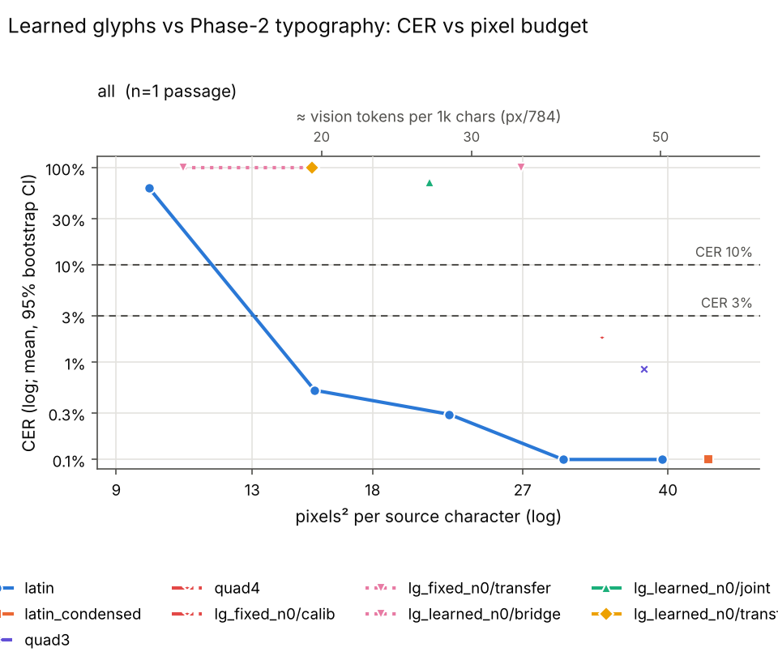
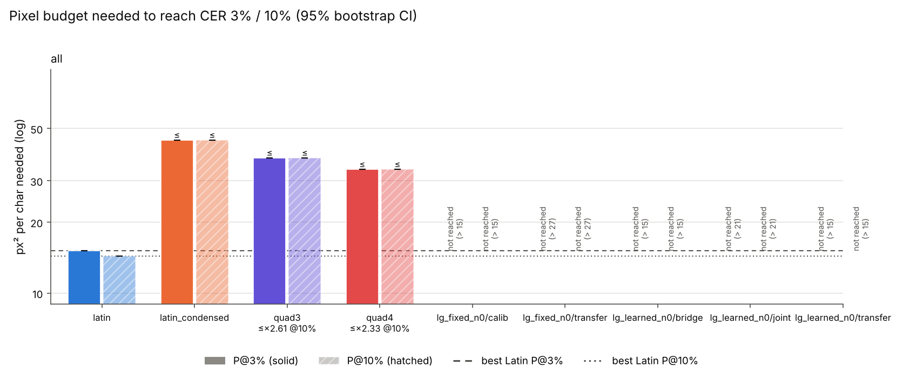

# Learned glyphs vs Phase-2 typography (phase 2)

## Decision (PLAN criteria)

P@3% in px²/char ('≤' = already below threshold at the smallest grid point; '> grid' = never reaches it). Fixed reference for joint/transfer = `lg_fixed_n0/joint` (else `/transfer`) through the same channel (fixed banks are frozen, so their runs are transfer runs); for the bridge = best Phase-2 Latin (**15.1**).

| mode | P learned N=0 | P learned N=300 | P fixed ref | S1 = L0/F0 | S2 = L300/L0 | L300/fixed | L300/Phase-2 Latin |
|---|---|---|---|---|---|---|---|
| joint | > grid | missing | > grid | n/a (neither crosses) | n/a (missing) | n/a (missing) | n/a (missing) |
| transfer | > grid | missing | > grid | n/a (neither crosses) | n/a (missing) | n/a (missing) | n/a (missing) |
| bridge | > grid | missing | 15.1 | ∞ (learned never crosses) | n/a (missing) | n/a (missing) | n/a (missing) |
| joint/harsh | missing | missing | missing | n/a (missing) | n/a (missing) | n/a (missing) | n/a (n/a) |
| transfer/harsh | missing | missing | missing | n/a (missing) | n/a (missing) | n/a (missing) | n/a (n/a) |

GO needs learned+tokens ≤ 0.70 × fixed in every criterion:

* fail: transfer vs fixed (same channel)
* fail: transfer vs Phase-2 best Latin
* fail: bridge vs Phase-2 best Latin
* fail: harsh transfer vs harsh fixed

**Verdict: NO-GO (or incomplete data)**

## Top confusions (char level, from samples/)

### calibration_quick/lg_fixed_n0_default_em5

20 lines, 945 ref symbols, 945 edits (rate 100.00%).

| ref -> hyp | n |
|---|---|

deleted: ` `×139, `e`×91, `t`×64, `a`×60, `r`×58, `o`×51, `n`×50, `i`×48, `s`×40, `d`×36

### smoke_joint/lg_learned_n0_h7

20 lines, 945 ref symbols, 676 edits (rate 71.53%).

| ref -> hyp | n |
|---|---|
| `t` -> `e` | 17 |
| `a` -> `e` | 17 |
| `i` -> `e` | 14 |
| `o` -> `e` | 10 |
| `d` -> `s` | 9 |
| `r` -> `e` | 9 |
| `A` -> `e` | 7 |
| `c` -> `e` | 6 |
| `p` -> `e` | 6 |
| `b` -> `e` | 6 |
| `s` -> `e` | 5 |
| `n` -> `e` | 5 |

deleted: `r`×43, `t`×42, `o`×33, `i`×27, `h`×23, `n`×22, `d`×22, `a`×20, `u`×20, `l`×18

inserted: `e`×1

### smoke_transfer/transfer_lg_fixed_n0_h8

20 lines, 945 ref symbols, 945 edits (rate 100.00%).

| ref -> hyp | n |
|---|---|

deleted: ` `×139, `e`×91, `t`×64, `a`×60, `r`×58, `o`×51, `n`×50, `i`×48, `s`×40, `d`×36

### smoke_transfer/transfer_lg_learned_n0_h6

20 lines, 945 ref symbols, 945 edits (rate 100.00%).

| ref -> hyp | n |
|---|---|

deleted: ` `×139, `e`×91, `t`×64, `a`×60, `r`×58, `o`×51, `n`×50, `i`×48, `s`×40, `d`×36

Rows: 14 total, 14 usable, 0 no-fit (scored CER=1), 0 errors. Total recorded cost: $0.00.

P@x = px²/char at which the isotonic-smoothed mean CER first reaches x (log-x interpolation). ratio = P(scheme)/P(best Latin) (best of latin, latin_condensed at that threshold); CI = paired passage bootstrap. compr = text tokens / vision tokens at P (Claude: px/784 = 28x28 patches, text ≈ chars/4). '≤' on P = already below threshold at the smallest budget; on a ratio '≤'/'≥'/'?' = upper/lower bound/undetermined because of that censoring.

## Verdicts

* K3 (Phase 2: subst P@3% >= 30% below best Latin): UNDETERMINED - no substitution scheme in data.
* Quadrant (Phase 2 rule: killed if P@3% >= best Latin): KILLED; quad3/all ratio 2.48, quad4/all ratio 2.22

## Condition: all

* best Latin @ 3%: **latin** (15.1 px²/char)
* best Latin @ 10%: **latin** (14.4 px²/char)

| scheme | P@3% [95% CI] | ratio@3% [CI] | vis tok/1k@3% | compr@3% | P@10% [95% CI] | ratio@10% [CI] | vis tok/1k@10% | compr@10% |
|---|---|---|---|---|---|---|---|---|
| latin | 15.1 [15.1, 15.1] | 1.00 [1.00, 1.00] | 19.3 | 12.97 | 14.4 [14.4, 14.4] | 1.00 [1.00, 1.00] | 18.3 | 13.65 |
| latin_condensed | ≤ 44.6 [44.6, 44.6] | ≤ 2.95 [2.95, 2.95] | 56.9 | 4.40 | ≤ 44.6 [44.6, 44.6] | ≤ 3.11 [3.11, 3.11] | 56.9 | 4.40 |
| quad3 | ≤ 37.5 [37.5, 37.5] | ≤ 2.48 [2.48, 2.48] | 47.8 | 5.23 | ≤ 37.5 [37.5, 37.5] | ≤ 2.61 [2.61, 2.61] | 47.8 | 5.23 |
| quad4 | ≤ 33.5 [33.5, 33.5] | ≤ 2.22 [2.22, 2.22] | 42.7 | 5.85 | ≤ 33.5 [33.5, 33.5] | ≤ 2.33 [2.33, 2.33] | 42.7 | 5.85 |
| lg_fixed_n0/calib | > 15 (not reached) | — | n/r | n/r | > 15 (not reached) | — | n/r | n/r |
| lg_fixed_n0/transfer | > 27 (not reached) | — | n/r | n/r | > 27 (not reached) | — | n/r | n/r |
| lg_learned_n0/bridge | > 15 (not reached) | — | n/r | n/r | > 15 (not reached) | — | n/r | n/r |
| lg_learned_n0/joint | > 21 (not reached) | — | n/r | n/r | > 21 (not reached) | — | n/r | n/r |
| lg_learned_n0/transfer | > 15 (not reached) | — | n/r | n/r | > 15 (not reached) | — | n/r | n/r |

Mean CER by budget:

| scheme | 9.8 | 10.8 | 15.3 | 15.4 | 21 | 22.1 | 26.9 | 30.1 | 33.5 | 37.5 | 39.4 | 44.6 |
|---|---|---|---|---|---|---|---|---|---|---|---|---|
| latin | 0.617 |  |  | 0.005 |  | 0.003 |  | 0.001 |  |  | 0.001 |  |
| latin_condensed |  |  |  |  |  |  |  |  |  |  |  | 0.001 |
| quad3 |  |  |  |  |  |  |  |  |  | 0.009 |  |  |
| quad4 |  |  |  |  |  |  |  |  | 0.018 |  |  |  |
| lg_fixed_n0/calib |  |  | 1.000 |  |  |  |  |  |  |  |  |  |
| lg_fixed_n0/transfer |  |  |  |  |  |  | 1.000 |  |  |  |  |  |
| lg_learned_n0/bridge |  | 1.000 | 1.000 |  |  |  |  |  |  |  |  |  |
| lg_learned_n0/joint |  |  |  |  | 0.711 |  |  |  |  |  |  |  |
| lg_learned_n0/transfer |  |  | 1.000 |  |  |  |  |  |  |  |  |  |

