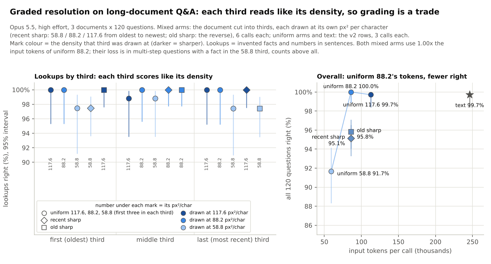

# Graded resolution: long-document Q&A with recent text sharp and old text dense

*Pre-registered 2026-11-13, written and committed before the first scored call. The results section is added
below it after the calls; nothing above "Results" changes after that commit.*

## Question

The DeepSeek-OCR paper proposes, without testing it, a context memory that forgets: older context is re-rendered at
ever lower resolution, so recent text is sharp and expensive and old text is blurry and cheap (noted in
[docs/gpu/COLOUR_GIST.md](../../../docs/gpu/COLOUR_GIST.md), "Prior art"; reference 1 in
[docs/background/prior-art.md](../../../docs/background/prior-art.md)). Does **non-uniform resolution for text**
work on one application that worked uniformly: Opus 5.5 answering questions about a long document given as page
images ([docs/claude/CLAUDE_QA.md](../../../docs/claude/CLAUDE_QA.md), Test 1)? Concretely: does a third of a
document read at density d, inside a document whose other thirds are at other densities, score like the whole
document read uniformly at density d? And does it matter whether the sharp part is the recent or the old part?

## Arms (new)

The document is cut into three equal parts by characters (cuts moved to the next space, and past any fact a
question needs, so no fact is split across two densities). Each third is rendered with the existing
`render_pages` at its own density on 1932-px pages; every page holds text of one third only; pages stay in
document order.

| arm | first (oldest) third | middle third | last (most recent) third |
|---|---|---|---|
| `recent_sharp` | 58.8 px²/char | 88.2 | 117.6 |
| `old_sharp` (control: separates position from density) | 117.6 | 88.2 | 58.8 |

## Held fixed (identical to the v2 uniform arms)

The 3 documents (v2 `qav2_d0/d1/d2`: 700k characters, paragraph offsets 0, 1150, 2480; seeds 0, 1, 2), the 120
questions per document (40 invented facts, 40 numbers in sentences, 40 multi-step; ids, wording and answers checked
equal to `qav2_d*_high_b88/questions.json`), the system prompt and the prompt (`claude_qa_render.SYSTEM`,
`prompt_for("image", ...)` with the total page count), the font and renderer, 1932-px pages, Opus 5.5
(`claude-opus-5-5`), `--effort high`, headless `claude -p` through `vtc/claude_eval.py`.

**Dry run (free, `check`):** each mixed arm is 18 pages per document (4 + 6 + 8 or 8 + 6 + 4), the same page
count as uniform 88.2, and its image-token formula total is 79,887 / 79,749 / 79,818 for d0 / d1 / d2 against
uniform 88.2's 79,887 / 79,749 / 79,749 (ratio 1.000, 1.000, 1.001). Image tokens per third for `recent_sharp`
d0: 17,745 / 26,652 / 35,490. Measured px²/char per third: 58.9-59.0, 88.3-88.5, 117.7-118.0. Lookups (needle and
number questions) per third, pooled over the 3 documents: 79 / 84 / 77. So both mixed arms cost the same tokens as
uniform 88.2 (2.9x fewer than text) by construction; the measured input tokens are reported per call.

Baselines (existing rows, not re-run, one call per document, paired by question): uniform 117.6, 88.2 and 58.8
(`qav2_d{0,1,2}_high_b{118,88,59}`, image rows) and text (the text row of the same directories).

## Calls

One call per document and arm (6 calls, repeat 0, no cache salt), then, if the cap allows, a second call per
document and arm with `cache_salt="gradient1"` (12 calls in all), so call-to-call variation is visible. Each call's
pages must arrive: input tokens >= 0.97 x the image-token formula, else the call is marked incomplete and excluded.
Calls that refuse, leave questions unanswered or trip the existing engagement check are excluded and listed.
Refusals are reported, never worked around.

## Scores and tests (existing scoring code: `norm_num` exact match, `analyse_claude_qa.wilson`, `paired_diff_ci`, `mcnemar`)

1. **Overall accuracy** of each mixed arm against text, uniform 88.2 (equal tokens), uniform 117.6 and uniform
   58.8: paired by question, Newcombe 95% interval, exact McNemar. Primary: the first call of each document
   (360 pairs). Secondary: every valid call, each paired with the same baseline row (720 pairs; the interval then
   ignores that the baseline is one call, so it is too narrow and only descriptive).
2. **By tier:** lookups (needle and number questions) by the third their fact sits in, for the two mixed arms and
   for the three uniform arms on the same questions, with Wilson intervals.
3. **Multi-step questions by the tiers their facts touch:** the rows' `anchors` are every fact a question needs
   (from `make_complex_v2`), so each question's tiers are where its anchors sit in the document. Split per mixed
   arm: "dense" = at least one fact in the third that arm draws at 58.8; "sharp" = all facts in its 88.2 / 117.6
   thirds. Every arm (incl. uniform ones) is scored on the same split. Counts touch every third almost always, so
   they fall in "dense". From the dry run: 24 sharp and 96 dense multi-step questions per split, pooled.
4. **Cost and input tokens per call** (`total_cost_usd`, list price).

Point estimates for N1-N4 pool every valid call of an arm (mean over calls).

## Predictions (from the brief; not to be changed)

- **N1:** each tier inside a mixed document scores within 3 points of the uniform arm at the same density on the
  same lookups (no penalty for mixing).
- **N2:** `recent_sharp` and `old_sharp` have the same overall accuracy within 3 points (density matters, position
  does not).
- **N3:** overall, both mixed arms land between uniform 88.2 and uniform 58.8, i.e. below the equal-token uniform
  arm: grading resolution is a trade (accuracy moved to where it is wanted), not a free gain. (Judged as: uniform
  58.8 <= mixed < uniform 88.2, for both arms.)
- **N4:** multi-step questions with a fact in the 58.8 tier lose at least 10 points against the same questions in
  the uniform 117.6 arm; those with all facts in sharper tiers do not. (Judged per mixed arm on its own split:
  dense loss >= 10 points and sharp loss < 10 points, for both arms.)

Mine (the runner's, labelled as such):

- **R1:** the dense-tier multi-step loss in each mixed arm is smaller than uniform 58.8's on the same questions
  (uniform 58.8: 76.0% / 74.0% on the two dense splits), because only part of each chain is dense.
- **R2:** the lookup tiers barely separate: uniform 58.8 already gets 97-99% of lookups in every third, so N1 holds
  mostly because lookups are near the ceiling, not because mixing is shown to be free.

## What this sample can and cannot show

With ~80 lookups per third per call and lookups at 97-100% at every density, a third's accuracy is 2 questions
from a 2.5-point difference: N1's 3-point margin is inside call-to-call noise and the Wilson interval of 80/80 is
95.4-100%. Only a penalty of roughly 8+ points in one third would stand out. Overall, 360 paired questions give a
Newcombe interval of about +-2-3 points near 92-100% accuracy, so differences of ~3 points between arms are at the
edge of what is detectable. The "sharp" multi-step group is small (24 questions per split): a 10-point loss there
is 2-3 questions. The test can show a large tier effect (a mixed third scoring like a different density, or the
dense third dragging chains down by 10-20 points); it cannot show small (<5 point) effects.

## Spend

Hard cap **$12 at list price** (`total_cost_usd`), tracked in `spend.jsonl`. A call starts only if spent + calls in
flight + this call's upper estimate (max of $1.00 and 1.3x the dearest call so far) stays within the cap. Calls
draw on the user's subscription quota; on a usage-limit error the run stops, rows are committed and what remains
is reported.

## Reproduce

```bash
python3 experiments/claude_qa/claude_qa_gradient.py check            # free: pages, tokens per tier
python3 experiments/claude_qa/claude_qa_gradient.py run --yes        # resumable; rows appended per call
python3 experiments/claude_qa/claude_qa_gradient.py analyse          # summary.md / summary.json from whatever rows exist
```

Files: `runs.jsonl` (one row per call, per-question outcomes with each fact's tier), `spend.jsonl`, `dry_run.json`,
`question_tiers.json`, `summary.md`, `summary.json`.

## Results

*2026-11-13. All 12 calls made (2 per document and arm), every one complete (input tokens 85,861-85,957 = image
formula + ~6.1k prompt), none refused, unanswered or disengaged. **$4.45 at list price** ($0.54-0.61 for first
calls; $0.10-0.25 for the salted repeats, whose prompts were read from the prompt cache). Full tables:
[summary.md](summary.md). Chart: [docs/img/claude_gradient.png](../../../docs/img/claude_gradient.png).*



**Measured saving.** Both mixed arms averaged 85,913 input tokens per call, the same as uniform 88.2 (85,889; image
formula ratio 1.000-1.001) and 2.87x fewer than text (246,192).

| arm | thirds (old to new) | calls | input tokens / call | all | lookups | multi-step |
|---|---|---|---|---|---|---|
| text | - | 3 | 246,192 | 99.7% | 100.0% | 99.2% |
| uniform 117.6 | 117.6 | 3 | 112,470 | 99.7% | 99.6% | 100.0% |
| uniform 88.2 | 88.2 | 3 | 85,889 | 100.0% | 100.0% | 100.0% |
| uniform 58.8 | 58.8 | 3 | 59,283 | 91.7% | 97.9% | 79.2% |
| `recent_sharp` | 58.8 / 88.2 / 117.6 | 6 | 85,913 | **95.1%** | 99.2% | 87.1% |
| `old_sharp` | 117.6 / 88.2 / 58.8 | 6 | 85,912 | **95.8%** | 99.2% | 89.2% |

Per call: `recent_sharp` 99.2, 97.5 / 92.5, 93.3 / 92.5, 95.8% (d0 / d1 / d2); `old_sharp` 95.8, 96.7 / 96.7,
93.3 / 97.5, 95.0%. Call-to-call spread within a document is up to 3.3 points.

**Lookups by third** (density drawn at in brackets; mixed arms pooled over 2 calls):

| arm | first third | middle third | last third |
|---|---|---|---|
| uniform 117.6 | 100.0% (79/79) | 98.8% (83/84) | 100.0% (77/77) |
| uniform 88.2 | 100.0% (79/79) | 100.0% (84/84) | 100.0% (77/77) |
| uniform 58.8 | 97.5% (77/79) | 98.8% (83/84) | 97.4% (75/77) |
| `recent_sharp` | 97.5% (154/158) [58.8] | 100.0% (168/168) [88.2] | 100.0% (154/154) [117.6] |
| `old_sharp` | 100.0% (158/158) [117.6] | 100.0% (168/168) [88.2] | 97.4% (150/154) [58.8] |

**Multi-step by the tiers their facts touch** (each arm on the named mixed arm's split; 24 sharp / 96 dense
questions per call set):

| arm | `recent_sharp` split: all sharp | a fact at 58.8 | `old_sharp` split: all sharp | a fact at 58.8 |
|---|---|---|---|---|
| uniform 117.6 | 100.0% (24/24) | 100.0% (96/96) | 100.0% (24/24) | 100.0% (96/96) |
| uniform 58.8 | 91.7% (22/24) | 76.0% (73/96) | 100.0% (24/24) | 74.0% (71/96) |
| `recent_sharp` | 100.0% (48/48) | 83.9% (161/192) | 97.9% (47/48) | 84.4% (162/192) |
| `old_sharp` | 83.3% (40/48) | 90.6% (174/192) | 100.0% (48/48) | 86.5% (166/192) |

By type, counts carry most of the loss: `recent_sharp` counts 41.7% (15/36), `old_sharp` 58.3% (21/36), against
27.8% for uniform 58.8 and 100% for uniform 88.2 and 117.6; three-hop 89.6% / 87.5% (uniform 58.8: 66.7%); two-hop
93.3% / 98.3%; sums 98.3% / 93.3%; largest-of-three 100% / 100%. Counts span the whole document, so the 58.8 third holds a fact of all 18 count
questions in the `old_sharp` split and of 17 in the `recent_sharp` split. Without counts (ad hoc, not pre-registered), the dense multi-step groups score
93.7% (`recent_sharp`) and 92.9% (`old_sharp`) against 100% for uniform 117.6 and 86.1% / 84.6% for uniform 58.8.

**Paired tests** (first call per document, 360 pairs; mixed − reference, Newcombe 95% interval, exact McNemar):

| comparison | mixed − ref | 95% interval | ref-only / mixed-only right | p |
|---|---|---|---|---|
| `recent_sharp` vs text | −5.0 | −7.8 to −2.7 | 19 / 1 | 4.0e-05 |
| `recent_sharp` vs uniform 88.2 (equal tokens) | −5.3 | −8.1 to −3.1 | 19 / 0 | 3.8e-06 |
| `recent_sharp` vs uniform 117.6 | −5.0 | −7.8 to −2.7 | 19 / 1 | 4.0e-05 |
| `recent_sharp` vs uniform 58.8 | +3.1 | +0.7 to +5.7 | 4 / 15 | 0.019 |
| `old_sharp` vs text | −3.1 | −5.4 to −1.4 | 11 / 0 | 0.00098 |
| `old_sharp` vs uniform 88.2 (equal tokens) | −3.3 | −5.7 to −1.6 | 12 / 0 | 0.00049 |
| `old_sharp` vs uniform 117.6 | −3.1 | −5.5 to −1.1 | 12 / 1 | 0.0034 |
| `old_sharp` vs uniform 58.8 | +5.0 | +2.1 to +8.2 | 6 / 24 | 0.0014 |

Over all 12 calls (720 pairs, descriptive): `recent_sharp` −4.9 and `old_sharp` −4.2 points against uniform 88.2.

### Predictions

- **N1 PASS:** every third scores exactly what the uniform arm at its density scores on the same lookups (difference
  0.0 points in all six cells: 97.5 vs 97.5 and 97.4 vs 97.4 at 58.8; 100 vs 100 at 88.2 and 117.6). This is
  mostly ceiling (R2): lookups score 97-100% at every density, so N1 can only rule out a mixing penalty of roughly
  8 points or more in a third.
- **N2 PASS:** `recent_sharp` − `old_sharp` = −0.7 points overall (95.1% vs 95.8%). Position did not matter at a
  size this test can see.
- **N3 PASS:** both mixed arms fall between uniform 58.8 (91.7%) and uniform 88.2 (100.0%): 95.1% and 95.8%, i.e.
  3.3-5.3 points *below* the uniform arm with the same tokens (first calls; p < 0.001). Grading resolution is a
  trade, not a gain: spending the same tokens unevenly loses accuracy, because the 58.8 third costs more accuracy
  than the 117.6 third buys back (88.2 is already at the ceiling).
- **N4 PASS:** multi-step questions with a fact in the 58.8 third lose 16.1 (`recent_sharp`) and 13.5
  (`old_sharp`) points against uniform 117.6 on the same questions; those with every fact in the sharper thirds
  lose 0.0 (n = 48 each). Caveat: the dense-group loss is mostly counts; without counts it is 6-7 points.
- **R1 (mine) PASS:** the dense multi-step groups score above uniform 58.8 on the same questions (83.9 vs 76.0;
  86.5 vs 74.0): a chain with only part of its facts dense loses less than a fully dense one.
- **R2 (mine) PASS:** the lookup tiers barely separate (97.4-100% everywhere).

### What the sample can and cannot show

It shows a large effect clearly: equal-token grading loses 3-5 points overall against uniform 88.2 (intervals
exclude 0), and multi-step questions that touch the dense third lose 13-16 points. It cannot show whether a third
inside a mixed document reads *slightly* worse than the same density alone: lookups are at the ceiling (~80 per
third per call; one wrong answer is 1.3 points), and the multi-step "all sharp" group is 24 questions per call set.
N2's 0.7-point difference is well inside the call-to-call spread (up to 3.3 points within a document), so a
position effect under ~4 points is not excluded. The uniform baselines are one call per document (the v2 rows),
the mixed arms two, so the paired intervals cover question-to-question but not run-to-run variation of the
baselines; the earlier repeat calls put that at under 1 point for uniform 117.6 and 88.2.

### Deviations

- None from the plan. The second call per document and arm ran because the first six cost $3.46. The by-type
  multi-step breakdown and the no-count split were added after the calls (descriptive; the verdicts above use only
  the pre-registered splits).
