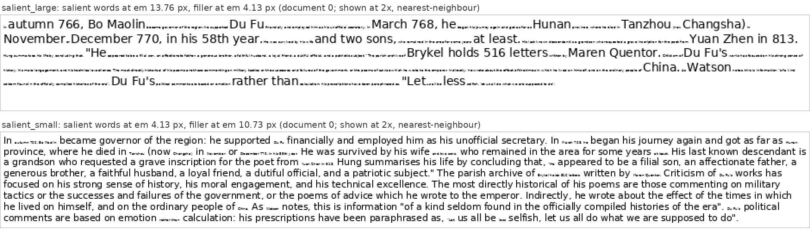

# Content-chosen mixed resolution: facts large, filler small, on the same page

*Pre-registered 2026-11-13, written and committed before the first scored call. The results section is added
below it after the calls; nothing above "Results" changes after that commit.*

## Question

The graded-resolution test ([../gradient/README.md](../gradient/README.md)) changed resolution by *position* (old
third blurry, recent third sharp). The user meant something else: **mixed resolution throughout every page, chosen
by content.** What must be read exactly (numbers, names, words that flip meaning) is drawn large and safe; the filler
around it is drawn small and cheap; the choice is made by a cheap rule-based detector when the pages are drawn (no
model call). On long-document Q&A with Opus 5.5 ([docs/claude/CLAUDE_QA.md](../../../docs/claude/CLAUDE_QA.md),
Test 1), uniform pages lose nothing down to 88.2 px²/char (2.9x fewer tokens than text) and lose 8 points at 58.8
(4.2x; 91.7%, chains and counts first). **At the token count of uniform 58.8, does spending the pixels on what must
be exact recover that loss?**

## Detector (frozen; regular expressions and fixed word lists only)

Run identically on all text of a document (`claude_qa_salient.detect_words`, `salient_mask`). A "word" is a
maximal run of non-space characters; its "core" is the word without leading/trailing punctuation and a final
possessive `'s`. A sentence ends at a word ending in `.`, `!` or `?` (optionally followed by closing quotes or
brackets); the next word starts a sentence. A word is salient for any of these reasons:

1. **Numbers in any form:** every word that contains a digit (covers separators `1,200`, decimals `12.5`,
   currency `$1,200`, ordinals `11th`, years and decades `1990s`, ranges, times); every word made only of `%`, `$`,
   `£`, `€`, `¥`; every word one of whose hyphen-separated parts is in this fixed list: zero one two three four five
   six seven eight nine ten eleven twelve thirteen fourteen fifteen sixteen seventeen eighteen nineteen twenty
   thirty forty fifty sixty seventy eighty ninety hundred thousand million billion trillion hundreds thousands
   millions billions dozen dozens half quarter percent first second third fourth fifth sixth seventh eighth ninth
   tenth eleventh twelfth twentieth hundredth thousandth once twice thrice double triple.
   **Padding:** a number is widened by one word on each side (the unit and the verb or preposition it hangs on:
   "holds 516 letters"), but never across a sentence end. Names and flip words are not padded.
2. **Names:** every capitalised word (core starts with an upper-case letter) that does not start a sentence. A
   sentence-initial capitalised word is a name only if the same core occurs capitalised mid-sentence somewhere in
   the document and never with a lower-case first letter anywhere in the document (so "Boulter" counts, "The",
   "During" do not). The pronoun "I" is never a name. Runs of names are runs of such words (spaces between two
   salient words are drawn large).
3. **Words that flip meaning** (each justified in one line):
   * `not`, any word ending in `n't`: negation reverses the fact.
   * `no`, `never`, `none`, `neither`, `nor`: negative quantifiers and adverbs; same.
   * `without`, `except`, `unless`: exclusion and condition; they remove part of what the sentence states.
   * `only`: restricts a count or a set to what follows.
   * `fewer`, `less`, and the phrases `more than`, `less than`, `fewer than`, `rather than`: a comparison's
     direction decides which number is larger; `more` alone is not marked (too common outside comparisons).
   * `before`, `after`: order in time decides which of two values applies.
   * `instead`, `instead of`: substitutes one value for another.
   * the phrases `all but`, `at least`, `at most`, `no longer`: each turns the number or state next to it into its
     complement or a bound.
   * `by`, `from`, `to` **only** within the next 8 words of the same sentence after a verb of payment or transfer
     (paid pay pays paying sold sell sells bought buy buys gave give given gives sent send sends lent lend loaned
     owed owe owes shipped ship transferred transfer donated donate received receive traded trade): there they say
     who gave and who got; elsewhere they are filler (marking every "to" would make a third of all words large).

The detector does not see the questions, the planted facts' positions, the test's quoting or its sentence templates.
**Its rules were written before any coverage was computed**, with two changes after a first look at one marked
passage of document 0 (before any planted-fact coverage was computed): padding was stopped at sentence ends, and the
large size was set to the measured 117.6 em (13.76 instead of a first guess of 13.77). **Caveat, said plainly:** the
documents' planted facts are numbers and invented names in plain sentences, and the flip-word list was drawn up
knowing the small-word set's categories (negation, "all but", passive "by", before/after, from/to, comparatives,
"instead of"). This is exactly what such a detector is built to catch, so it is close to a best case for the
detector.

## Rendering

Two type sizes inline on the same page, in reading order, sharing a baseline: salient words at one size, all other
words at the other (a space is drawn at the salient size only between two salient words). Dedicated renderer in
`claude_qa_salient.py` (`Flow`, `layout`, `draw`), because `vbpe/layout.py` draws one em per page: DejaVu Sans (the
font of every Latin page in this repo), one glyph at a time with its advance (as `GlyphUnit` does), greedy word
wrap on 1932-px-wide pages with 4-px margins, **each line's pitch = 1.2 x the largest em on it** and its baseline
0.9 x that em below the line's top (as `vbpe/layout.py` places a uniform line), pages filled line by line up to
1932 px, the last page cut to the height its text needs (a multiple of 28). Image tokens per page =
ceil(W/28) x ceil(H/28) + 3.

**Sizes.** Large = the em of the 117.6 px²/char pages: **13.76 px** (median over the 67 full pages of the uniform
117.6 rendering of d0-d2; range 13.65-13.79). Small = the em at which the whole document's image tokens equal those
of uniform 58.8 (the `image_tokens_formula` of `qav2_d{d}_high_b59`), solved per document by bisection (largest em,
to 0.01 px, with tokens <= the target).

## Dry run (free, `check`; numbers computed after the rules were frozen, before any call)

| | d0 | d1 | d2 |
|---|---|---|---|
| characters salient (of non-space characters) | 29.5% | 34.0% | 30.9% |
| words salient | 32,923 of 117,525 | 36,157 of 116,105 | 33,264 of 116,294 |
| words marked as number / number padding / name / flip word | 6,458 / 11,409 / 16,964 / 1,473 | 6,218 / 10,886 / 21,043 / 1,316 | 5,536 / 9,767 / 19,288 / 1,383 |
| `salient_large`: em salient / filler | 13.76 / **4.13** | 13.76 / **3.51** | 13.76 / **3.98** |
| `salient_small`: em salient / filler | 4.13 / 10.73 | 3.51 / 11.05 | 3.98 / 10.83 |
| image tokens `salient_large` / `salient_small` / uniform 58.8 | 53,235 / 53,235 / 53,235 | 53,166 / 53,028 / 53,166 | 53,166 / 53,166 / 53,166 |
| pages per arm (uniform 58.8: 12) | 12 | 12 | 12 |

Token match: ratio 1.000 for every arm and document except `salient_small` d1 (0.997).

**Coverage of what the questions need** (pooled; identical in the three documents to within 2 points):

* The number every answer is read from (needle facts, number sentences, the last link of two- and three-hop chains,
  the parts of sums and largest-of-three): **100% of their digits are salient** in all 3 x 114 questions (counts
  have no number in the document).
* Share of the characters of the facts a question needs that are salient: needles 57-58%, two-hop 70-72%, three-hop
  58-59%, sums and largest-of-three 56-58%, counts 45-46%, and **number questions 35-37%**: these questions locate
  their sentence by its quoted opening words, which are mostly filler.
* Small-word document (Test A's, for the optional arm): all answer and lure numbers salient; 91% of the words each
  answer depends on (`critical` in `claude_qa_prune.SMALL`) are salient (missing per document: the passive's "was",
  10 words, and the second "to" of the 5 from/to sentences, 9-10 words after "shipped");
  em of the filler 4.10 / 3.48 / 3.95, tokens equal to Test A's `page59` pages (ratio 1.000).

**The small size is far below the danger line.** Every line of WikiText contains a name or a number, so every line
takes the large pitch (16.5 px); the token budget then leaves room only for filler at em 3.5-4.1 px. A uniform page
at that em would be **7.6-10.5 px²/char** (1.2 em x 0.51 em per character), against ~29 px²/char where Claude's
transcription error is 3% and ~18 px²/char below which it hallucinates or refuses
([docs/GOTCHAS.md](../../../docs/GOTCHAS.md)). Charged its share of the line (advance x the large pitch), the filler
occupies 29-34 px²/char, but its glyphs are 2-3 px tall. I viewed the rendered pages (Read tool, also at 2x): the
large words are crisp and sit on the line's baseline; the filler is a grey dotted smear that I could not read.
This is the trade the brief asked to test, and it is run as specified. Sample:
[docs/img/claude_salient_sample.png](../../../docs/img/claude_salient_sample.png).



## Arms (new)

| arm | salient words | filler | calls |
|---|---|---|---|
| `salient_large` | em 13.76 (the 117.6 setting) | em solved to the tokens of uniform 58.8 (3.51-4.13) | 2 per document |
| `salient_small` (control: does the detector's choice matter, or does any two-size page behave the same?) | the small em of `salient_large` | em re-solved to the same tokens (10.73-11.05) | 2 per document |
| `salient_large_small_words` (only if, after the 12 calls above, at least $4 of the cap is left) | as `salient_large`, on Test A's document | | 1 per document |

`salient_small` keeps the two sizes of `salient_large` only in name: with the salient words at the small em, the
filler must be re-solved (it cannot be 13.76 at this token count), so it lands near uniform 58.8's em (9.8).

The second call per document uses `cache_salt="salient1"`. The small-word arm uses Test A's document
(`claude_qa_prune.build_doc`: the v2 document plus 40 small-word facts) and Test A's prompt for page arms (all 160
questions in one call), with the small size re-solved to the image tokens of Test A's `page59` row.

## Held fixed (identical to the v2 uniform arms)

The 3 documents (`qav2_d0/d1/d2`: offsets 0, 1150, 2480; seeds 0, 1, 2), the 120 questions per document (ids,
wording and answers checked equal to `qav2_d*_high_b88/questions.json`), the system prompt and the prompt
(`claude_qa_render.SYSTEM`, `prompt_for("image", ...)` with the page count), 1932-px-wide pages, Opus 5.5
(`claude-opus-5-5`), `--effort high`, headless `claude -p` through `vbpe/claude_eval.py` (`hires=True`).

Baselines (existing rows, not re-run, paired by question): uniform 117.6, 88.2 and 58.8 and text
(`qav2_d{0,1,2}_high_b{118,88,59}`, one call per document). Small words: Test A's `page118`, `page88`, `page59` and
`text` rows (`results/claude_qa/prune/d*`) and the repeat calls (`results/claude_qa/repeat`: 117.6 pages over 15
calls 97.2%, 88.2 pages 96.2%, text 100%).

## Validity

A call counts only if its pages arrived (input tokens >= 0.97 x the image-token formula; otherwise "incomplete"),
it was not refused, it answered every question, and the existing engagement check finds no disengagement phrase.
Excluded calls are listed. Refusals are reported, never worked around; prompts are not reworded.

## Scores and tests (existing scoring code: `norm_num` exact match, `analyse_claude_qa.wilson`, `paired_diff_ci`, `mcnemar`)

1. Overall, lookups (needle + number), multi-step, and by question type (needle, number, two-hop, three-hop, sum,
   largest-of-three, count), per arm, pooled over valid calls (Wilson 95% intervals).
2. Paired against uniform 58.8 (equal tokens: **the main comparison**), uniform 88.2, uniform 117.6 and text:
   Newcombe 95% interval and exact McNemar on the first call per document (360 pairs); all calls pooled as
   descriptive (720 pairs, the baseline repeated). Also `salient_large` vs `salient_small` (first calls).
3. Tokens and cost per call (`total_cost_usd`, list price).
4. For wrong answers: whether the numbers the answer is read from were drawn large (all digits salient), and the
   share of the needed facts' characters that are salient.
5. Small-word arm: accuracy on the 40 small-word questions and the original 120, per type, share of answers equal
   to the lure; paired against Test A's `page118`, `page59` and `text` calls on the same document.

Point estimates for M1-M4 pool every valid call of an arm.

## Predictions (from the brief; not to be changed)

- **M1:** `salient_large` beats uniform 58.8 at equal tokens by at least 3 points overall (the detector recovers
  part of the loss).
- **M2:** `salient_large` lookups are at least 99% (as at 117.6); its multi-step questions stay below uniform
  88.2's by at least 3 points (the small filler still costs chains and counts).
- **M3:** `salient_small` scores below `salient_large` by at least 5 points overall (the choice of what to enlarge
  matters).
- **M4 (only if run):** on small-word questions `salient_large` does no better than uniform 117.6 pages did (about
  97%). (Judged as: its small-word accuracy <= the 117.6 pages' pooled 97.2% over 15 calls.)

Mine (the runner's, labelled as such, written after seeing the sizes and the pages, before any call):

- **R1:** M1 fails: `salient_large` scores *below* uniform 58.8 overall, because the filler is unreadable.
- **R2:** in `salient_large`, number questions (found by their quoted opening, 64% filler) score below 60%, while
  needle questions (found by names and a number, all large) score at least 90%.
- **R3:** in `salient_large`, count questions score at most 20% (the six fact types differ only in a filler noun:
  lighthouse, windmill, observatory, foundry, library, ferry), while two- and three-hop chains (names, "Rowing
  Club" and "owns 362 boats" / "has 640 lamp" all large) score at least 70%.
- **R4:** `salient_small` lookups score below 50% (the names and numbers are the unreadable part).

## What this sample can and cannot show

360 questions per arm and call set give intervals of about +-3 points near 90% and +-5 near 50%: differences of 5+
points between arms are visible, 1-2 points are not. The test can show whether a page made of large keywords in
an unreadable filler supports Q&A at equal tokens, and which question types it serves. It cannot show what a
better layout would do (filler at a legible size needs lines whose height does not follow the tallest word, or far
fewer salient words); it tests one detector on text whose planted facts suit it, one model and one effort; and the
uniform baselines are one call per document.

## Spend

Hard cap **$12 at list price** (`total_cost_usd`), tracked in `spend.jsonl`. A call starts only if spent + calls in
flight + this call's upper estimate (max of $1.00 and 1.3x the dearest call so far) stays within the cap. Calls
draw on the user's subscription quota; on a usage-limit error the run stops, rows are committed and what remains
is reported.

## Reproduce

```bash
python3 experiments/claude_qa/claude_qa_salient.py check --small-words      # free: coverage, sizes, tokens, sample image
python3 experiments/claude_qa/claude_qa_salient.py run --yes                # 12 calls; resumable, rows appended per call
python3 experiments/claude_qa/claude_qa_salient.py run --small-words --yes  # 3 calls, only if >= $4 of the cap is left
python3 experiments/claude_qa/claude_qa_salient.py analyse                  # summary.md / summary.json from whatever rows exist
```

Files: `runs.jsonl` (one row per call; per question: answer, given, correct, `num_cov`, `anchor_cov`),
`spend.jsonl`, `dry_run.json`, `summary.md`, `summary.json`; rendered preview pages in `images/` (git-ignored).
