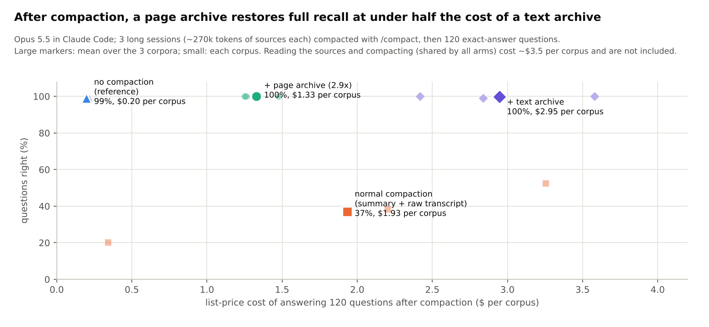

# Context compaction with a page-image archive: pre-registration (2026-11-11, before any agent call)

Question (user): when Claude Code compacts a long session, can the full pre-compaction transcript be kept as page
images that the model opens on demand, and what does that cost and gain against normal compaction?

Mechanism (verified headless with Haiku): a PreCompact hook receives `transcript_path` (which still holds the
pre-compaction messages) and can render it; a SessionStart hook with matcher `compact` adds a note after compaction,
which the model sees. No hook can edit the summary itself. In this test the archive pointer goes in the question
prompt instead, so all arms fork from one compacted session.

Design (`experiments/compaction/run_compact.py`), Opus 5.5, per corpus (the 3 deep-research corpora, 34-50 real
Wikipedia sources with invented facts, ~240-290k tokens of text, 120 exact-answer questions: 60 lookups, 60 across
sources):

1. One session reads every source file with Read (low effort; shared by all arms); the source files are then removed.
2. **D, no compaction:** a fork answers the questions (high effort).
3. `/compact` on the session (one summary shared by A-C).
4. Forks of the compacted session answer the same questions with Read only:
   **A, normal compaction** (summary only); **B, page archive** (the sources from the transcript as 88.2 px²/char
   pages, ~3x fewer tokens than text, plus a text index of which sources each page holds); **C, text archive** (the
   same chunks as text files, same index).

Metrics: accuracy (all, lookups, synthesis) and the list-price cost of the question phase; reading and compaction
costs reported separately (shared).

Predictions:
1. A (normal compaction) loses at least 30 points against D: a summary cannot hold 60 planted facts and numbers.
2. B recovers to within 5 points of D, and within 5 points of C.
3. B's question phase costs less than C's (at least 1.5x less), because looking things up in an archive is reading.
4. Reported without a threshold: B's cost and accuracy against A (the user's two key metrics), points gained per
   extra dollar, and how many archive files each arm opened.

## Results (2026-11-11): 3 corpora x 4 arms, all complete

| after the session | accuracy (360 questions) | lookups / across sources | cost of answering, 3 corpora | per corpus | $ per correct answer |
|---|---|---|---|---|---|
| D: no compaction (reference) | 99.2% | 99.4% / 99.4% | $0.59 | $0.20 | $0.0017 |
| A: normal compaction | **36.9%** | 44.6% / 30.0% | $5.80 | $0.34-3.26 | $0.044 |
| **B: + page archive (88.2 px²/char)** | **100.0%** | 100% / 100% | **$3.99** | $1.25-1.48 | **$0.011** |
| C: + text archive | 99.7% | 99.4% / 100% | $8.84 | $2.42-3.58 | $0.025 |

Shared by all arms per corpus: reading the sources $1.47-2.74, compaction $1.25-1.53 (from the session's CLI total;
`/compact` reports no usage of its own). Costs per step are computed from each invocation's usage at Opus 5.5 list
prices; a forked session's CLI total includes the whole session history, so it is not used.

Paired over 360 questions (Newcombe 95% interval, exact McNemar):
* B - A: **+63.1 points** (+57.8 to +67.9), p = 9e-69.
* B - C: +0.3 (-0.8 to +1.6), p = 1. B - D: +0.8 (-0.4 to +2.4), p = 0.25.
* A - D: -62.2 (-67.0 to -57.0).

**Normal compaction is not summary-only.** Claude Code's compaction summary gives the path of the full transcript
(JSONL). Arm A used it: on corpus 0 it read the transcript in 26 chunks ($2.20, 38%), on corpus 2 in 47 ($3.26, 53%);
on corpus 1 it gave up after 9 reads ($0.34, 20%). Raw JSONL with no index is slow to search and the model often
stops early. With an index and pages, B opened 29-36 files per corpus and found everything.

Pre-registered verdicts:
1. A loses at least 30 points against D: **PASS** (-62.2).
2. B within 5 points of D and of C: **PASS** (+0.8 and +0.3).
3. B's question phase at least 1.5x cheaper than C's: **PASS** (2.2x: $3.99 vs $8.84).
4. Against normal compaction (the two key metrics): B is **+63 points** and **31% cheaper** ($3.99 vs $5.80), so
   **3.9x cheaper per correct answer** ($0.011 vs $0.044). No compaction is cheaper still ($0.20 per corpus): the
   archive pays when the session cannot keep its context, which is when compaction happens.

Limits: one model; 3 sessions; questions with exact answers about planted facts, not open-ended work; compaction
triggered by `/compact` (auto-compaction would fire at the same point with the same hooks); the archive pointer was
put in the prompt, where a SessionStart(compact) hook would put it (verified separately).
