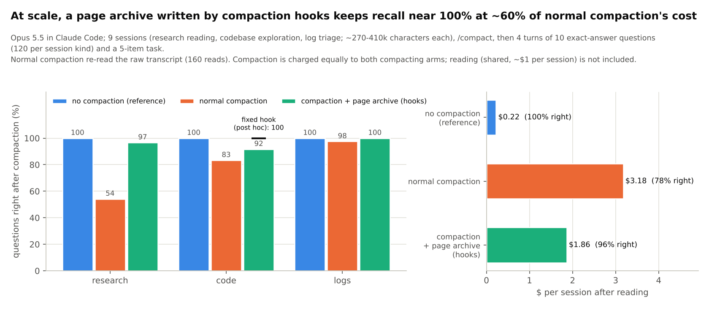

# Compaction archive at scale: pre-registration (2026-11-11, written before any agent call)

Follow-up to [results/compaction](../compaction/README.md) (3 research sessions: normal compaction 36.9%, page archive
100%, 31% cheaper). That test left four gaps, which this one closes:

| | first test | this test |
|---|---|---|
| sessions | 3, all reading Wikipedia sources | **9 in 3 kinds**: research (Read, 14 Wikipedia articles with planted facts, new seeds), codebase exploration (Read, ~22 Python files of this repository), log triage (Bash, synthetic service logs with planted events) |
| archive delivery | pointer written into the question prompt | **real hooks** (`experiments/compaction/hooks/`): PreCompact renders the whole transcript (files read, command output, the agent's own messages) to 88.2 px²/char pages plus an index; SessionStart(compact) tells the model where it is |
| archive content | Read results only | everything in the transcript, code and logs minified with their line structure (`vbhook` minifiers) |
| questions | 120 in one turn | 40 per session in **4 turns of 10**, then a **task turn**: write a file that needs 5 details from before the compaction |

Arms per session (Opus 5.5; reading at low effort, everything after it at high effort):
* **D, no compaction:** a fork of the reading session answers.
* **A, normal compaction:** a fork runs `/compact` with no hooks, then answers (Claude Code's summary includes the
  raw transcript path, which the model may read).
* **B, compaction + page archive:** a fork runs `/compact` with the two hooks installed, then answers. Nothing about
  the archive is in any prompt.

Questions have exact numeric answers, scored automatically. Research: lookups (needle, number) and cross-source
(citation, conflict, chain, source count, total), 20 + 20. Code: value of a module-level constant, line of a
top-level `def`/`class`, and which file (by reading order) defines a function. Logs: a request's latency, a deploy's
build number, an incident's affected requests, differences between days' p99, which day had the highest p99.

Metrics: accuracy per arm (all, per kind, per turn, task items); cost of everything after the reading (compaction +
answering) from each invocation's usage at Opus 5.5 list prices; cost per correct answer; archive pages opened;
whether the hook's note reached the model.

Predictions:
1. A loses at least 30 points against D (pooled over 360 questions).
2. B is within 5 points of D pooled, and within 10 points of D within each session kind.
3. B costs at most half of A per correct answer (pooled).
4. The hooks work unaided: in every B session the archive note is in the post-compaction context and B opens at least
   one archive page.
5. Task turn: B beats A by at least 30 points on task items (pooled, 45 items).
6. Reported without a threshold: results per kind, cost of compaction vs answering, hook run time, archive size.

Budget: ~$6-7 per session, ~$60 for 9; one session of each kind first as a pilot (~$20), checked before the rest.

## Results (2026-11-11): 9 sessions x 3 arms, all complete ($48 at list prices, including the post-hoc re-run)

| after compaction | questions right (360) | research | code | logs | task items (45) | $ per session after reading | $ per correct answer |
|---|---|---|---|---|---|---|---|
| D: no compaction (reference) | 100.0% | 100% | 100% | 100% | 100% | $0.22 | $0.005 |
| A: normal compaction | **78.3%** | 54.2% | 83.3% | 97.5% | 80% | $3.18 | $0.090 |
| **B: compaction + page archive (hooks)** | **96.1%** | 96.7% | 91.7% | 100% | 100% | **$1.86** | **$0.043** |
| B with the fixed hook (post hoc, code re-run) | **98.9%** | 96.7% | **100%** | 100% | 100% | **$1.85** | **$0.041** |

Costs: compaction (~$1.45 per session) is charged at A's cold-cache cost to both compacting arms; answering cost
A $1.73 and B $0.42 per session on average. Reading (shared by all arms) cost ~$1 per session. Full tables, per-turn
accuracy and paired tests: [summary.md](summary.md) (`experiments/compaction/analyse_scale.py`).

Paired over 360 questions (Newcombe 95% interval, exact McNemar):
* B - A: **+17.8 points** (+13.4 to +22.4), p = 2e-14; task items +20.0 (+8.0 to +33.8).
* B - D: -3.9 (-6.4 to -2.0), p = 0.0001 as pre-registered; **-1.1 (-2.8 to +0.1), p = 0.12 with the fixed hook**.
* A - D: -21.7 (-26.2 to -17.6).

Pre-registered verdicts:
1. A loses at least 30 points against D: **FAIL** (-21.7). Normal compaction did better than in the first test (78% vs
   37%) because it read the raw transcript JSONL 160 times; on research it still fell to 54% (cross-source questions:
   conflicts 1/12, source counts 1/12), while on logs, where each request id or incident is easy to grep for in the
   JSONL, it kept 97.5%, at 6x B's answering cost.
2. B within 5 points of D pooled and within 10 in each kind: **PASS** (-3.9; research -3.3, code -8.3, logs 0.0).
3. B at most half of A per correct answer: **PASS** ($0.043 vs $0.090, 2.1x).
4. Hooks work unaided: **PASS**. In 9/9 sessions the SessionStart note was in the post-compaction context and B opened
   archive pages (79 page reads in total); no hook errors; archives of 7-11 pages (31-47k image tokens), rendered in
   11-16 s inside the PreCompact hook.
5. Task items, B beats A by at least 30 points: **FAIL** (+20.0: A 80%, B 100%).

**Post hoc: a hook bug, found and fixed.** 10 of B's 14 misses were questions about the line a `def` starts on, all in
7 files the Python minifier refused (they contain its own marker characters § and »). For those, the first version of
the hook fell back to flowed text without line numbers, so the model had to count lines. The fix keeps a §n tag on
every line in the fallback (`hooks/precompact_archive.py`). Re-running B on the 3 code sessions with it (arm `Bfix`,
new fork and compaction, same questions; $3.60): code 100% (was 91.7%), all 360 questions 98.9%, no significant
difference from no compaction. The cost barely moves: answering the code sessions cost $0.37 per session with the fix
against $0.42 without, so the whole arm comes to $1.85 per session after reading and $0.041 per correct answer, 2.2x
cheaper than normal compaction (compaction charged at the same cold-cache cost as the other arms). The other 4 misses: two research answers that gave the two values instead of the
difference, one misread number, one chain.

What this adds to the first test: the archive works through real hooks with nothing in the prompt, on code and
command output as well as prose, across several turns and in a file-writing task; and normal compaction, which can
grep its own transcript, is a stronger baseline than it looked (78%, not 37%), but costs 4x more to answer with and
still misses a fifth of the questions, mostly the cross-source ones.
