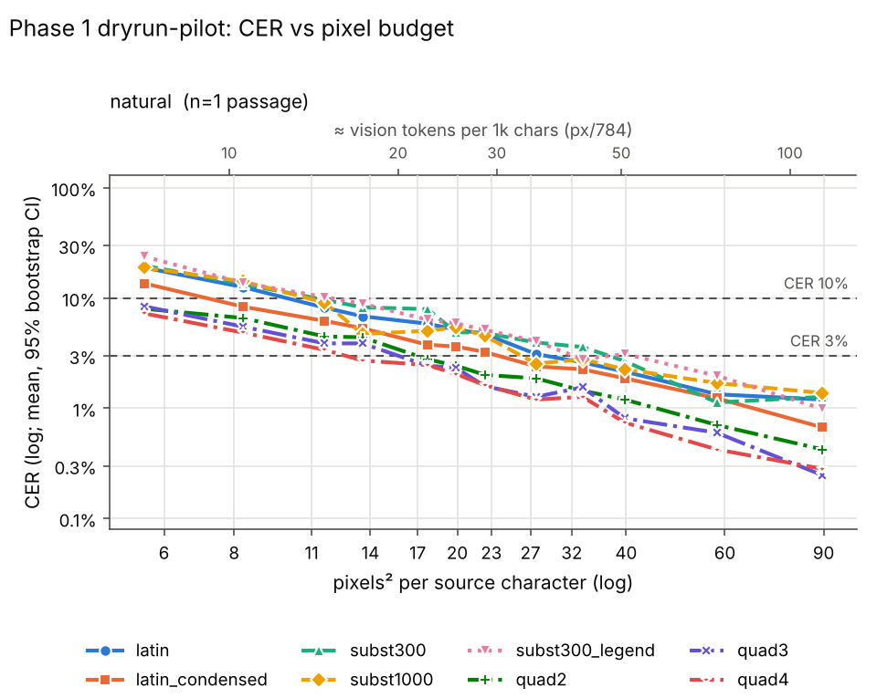
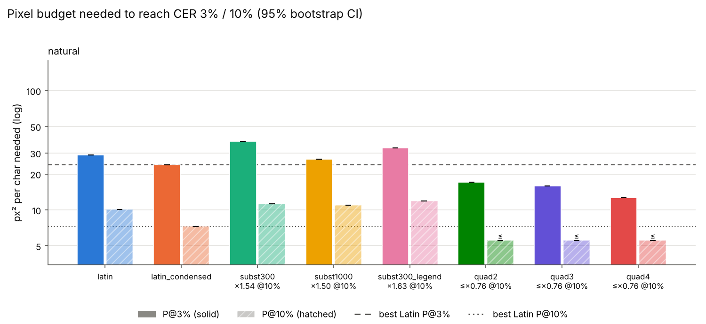

# Phase 1 dryrun-pilot (phase 1)

Rows: 96 total, 96 usable, 0 no-fit (scored CER=1), 0 errors. Total recorded cost: $0.00.

P@x = px²/char at which the isotonic-smoothed mean CER first reaches x (log-x interpolation). ratio = P(scheme)/P(best Latin) (best of latin, latin_condensed at that threshold); CI = paired passage bootstrap. compr = text tokens / vision tokens at P (Claude: px/784 = 28x28 patches, text ≈ chars/4). '≤' on P = already below threshold at the smallest budget; on a ratio '≤'/'≥'/'?' = upper/lower bound/undetermined because of that censoring.

## Verdicts

* K2 (Phase 1: subst P@10% >= 20% below best Latin, natural or scrambled): TRIGGERED - zero-shot negative; best case subst1000 on natural: P@10%=10.9 vs latin_condensed 7.3 px^2/char, ratio 1.50 (95% CI 1.50-1.50)
* P1 (quadrant needs >= 30% more px^2/char than best Latin, at P@10%): NOT confirmed; quad2/natural ratio 0.76, quad3/natural ratio 0.76, quad4/natural ratio 0.76
* P2 (subst300 / latin_condensed at P@10%): natural: 1.54 (outside +-20%)

## Condition: natural

* best Latin @ 3%: **latin_condensed** (23.8 px²/char)
* best Latin @ 10%: **latin_condensed** (7.3 px²/char)

| scheme | P@3% [95% CI] | ratio@3% [CI] | vis tok/1k@3% | compr@3% | P@10% [95% CI] | ratio@10% [CI] | vis tok/1k@10% | compr@10% |
|---|---|---|---|---|---|---|---|---|
| latin | 28.7 [28.7, 28.7] | 1.21 [1.21, 1.21] | 36.7 | 6.82 | 10.1 [10.1, 10.1] | 1.38 [1.38, 1.38] | 12.9 | 19.41 |
| latin_condensed | 23.8 [23.8, 23.8] | 1.00 [1.00, 1.00] | 30.3 | 8.24 | 7.3 [7.3, 7.3] | 1.00 [1.00, 1.00] | 9.3 | 26.85 |
| subst300 | 37.4 [37.4, 37.4] | 1.57 [1.57, 1.57] | 47.8 | 5.24 | 11.2 [11.2, 11.2] | 1.54 [1.54, 1.54] | 14.3 | 17.46 |
| subst1000 | 26.6 [26.6, 26.6] | 1.12 [1.12, 1.12] | 33.9 | 7.37 | 10.9 [10.9, 10.9] | 1.50 [1.50, 1.50] | 13.9 | 17.93 |
| subst300_legend | 33.1 [33.1, 33.1] | 1.39 [1.39, 1.39] | 42.2 | 5.92 | 11.9 [11.9, 11.9] | 1.63 [1.63, 1.63] | 15.2 | 16.46 |
| quad2 | 17.1 [17.1, 17.1] | 0.72 [0.72, 0.72] | 21.8 | 11.48 | ≤ 5.5 [5.5, 5.5] | ≤ 0.76 [0.76, 0.76] | 7.0 | 35.46 |
| quad3 | 15.9 [15.9, 15.9] | 0.67 [0.67, 0.67] | 20.3 | 12.31 | ≤ 5.5 [5.5, 5.5] | ≤ 0.76 [0.76, 0.76] | 7.0 | 35.46 |
| quad4 | 12.7 [12.7, 12.7] | 0.53 [0.53, 0.53] | 16.2 | 15.46 | ≤ 5.5 [5.5, 5.5] | ≤ 0.76 [0.76, 0.76] | 7.0 | 35.46 |

Mean CER by budget:

| scheme | 6 | 8 | 11 | 14 | 17 | 20 | 23 | 27 | 32 | 40 | 60 | 90 |
|---|---|---|---|---|---|---|---|---|---|---|---|---|
| latin | 0.189 | 0.126 | 0.082 | 0.068 | 0.059 | 0.052 | 0.047 | 0.031 | 0.026 | 0.022 | 0.013 | 0.012 |
| latin_condensed | 0.136 | 0.084 | 0.062 | 0.053 | 0.038 | 0.036 | 0.032 | 0.024 | 0.023 | 0.019 | 0.012 | 0.007 |
| subst300 | 0.197 | 0.134 | 0.096 | 0.082 | 0.079 | 0.049 | 0.048 | 0.039 | 0.036 | 0.027 | 0.011 | 0.013 |
| subst1000 | 0.189 | 0.142 | 0.091 | 0.047 | 0.050 | 0.054 | 0.045 | 0.025 | 0.028 | 0.023 | 0.017 | 0.014 |
| subst300_legend | 0.239 | 0.137 | 0.102 | 0.089 | 0.064 | 0.059 | 0.051 | 0.041 | 0.028 | 0.031 | 0.020 | 0.010 |
| quad2 | 0.080 | 0.066 | 0.045 | 0.044 | 0.028 | 0.024 | 0.020 | 0.019 | 0.014 | 0.012 | 0.007 | 0.004 |
| quad3 | 0.084 | 0.055 | 0.039 | 0.039 | 0.024 | 0.023 | 0.016 | 0.013 | 0.016 | 0.008 | 0.006 | 0.002 |
| quad4 | 0.073 | 0.049 | 0.034 | 0.027 | 0.025 | 0.020 | 0.016 | 0.012 | 0.013 | 0.007 | 0.004 | 0.003 |

## Refusal / non-transcription rate (heuristic)

| condition | latin | latin_condensed | subst300 | subst1000 | subst300_legend | quad2 | quad3 | quad4 |
|---|---|---|---|---|---|---|---|---|
| natural | 0% (n=12) | 0% (n=12) | 0% (n=12) | 0% (n=12) | 0% (n=12) | 0% (n=12) | 0% (n=12) | 0% (n=12) |

