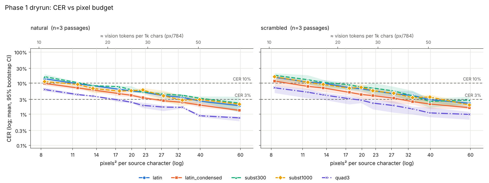
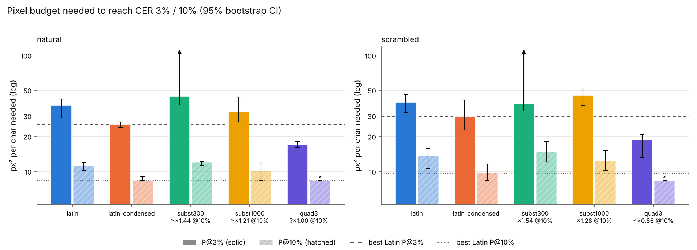

# Phase 1 dryrun (phase 1)

Rows: 300 total, 300 usable, 0 no-fit (scored CER=1), 0 errors. Total recorded cost: $0.00.

P@x = px²/char at which the isotonic-smoothed mean CER first reaches x (log-x interpolation). ratio = P(scheme)/P(best Latin) (best of latin, latin_condensed at that threshold); CI = paired passage bootstrap. compr = text tokens / vision tokens at P (Claude: px/784 = 28x28 patches, text ≈ chars/4). '≤' on P = already below threshold at the smallest budget; on a ratio '≤'/'≥'/'?' = upper/lower bound/undetermined because of that censoring.

## Verdicts

* K2 (Phase 1: subst P@10% >= 20% below best Latin, natural or scrambled): TRIGGERED - zero-shot negative; best case subst1000 on natural: P@10%=10.0 vs latin_condensed 8.3 px^2/char, ratio 1.21 (95% CI 0.94-1.40); WARNING ratio is only a lower bound (threshold reached at the smallest budget - extend the grid downwards)
* P1 (quadrant needs >= 30% more px^2/char than best Latin, at P@10%): NOT confirmed; quad3/natural ratio 1.00, quad3/scrambled ratio 0.86
* P2 (subst300 / latin_condensed at P@10%): natural: 1.44 (outside +-20%); scrambled: 1.54 (outside +-20%)
* P3 (Latin advantage shrinks on scrambled): best subst ratio natural 1.21 -> scrambled 1.28 -> NOT confirmed

## Condition: natural

* best Latin @ 3%: **latin_condensed** (25.2 px²/char)
* best Latin @ 10%: **latin_condensed** (8.3 px²/char)

| scheme | P@3% [95% CI] | ratio@3% [CI] | vis tok/1k@3% | compr@3% | P@10% [95% CI] | ratio@10% [CI] | vis tok/1k@10% | compr@10% |
|---|---|---|---|---|---|---|---|---|
| latin | 36.9 [28.7, 42.1] | 1.46 [1.21, 1.58] | 47.1 | 5.31 | 11.1 [10.1, 11.9] | ≥ 1.35 [1.22, 1.36] | 14.2 | 17.59 |
| latin_condensed | 25.2 [23.8, 26.6] | 1.00 [1.00, 1.00] | 32.2 | 7.77 | ≤ 8.3 [8.3, 9.0] | 1.00 [1.00, 1.00] | 10.6 | 23.67 |
| subst300 | 44.2 [37.4, n/r] | 1.75 [1.57, n/r] | 56.4 | 4.43 | 11.9 [11.2, 12.2] | ≥ 1.44 [1.35, 1.45] | 15.2 | 16.45 |
| subst1000 | 32.7 [26.6, 43.5] | 1.30 [1.10, 1.66] | 41.7 | 5.99 | 10.0 [8.3, 11.8] | ≥ 1.21 [0.94, 1.40] | 12.8 | 19.54 |
| quad3 | 16.9 [15.9, 18.2] | 0.67 [0.64, 0.73] | 21.6 | 11.59 | ≤ 8.3 [8.3, 8.3] | ? 1.00 [0.92, 1.00] | 10.6 | 23.67 |

Mean CER by budget:

| scheme | 8 | 11 | 14 | 17 | 20 | 23 | 27 | 32 | 40 | 60 |
|---|---|---|---|---|---|---|---|---|---|---|
| latin | 0.139 | 0.095 | 0.083 | 0.063 | 0.056 | 0.052 | 0.040 | 0.035 | 0.026 | 0.019 |
| latin_condensed | 0.098 | 0.070 | 0.060 | 0.046 | 0.041 | 0.034 | 0.027 | 0.024 | 0.020 | 0.013 |
| subst300 | 0.161 | 0.104 | 0.082 | 0.077 | 0.061 | 0.052 | 0.044 | 0.041 | 0.033 | 0.023 |
| subst1000 | 0.112 | 0.091 | 0.067 | 0.056 | 0.057 | 0.060 | 0.039 | 0.028 | 0.030 | 0.021 |
| quad3 | 0.062 | 0.043 | 0.038 | 0.028 | 0.024 | 0.019 | 0.017 | 0.017 | 0.009 | 0.008 |

## Condition: scrambled

* best Latin @ 3%: **latin_condensed** (29.7 px²/char)
* best Latin @ 10%: **latin_condensed** (9.6 px²/char)

| scheme | P@3% [95% CI] | ratio@3% [CI] | vis tok/1k@3% | compr@3% | P@10% [95% CI] | ratio@10% [CI] | vis tok/1k@10% | compr@10% |
|---|---|---|---|---|---|---|---|---|
| latin | 39.3 [32.1, 46.3] | 1.32 [1.12, 1.44] | 50.1 | 4.99 | 13.6 [10.5, 15.8] | 1.42 [1.27, 1.42] | 17.4 | 14.39 |
| latin_condensed | 29.7 [22.7, 41.3] | 1.00 [1.00, 1.00] | 37.8 | 6.61 | 9.6 [8.3, 11.5] | 1.00 [1.00, 1.00] | 12.2 | 20.42 |
| subst300 | 38.1 [33.2, n/r] | 1.29 [1.11, n/r] | 48.7 | 5.14 | 14.8 [12.1, 18.1] | 1.54 [1.46, 1.86] | 18.8 | 13.28 |
| subst1000 | 45.3 [36.6, 51.1] | 1.53 [1.22, 1.93] | 57.8 | 4.33 | 12.3 [10.2, 15.0] | 1.28 [1.23, 1.33] | 15.7 | 15.96 |
| quad3 | 18.7 [13.1, 20.8] | 0.63 [0.50, 0.66] | 23.8 | 10.49 | ≤ 8.3 [8.3, 8.3] | ≤ 0.86 [0.72, 1.00] | 10.6 | 23.67 |

Mean CER by budget:

| scheme | 8 | 11 | 14 | 17 | 20 | 23 | 27 | 32 | 40 | 60 |
|---|---|---|---|---|---|---|---|---|---|---|
| latin | 0.154 | 0.107 | 0.101 | 0.071 | 0.066 | 0.057 | 0.045 | 0.040 | 0.029 | 0.023 |
| latin_condensed | 0.117 | 0.079 | 0.070 | 0.050 | 0.043 | 0.040 | 0.033 | 0.025 | 0.021 | 0.016 |
| subst300 | 0.179 | 0.129 | 0.105 | 0.089 | 0.074 | 0.070 | 0.056 | 0.039 | 0.026 | 0.029 |
| subst1000 | 0.161 | 0.106 | 0.091 | 0.069 | 0.073 | 0.057 | 0.047 | 0.034 | 0.036 | 0.020 |
| quad3 | 0.071 | 0.051 | 0.042 | 0.031 | 0.028 | 0.023 | 0.019 | 0.015 | 0.011 | 0.010 |

## Refusal / non-transcription rate (heuristic)

| condition | latin | latin_condensed | subst300 | subst1000 | quad3 |
|---|---|---|---|---|---|
| natural | 0% (n=30) | 0% (n=30) | 0% (n=30) | 0% (n=30) | 0% (n=30) |
| scrambled | 0% (n=30) | 0% (n=30) | 0% (n=30) | 0% (n=30) | 0% (n=30) |

## Prior credit: mean CER(natural) - mean CER(scrambled)

Negative = the language prior helps. Unpaired (different passages per variant).

Setting: all

| scheme | 8 | 11 | 14 | 17 | 20 | 23 | 27 | 32 | 40 | 60 |
|---|---|---|---|---|---|---|---|---|---|---|
| latin | -0.015 | -0.012 | -0.018 | -0.008 | -0.010 | -0.006 | -0.006 | -0.005 | -0.003 | -0.004 |
| latin_condensed | -0.019 | -0.009 | -0.010 | -0.005 | -0.002 | -0.006 | -0.006 | -0.001 | -0.002 | -0.003 |
| subst300 | -0.017 | -0.025 | -0.023 | -0.012 | -0.013 | -0.017 | -0.012 | +0.002 | +0.007 | -0.006 |
| subst1000 | -0.049 | -0.015 | -0.024 | -0.013 | -0.016 | +0.003 | -0.008 | -0.006 | -0.006 | +0.001 |
| quad3 | -0.009 | -0.008 | -0.004 | -0.003 | -0.004 | -0.004 | -0.002 | +0.002 | -0.002 | -0.002 |

