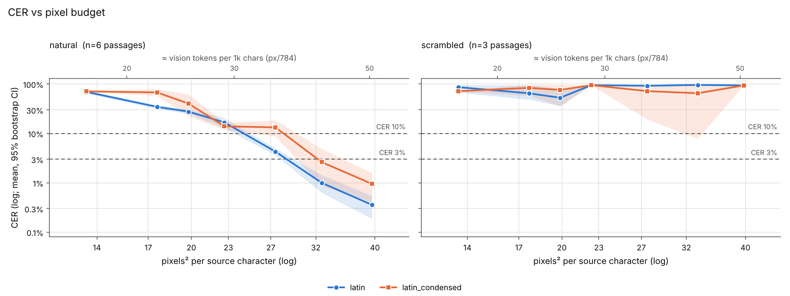
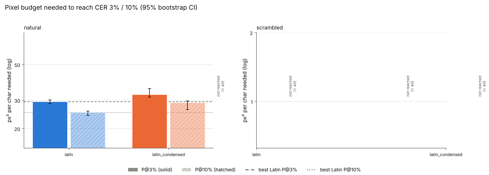

# Sweep summary (phase 1)

Rows: 126 total, 126 usable, 0 no-fit (scored CER=1), 0 errors. Total recorded cost: $2.62.

P@x = px²/char at which the isotonic-smoothed mean CER first reaches x (log-x interpolation). ratio = P(scheme)/P(best Latin) (best of latin, latin_condensed at that threshold); CI = paired passage bootstrap. compr = text tokens / vision tokens at P (Claude: px/784 = 28x28 patches, text ≈ chars/4). '≤' on P = already below threshold at the smallest budget; on a ratio '≤'/'≥'/'?' = upper/lower bound/undetermined because of that censoring.

## Verdicts

* K2 (Phase 1: subst P@10% >= 20% below best Latin, natural or scrambled): UNDETERMINED - no substitution scheme in data.

## Condition: natural

* best Latin @ 3%: **latin** (29.4 px²/char)
* best Latin @ 10%: **latin** (25.1 px²/char)

| scheme | P@3% [95% CI] | ratio@3% [CI] | vis tok/1k@3% | compr@3% | P@10% [95% CI] | ratio@10% [CI] | vis tok/1k@10% | compr@10% |
|---|---|---|---|---|---|---|---|---|
| latin | 29.4 [28.6, 30.2] | 1.00 [1.00, 1.00] | 37.5 | 6.66 | 25.1 [24.2, 25.7] | 1.00 [1.00, 1.00] | 32.1 | 7.79 |
| latin_condensed | 32.5 [31.5, 35.6] | 1.11 [1.06, 1.23] | 41.5 | 6.03 | 29.0 [26.3, 29.8] | 1.15 [1.06, 1.19] | 37.0 | 6.76 |

Mean CER by budget:

| scheme | 14 | 17 | 20 | 23 | 27 | 32 | 40 |
|---|---|---|---|---|---|---|---|
| latin | 0.692 | 0.345 | 0.276 | 0.167 | 0.043 | 0.010 | 0.004 |
| latin_condensed | 0.711 | 0.676 | 0.403 | 0.139 | 0.133 | 0.026 | 0.009 |

## Condition: scrambled

* best Latin @ 3%: **latin** (n/r px²/char)
* best Latin @ 10%: **latin** (n/r px²/char)

| scheme | P@3% [95% CI] | ratio@3% [CI] | vis tok/1k@3% | compr@3% | P@10% [95% CI] | ratio@10% [CI] | vis tok/1k@10% | compr@10% |
|---|---|---|---|---|---|---|---|---|
| latin | > 40 (not reached) | — | n/r | n/r | > 40 (not reached) | — | n/r | n/r |
| latin_condensed | > 40 (not reached) | — | n/r | n/r | > 40 (not reached) | — | n/r | n/r |

Mean CER by budget:

| scheme | 14 | 17 | 20 | 23 | 27 | 32 | 40 |
|---|---|---|---|---|---|---|---|
| latin | 0.865 | 0.650 | 0.528 | 0.950 | 0.924 | 0.960 | 0.940 |
| latin_condensed | 0.717 | 0.838 | 0.761 | 0.949 | 0.719 | 0.652 | 0.937 |

## Refusal / non-transcription rate (heuristic)

| condition | latin | latin_condensed |
|---|---|---|
| natural | 5% (n=42) | 7% (n=42) |
| scrambled | 76% (n=21) | 67% (n=21) |

## Prior credit: mean CER(natural) - mean CER(scrambled)

Negative = the language prior helps. Unpaired (different passages per variant).

Setting: all

| scheme | 14 | 17 | 20 | 23 | 27 | 32 | 40 |
|---|---|---|---|---|---|---|---|
| latin | -0.173 | -0.305 | -0.251 | -0.783 | -0.882 | -0.950 | -0.936 |
| latin_condensed | -0.006 | -0.162 | -0.358 | -0.809 | -0.587 | -0.626 | -0.928 |

