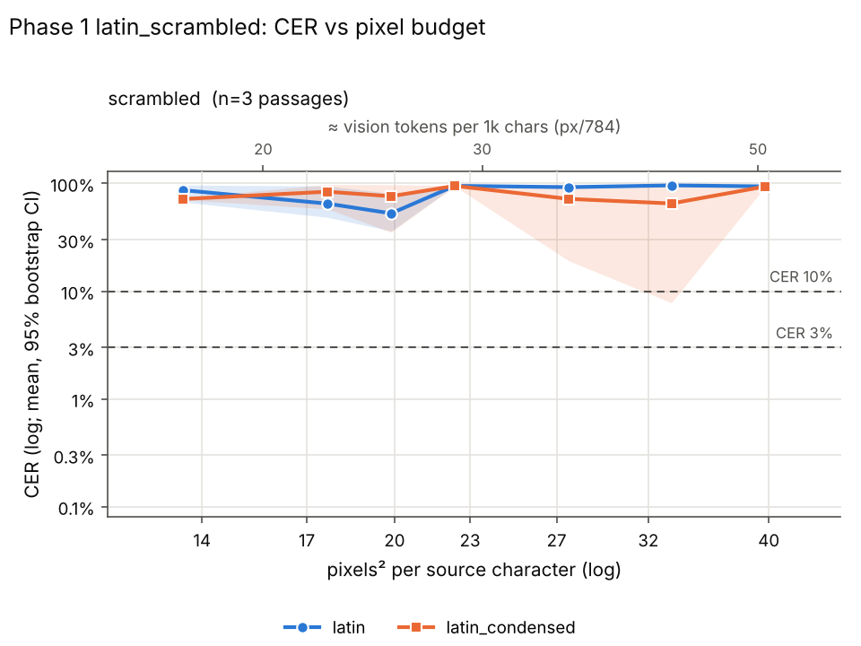
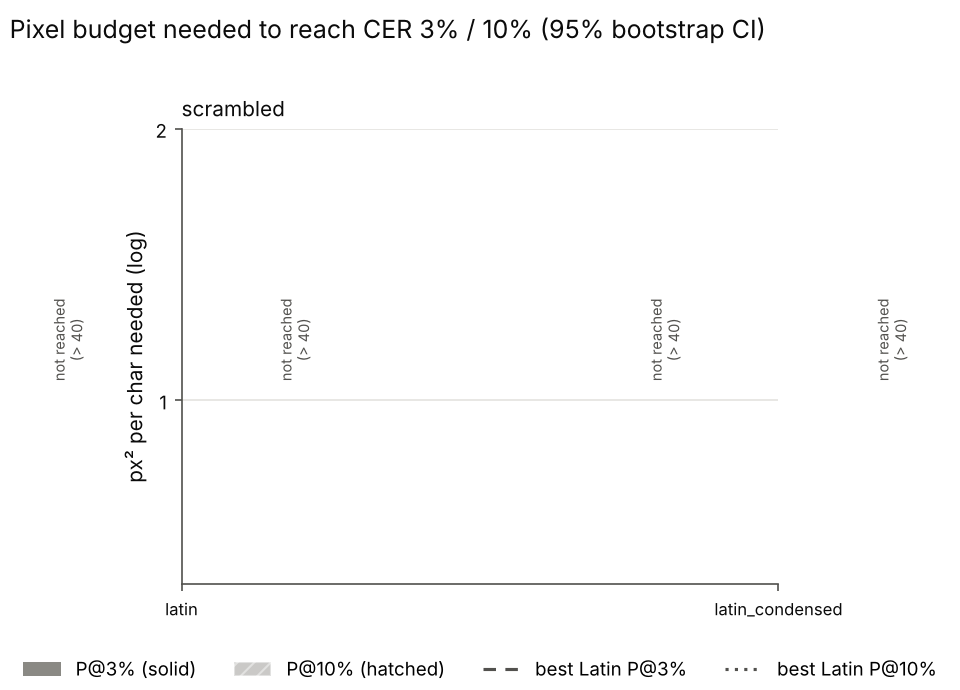

# Phase 1 latin_scrambled (phase 1)

Rows: 42 total, 42 usable, 0 no-fit (scored CER=1), 0 errors. Total recorded cost: $0.70.

P@x = px²/char at which the isotonic-smoothed mean CER first reaches x (log-x interpolation). ratio = P(scheme)/P(best Latin) (best of latin, latin_condensed at that threshold); CI = paired passage bootstrap. compr = text tokens / vision tokens at P (Claude: px/784 = 28x28 patches, text ≈ chars/4). '≤' on P = already below threshold at the smallest budget; on a ratio '≤'/'≥'/'?' = upper/lower bound/undetermined because of that censoring.

## Verdicts

* K2 (Phase 1: subst P@10% >= 20% below best Latin, natural or scrambled): UNDETERMINED - no substitution scheme in data.

## Condition: scrambled

* best Latin @ 3%: **latin** (n/r px²/char)
* best Latin @ 10%: **latin** (n/r px²/char)

| scheme | P@3% [95% CI] | ratio@3% [CI] | vis tok/1k@3% | compr@3% | P@10% [95% CI] | ratio@10% [CI] | vis tok/1k@10% | compr@10% |
|---|---|---|---|---|---|---|---|---|
| latin | > 40 (not reached) | — | n/r | n/r | > 40 (not reached) | — | n/r | n/r |
| latin_condensed | > 40 (not reached) | — | n/r | n/r | > 40 (not reached) | — | n/r | n/r |

Mean CER by budget:

| scheme | 14 | 17 | 20 | 23 | 27 | 32 | 40 |
|---|---|---|---|---|---|---|---|
| latin | 0.865 | 0.650 | 0.528 | 0.950 | 0.924 | 0.960 | 0.940 |
| latin_condensed | 0.717 | 0.838 | 0.761 | 0.949 | 0.719 | 0.652 | 0.937 |

## Refusal / non-transcription rate (heuristic)

| condition | latin | latin_condensed |
|---|---|---|
| scrambled | 76% (n=21) | 67% (n=21) |

