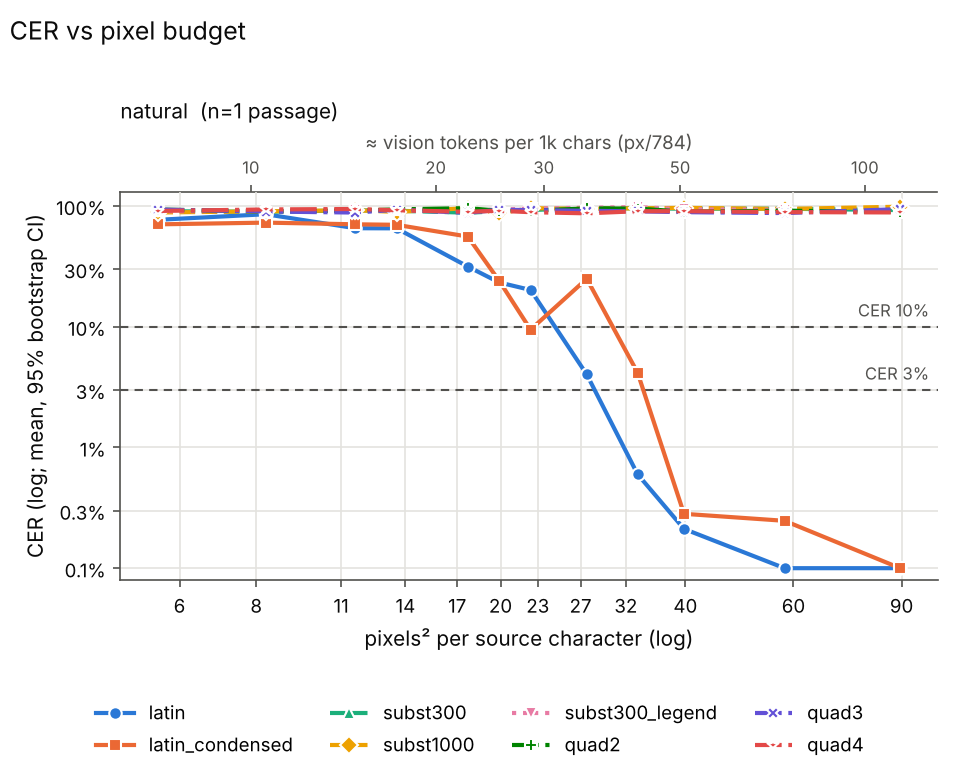
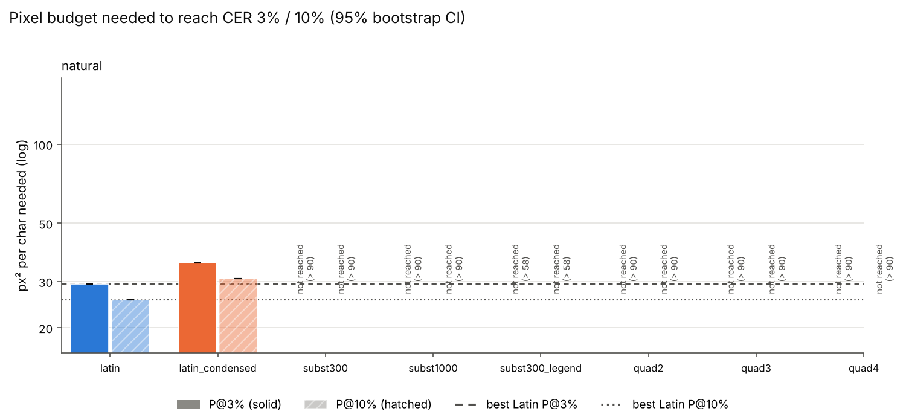

# Sweep summary (phase 1)

Rows: 96 total, 92 usable, 0 no-fit (scored CER=1), 4 errors. Total recorded cost: $1.29.

P@x = px²/char at which the isotonic-smoothed mean CER first reaches x (log-x interpolation). ratio = P(scheme)/P(best Latin) (best of latin, latin_condensed at that threshold); CI = paired passage bootstrap. compr = text tokens / vision tokens at P (Claude: px/784 = 28x28 patches, text ≈ chars/4). '≤' on P = already below threshold at the smallest budget; on a ratio '≤'/'≥'/'?' = upper/lower bound/undetermined because of that censoring.

## Verdicts

* K2 (Phase 1: subst P@10% >= 20% below best Latin, natural or scrambled): UNDETERMINED - neither subst nor best Latin reaches CER 10% within the grid; extend budgets.
* P1 (quadrant needs >= 30% more px^2/char than best Latin, at P@10%): CONFIRMED; quad2/natural ratio n/r, quad3/natural ratio n/r, quad4/natural ratio n/r

## Condition: natural

* best Latin @ 3%: **latin** (29.2 px²/char)
* best Latin @ 10%: **latin** (25.6 px²/char)

| scheme | P@3% [95% CI] | ratio@3% [CI] | vis tok/1k@3% | compr@3% | P@10% [95% CI] | ratio@10% [CI] | vis tok/1k@10% | compr@10% |
|---|---|---|---|---|---|---|---|---|
| latin | 29.2 [29.2, 29.2] | 1.00 [1.00, 1.00] | 37.3 | 6.70 | 25.6 [25.6, 25.6] | 1.00 [1.00, 1.00] | 32.6 | 7.67 |
| latin_condensed | 35.2 [35.2, 35.2] | 1.20 [1.20, 1.20] | 44.9 | 5.56 | 30.7 [30.7, 30.7] | 1.20 [1.20, 1.20] | 39.2 | 6.38 |
| subst300 | > 90 (not reached) | — | n/r | n/r | > 90 (not reached) | — | n/r | n/r |
| subst1000 | > 90 (not reached) | — | n/r | n/r | > 90 (not reached) | — | n/r | n/r |
| subst300_legend | > 58 (not reached) | — | n/r | n/r | > 58 (not reached) | — | n/r | n/r |
| quad2 | > 90 (not reached) | — | n/r | n/r | > 90 (not reached) | — | n/r | n/r |
| quad3 | > 90 (not reached) | — | n/r | n/r | > 90 (not reached) | — | n/r | n/r |
| quad4 | > 90 (not reached) | — | n/r | n/r | > 90 (not reached) | — | n/r | n/r |

Mean CER by budget:

| scheme | 6 | 8 | 11 | 14 | 17 | 20 | 23 | 27 | 32 | 40 | 60 | 90 |
|---|---|---|---|---|---|---|---|---|---|---|---|---|
| latin | 0.767 | 0.853 | 0.653 | 0.652 | 0.315 | 0.232 | 0.201 | 0.040 | 0.006 | 0.002 | 0.000 | 0.000 |
| latin_condensed | 0.703 | 0.727 | 0.704 | 0.697 | 0.557 | 0.240 | 0.094 | 0.249 | 0.042 | 0.003 | 0.002 | 0.000 |
| subst300 | 0.903 | 0.894 | 0.919 | 0.912 | 0.878 | 0.903 | 0.924 | 0.960 | 0.956 | 0.948 | 0.947 | 0.923 |
| subst1000 | 0.882 | 0.902 | 0.920 | 0.892 | 0.957 | 0.870 | 0.957 | 0.945 | 0.955 | 0.963 | 0.943 | 0.985 |
| subst300_legend | 0.900 |  | 0.920 |  | 0.923 | 0.930 | 0.951 |  | 0.978 | 0.937 | 0.927 |  |
| quad2 | 0.933 | 0.899 | 0.913 | 0.936 | 0.957 | 0.912 | 0.913 | 0.952 | 0.951 | 0.896 | 0.913 | 0.890 |
| quad3 | 0.933 | 0.898 | 0.881 | 0.930 | 0.876 | 0.929 | 0.924 | 0.910 | 0.901 | 0.887 | 0.872 | 0.940 |
| quad4 | 0.908 | 0.934 | 0.943 | 0.921 | 0.894 | 0.910 | 0.887 | 0.867 | 0.903 | 0.904 | 0.888 | 0.882 |

## Refusal / non-transcription rate (heuristic)

| condition | latin | latin_condensed | subst300 | subst1000 | subst300_legend | quad2 | quad3 | quad4 |
|---|---|---|---|---|---|---|---|---|
| natural | 17% (n=12) | 0% (n=12) | 100% (n=12) | 100% (n=12) | 100% (n=8) | 100% (n=12) | 100% (n=12) | 100% (n=12) |

