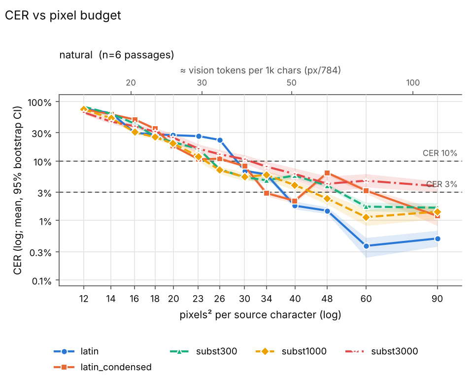
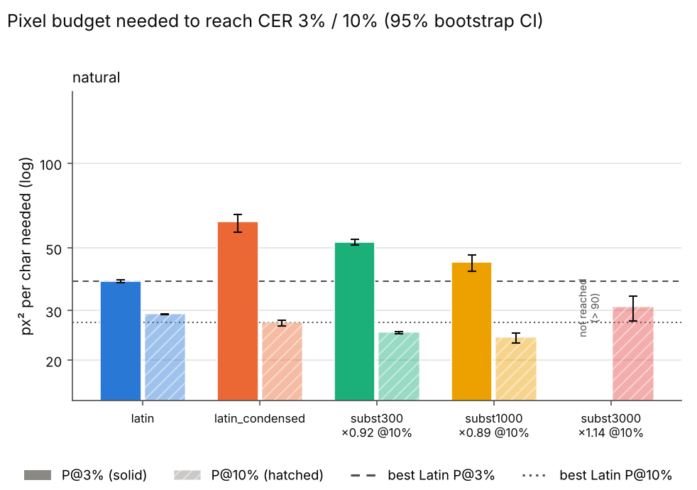

# Sweep summary (phase 1)

Rows: 390 total, 390 usable, 0 no-fit (scored CER=1), 0 errors. Total recorded cost: $0.00.

P@x = px²/char at which the isotonic-smoothed mean CER first reaches x (log-x interpolation). ratio = P(scheme)/P(best Latin) (best of latin, latin_condensed at that threshold); CI = paired passage bootstrap. compr = text tokens / vision tokens at P (Claude: px/784 = 28x28 patches, text ≈ chars/4). '≤' on P = already below threshold at the smallest budget; on a ratio '≤'/'≥'/'?' = upper/lower bound/undetermined because of that censoring.

## Verdicts

* K2 (Phase 1: subst P@10% >= 20% below best Latin, natural or scrambled): TRIGGERED - zero-shot negative; best case subst1000 on natural: P@10%=24.2 vs latin_condensed 27.2 px^2/char, ratio 0.89 (95% CI 0.85-0.91)
* P2 (subst300 / latin_condensed at P@10%): natural: 0.92 (within +-20%)

## Condition: natural

* best Latin @ 3%: **latin** (38.1 px²/char)
* best Latin @ 10%: **latin_condensed** (27.2 px²/char)

| scheme | P@3% [95% CI] | ratio@3% [CI] | vis tok/1k@3% | compr@3% | P@10% [95% CI] | ratio@10% [CI] | vis tok/1k@10% | compr@10% |
|---|---|---|---|---|---|---|---|---|
| latin | 38.1 [37.7, 38.6] | 1.00 [1.00, 1.00] | 48.6 | 5.15 | 29.2 [29.1, 29.2] | 1.07 [1.05, 1.10] | 37.2 | 6.72 |
| latin_condensed | 62.2 [56.9, 65.9] | 1.63 [1.50, 1.73] | 79.3 | 3.15 | 27.2 [26.5, 27.7] | 1.00 [1.00, 1.00] | 34.7 | 7.20 |
| subst300 | 52.5 [51.3, 53.7] | 1.38 [1.36, 1.41] | 66.9 | 3.74 | 25.1 [24.9, 25.2] | 0.92 [0.91, 0.94] | 32.0 | 7.82 |
| subst1000 | 44.5 [41.3, 47.4] | 1.17 [1.09, 1.23] | 56.8 | 4.40 | 24.2 [23.0, 24.9] | 0.89 [0.85, 0.91] | 30.8 | 8.11 |
| subst3000 | > 90 (not reached) | — | n/r | n/r | 31.0 [27.6, 33.7] | 1.14 [1.04, 1.23] | 39.5 | 6.33 |

Mean CER by budget:

| scheme | 12 | 14 | 16 | 18 | 20 | 23 | 26 | 30 | 34 | 40 | 48 | 60 | 90 |
|---|---|---|---|---|---|---|---|---|---|---|---|---|---|
| latin | 0.757 | 0.634 | 0.296 | 0.280 | 0.272 | 0.262 | 0.226 | 0.068 | 0.059 | 0.018 | 0.015 | 0.004 | 0.005 |
| latin_condensed | 0.741 | 0.609 | 0.496 | 0.348 | 0.179 | 0.107 | 0.109 | 0.082 | 0.029 | 0.021 | 0.063 | 0.032 | 0.012 |
| subst300 | 0.814 | 0.623 | 0.424 | 0.257 | 0.207 | 0.160 | 0.072 | 0.053 | 0.047 | 0.057 | 0.038 | 0.017 | 0.016 |
| subst1000 | 0.732 | 0.523 | 0.304 | 0.251 | 0.196 | 0.119 | 0.070 | 0.054 | 0.058 | 0.039 | 0.023 | 0.011 | 0.014 |
| subst3000 | 0.655 | 0.459 | 0.383 | 0.310 | 0.246 | 0.161 | 0.130 | 0.107 | 0.081 | 0.060 | 0.041 | 0.047 | 0.038 |

## Refusal / non-transcription rate (heuristic)

| condition | latin | latin_condensed | subst300 | subst1000 | subst3000 |
|---|---|---|---|---|---|
| natural | 0% (n=78) | 0% (n=78) | 0% (n=78) | 0% (n=78) | 0% (n=78) |

