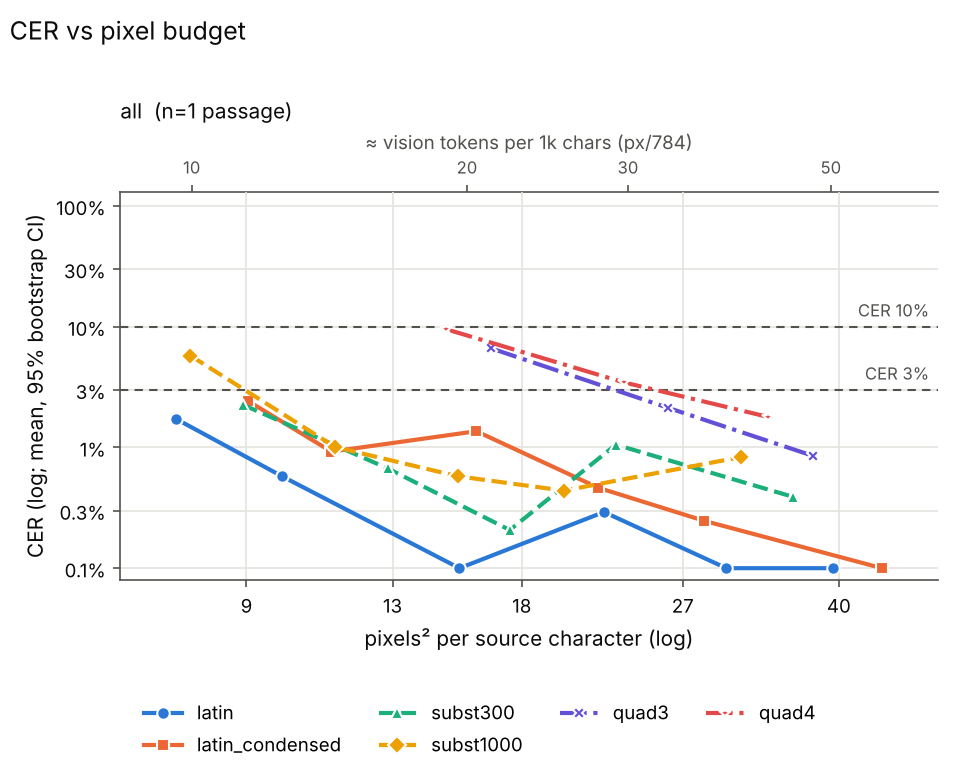
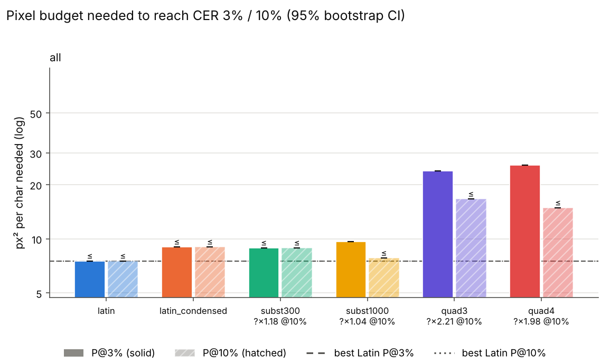

# Sweep summary (phase 2)

Rows: 28 total, 28 usable, 0 no-fit (scored CER=1), 0 errors. Total recorded cost: $0.00.

P@x = px²/char at which the isotonic-smoothed mean CER first reaches x (log-x interpolation). ratio = P(scheme)/P(best Latin) (best of latin, latin_condensed at that threshold); CI = paired passage bootstrap. compr = text tokens / vision tokens at P (Claude: px/784 = 28x28 patches, text ≈ chars/4). '≤' on P = already below threshold at the smallest budget; on a ratio '≤'/'≥'/'?' = upper/lower bound/undetermined because of that censoring.

## Verdicts

* K3 (Phase 2: subst P@3% >= 30% below best Latin): KILL; best case subst300 on all: P@3%=8.9 vs latin 7.5 px^2/char, ratio 1.18 (95% CI 1.18-1.18); WARNING ratio is undetermined (threshold reached at the smallest budget - extend the grid downwards)
* Quadrant (Phase 2 rule: killed if P@3% >= best Latin): KILLED; quad3/all ratio 3.17, quad4/all ratio 3.41
* P2 (subst300 / latin_condensed at P@3%): all: 0.99 (within +-20%)

## Condition: all

* best Latin @ 3%: **latin** (7.5 px²/char)
* best Latin @ 10%: **latin** (7.5 px²/char)

| scheme | P@3% [95% CI] | ratio@3% [CI] | vis tok/1k@3% | compr@3% | P@10% [95% CI] | ratio@10% [CI] | vis tok/1k@10% | compr@10% |
|---|---|---|---|---|---|---|---|---|
| latin | ≤ 7.5 [7.5, 7.5] | 1.00 [1.00, 1.00] | 9.6 | 26.02 | ≤ 7.5 [7.5, 7.5] | 1.00 [1.00, 1.00] | 9.6 | 26.02 |
| latin_condensed | ≤ 9.0 [9.0, 9.0] | ? 1.20 [1.20, 1.20] | 11.5 | 21.72 | ≤ 9.0 [9.0, 9.0] | ? 1.20 [1.20, 1.20] | 11.5 | 21.72 |
| subst300 | ≤ 8.9 [8.9, 8.9] | ? 1.18 [1.18, 1.18] | 11.4 | 21.99 | ≤ 8.9 [8.9, 8.9] | ? 1.18 [1.18, 1.18] | 11.4 | 21.99 |
| subst1000 | 9.7 [9.7, 9.7] | ≥ 1.28 [1.28, 1.28] | 12.3 | 20.30 | ≤ 7.8 [7.8, 7.8] | ? 1.04 [1.04, 1.04] | 10.0 | 25.08 |
| quad3 | 23.9 [23.9, 23.9] | ≥ 3.17 [3.17, 3.17] | 30.4 | 8.21 | ≤ 16.7 [16.7, 16.7] | ? 2.21 [2.21, 2.21] | 21.3 | 11.76 |
| quad4 | 25.7 [25.7, 25.7] | ≥ 3.41 [3.41, 3.41] | 32.8 | 7.62 | ≤ 14.9 [14.9, 14.9] | ? 1.98 [1.98, 1.98] | 19.0 | 13.16 |

Mean CER by budget:

| scheme | 7.5 | 7.8 | 8.9 | 9 | 9.8 | 11.1 | 11.3 | 12.8 | 14.9 | 15.3 | 15.4 | 16.1 | 16.7 | 17.5 | 20 | 21.8 | 22.1 | 22.8 | 23.3 | 26 | 28.5 | 30.1 | 31.3 | 33.5 | 35.7 | 37.5 | 39.4 | 44.6 |
|---|---|---|---|---|---|---|---|---|---|---|---|---|---|---|---|---|---|---|---|---|---|---|---|---|---|---|---|---|
| latin | 0.017 |  |  |  | 0.006 |  |  |  |  |  | 0.001 |  |  |  |  |  | 0.003 |  |  |  |  | 0.001 |  |  |  |  | 0.001 |  |
| latin_condensed |  |  |  | 0.024 |  | 0.009 |  |  |  |  |  | 0.014 |  |  |  | 0.005 |  |  |  |  | 0.002 |  |  |  |  |  |  | 0.001 |
| subst300 |  |  | 0.023 |  |  |  |  | 0.007 |  |  |  |  |  | 0.002 |  |  |  | 0.011 |  |  |  |  |  |  | 0.004 |  |  |  |
| subst1000 |  | 0.058 |  |  |  |  | 0.010 |  |  | 0.006 |  |  |  |  | 0.004 |  |  |  |  |  |  |  | 0.008 |  |  |  |  |  |
| quad3 |  |  |  |  |  |  |  |  |  |  |  |  | 0.066 |  |  |  |  |  |  | 0.021 |  |  |  |  |  | 0.009 |  |  |
| quad4 |  |  |  |  |  |  |  |  | 0.095 |  |  |  |  |  |  |  |  |  | 0.035 |  |  |  |  | 0.018 |  |  |  |  |

