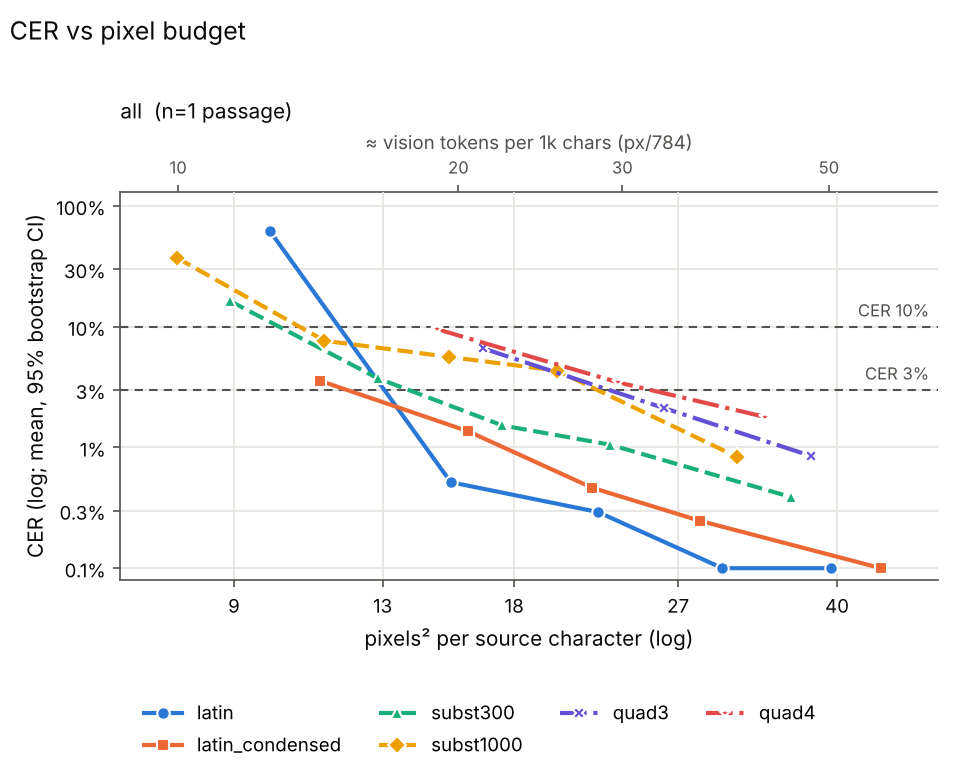
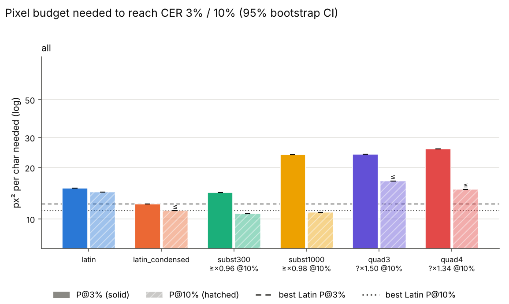

# Sweep summary (phase 2)

Rows: 26 total, 26 usable, 0 no-fit (scored CER=1), 0 errors. Total recorded cost: $0.00.

P@x = px²/char at which the isotonic-smoothed mean CER first reaches x (log-x interpolation). ratio = P(scheme)/P(best Latin) (best of latin, latin_condensed at that threshold); CI = paired passage bootstrap. compr = text tokens / vision tokens at P (Claude: px/784 = 28x28 patches, text ≈ chars/4). '≤' on P = already below threshold at the smallest budget; on a ratio '≤'/'≥'/'?' = upper/lower bound/undetermined because of that censoring.

## Verdicts

* K3 (Phase 2: subst P@3% >= 30% below best Latin): KILL; best case subst300 on all: P@3%=14.2 vs latin_condensed 12.2 px^2/char, ratio 1.16 (95% CI 1.16-1.16)
* Quadrant (Phase 2 rule: killed if P@3% >= best Latin): KILLED; quad3/all ratio 1.95, quad4/all ratio 2.10
* P2 (subst300 / latin_condensed at P@3%): all: 1.16 (within +-20%)

## Condition: all

* best Latin @ 3%: **latin_condensed** (12.2 px²/char)
* best Latin @ 10%: **latin_condensed** (11.1 px²/char)

| scheme | P@3% [95% CI] | ratio@3% [CI] | vis tok/1k@3% | compr@3% | P@10% [95% CI] | ratio@10% [CI] | vis tok/1k@10% | compr@10% |
|---|---|---|---|---|---|---|---|---|
| latin | 15.1 [15.1, 15.1] | 1.24 [1.24, 1.24] | 19.3 | 12.97 | 14.4 [14.4, 14.4] | ≥ 1.29 [1.29, 1.29] | 18.3 | 13.65 |
| latin_condensed | 12.2 [12.2, 12.2] | 1.00 [1.00, 1.00] | 15.6 | 16.03 | ≤ 11.1 [11.1, 11.1] | 1.00 [1.00, 1.00] | 14.2 | 17.59 |
| subst300 | 14.2 [14.2, 14.2] | 1.16 [1.16, 1.16] | 18.2 | 13.77 | 10.7 [10.7, 10.7] | ≥ 0.96 [0.96, 0.96] | 13.7 | 18.31 |
| subst1000 | 23.7 [23.7, 23.7] | 1.94 [1.94, 1.94] | 30.2 | 8.27 | 10.9 [10.9, 10.9] | ≥ 0.98 [0.98, 0.98] | 13.9 | 17.92 |
| quad3 | 23.9 [23.9, 23.9] | 1.95 [1.95, 1.95] | 30.4 | 8.21 | ≤ 16.7 [16.7, 16.7] | ? 1.50 [1.50, 1.50] | 21.3 | 11.76 |
| quad4 | 25.7 [25.7, 25.7] | 2.10 [2.10, 2.10] | 32.8 | 7.62 | ≤ 14.9 [14.9, 14.9] | ? 1.34 [1.34, 1.34] | 19.0 | 13.16 |

Mean CER by budget:

| scheme | 7.8 | 8.9 | 9.8 | 11.1 | 11.3 | 12.8 | 14.9 | 15.3 | 15.4 | 16.1 | 16.7 | 17.5 | 20 | 21.8 | 22.1 | 22.8 | 23.3 | 26 | 28.5 | 30.1 | 31.3 | 33.5 | 35.7 | 37.5 | 39.4 | 44.6 |
|---|---|---|---|---|---|---|---|---|---|---|---|---|---|---|---|---|---|---|---|---|---|---|---|---|---|---|
| latin |  |  | 0.617 |  |  |  |  |  | 0.005 |  |  |  |  |  | 0.003 |  |  |  |  | 0.001 |  |  |  |  | 0.001 |  |
| latin_condensed |  |  |  | 0.036 |  |  |  |  |  | 0.014 |  |  |  | 0.005 |  |  |  |  | 0.002 |  |  |  |  |  |  | 0.001 |
| subst300 |  | 0.163 |  |  |  | 0.037 |  |  |  |  |  | 0.015 |  |  |  | 0.011 |  |  |  |  |  |  | 0.004 |  |  |  |
| subst1000 | 0.372 |  |  |  | 0.077 |  |  | 0.056 |  |  |  |  | 0.043 |  |  |  |  |  |  |  | 0.008 |  |  |  |  |  |
| quad3 |  |  |  |  |  |  |  |  |  |  | 0.066 |  |  |  |  |  |  | 0.021 |  |  |  |  |  | 0.009 |  |  |
| quad4 |  |  |  |  |  |  | 0.095 |  |  |  |  |  |  |  |  |  | 0.035 |  |  |  |  | 0.018 |  |  |  |  |

