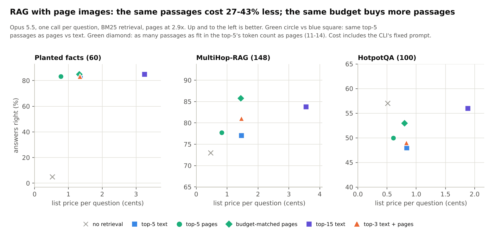

# RAG with page images

Plan, arms and predictions: [docs/claude/RAG_PLAN.md](../../docs/claude/RAG_PLAN.md), committed (9810725) before any call.
Harness: `experiments/rag/run_rag.py` (resumable: finished calls in `runs.jsonl`, responses cached; failed calls
neither recorded nor cached; it stops itself when most of a batch fails, e.g. on a usage limit).

Dry run (no calls): BM25 recall of the gold evidence at 5 / 15 passages: planted facts 0.88 / 0.88, MultiHop-RAG
0.55 / 0.79, HotpotQA 0.72 / 0.90. Budget-matched pages (`Pmatch`) carry 13.7 / 14.3 / 11.5 passages in the tokens of
the top-5 as text; the top-5 as pages cost 700 / 797 / 352 image tokens against ~1,830 / 2,110 / 770 as text.
Deviation from the plan: MultiHop-RAG has 148 questions (37 per type), not 150.

**Scoring fix after stage A (applied to every arm; all rows are rebuilt from the response cache at no cost):** the
first scorer took the first number on the answer's first line. The model often shows its working on that line
(`4543-3710=833`, `Lengav: 2,007 + 904 = 2,911`), more often with text than with pages, so correct answers were scored
wrong and the text arms looked worse than they were (e.g. "total" questions 22-33% from text vs 89% from pages). The
fix reads the whole answer and takes the number after the last `=`/arrow, else after "total" / "difference" /
"answer", else the only number, else the last.

**Free-text scoring (added during stage B, applied to every arm):** at low effort the model sometimes reasons before
answering on the answer line. Primary score: the candidate after the last "answer:" (else the last line) equals the
gold answer or starts with a gold answer of at most 4 words; the strict first-line exact match is kept as `em_strict`.

## Results (2026-11-11): 1,848 calls, all complete, $24.22 at list price

Full tables (by arm and question type, both scores): [summary.md](summary.md). Accuracy, paired against top-5 as
text (Newcombe 95% interval, exact McNemar), and list price per question (including the CLI's fixed prompt):

| arm | planted facts (60) | MultiHop-RAG (148) | HotpotQA (100) |
|---|---|---|---|
| no retrieval | 5.0% | 73.0% | 57.0% |
| top-5 as text | 83.3%, 1.34¢ | 77.0%, 1.46¢ | 48.0%, 0.84¢ |
| **top-5 as pages** | **83.3% (±0), 0.78¢** | **77.7% (+0.7, -1.2 to +2.6), 0.83¢** | **50.0% (+2.0, -2.7 to +6.7), 0.61¢** |
| **budget-matched pages** (13.8 / 14.1 / 11.2 passages) | 85.0% (+1.7, p = 1), 1.32¢ | **85.8% (+8.8, +3.9 to +14.1, p = 0.001)**, 1.44¢ | 53.0% (+5.0, -0.7 to +10.6, p = 0.18), 0.80¢ |
| top-15 as text | 85.0% (+1.7), 3.25¢ | 83.8% (+6.8, p = 0.013), 3.56¢ | 56.0% (+8.0, p = 0.039), 1.88¢ |
| top-3 text + pages | 83.3% (±0), 1.34¢ | 81.1% (+4.1, p = 0.15), 1.46¢ | 49.0% (+1.0), 0.83¢ |

Context tokens of the top-5 (input minus the closed-book call's): 1,956 / 2,126 / 893 as text, 759 / 828 / 408 as
pages (2.6x, 2.6x, 2.2x fewer). Recall of the gold evidence: top-5 0.85 / 0.38 / 0.73; budget-matched pages 0.85 /
0.50 / 0.85; top-15 0.85 / 0.50 / 0.89.

* **Same passages as pages: no accuracy change, 27-43% cheaper per question** (42% / 43% / 27%; the CLI's fixed
  ~5k-token prompt dilutes the 2.2-2.6x saving on the passages themselves).
* **Same budget as pages buys recall:** on MultiHop-RAG, 14 passages as pages at the price of 5 as text gained 8.8
  points, more than top-15 as text (+6.8) at 2.5x the price. On HotpotQA +5.0 (not significant with 100 questions).
* **Hybrid (top-3 text + pages) is worse than all-pages**: the text head uses up the budget (8 / 8 / 6.5 passages).
* **Memorisation:** without retrieval Opus answers 73% of MultiHop-RAG and 57% of HotpotQA, more than with top-5
  text on HotpotQA (48%): weak retrieval makes it answer "Insufficient information" where it would otherwise have
  known. Planted facts (5% closed-book) are the clean test, and there pages and text tie at equal passages.
* Chain questions in the planted set are 0% in every arm: BM25 on the question does not retrieve the intermediate
  facts (a multi-step retriever would be needed); this is a retrieval limit, not a reading one.

Pre-registered verdicts (docs/claude/RAG_PLAN.md):
1. Top-5 as pages within 2 points of top-5 as text, with at least 2x fewer context tokens: **PASS** on point estimates
   (±0, +0.7, +2.0) and tokens (2.6x, 2.6x, 2.2x); the 95% bound is within 2 points only on MultiHop-RAG (the other
   sets have 60 and 100 questions).
2. Budget-matched pages beat top-5 text by at least 3 points on MultiHop-RAG and HotpotQA: **PASS on MultiHop-RAG**
   (+8.8, p = 0.001); **HotpotQA +5.0 on the point estimate but not significant** (p = 0.18).
3. Hybrid at least as accurate as budget-matched pages: **FAIL** on all three sets.
4. Planted facts: budget-matched pages and top-5 text tie: **PASS** (+1.7, p = 1).

Spend: planted $5.13, MultiHop-RAG $13.63, HotpotQA $5.46; total $24.22 (the plan estimated ~$105).
